# Architecture — wsl_care

> As of 2026-10-02 the repository holds the **daemon skeleton, its foundation seams and its scenario
> harness** (E1.S1–E1.S3 of `todo/PLAN_wsl_care_daemon.md` §16): the build, the two product projects,
> the seams every later story hangs on, their tests, the harness that drives the built CLI, and CI on
> all three shipped RIDs — and, from E2.S1, the memory / process / container / disk collectors behind
> the two probes and the `status [--json]` verb, and from E2.S2 the Docker collectors, the first-sighting
> record `volume-seen.json`, the Docker hygiene audit, the `preview --all [--json]` verb and the live contract
> check against the real tools, and from E2.S3 the full run `collect` (health collectors, thresholds, the daily
> folder walk, run detail → history line with the startup reconcile and retention, read-only when unprivileged),
> `doctor` and the container-start follower `events follow`, and from E3.S1 the action engine, the command policy (the
> never-list and deny-by-default templates every argv passes), the root-only `act` verb, the target user and its
> `runuser` wrapper, and the reference action A10 (the journal vacuum), and from E3.S2 the irreversible deletions A4–A9, A11,
> A12, A14, A17 (one preview computation shared with `preview --all`, measured freed bytes, a pid-and-start signal seam, the
> target user's home for every per-user path), and from E3.S3 A1, A2, A3, A15, A16, the timer's action pass inside `collect`
> and the read-only `logs` / `runs` verbs — then hardened on 2026-10-03 by the epic's review round (section *E3 review
> fixes* below) — and from E4.S1 the installer `install.sh` with the three systemd units and the machine configuration
> layer it installs (section *The installer and the units* of [module_daemon.md](module_daemon.md)), and from E4.S2 the release pipeline — release-please, the
> per-RID `release.yml` with build-provenance attestations, the shared smoke / package / guard / verify scripts, and the
> owner-applied rulesets, Sonar and CodeRabbit settings (section *The release pipeline* of [module_daemon.md](module_daemon.md)), and from E5.S0 the threshold
> verdicts and the product version in `status --json` and the golden contracts the extension's client tests replay
> (section *The verdicts in `status`*), and from E5.S1 the VS Code extension's skeleton — the runner seam, `WslCareClient` over
four read-only verbs, the strict fake `wsl.exe` and `ci-extension.yml` (section *The extension: client, runner and fake* of [module_vs_code.md](module_vs_code.md)),
and from E5.S2 its status bar, the read-only panel driven by one field map, and the focused-window polling (section *The
extension: status bar, read-only panel and polling* of [module_vs_code.md](module_vs_code.md)), and from E5.S3 *Install daemon*, the universal `.vsix` with its leak checks, and the extension's own release pipeline as files and tests (section *The extension: Install daemon, packaging and its release* of [module_vs_code.md](module_vs_code.md)), and from E6.S0 the daemon read contract — `status`'s `actions`, `capabilities`, `running` and `lastCleanup`, A4's full `shown` list, `runs show`, the instant range, `RunLine.metrics`, SIGHUP as a cancellation and `contracts/*.json` (section *The daemon read contract* of [architecture-daemon-e6.md](architecture-daemon-e6.md)), and from E6.S1 the detached runs — `act` / `collect --detach`, the request files, `act --request`, the request sweep, `act --stop`, `--only -` and the template unit `wsl-care-act@.service` (section *Detached runs* of [architecture-daemon-e6.md](architecture-daemon-e6.md)); nothing is released yet. `wsl-care` answers `--help`, `--version`, the `config` verbs, `status`, `preview`, `collect`, `doctor`,
> `events follow`, `act` (with `--detach`, `--request`, `--stop`), `logs`, `runs` and `runs show`, and refuses everything else; the extension shows the daemon's state read-only (E5.S2). This file describes
> what exists and is rewritten as each part lands.

## What exists

- The family rules at `.agents/conventions` (tracking `release`) and the Claude host adapter.
- **Root build files**, mirrored from the family's credential-store repository: `global.json` (SDK
  `10.0.100`, `rollForward: latestFeature`, the Microsoft Testing Platform runner),
  `Directory.Build.props` (`net10.0`, nullable, warnings as errors, central package management,
  invariant globalization), `Directory.Packages.props` (Serilog for the CLI; test packages),
  `Directory.Build.rsp` (`-nr:false`), `nuget.config` (nuget.org only), `.editorconfig`, `wsl_care.slnx`.
- **`src_daemon/`** — the daemon/CLI ([module_tests.md](module_tests.md) lists what is tested):
  - `version.txt` — the daemon's one version; `src_daemon/Directory.Build.props` stamps every
    assembly under `src_daemon/` from it (`0.0.0` = nothing released yet).
  - `src/WslCare.Core` — class library, `IsAotCompatible`, **zero package references** (an
    architecture test keeps it so). Holds the seams below, the configuration system, the run-record
    type and its writer, `ProductVersion`, since E2.S1 the collectors (`Collectors/`) and the
    `status` report (`Status/`), and since E2.S2 the Docker collectors (`Docker/`), the cleanup preview
    (`Preview/`) and the `systemctl` / `journalctl` commands and parsers (`Systemd/`), and since E2.S3 the full
    run (`Collect/`), the health collectors (`Health/`), the thresholds (`Thresholds/`), the daily folder walk
    (`Folders/`), the container-start follower (`Events/`), `doctor` (`Doctor/`) and the run detail store, history
    reader, reconcile and retention (`Records/`), and since E3 the action engine and every action but A13 (`Actions/`), the
    command policy (`Processes/Policy/`) and, since E3.S3, `logs` / `runs` (`History/`).
  - `src/WslCare.Cli` — the executable `wsl-care` / `wsl-care.exe`: `PublishAot`, `StripSymbols`,
    reflection-free JSON, RIDs `linux-x64`, `linux-arm64`, `win-x64`; one package, Serilog.
    `CommandLine.Commands` is the one register of what the binary accepts — the parser, the help text
    and the derived test are all read from it. Exit codes live in one enum (`ExitCode`: 0 ok, 2 usage,
    70 internal, 130 interrupted).
  - `tests/WslCare.TestSupport` — the doubles and fixtures the test projects share (a temp root, a
    frozen clock, the recording command runner, a sandboxed host, a directory-link maker, and
    `ChildProcess` — the one launcher for a built executable: argv list, a ceiling or a progress wait
    (`ProgressWait`: killed after a silence, or at a cap), tree kill — the killed child awaited before the timeout is
    raised, and an output still held open 5 s after the child's exit ended as a named timeout; and a manual clock whose
    timers fire only when a test advances it, held to the system timer's contract by its own tests).
  - `tests/WslCare.Core.Tests`, `tests/WslCare.Cli.Tests` — xUnit v3 on Microsoft Testing Platform,
    run as executables.
  - `tests/fixtures/procfs/ubuntu-2026-10-02` — the procfs / cgroup tree CAPTURED from WSL `Ubuntu` on
    2026-10-02 (its `SOURCE.txt` names source, date, redactions), linked into the three test outputs.
  - `tests/fixtures/docker/ubuntu-2026-10-02` — the `docker` / `systemctl` / `journalctl` answers CAPTURED by
    the live contract on 2026-10-02 for exactly the product's argv, redacted by
    `research/diagnostics/docker_fixture_redact.mjs` (its `SOURCE.txt`), linked into the three test outputs and
    replayed by the scenario fakes.
  - **Every captured fixture is anonymised** (E5 code round, 2026-10-04 — this repository is public) through ONE
    identity list, `tests/WslCare.TestSupport/FixtureIdentity.cs` (rules by shape, no original value in it), applied by
    `FixtureAnonymisationTests` (`WSL_CARE_ANONYMISE_FIXTURES=1` rewrites; otherwise it fails on any fixture the list
    would still change) and by the golden writer; `FixturePrivacyTests` scans every committed `fixtures` / `golden` tree
    on every OS (section *Fixture privacy*).
  - `tests/WslCare.LiveContract` — **the live contract check** (xUnit v3 MTP executable, in the solution, NOT in
    the CI test steps): the real tools of this machine through `ProcessCommandRunner` (30 s ceiling, tree
    kill), parsed by the product's parsers; an absent tool skips with its reason, `WSL_CARE_REQUIRE_LIVE=1`
    (the release checklist) makes a skip a failure.
  - `tests/WslCare.Scenarios` — **the scenario harness** (xUnit v3 MTP executable): the BUILT
    `wsl-care` run as a child process over a temporary `WSL_CARE_ROOT`, with fake `docker` /
    `systemctl` / `journalctl` / `powershell` alone on its `PATH`, plus the derived verb register that fails when a
    verb of `CommandLine.Commands` has no row in [module_tests.md](module_tests.md).
  - `tests/WslCare.FakeTool` — the fake tool (`wsl-care-fake-tool`), one console program the harness
    installs under each tool's name; it records argv and answers from fixtures. Ships in no binary.
- **`install.sh`** (E4.S1) — the installer and uninstaller a person pipes into `sudo sh`; with
  `src_daemon/systemd/` (`wsl-care.service`, `wsl-care.timer`, `wsl-care-events.service`) and
  `src_daemon/config/machine.json` (the empty machine layer) — what a release archive carries (section *The installer
  and the units* of [module_daemon.md](module_daemon.md)).
- **`.github/`** — `ci-daemon.yml`, `ci-workflows.yml`, `family-checks.yml`, `pr-title.yml`, since E5.S1
  `ci-extension.yml`, `dependabot.yml` (below); since E5.S3 `release-extension.yml` with `scripts/release-extension-guard.sh`,
  `verify-extension-assets.sh`, `lib/versions.sh` (since the E5 code round), `compare-installed-extension.sh` (2026-10-06) and
  `rulesets/tags-extension.json` (section *The
  extension: Install daemon, packaging and its release* of [module_vs_code.md](module_vs_code.md)); since E4.S2 the release pipeline: `release-please.yml`, `release.yml`, the scripts both
  CI and the release run (`scripts/smoke-daemon.sh`, `package-daemon.sh`, `release-guard.sh`, `verify-release-assets.sh`,
  `lib/daemon-assets.sh`), `sonarcloud.yml` + `sonar.properties`, `coderabbit-review.yml`, and the owner-applied ruleset
  bodies `rulesets/tags-daemon.json` and `rulesets/branch-main.json` — with `release-please-config.json`,
  `.release-please-manifest.json` and `.coderabbit.yaml` at the root and the owner's commands in `docs/repo-settings.md`
  (section *The release pipeline* of [module_daemon.md](module_daemon.md)).
- **`src_vs_code/`** (E5.S1) — the VS Code extension: `package.json` (AI OS Care — id `ai-os-care`, publisher `remsoftdev`, renamed from *WSL Care* on 2026-10-06; 0.0.0, `extensionKind ["ui"]`,
  `engines.vscode ^1.85.0`, every setting application-scoped — `wslCare.distro`, `wslCare.refreshSeconds` and the number table of `src/settings/numbers.ts`), `src/process/runner.ts` (the one process launcher),
  `src/process/runnerSelection.ts`, `src/client/` (`WslCareClient`, the closed `VERBS`, the handshake, the failure
  reading, the exit-code names), `src/wsl/` (the launcher path, UTF-16LE, distribution names), `src/test/` (unit,
  structural, bundle and client-scenario tests, the strict fake, the tripwire), esbuild into `dist/extension.js`
  (section *The extension: client, runner and fake* of [module_vs_code.md](module_vs_code.md)); since E5.S2 `src/statusBar/`, `src/panel/` (the field map, the
  view model, the webview shell and provider), `src/poll/`, `src/state/`, `media/` (the page script, its styles, the
  activity-bar icon), the page harness and the extension-host suite (`src/test/host/`, `scripts/run-host.mjs`) (section
  *The extension: status bar, read-only panel and polling* of [module_vs_code.md](module_vs_code.md)); since E5.S3 `src/install/` (*Install daemon*),
  `scripts/bundle.mjs` (the build stamp and `dist/min-daemon.json`), `scripts/check-vsix.mjs` with `vsix-files.txt` /
  `vsix-denylist.txt`, `media/icon.png`, `CHANGELOG.md`, `LICENSE`, and since the E5 code round the checked-in
  `min-daemon.json` the release guard reads (section *The extension: Install daemon, packaging and its release* of [module_vs_code.md](module_vs_code.md)); since
  E6.S2 `src/root/` (the closed root union `rootCall.ts`, the cleanup controller, the gate, the answer and failure readers,
  the typed ids, the root words), `src/text/safeText.ts` (the one sanitiser), `src/client/enumValue.ts`, and the runner's
  stdin (section *The extension: the root boundary* of [architecture-extension-e6.md](architecture-extension-e6.md)); since E6.S3 `src/cleanup/` (the cleanup buttons' host transaction,
  the `globalState` journal, the durable poll, the controls' derivation, the modals' and results' words) and the client's two
  run reads (section *The extension: the cleanup buttons* of [architecture-extension-e6.md](architecture-extension-e6.md)); since
  E10.S1a `src/archive/` (the AI-session archive's host, flows, view and its folder dialog) and `src/config/configCall.ts` — a
  NEW extension → daemon interaction: besides the reads (`archive status`, `archive preview`, `archive check-base <path>`, all
  unprivileged), the extension WRITES one daemon setting, `config set archive.baseFolder <folder | "">`, as the person's own user
  (never `-u`). The folder is one the daemon itself judged and accepted, and the daemon judges it again on the write
  (`ConfigCommand.SetBaseFolderAsUser`), so the extension decides nothing about a base folder the daemon would not. The bundle
  scan holds the writer to its own region, exactly as the root region is held ([module_vs_code.md](module_vs_code.md), plan §15s).
  Since E10.S1b *Archive now* — the archive section's third button — runs the daemon's A13 through the cleanup controller AS IT
  IS (`CleanupHost.archiveNow()` → `CleanFlow.archive()`, the cleanup transaction over `['A13']`: `act A13 --preview --json`, its
  own modal, the journal entry before the call, ONE `act A13 --confirm --manual --detach --json`, the follower): one more id of the
  closed root union, no new root word, no new root op, no new journal field. The one new dependency inside the extension is
  archive → cleanup: `ArchiveHost.archiveNow()` refuses the request, and says why, on the archive's own conditions (a folder set,
  no archive flow busy, A13 offered with its capabilities — the conditions the button greys on, because the palette's command and
  a stale page send the same bare request) and hands it to the cleanup host, which refuses its own (a run in flight, the journal
  full); the archive host reads the cleanup host's controls, re-renders on its changes and stops listening on `dispose`; and the
  button's capability requirement is the controller's own (`previewNeeds(['A13'])` ∪ `confirmNeeds(['A13'])`), never a second list.
  Since E10.S2a `src/archivePage/` — the Archive page, browse only: one more unprivileged read, `archive list --json` (section *The
  extension: the Archive page* of [architecture-extension-e6.md](architecture-extension-e6.md)).
  Since S7b.2b *Stop client-gone relays* runs the daemon's A21 the same way as *Archive now*, from the *AI agents* section.
  - **The road:** `CleanupHost.stopRelays()` → `CleanFlow.relays()`, the cleanup transaction over `['A21']` alone.
  - **What crosses:** the daemon's `act A21 --preview --json` answer carries `shown`, every selected relay as `pid:start`. The
    extension holds it, cut to `MAX_PROCESS_ARGS` (500, the command line's bound), and sends it back as ONE
    `act A21 --confirm --manual --detach --process <pid:start>… --json`.
  - **The one new root word is `--process`.** The bundle scan and the structure test hold it to the root region.
  - **The daemon decides what ends:** it re-validates the pairs, intersects them with a fresh judgement and re-judges again before
    SIGTERM, so a stale list ends nothing A21 would not end alone.
  - **The status read:** the line beside the button reads `status.interopRelays` through `state/statusBody.ts`, the one reader of
    the status body, extracted from the archive host.
  - **The cross-implementation check** is the daemon-written golden `act-a21-preview-action.json`, which the extension's tests
    replay ([module_vs_code.md](module_vs_code.md), plan S7b.2b).
  Since E10.S2b the Archive page's *Restore*: the selected entry ids, as text, to the cleanup host — A20 through the cleanup transaction and two
  new root ops, the ids on stdin (section *The extension: Restore from the Archive page*).
- **`contracts/golden/head/`** (E5.S0) — `status.json`, `preview.json`, `doctor.json`: the built CLI's answers over the
  captured fixtures, normalised, held current by `GoldenContractTests` (section *The verdicts in `status`*); since E6.S0
  also `status-running-*.json`, `act-a4-preview.json`, `runs-show-*.json`, `runs-local-day.json`, `logs-local-day.json`,
  since E6.S1 `act-detach-accepted.json`,
  and since E10.S0 `contracts/requests/act-a20-entry-stdin.json` — not an answer but the one REQUEST the extension sends for A20 (the
  daemon argv and the entry ids on stdin, plan §15s D7): the daemon's `ActEntryStdinTests` parse exactly those bytes, the extension's
  root-call test emits exactly them, so neither half drifts alone,
  and beside them `contracts/actions.json` / `contracts/exit-codes.json` held equal to `ActionId` / `ExitCode` by
  `ContractFilesTests` (section *The daemon read contract* of [architecture-daemon-e6.md](architecture-daemon-e6.md)), and since plan §15o `contracts/history-reasons.json` (the reason
  prefixes of a kind-less history line that is not a full check, from `HistoryReasons`; section *A full check's history line
  names itself* of [architecture-daemon-e6.md](architecture-daemon-e6.md)). There is no `RunLine` field list in `contracts/`: that wire is pinned by the `runs-*.json` goldens. Two rules live in both halves as source, each held equal by a daemon architecture test that reads the extension's file: the PowerShell module-path pin (`HealthCommands.ModulePathPin` = `MODULES` in `elevatedEngine.ts`) and the distro-name rule (`DistroIdentity.NamePatternText` = `DISTRO_NAME` in `wsl/distros.ts`, E15.S2), both 2026-10-11. The distro-name rule has a third copy in `install.sh` (`DISTRO_NAME_PATTERN`, E15.S2b: `--distro-name` is refused by it), held equal to the daemon's by `ArchitectureTests.The_installer_and_the_daemon_share_one_distro_name_rule`.
- Read-only diagnostic scripts under `research/diagnostics/`, which produced the baselines.
- Plans: the daemon and extension (`todo/PLAN_wsl_care_daemon.md`), the Windows side
  (`todo/PLAN_windows_care.md`), the AI-session archive (`todo/PLAN_ai_session_archive.md`), the shared
  VS Code kit (`todo/PLAN_shared_vscode_kit.md`).

## The seams (E1.S2)

Everything a later story does to the machine goes through one of these. Each is an interface in
`WslCare.Core` with exactly one real implementation and a test double in `WslCare.TestSupport`.

| Seam | Namespace | Real implementation | What it guarantees |
|---|---|---|---|
| `IHostPaths` | `Core.Hosting` | `LinuxHostPaths`, `WindowsHostPaths`; `HostPaths.ForThisMachine()` | every path per OS (plan §6, §4.6): state, logs, temp, the two config layers, the protected roots (AI agents, `~/git`, Claude's temp folder). Since E2.S2 also Docker Desktop's `daemon.json` (the Windows-side file; empty inside the distro) and `DistroPath` (where a path Docker reports inside the distro is seen from this process: itself, under the sandbox root, or nowhere on Windows). Since E2.S3 `UserLogDirectory` (`$XDG_STATE_HOME/wsl-care/logs` — the log root of a run that may not write `/var/log/wsl-care`), the apt / snap / sysstat / atop / `wsl.conf` paths (Linux) and `.wslconfig` (Windows). `WSL_CARE_ROOT=<dir>` lays the whole thing out under one directory — what tests and the built-binary tests use so nothing real is touched. No path literal exists outside these two classes. |
| `PathRules` | `Core.Hosting` | values `Linux`, `Windows` | pure path arithmetic per OS family (separators, case, roots), so the Windows policy is checked on the Linux CI leg and vice versa |
| `IFileSystem` | `Core.Files` | `PhysicalFileSystem` | the only road to delete/move/atomic-write/append; since E2.S1 also the read-only `ReadLink` (the same attributes-first reader the policy trusts, so an uninspectable link is `Unreadable`, not "not a link") and `MeasureVolume` (one `DriveInfo` = `statvfs` / `GetDiskFreeSpaceEx`, no walk); since E2.S2 `FileSize` (one stat, never a read: a container log can be gigabytes); every destructive call resolves the REAL path (`RealPath`: links followed component by component, `..` applied to the real parent) of the target, the destination and the declared root, and asks the `DeletionPolicy` first; a path whose real location cannot be established — a component that cannot be inspected, a cycle of links — is refused by `Unresolvable` (fail closed); the atomic write makes its temporary file in the RESOLVED parent, judges it, re-resolves the target and its parent just before the rename (`PathChanged`) and renames the resolved paths (§ *Fail-closed resolution and the atomic write*); `AppendLine` is a cross-process-safe JSONL append (exclusive open of `{file}.lock`, released by the OS); since E2.S3 `ListFiles`, the bounded `MeasureTree` (links never followed, a stat per entry, an entry and time ceiling), `ProbeWriteAccess` (a delete-on-close probe file: privilege is the OS's answer), `TryLockExclusive` (an exclusive open the OS releases), `RewriteLines` (a line file rewritten atomically under the SAME lock as the append) and a last-write time on `FileSize`; since the E5 code round (2026-10-04) `ListDirectories` and `ListFiles` answer in ORDINAL order, never the disk's — an ext4 directory reads in the order of a hash seeded per filesystem, so `status --json`'s container list (read from the cgroup directories) came out in a different order on every machine and the head golden went stale on both Linux CI legs |
| `DeletionPolicy` | `Core.Files.Deletion` | the one class | the never-list as a pure decision over resolved paths: never `projects/*/memory/` (even for the archive), never under an AI agent folder except an archive MOVE with the permit, never under `~/git`, never under `%TEMP%\claude` / `/tmp/claude`, never outside the action's declared root (strictly inside), never a root that is `/`, `C:\` or the home; move destinations are judged too; since the retro gate over PR #4 (2026-10-06) a protected root's ANCESTORS are refused under its rule too — a delete or move is recursive, so a folder that holds an agent folder, a repositories folder or Claude's temp folder would take it along |
| `ICommandRunner` + `CommandPolicy` | `Core.Processes` (+ `.Policy`) | `ProcessCommandRunner`, whose ONLY constructor takes the sealed `CommandPolicy` (E3.S1: the never-list, then deny by default against the declared templates — § *The action engine, the command policy and `act`*) | argv list only, a bare executable name resolved on `PATH` ALONE and started by its full path (`ExecutableResolver`, below), a required ceiling, (since E2.S2 every collector command is a named `ToolCommand` — executable, argv, ceiling, output cap — built in ONE place per tool), the WHOLE process tree killed on timeout, bounded capture of both streams, a closed outcome (`Exited` / `TimedOut` / `FailedToStart` / `Refused`), the caller's cancellation thrown as such after the kill; the policy is asked before any start; since E2.S3 `StreamAsync` — the same launcher for a child whose stdout is a stream (`docker events`), each line handed to a callback as it arrives and cut at the output cap |
| `IHostProbe` | `Core.Hosting` | `Collectors.LinuxProbe`, `Collectors.WindowsProbe` (E2.S1) | the platform split of plan §8: ONE fast `Sample` per binary, its own side read, the other side unavailable naming the other binary; a probe holds no command runner, so it starts no process (§ *The collectors and `status`*) |
| run records | `Core.Records` | `RunRecordWriter` → `{state}/history.jsonl` | `RunRecord` (schemaVersion, `RunId` = UTC second + pid, trigger `timer|manual|cli`, UTC start/end, outcome `completed|failed|interrupted|observeOnly`, actions — per-action RESULTS only — and since plan §15o `kind` `collect|act`, a positional member every writer decides, read as a three-state `RecordedKind` — absent, known, or unknown (a newer build's value, never guessed and never a parse failure; PR #16 retro round) — while `trigger` / `outcome` stay strict and refuse integers) as one JSON line, source-generated; since E2.S3 the line names its detail (`detail`), carries `dryRun`, `reason`, the non-ok `warnings` and headline `metrics`; `RunDetailStore` writes `{state}/runs/{day}/{runId}.json` atomically FIRST; `RunHistory` is the one parser; `RunReconcile` and `RunRetention` (§ *The full run*) |
| configuration | `Core.Config` | `ConfigLoader`, `UserConfigWriter`, `ConfigKeys` | three layers (embedded `default.json` < machine < user), validated against the one register in code; an invalid layer makes the result **observe-only** with `configError {file, line, message}` and the layer's valid keys still in force (plan §15a #1); `config set`/`reset` rewrite the user layer atomically and repair it (invalid keys dropped and named, an unparseable file moved aside with a UTC stamp, `-2`, `-3`, … appended when a repair in the same second already took that name — an aside file is never overwritten). Since E7.S0 (plan §15q R1): every text / list key closed (`TextRule`, the families list without `other` / `ai-agents`), each key's `KeyTrust` (safe direction, machine-only, tighten-only-for-root), both layers read through hardened readers, the `UserLayerTrust` a root run applies, `configNotices`, and `contracts/config-keys.json` — § *The configuration trust (E7.S0)* |

**Which file a tool name means** (`ExecutableResolver`, since the E2 CI fix). The runner never hands the operating
system a bare name to search for: `docker` is looked up on `PATH` alone — each absolute entry in order, empty and
relative entries skipped (both mean "the current directory"), `.exe` / `.com` only on Windows (a `.cmd` / `.bat` needs a
shell, and no shell is ever involved), an execute bit on Linux — and the FULL path is what `Process.Start` gets; an
absolute path passes through, a relative one is refused, nothing found is `FailedToStart` naming the name and the
search. Found by CI run 37045304356 (win-x64): Windows `CreateProcess` searches the application's directory, the
current directory, System32 and the Windows directory BEFORE `PATH` (and .NET's Unix launcher tries the application's
and the current directory first), and GitHub's Windows image ships `C:\Windows\System32\docker.exe` — so nine
scenarios measured the runner's real Docker instead of their fake. The same lookup on an owner's machine would let a
`docker.exe` in whatever directory the daemon started from win; the family's `gh` resolver
(`dew_flow_conventions/.github/scripts/lib/resolved.mjs`) records the same lesson.

**The one fallback: Windows programs on the mounted system drive** (`WindowsSystemDrive`, `SystemDriveFiles`,
`SystemDriveLookup`; live finding 2026-10-04, plan §17 #1). systemd gives `wsl-care.service` the PATH
`/usr/local/sbin:/usr/local/bin:/usr/sbin:/usr/bin:/snap/bin`; WSL appends the Windows folders to PATH only for
interactive and login sessions, so under the timer `powershell.exe` was "not found on PATH", `clock.drift` unknown and
A16 refused — on every machine. Now, inside the distro only, when PATH does not hold a name in the CLOSED list
`WindowsSystemDrive.Programs` (`powershell.exe` → `Windows/System32/WindowsPowerShell/v1.0`, nothing else), the resolver
asks four questions, in this order, under a 5 s ceiling (`WindowsSystemDrive.Ceiling` — the share is 9p served by the
host; a lookup that does not answer is a named refusal, its blocked thread abandoned once per resolve):

1. **Where is `C:` mounted?** From `/proc/self/mountinfo` (it carries each mount's root and device): a line whose root is
   `/` (the whole drive, not a bound folder), at an absolute mount point, of type `9p` with `aname=drvfs` and a `path=`
   option naming `C:\` or `C:` (the source label is not read — a manual `mount -t drvfs C:` writes `path=C:`), or of
   type `drvfs` (WSL 1) with the source `C:\` or `C:`. Octal escapes are decoded in the root, mount point and source only —
   the kernel prints super options raw, so `path=C:\134` (a folder) is never read as `C:\`. One mount point is the answer;
   several DIFFERENT ones are refused, naming them. WSL's virtiofs mode (a share mounted by tag, a child bound onto the
   drive's folder) is not identified: the refusal names the filesystem found at the automount folder (read from
   `/etc/wsl.conf` `[automount] root=` for that sentence only). Only root and WSL's init can mount, so a folder nobody
   mounted is never searched. WHICH drive holds Windows is a documented assumption, `C:`: nothing a service can read names
   `%SystemDrive%`, and searching every drive would let a folder a Windows user may create on a data drive be started by
   the root daemon.
2. **Can a Windows program run here?** WSL's binfmt_misc handler (`WSLInterop`, or `WSLInterop-late` on newer WSL) is
   registered and the first line of ANY entry is `enabled` (observed: interpreter `/init`, magic `4d5a` = `MZ`); a refusal
   names every entry and its state.
3. **Can anybody but root change what is under the mount point?** Every ancestor from `/` down is a directory, never a
   link, owned by root and writable by neither its group nor others.
4. **Is the file what may be started?** No component from the mount point down is a symbolic link, each is on the
   mount's device; the file is opened once with `O_NONBLOCK` (a FIFO never blocks — `RegularFiles.ReadHead` /
   `StatNoFollow`, the statx reader A4's `--only` list already uses) and from that descriptor it is a
   regular file, the same file (device and inode) the path check saw, carries an execute bit (exec(2)'s own requirement,
   not a protection — drvfs reports `0555` on the whole path) and starts with `MZ`. At most two bytes are read; a read that
   fails (EIO on the share) is a reason, and a lookup that throws surfaces its own exception (`Bounded.Run`).

What that rests on, and does not check: Windows lets only administrators change `C:\Windows\System32`. Residuals,
recorded: an administrator can replace the file (already above the daemon); another `MZ` handler in binfmt_misc (wine,
mono) could claim the file before interop; the file is checked by descriptor but started by path, so a swap in the
milliseconds between is not excluded. PATH still wins, every other name is PATH-only, Windows is unchanged. The
`CommandPolicy` judges the argv with the BARE name (it would refuse the absolute path — the catalogue declares bare
names); the launcher starts the resolved path as found, never re-resolved, reports it as `CommandOutcome.StartedFrom`, stamps
`CommandOutcome.StartedAt` immediately before the start (after the lookup — the clock probe's offset is measured from it, so
the lookup's time is never drift), and
an action's command record names both (`powershell.exe -NoProfile … (started from /mnt/c/…/powershell.exe)`). The
not-found reason names both searches (`… not found on PATH (5 directories searched, …); not started from the Windows
system drive: …`).

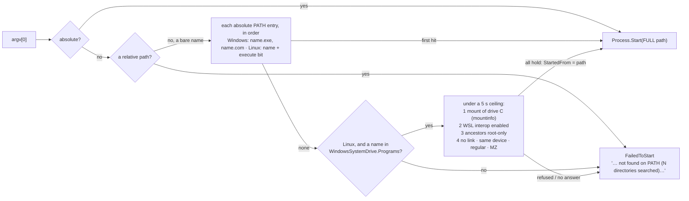

Logging (`Cli.Logging`, per the family rule): Serilog configured in code before the verb runs; the
coloured console sink is the repository's own `AnsiConsoleSink` on **stderr** (stdout carries the
answers the extension parses); `DailyRunFileSink` writes `{log dir}/{yyyy-MM-dd}/wsl-care-{HH-mm-ss}-{pid}.log`
in UTC and segments at UTC midnight; the level and the retention window come from `logging.*` in the
configuration; `LogRetention` prunes day folders older than the window at startup **through
`IFileSystem`**, so the deletion policy judges it like any cleanup; a log root that cannot even be listed is one counted
failure in the report, never an exception (the logger starts outside `Main`'s catch — retro gate over PR #4). An unwritable log directory degrades
to console-only with a note. `ShutdownSignals` turns Ctrl+C / SIGTERM / SIGQUIT into the root
`CancellationToken` that reaches every command.

What reaches the terminal is printable. `Cli.Output` is the one road from a verb to a stream — answers
on stdout; refusals, notes, internal errors and the interruption line on stderr — and every stderr
message passes `CommandLine.Printable`, which replaces control characters, so a key typed with a
newline or an escape sequence, a key read from the user's file, or a path in a refusal reason cannot
split or repaint the line; a verb that renders what a tool ANSWERED on stdout passes it through the same function
(`doctor`'s checks and, since the retro gate over PR #17, its versions line). The console sink, the one road for log lines, does the same to the message
it renders (and to each line of an exception) and keeps only its own colour escapes. `OutputRoadTests`
fails the build on a stream write anywhere else in the CLI. The file sink writes values as they are.

### Deviations from the plan recorded in E1.S2

- `processes.killEnabled` (plan §7.5) is not a key: it would duplicate `auto.A11`. A5 and A6 carry two
  switches each (`auto.A5` / `auto.A5Testcontainers`, `auto.A6` / `auto.A6Unused`) because §5 gives them
  two defaults.
- `aiAgents.extra` is not in the schema yet; E7 adds it with its object shape (the schema today holds
  scalars and string lists only).
- The log file is written by the sink's own `StreamWriter`, not `Serilog.Sinks.File`: one package in
  the AOT binary instead of two, and the segment logic owns the file either way.
- `WslCare.Core` takes no `ILogger<T>` yet because nothing in it logs; the host does. When a Core
  component needs to log, it takes `Microsoft.Extensions.Logging.Abstractions` then.
- The Linux analogue of `%TEMP%\claude\` is `/tmp/claude` (Claude Code's `$TMPDIR/claude`); the plan
  names only the Windows folder.
- A `RootTooBroad` rule exists (not in the plan): a declared root of `/`, a drive root or the home
  directory is refused before "inside the root" is asked.
- The agent roots protected today are the §4.6 entries with named folders (Claude Code, Codex, Gemini,
  Antigravity, Copilot, Rovo Dev, Ollama); the catalogue of E7 must feed the same list.
- Only `history.jsonl` is written here; the per-run detail file `runs/{day}/{runId}.json` is E2.S3.
- `config reset` of a key absent from the user layer is a no-op that says so (exit 0 — the note itself only since the
  retro gate over PR #4: the writer knew, the command never said; never said over an unparseable layer, whose contents are unknown); an unparseable
  user file is moved to `config.json.broken-{utc}` (or `…-2`, `…-3` when that name is taken) rather
  than overwritten — and only once the write is known to go ahead (a refused `set` moves nothing). A layer whose bytes were read (an empty one too) is COPIED aside — created exclusively, name by name, so a concurrent repair's kept file is never overwritten — so it stays in place until its replacement is renamed over it — a process killed in between leaves the person's file, not none; only an unreadable one (a FIFO, a folder, a file over the cap) is moved, and moved back when the write fails. A refused put-back is an error naming where the file is, never swallowed. A repair that LOSES
  anything but the key being written also writes `dryRun = true` (unless the command WRITES `dryRun` itself — a `reset dryRun` writes nothing and is pinned too), because a
  lost `auto.A# = false` is that action back ON by default at the next timer run (plan §15a #1; retro gate over PR #4).
- An object where a setting's VALUE belongs (`{"auto":{"A4":{}}}`) is an entry of that setting, refused by validation —
  it used to flatten to nothing, and the layer read as valid (retro gate over PR #4).

## The collectors and `status` (E2.S1)

`WslCare.Core/Collectors` holds the fast collectors; `WslCare.Core/Status` the wire shape of
`status --json`; `WslCare.Cli/Commands/StatusCommand.cs` the verb. Every figure is a `Reading<T>` —
`Available(value)` or `Unavailable(reason)` — from the parser to the JSON edge, so an unread figure is
never a 0: in JSON it is `"available": false` with a `reason` and no value key (the context writes with
`WhenWritingNull`, and the nullable members exist only in the `Status/StatusReport.cs` DTOs).

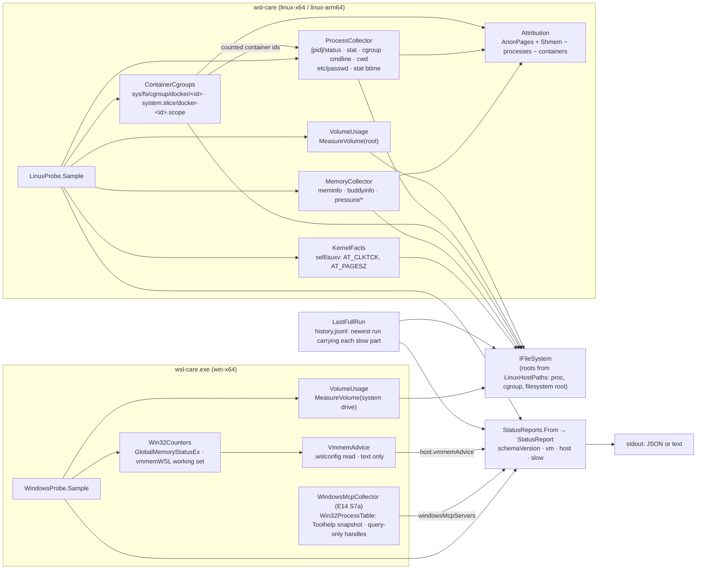

**No slow process in `status`** (plan §15b #5): the probes are constructed without the command runner,
so `docker stats` and `powershell.exe Get-Date` cannot be reached from `status`; their values come from
the newest `history.jsonl` line that carries each part (`RunRecord.Slow`, optional, absent on E1's lines),
reported with that run's id, the sample instant and its age — or unavailable with *no full run has been
recorded yet* / *no recorded full run has sampled …* / *the last full run that tried (id) could not sample
…: reason*. `collect` (E2.S3) and the Docker collector (E2.S2) write those parts; this story reads them.

**Who holds the memory** (plan §4.2 as amended by §15b #4):

- process memory is `RssAnon` + `RssShmem` from `/proc/[pid]/status` — never `VmRSS`, whose `RssFile`
  share is page cache; the top 30 are ranked by it, every counted process is kept in
  `ProcessSnapshot.All` (the input A11's suspect selection will read), kernel threads (`Kthread: 1`, or no
  `RssAnon`) and pids that vanish between listing and reading are counted apart;
- a process whose cgroup path is a container's (`/docker/<64-hex>` — Docker Desktop, cgroupfs driver — or
  `/system.slice/docker-<64-hex>.scope` — an Engine in the distro, systemd driver) is NOT counted as a
  process when that container's cgroup was read: the container is counted once, through its cgroup;
- container memory is read from the cgroup tree, never `docker stats`: both `memory.current` (shown) and
  `memory.stat` `anon` + `shmem` (subtracted);
- the remainder `AnonPages + Shmem − Σ processes − Σ containers` is `remainder`, or
  `inconsistentSample` with its overshoot when below zero, or `unavailable` when an input was not read.

**Deviation, measured:** the subtraction uses the containers' `anon` + `shmem`, not `memory.current` as
§4.2's wording has it. `memory.current` also charges page cache and kernel memory, which `AnonPages` +
`Shmem` do not hold; on 2026-10-02 (~13:45 UTC, ten containers) mixing the units made the live remainder
−1.05 GiB, like for like it was +0.46 GiB — and the captured fixture reproduces it (a test).

**Disk** (§4.4): `df /` through `MeasureVolume` of the filesystem root. Host `C:`, `vmmemWSL` and host RAM
are the Windows binary's (§2: no walk of `C:` from the VM); the `.vhdx` sizes are named in the answer and
unavailable until the Windows collectors (E11) read them. The daily folder sizes of §4.4 are a full-run
figure (E2.S3).

**Other decisions recorded here:**

- The clock tick and page size come from `/proc/self/auxv` (the source glibc's `sysconf` reads), so no
  native call is needed on Linux and a captured tree carries its own values (100 / 4096 here).
- Command lines are shown cut to 200 characters with secret-looking values redacted (`--x=v`, `--x v`
  where the name holds token, secret, password, apikey or credential) — measured on this machine: the VS
  Code server's `--connection-token=` and an agent hub's `--csrf_token=` are in plain argv.
- Families are a built-in catalogue (`ProcessFamilies`, first match wins: build servers, testhost, AI
  agents, Docker Desktop proxy, vscode-server, node, other): regex-per-family settings need the
  object-shaped configuration keys E7 brings.
- The minimal Windows probe reads host RAM (`GlobalMemoryStatusEx` through `LibraryImport` — since E14 S7a the Win32 process table's imports too —
  hence `AllowUnsafeBlocks` for the generated stub), the system drive and `vmmemWSL`'s working set (the
  process snapshot the OS keeps — nothing is started, no handle opened). Under `WSL_CARE_ROOT` only the
  system drive follows the sandbox; RAM and `vmmemWSL` are the real host's, read-only.
- **E14 S7a:** the Windows binary's `status` also counts the Windows side's MCP servers (`coai-mcp.exe`, `creds-mcp.exe`,
  the user's programs) through `Win32ProcessTable` — a Toolhelp snapshot plus `PROCESS_QUERY_LIMITED_INFORMATION` handles,
  read-only, real even under `WSL_CARE_ROOT` — into `windowsMcpServers`, and adds `host.vmmemAdvice` (text, never acted on)
  when `vmmemWSL` holds more than `wslConfig.vmmemAdviceGb`. Details: [module_mcp_servers.md](module_mcp_servers.md) § *The Windows side*.
- **E19.S3:** the Windows binary has three more verbs — `worktrees roots set` (folders on stdin, all-or-nothing, a verdict per path), `worktrees roots clear` and `worktrees scan` (read-only, no process) — and its `status` carries `worktrees` (basis `scan`) and the verdict `worktrees.reclaimable`, always `unknown` until git confirms (E19.S4). The distro's binary refuses all three naming the Windows side. Details: [module_daemon.md](module_daemon.md) § *The worktree report*.
- `status` without `--json` prints a short ASCII summary; the JSON is what the extension reads.

## The Docker collectors and `preview` (E2.S2)

`WslCare.Core/Docker` holds the Docker collectors, `WslCare.Core/Preview` the cleanup rows and the wire shape of
`preview --all --json`, `WslCare.Core/Systemd` the `systemctl` / `journalctl` commands and parsers (their
collectors are E2.S3's), `WslCare.Cli/Commands/PreviewCommand.cs` the verb.

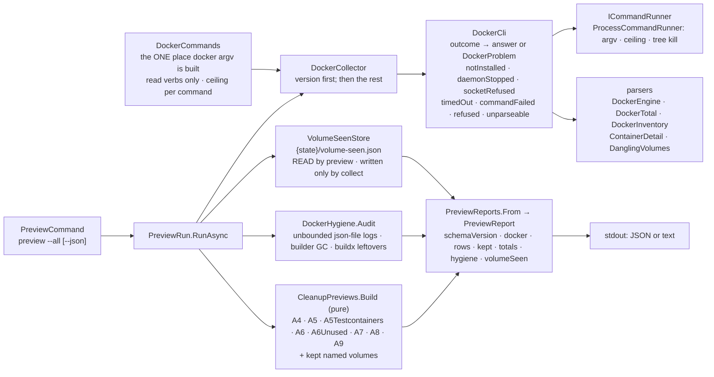

**Read commands only.** `DockerCommands` builds every docker argv — `version`, `system df`, `system df -v`,
`volume ls --filter dangling=true`, `container inspect` (batches of 100), `ps -a`, `stats --no-stream`,
`events --since/--until` — and its `ReadVerbs` list is what a Core test holds every buildable command to (enumerated
by reflection, so a new command is checked without being listed) and what the scenario holds every argv the fake
saw to. `container inspect` goes through a Go template that names its fields, so a container's environment,
command and bind sources never reach the process or a fixture; it reads a mount with `index $m "Name"` because
`$m.Name` fails the WHOLE command on a bind mount (found by the live contract, see below).

**Ceilings.** `version` 10 s (a daemon still starting reads as unavailable, not as a hung panel), listings 30 s,
`system df [-v]` 2 min (plan §4.3: "seconds to minutes"; 2 s measured here). Output caps of 1–64 MiB; an answer cut
by its cap is `unparseable`, never read as a shorter truth.

**Unavailable, never 0** (plan §15b #7). The version probe runs first; when no daemon answers nothing else is
started and every Docker figure is `available: false` with the reason — `notInstalled` (no executable),
`daemonStopped` (Docker's own "failed to connect to the docker API" / "Cannot connect to the Docker daemon", or
`"Server": null`), `socketRefused` (permission denied, connection refused), `timedOut` (our ceiling, tree killed,
or Docker's own i/o timeout), `commandFailed` (anything else, Docker's message quoted), `refused` (the command
policy), `unparseable`. A later command that fails leaves only the parts that depend on it unavailable (no
`system df -v` → no rows, no inspect; the totals still answer). `container inspect` exiting 1 with ONLY "No such
container" lines is read for the containers that still exist — a container removed between the listing and the
inspect is gone, which is all a cleanup preview needs to know (measured 2026-10-02, a parallel session replacing its
containers). The classification phrases are Docker 29.6.1's own, measured on Linux and Windows.

**The rows** (plan §4.3, the preview figures of §5). One row per `auto` switch:

| Row | Selected | Bytes | Left out, as notes |
|---|---|---|---|
| A4 | the dangling list ∩ ANONYMOUS volumes — Docker's `com.docker.volume.anonymous` label AND a 64-hex name (since 2026-10-03; a 64-hex name alone is what `docker volume create` without a name leaves, and Docker 23+ keeps it as named) ∖ `wsl-care.keep=true`, first seen unattached ≥ `volumes.anonymousOlderThanDays` ago | `system df -v` volume sizes | younger than the limit; kept by label; 64-hex names without the label (named to Docker: kept, listed with the named volumes); unattached volumes whose labels are unknown (missing from `system df -v`) |
| A5 / A5Testcontainers | stopped (`exited`, `created`, `dead`) since `FinishedAt` (or `Created` for one never started) ≥ the days / hours limit, by the `org.testcontainers=true` label | writable layer + the distinct anonymous volumes they hold (anonymous by the same label rule, each counted once however many of them share it) | their named volumes (kept); volumes whose labels are unknown (not counted); stopped more recently; kept by label |
| A6 / A6Unused | dangling / tagged images with Docker's container count 0 AND not the image id of any inspected container (a stopped one included), A6Unused created ≥ `images.unusedOlderThanDays` ago | unique size | created more recently |
| A7 | build-cache entries neither in use nor shared | entry sizes | last used more than `buildCache.olderThanDays` ago (an age filter alone); above the `buildCache.maxGb` cap (2³⁰ per GB, as Docker reads `--keep-storage`) |
| A8, A9 | — | — | `available: false`: the npm / apt / snap figures are file walks the full run takes (E2.S3) |

The arithmetic is Docker's own, checked by hand on 2026-10-02 and held by the live contract: images reclaimable =
Σ unique size of the images no container uses; volumes reclaimable = Σ size of the unattached volumes (A4 + the
kept named ones); build-cache reclaimable = Σ size of entries neither in use nor shared. A4 is counted on Docker
below 23 but carries the refusal (plan §5). **Kept**: the unattached named volumes with their sizes, report-only.

**`volume-seen.json`** (plan §5 "Volume age", §15 #0/#4, §15b #3). `{state}/volume-seen.json` maps each anonymous
volume name (anonymous by `AnonymousVolumes`: the label AND the name — `DockerSnapshot.UnattachedAnonymous` needs the
inventory for the labels) to when it was first seen UNATTACHED; each look keeps the first sighting of a name still unattached,
stamps new names now and drops every name that is no longer an unattached anonymous volume (removed or attached
again) — so the file is bounded by what Docker lists. Written atomically through `IFileSystem` (scope: the state
directory). **Who writes it:** only the full run (`collect`, later the cleanup actions) — `preview` is strictly
read-only, privileged or not (plan §15b #3; gate finding #3/#6/#10 found a root `preview` recording sightings in
E2.S2): it observes the record against the snapshot IN MEMORY for its rows, reports `volumeSeen.recorded: false`
with *read-only: preview only reads volume-seen.json…*, and leaves the file byte-identical (absent if it was
absent). **Privilege** for `collect` is the operating system's answer, not an id check: the write is ATTEMPTED, and
on the installed layout (`/var/lib/wsl-care`, `root:root 0755`, E4.S1) only root succeeds; an unprivileged run writes
nothing at all. A run that does not record reads the stored record plus "first seen now" for new names — which can
only make A4 select fewer. When Docker did not list
its volumes the record is neither observed nor written, so an outage never drops a first sighting. A sandbox under
`WSL_CARE_ROOT` belongs to the test user and is the writable case; the unwritable case is tested with the state
directory denied (`AccessDenial`).

**Hygiene audit** (plan §4.5, report only): containers on `json-file` without `max-size` and the size of each log
— one `FileSize` stat of `DistroPath(LogPath)`; under Docker Desktop the logs live inside its own VM, so the Linux
binary reports each size unavailable with that reason and the Windows binary names the Linux binary; Docker
Desktop's `daemon.json` builder GC (`present`, `enabled`, `defaultKeepStorage`) — read by `wsl-care.exe` from
`%USERPROFILE%\.docker\daemon.json`, unavailable inside the distro, which does not know the Windows profile yet
(E2.S3's `.wslconfig` audit resolves it); `buildx_buildkit_*` containers and `buildx_buildkit_*_state` volumes.

**`docker stats`** for a full run: `DockerStats.SampleAsync` returns the `ContainerStatsSample` E2.S1's record
carries (binary units of `MemUsage`, full ids), or the problem's reason with no containers — never an empty
success. `collect` (E2.S3) calls it; `status` keeps reading it back with its age.

### The live contract (`src_daemon/tests/WslCare.LiveContract`, plan §15a C2, §15b #2/#6)

A separate xUnit v3 executable, in the solution but in none of CI's test steps. It runs the product's own
`DockerCommands` / `SystemdCommands` against the REAL tools through `ProcessCommandRunner` with a 30 s ceiling and
tree kill, parses with the product's parsers, and asserts what holds on any healthy machine — and that the
product's sums over `system df -v` rows land on Docker's own `system df` totals. Two answers compared with each
other are taken while Docker holds still (probe, subject, probe again; three attempts), and an error Docker printed
is retried twice 5 s apart — both measured necessities on 2026-10-02, while a parallel session was building images
and replacing containers. No `docker` / no daemon / no `systemctl` / not booted with systemd → an explicit skip with
the reason; `CI=true` → skip; `WSL_CARE_REQUIRE_LIVE=1` (the release checklist in `POST_DEPLOY.md`) → every skip is
a failure. `WSL_CARE_LIVE_CAPTURE=<dir>` writes each answer to a file — how `tests/fixtures/docker/*` was recorded.

### Deviations from the plan recorded in E2.S2

- Rows are named by their `auto` switch — `A5Testcontainers` and `A6Unused` are rows of their own — so each row
  carries the one switch and the one age limit that governs it.
- `volume-seen.json` records the first sighting UNATTACHED and drops a name that is attached again (the plan:
  "first time it sees each anonymous volume"), so A4's age means "unused for", which is what §5 says it limits.
- ~~A `preview` run by root also records first sightings~~ — **withdrawn after the E2 code round** (gate finding
  #3/#6/#10): `preview` never writes `volume-seen.json`, as §15b #3 says; `collect` records the sightings.
- A8 and A9 are present and `available: false` until the full run measures the folders (E2.S3).
- The builder-GC figure is the Windows binary's; inside the distro it is unavailable until E2.S3 resolves the
  Windows profile. Log sizes under Docker Desktop are unavailable (the logs are in Docker Desktop's VM).
- `docker ps -a` is not used by `preview` (`system df -v` lists the containers with their sizes); the live contract
  parses it with the same row parser and holds its ids to `system df -v`'s.
- The `systemctl show` / `journalctl --disk-usage` / `docker events` parsers ship here for the live contract;
  their collectors are E2.S3's. Measured: Docker's in-memory event buffer held only 255 healthcheck `exec_*`
  events — no container start of the last 24 h survived in it — so the follower's backfill (E2.S3) must expect an
  empty `events --since` even right after starts.

## The full run, `doctor` and the events follower (E2.S3)

`WslCare.Core/Collect` holds the full run (`CollectRun`) and the wire shape of its run detail; `Health` the health
collectors of plan §4.5 and their parsers; `Thresholds` the threshold rules; `Folders` the daily folder walk; `Events`
the container-start follower; `Doctor` the installation check; `Records` gained the run detail store, the history
reader, the startup reconcile and the retention sweep. The verbs are `CollectCommand`, `DoctorCommand`,
`EventsCommand` in `WslCare.Cli/Commands`. Before it measures, `collect` logs one line (console = stderr, and the run
file) that it is measuring and that Docker's disk figures and the folder walks can take minutes — a full run said nothing
until it ended, and working looked like stuck (retro gate over PR #5, 2026-10-06). The promise is that line only: it says
the run STARTED; each slow stage may then stay silent until it finishes or reaches its own ceiling (no per-stage
progress — `WslCare.Core` has no logger).

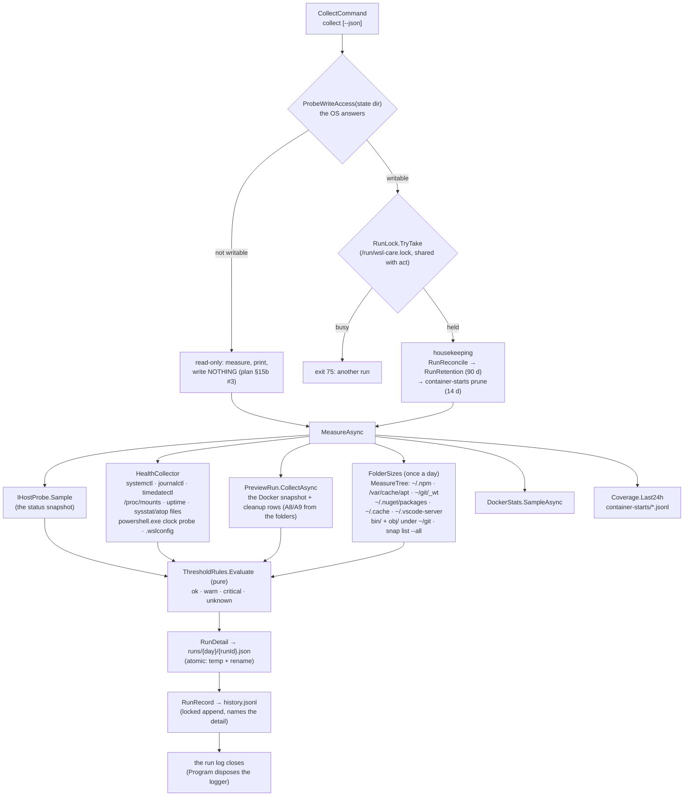

**What a full run measures.** Everything `status` reads (the fast probe), plus what only `collect` may start (plan
§15b #5): Docker's full numbers and the cleanup rows (the same `PreviewRun` as `preview`), `docker stats`, the
Windows clock, the health collectors, and once a day the folder walk; and what the follower recorded — container
starts of the last 24 h, complete or partial. The thresholds are evaluated over all of it; the detail holds every
verdict, the history line the ones that are not `ok` (`warnings`) and a few headline `metrics`.

**The health collectors** (plan §4.5, read-only, each command with its ceiling, built in `SystemdCommands` /
`HealthCommands`): failed units (`systemctl list-units --failed --output=json`), journal size and history
(`journalctl --disk-usage`, the oldest `first_entry` of `--list-boots --output=json`), clock jumps since the last run
(systemd-resolved's "Clock change detected" — `journalctl --unit=systemd-resolved --grep`, 875 in ~3.9 h measured),
the kernel's allocation failures and OOM kills since the last run (`journalctl --dmesg --grep` — journald's copy of
the kernel log, no `dmesg`), time sync (`timedatectl show`), `wsl-pro.service` and `fstrim.timer`
(`systemctl show`, now with `UnitFileState`), earlyoom / systemd-oomd present, uptime and `discard` on `/` from
`/proc`, sysstat / atop collecting (the newest file's last write, < 30 min). journalctl exits 1 printing nothing when
nothing matched — read as 0, never as a failure. A missing tool leaves only its part unavailable with the reason.

**The Windows clock** (plan §4.5, §15b #5). `powershell.exe` prints Windows' "now", its OWN start and
`%USERPROFILE%`, all on Windows' clock. The start lines up with the instant this side launched it, so the offset is
*Windows start − our launch instant* and the launch latency (*printed − started*, measured on one clock) is
subtracted rather than counted as skew — measured 2026-10-02: −2.89 s and −2.74 s a second apart this way,
−2.05 s / −2.18 s without the subtraction. A drift is reported only on TWO observations above
`clock.maxDriftSeconds` at least 5 minutes apart — this run's and the previous full run's (plan §15 #10). The printed
profile, seen through `/etc/wsl.conf`'s automount root (`/mnt/c/Users/…`), is how the distro reads `.wslconfig` and
Docker Desktop's `daemon.json` (the builder-GC figure E2.S2 left unavailable) without a walk; `preview` reuses the last
full run's profile.

**Thresholds** (`ThresholdRules`, pure). Settings where the plan made them settings (`thresholds.*`, `volumes.*`,
`images.unusedMaxGb`, `buildCache.maxGb`, `npm.maxCacheGb`, `clock.maxDriftSeconds`); plan §4's other starting points
are named constants (page cache / inactive anon 15 GiB, order-7 blocks < 32 warn / 0 critical, PSI > 10, `/` > 80 %,
journal > 1 GiB or < 7 days, > 100 clock jumps per 4 h). An unread figure is `unknown` with its reason, never `ok`.
**`.wslconfig`**: the VM's ceiling (inside the VM `MemTotal` IS the ceiling) is red above 90 % used; the row SHOWS
the owner's recommendation `memory=36GB` and the file's own settings (`sparseVhd=true` and `autoMemoryReclaim=gradual`
warn) — nothing ever writes the file. Since E14 S5 (2026-10-09) the full run's `wslConfig.advice` lists, per setting the file
does not already say, the line to add, its section (`[wsl2]` `memory=` / `swap=`, `[experimental]`
`autoMemoryReclaim=dropcache`), what the file says now and the measurement it rests on (`Health/WslConfigAdvice`); an
architecture test holds that no product file naming `.wslconfig` contains a write. Two report verdicts after `memory.swap`
(`Thresholds/SwapAndCommit`): `memory.swapFree` (swap LEFT under `thresholds.swapFreeWarnGb`, 4; a smaller swap is judged by
`memory.swap` only) and `memory.committed` (`Committed_AS` above `thresholds.committedWarnPercent`, 80, of `MemTotal` — a
warning of promises). A1 and A2 record memory PSI as a fact and their trigger reason says whether the S6 pressure rule
WOULD fire — a shadow, their firing unchanged, until the S8 soak measures it.

**The daily folder walk** (`FolderSizes`, plan §4.4 and the A8 / A9 rows). `IFileSystem.MeasureTree`: one
`FileSystemEnumerable` pass, a stat per entry and no read, links (symlinks, junctions — `ReparsePoint`) neither counted
nor entered, a folder that is itself a link not walked, a ceiling of 2 000 000 entries or 2 minutes per folder (a
stopped walk is marked a lower bound). Measured when the newest recorded sample is older than 20 h; the other runs
carry none and readers take the newest line that does. A9's disabled snap revisions come from `snap list --all`, each
one's size a stat of `{name}_{rev}.snap`. `preview` shows A8 / A9 from that sample with its age in the basis.

### Write order, reconcile, retention (plan §15b #1)

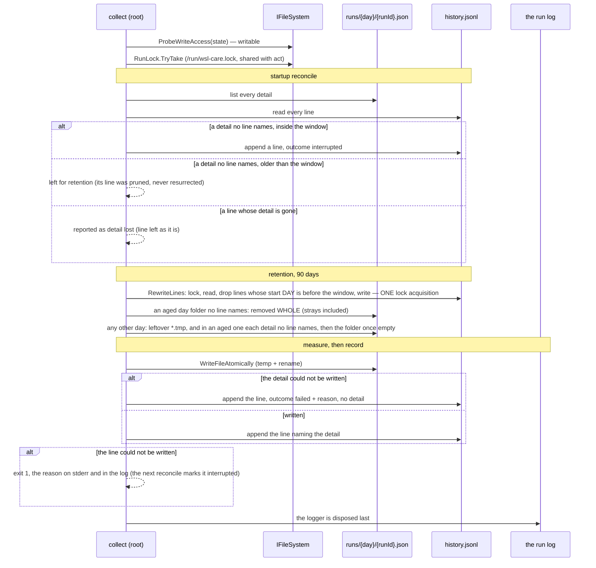

**One boundary, one lock** (after the E2 code round, gate findings #0/#4 and #11). Retention ages by the UTC DAY
(`RunRetention.CutoffDay` = today − 90 days): a history line whose start's day is before it, and a
`runs/{yyyy-MM-dd}/` folder whose day is. A line and the detail it names share that day (the run id carries it), so
they age out in the same sweep — E2.S3 aged the line by the instant and the folder by the day, and a run 90 days and
one hour old lost its line while its detail stayed, which the next reconcile turned into an `interrupted` run. The
reconcile now ignores a detail older than the window (`RunRetention.IsAged`), so a detail whose deletion failed is
never resurrected either. An aged day folder no line names goes whole, through `IFileSystem.DeleteDirectory` with
`runs/` as the declared root. The history is read, filtered and atomically rewritten inside ONE acquisition of
`history.jsonl.lock` (`IFileSystem.RewriteLines`, the lock `AppendLine` takes), so an append that arrives meanwhile
waits and lands in the new file — proved by an append interleaved inside the rewrite (`RunRetentionTests`).

Every delete and the history rewrite pass `IFileSystem` with a declared root (`runs/`, the state directory,
`container-starts/`), so the `DeletionPolicy` judges them like any cleanup. `RunHistory` is the one parser of
`history.jsonl` (`LastFullRun`, the reconcile, retention, `doctor` read through it); a line that does not parse is never
aged out — it has no start to age it by.

**Read-only** (plan §15b #3). The write probe answers no for an unprivileged process on the installed layout
(`/var/lib/wsl-care` is root's): the run still measures everything and prints it, and writes nothing — no reconcile, no
retention, no detail, no line, no first sighting (`PreviewExtras.MayRecord`) — and says *read-only: run as root to
record*. Its log goes to `$XDG_STATE_HOME/wsl-care/logs` (`IHostPaths.UserLogDirectory`; `WslCareLogging.LogRoot` picks
it whenever the system log directory is not writable — for every verb, not only `collect`).

**One run at a time.** THE run lock is held for the whole privileged run — an exclusive open the OS releases
when the holder dies — so the reconcile never takes a running run's detail for an orphan; a second `collect` exits 75.
Since E3.S1 it is `/run/wsl-care.lock` (`RunLock`), ONE file for `collect` and `act` (E2.S3 held `{state}/run.lock`).

### `events follow` — the container-start follower (plan §4.3, §15b #0, #8)

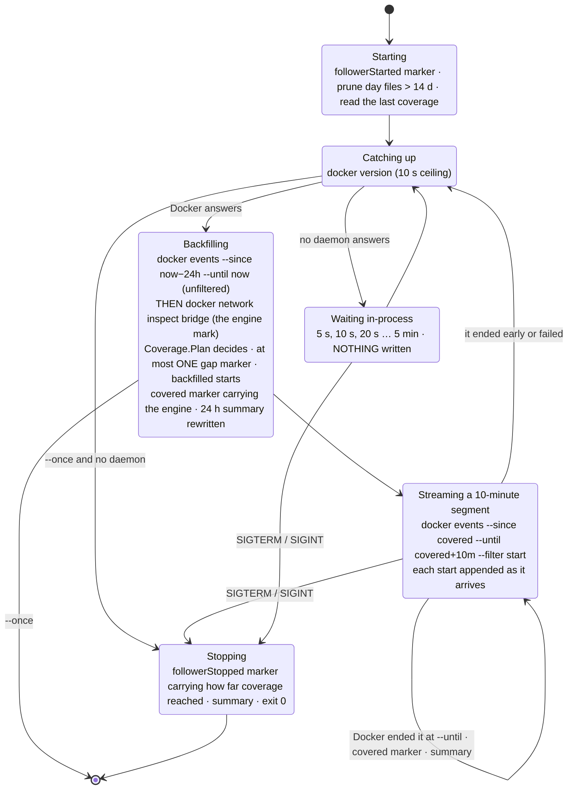

**Files.** `{state}/container-starts/{yyyy-MM-dd}.jsonl`, one line per start (`id`, `name`, `image`,
`testcontainers`, `backfilled`) and the markers — `followerStarted`, `followerStopped` (with the coverage it reached),
`covered` (every start up to this instant is recorded), `gap` (from, to, reason) — filed under the UTC day of the line,
appended under the cross-process lock, kept 14 days (pruned at start and by `collect`). A `covered` marker also carries
the engine instance it came from (`engineId`, `engineStartedAt`). One follower at a time
(`{state}/events-follower.lock`; a second exits 75); a process that may not write the state directory exits 1.
**`{state}/starts-summary.json`** (gate finding #8): the trailing-24-hour count (`StartsSummary`: when it was written,
how far coverage reached, the `StartsWindow`), recomputed over the day files and written atomically after EVERY marker.
`status` reads only this file (`ContainerStartsStore.ReadSummary`) — its cost no longer grows with the starts recorded —
and marks it partial with the open gap when the newest coverage is more than 15 minutes old; with no summary yet it
answers a partial 0 naming why. `collect` and the follower still count over the raw files (`Coverage.Last24h`). A
failed summary write is noted and the follower goes on: the summary is a cache, the day files are the record.

**Leaving a segment** (gate finding #1/#5). `StreamAsync` drains stderr concurrently into a bounded capture, and every
way out of a segment but a normal end — its ceiling, SIGTERM's cancellation, a callback that throws — kills the whole
tree and waits for the child (bounded by a 2 s grace) in a `finally`, before the outcome or the exception propagates.

**Why segments.** A stream that never ends would be a wait without a ceiling. Docker closes `docker events` by itself
at a FUTURE `--until` (observed by the live contract), so each segment is a bounded command (ceiling: the segment and
one minute) run through `ICommandRunner.StreamAsync` — the same launcher, policy and tree kill, its lines handed over
as they arrive (each cut at the output cap) — and the next segment resumes `--since` the previous `--until` from
Docker's buffer.

**The continuity rule** (`Coverage.Plan` + `Continuity`, pure; amended after the E2 code round, gate finding
#2/#7/#9 — E2.S3 treated an empty or short buffer as proof of loss). Docker keeps its events in a RING in memory:
moby's `eventsLimit` is **256**, the oldest dropped first — measured 2026-10-02: the unfiltered window answered 248, 255
and 255 events, all healthcheck `exec_*`, spanning **91 seconds** on a busy engine. So the buffer is complete from its
oldest event onward, always; and while it is not full it is complete from the moment the ENGINE STARTED. Events can
have been lost only when the buffer is FULL (≥ 240 events, `Coverage.FullAt` — within 16 of the capacity, because a
full buffer never answered 256) or the engine RESTARTED since the last coverage. The proven start of completeness is
the earlier of the oldest buffered event and — for a buffer that is not full — the engine's start (never before the
24 h window); coverage holds when it is at or before the last coverage, otherwise the stretch between them is ONE
`unrecoverable` gap with its reason (engine restarted at …, buffer full and reaching back only to …, older than the
24-hour window, the follower's first start). An idle engine with an empty buffer is covered with zero starts; a host
that slept (the engine suspended, the same instance after) is covered.

**The engine signal** (`DockerCommands.EngineStart`, read-only: `docker network inspect bridge`, its `Id` and
`Created`). The engine deletes and re-creates the default `bridge` network at every start, so its id is new per engine
start and its creation is the start instant — measured 2026-10-02 on Docker Desktop 4.81.0 / Engine 29.6.1: `bridge`
created 13:39:47.63Z, the restart-policy containers started from 13:39:48.27Z, while `host` and `none` still carry
2026-07-16 (they persist). `docker info` has no start time and its `ID` persists across restarts, so it cannot tell a
restart. Plain `dockerd` runs the same engine start-up, so the same re-creation is EXPECTED there (unless `live-restore`
keeps the bridge) — not measured: this machine runs Docker Desktop only, and the live contract is what checks it on an
installation that has a plain `dockerd`. The
follower reads the mark AFTER the events (a restart between the two then reads as a gap, never as false
completeness) and records it on each `covered` marker; a different bridge id with a start before the marker means a
different engine answers, and only the oldest-event rule is trusted. When the mark cannot be read (no `bridge`
network, the command failing) the rule falls back to E2.S3's: only the oldest buffered event proves anything. The
live contract checks the signal on this machine: every running container started no earlier than the engine.
The wait for Docker writes nothing, so one outage is one
gap, however many retries and even across a restart of the follower. **Counts** (`Coverage.Last24h`): starts in the last
24 h, Testcontainers apart, the top images; `complete` only when no gap overlaps the window — a recorded gap, the stretch
before the first record, or an open gap when the newest coverage is more than 15 minutes old — so a count is complete
again only once a whole 24 h lies after a gap's end. `status` and `collect` report it.

### `doctor` (plan §6)

Read-only: the configuration (observe-only is a problem), the state directory (missing is a problem; read-only for
this process is expected), the last run (older than 5 h or `failed` is a problem), lost details, the four units
(`wsl-care.timer`, `wsl-care-events.service`, `sysstat.service`, `atop.service` — `systemctl show`), sysstat / atop
collecting, the follower's coverage (≤ 15 min), root reachability `notChecked` (E6), and the versions of `wsl-care`,
Docker (server and CLI), systemd and the kernel. `healthy` is true when no check is a `problem`; the exit code is 0
whatever it finds (the JSON is the verdict).

### Exit codes (`ExitCode`)

0 answered / recorded / read-only / follower stopped by a signal · 1 the run could not be recorded, or `events follow`
without a writable state directory · 2 usage · 70 a defect · 75 busy (another run or follower holds the lock) ·
130 interrupted. Since E3.S1 also, for `act`: 3 an action failed · 76 wedged · 77 needs root · 78 observe-only (§ *The action
engine, the command policy and `act`*); since 2026-10-03 · 79 `running.json` unreadable after retries (gate finding #7). Since
E3.S3, for `logs` / `runs`: 4 the history exists but cannot be read. The detached runs' codes (69, 71, 73, 80, 81, and 82 an
unusable request recorded refused) and which of them each unit counts as success: `architecture-daemon-e6.md`. Since E14 S6, 83
machine busy (`busy` only). Since WR-D3 (PLAN_windows_runner.md, 2026-10-12), **84 `TaskEnded`** — the Windows binary's `tasks run`
only: the supervised worker was ended at its deadline with its whole tree (its job terminated); otherwise `tasks run` exits with the
worker's own code, 1 when no worker could start inside a job, 130 when stopped. No systemd unit runs that verb, so no unit counts
84 (`UnitSuccessExitTests`: not reachable). **Across to the extension:** `contracts/exit-codes.json` (written from `ExitCode` by
`ContractFilesTests`) carries `taskEnded: 84`; the extension names it `DAEMON_EXIT.taskEnded` (`src_vs_code/src/client/exitCodes.ts`,
held equal to the contract both ways by `exitCodes.test.ts`) and reads it as its own root kind `taskEnded` — label *ended at its
deadline*, a sentence naming the run and the daemon's lines (`root/rootOutcome.ts`, `rootFailures.ts`, `rootFailureText.ts`;
`rootFailures.test.ts` holds every non-zero contract code to a distinct kind). The Task Scheduler run buttons that will meet it
are WR-E3/E4's (they read Task Scheduler's `lastResult`, which for a task run is this exit code).

### Deviations from the plan recorded in E2.S3

- Thresholds without a setting in `ConfigKeys` stay named constants in `ThresholdRules` (plan §4's starting points);
  their keys arrive with E7's settings sync if the week of data asks for tuning.
- `collect` takes `{state}/run.lock` (not in the plan for E2) so the reconcile cannot race a running run; E3.S1's lock
  supersedes it. The trigger is `timer` only with `--timer` (the timer unit passes it in its `ExecStart`), `cli` otherwise — never
  inferred from `INVOCATION_ID`, which every descendant of any systemd unit inherits (a CI runner job, a VS Code Server
  user service; CI run 37129452377 caught four act tests taking a runner job for the timer).
- The backfill reads the WHOLE 24-hour window unfiltered (`events --since now−24h --until now`), not `--since <marker>`:
  the oldest buffered event of any kind is the only evidence that the buffer reaches back past the marker. Its lines
  are parsed in memory only (healthcheck command lines are in them) and never stored.
- The live follower runs in bounded 10-minute segments rather than one endless stream (a ceiling on every wait); each
  segment's end is a `covered` marker.
- `events follow --once` (catch up and stop) is not in the plan; it is what the derived register's example and a
  manual backfill use.
- `.vhdx` sizes and their growth stay unavailable (the Windows collectors, E11); "what grew since yesterday" is the
  growth of each walked folder against the previous sample, not of `$HOME` and `/var` (a walk of the whole home is
  not a 4-hourly or daily cost this run pays). inotify usage, VS Code Server builds (A14's input) and the WSL
  "failed to start within" boot error are not collected yet.
- The kernel's signals come from journald's copy of the kernel log (`journalctl --dmesg`), of THIS boot.
- The run log's retention stays `logging.retentionDays` (14, E1.S2), not §6's 30 days.
- Under the root timer `$HOME` is root's: whose home the daily walk, `~/.npm` and the protected `~/git` mean was left
  to E4.S1 — **decided in E3.S2**: the TARGET user's (§ *The irreversible deletions* below).
- **Amended after the E2 code round** (gate session `714367be`): the gap rule became the continuity rule above (an engine
  mark, the ring's capacity), `status` reads `starts-summary.json` instead of the day files, retention ages lines and
  day folders by one UTC-day boundary under one lock and the reconcile ignores aged details, `StreamAsync` kills and
  reaps in a `finally`, and `preview` writes no first sighting.
- `ICommandRunner` gained `StreamAsync`; `IFileSystem` gained `ListFiles`, `MeasureTree`, `ProbeWriteAccess`,
  `TryLockExclusive`, `RewriteLines` and a last-write time on `FileSize`; `IHostPaths` gained `UserLogDirectory`
  (Linux: `$XDG_STATE_HOME`), `LinuxHostPaths` the apt / snap / sysstat / atop / `wsl.conf` paths, `WindowsHostPaths`
  `.wslconfig`. The fake tool learned prefix matching, a per-answer call budget (`upTo`: down, then up) and output
  followed by a hang (a live stream); `timedatectl` and `snap` joined the fakes.

## The action engine, the command policy and `act` (E3.S1)

`WslCare.Core/Actions` holds the action interface (`ICleanupAction`), the closed set of action ids (`ActionId`, derived
from the `auto.*` keys of `ConfigKeys`, with the fixed `ExecutionOrder`), the registry (`ActionRegistry.Product` — this
release holds ONE action), the reference action A10 (`JournalVacuum`), the target-user discovery
(`TargetUserDiscovery`) and the `runuser` wrapper (`TargetUserCommands`), and the executor an action runs its commands
through (`ActionCommands`); `Actions/Engine` the engine (`ActionEngine`), `running.json` (`RunningState`, `Heartbeat`,
`IProcessTable`), the timer's dry-run window (`DryRunWindow`) and the idle gate (`IdleGate`). `Processes/Policy` is the
command policy (`CommandPolicy`, `NeverList`, `CommandTemplate`, `SlotKind`, `CommandCatalogue`, `ReadCommandTemplates`,
`TargetUserArgv`). `Records` gained THE run lock (`RunLock`) and the write order shared by every kind of run
(`RunRecorder`, extracted from `CollectRun`). `Hosting` gained `ProcessPrivilege`. The verb is `ActCommand` in
`WslCare.Cli/Commands`.

### One run of `act`

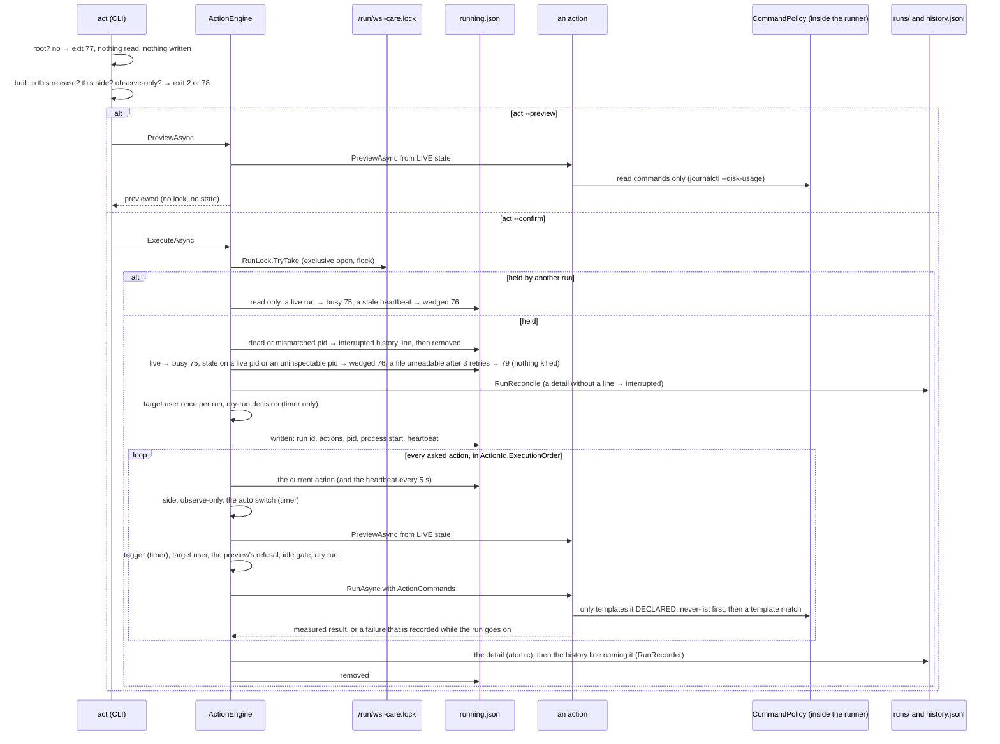

**The gates, in order, per action** (each stop is an outcome with its reason, never a silent skip): the action's SIDE
(`skipped`); observe-only (`skipped`); on the timer, a user layer that was not read — root with no single target user —
(`skipped`, every action: a switch the person turned off there cannot be seen, and a default must not re-enable it; retro
gate over PR #7, 2026-10-06 — a button still runs); on the timer its `auto.<id>` switch (`skipped`); the LIVE preview (unreadable →
`refused`); on the timer its trigger (`skipped`); a user-scoped action without a target user (`refused`); the
preview's own refusal (`refused`); the idle gate (`deferred`, logged as a warning); the dry run (`dryRun`, the preview
recorded as *would have freed*); then the run — `ran`, or `failed` with the reason, and the next action. ANY exception
of an action is caught at that unit boundary and recorded as `failed` (reliability rule: one unit's failure is the
unit's); the caller's cancellation is not — it ends the loop, the run is recorded `interrupted`, `running.json` is
removed and the cancellation flies on (exit 130).

**Order** is the engine's, whatever order the actions were asked in (`ActionId.ExecutionOrder`): A5Testcontainers, A5,
A4, A6, A6Unused, A7, A8, A9 (plan §7.3: removing containers first frees their volumes and images), A12, A14, A17, A10,
A13, A15, A16, A3, A11, A1, A2 (the build servers and suspects before the cache drop, A2 after A1).

**`running.json`** (plan §6, §15 #6, §15a #0): the run id, the trigger, the asked actions, the CURRENT one, the pid,
the process's START as the operating system reports it (`Process.GetProcessById(pid).StartTime` — inspected, never
started or killed), the start of the run and a heartbeat. Rewritten at once when the run moves to its next action, and
by a detached loop every 5 s (`PeriodicTimer` on the run's `TimeProvider`; its outermost frame ends in a catch-all that
keeps the failure in the run's notes). A reader judges it: no file → none; the pid gone, or alive with a start more
than 2 s from the recorded one (a reused pid) → **dead**: an `interrupted` history line (the asked actions, the one it
was on, the last heartbeat) and the file removed — unless the run had already recorded itself (it died between its
history line and the removal), then the file alone goes; the pid alive with that start and a heartbeat at most 30 s old
→ **live** (busy); older → **wedged**: no new run, nothing killed, the file left exactly as it is; a pid that cannot be
inspected → refused like wedged, because a guess there is a second run beside a live one. A file that cannot be read or
does not parse is read again — three more times, 100 ms apart (`RunningReadRetry`; a writer's temp + rename can race a
reader on Windows) — and only then judged: **unreadable**, its OWN state (`RunningStatus.Unreadable`,
`ActResult.StateUnreadable`, exit 79, the file and the reason named), never taken for a wedged live process. The sweep
itself is `RunningSweep` (since 2026-10-03), ONE implementation for the engine and every full run's housekeeping.

### The command policy — the one filter every argv passes

`ProcessCommandRunner`'s only public constructor takes a `CommandPolicy`, a sealed class whose never-list no caller can
switch off; `CommandPolicy.Product` is the never-list over `CommandCatalogue.Product` = the collectors' read commands
(`ReadCommandTemplates`, each fixed one taken from its own `ToolCommand`) + every template a registered action
declares. A test may build `CommandPolicy.Over(itsOwnCatalogue)` — which templates, never which rules. The runner's own
tests use `ProcessCommandRunner.UnguardedForItsOwnTests` (internal; their child is a shell, which the never-list
refuses), and a test fails if any other product file names it.

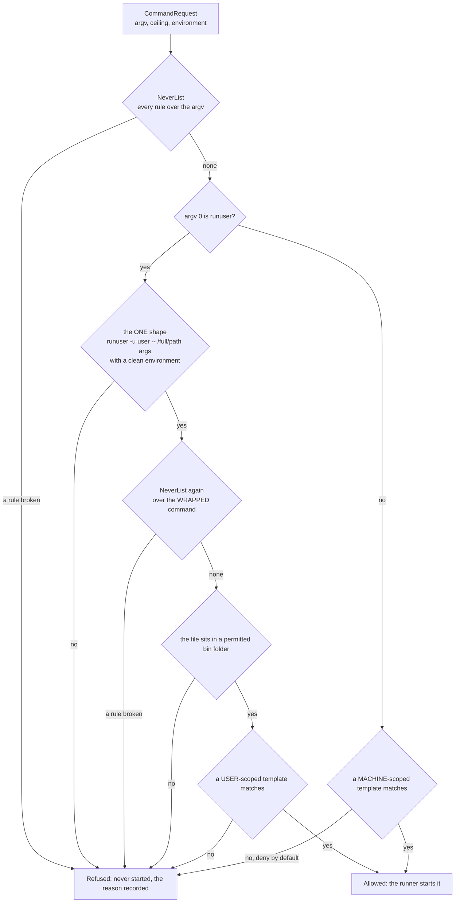

**The never-list** (`NeverList.Rules`, each a named rule with a known instance in `CommandPolicyTests`): a control
character in any argument; a SHELL in any form (`sh`, `bash`, `dash`, `zsh`, …, `cmd` — plan §15c #3, no shell
anywhere, so not only `-c` / `-ic`); PowerShell with anything but an EXACT member of its closed set,
`HealthCommands.FixedScripts` — the Windows clock probe (E2.S3) and, since E15.S1, the Windows disk script, program and
arguments alike, no slot ([module_daemon.md](module_daemon.md) § *The Windows disk script*); an interpreter given inline code (`python -c`, `perl -e`, `node -e`, `awk`, …);
`git worktree prune`; `docker system prune` in ANY form; `docker volume prune` in any form; `vm.drop_caches` with any
value but `1`, and any argument naming `/proc/sys/vm/drop_caches`; `sysctl` loading a file (`-p`, `--load`,
`--system`); `wsl --shutdown` / `--terminate` / `--unregister`; deleting or moving by command (`rm`, `rmdir`, `unlink`,
`shred`, `mv`, `del`, `find -delete`, `rsync --delete`, `git clean` — files go only through `IFileSystem` and its
`DeletionPolicy`); a path under ANY home's `git`, an AI agent's folder or Claude's temp folder as an argument to ANY
command; `sparseVhd` / `--set-sparse`; `autoMemoryReclaim` with `gradual`; a command that runs another command
(`sudo`, `su`, `env`, `xargs`, `nohup`, `timeout`, `nice`, `wsl`, …) — `runuser` only in its one shape; killing by
name (`pkill`, `killall`, `taskkill`). Broader than plan §5 wherever breadth costs nothing: no action needs any of it.

**Deny by default.** A template (`CommandTemplate`) is the executable as a BARE name (never a path — the catalogue
refuses one), fixed literals and typed slots (`SlotKind`, a closed set: a bounded number with a suffix, `@unix`
seconds, an RFC 3339 UTC instant, n hex digits, a unit name, a POSIX user name, plain search text, one of a fixed set,
a fixed prefix plus a slot, any of several), the last part optionally a bounded repeat. No slot accepts a value that
starts with `-` (except a fixed set) or holds a control character; the text slot holds only letters, digits, space and
`| . _ : -`. An action may BIND only the templates it declares itself (`ActionCommands`, compared by identity), and the
runner's policy then judges the argv again — two filters, one written by the action's author and one nobody can skip.

**The property test** (`CommandPolicyPropertyTests`, a seeded generator in `TestSupport/HostileInputs` — no package):
20 000 generated requests — every never-command in many spellings (paths, case, `.exe`, extra words, behind a
wrapper), every declared template with valid and with hostile slot values (`--all`, `;`, `$(…)`, `../`, `~/git`, agent
folders, unicode, newlines, NUL), token soup, all of it also wrapped in `runuser` with a clean or an inherited
environment — none the policy allows is a never-command by the INDEPENDENT oracle (`NeverOracle`: the plan's list
written a second time, as patterns over the joined argv with every wrapper peeled), and every one it allows matches a
declared template; every declared template instantiated with values its slots accept is never a never-command; and
every registered action, previewed AND run 2 000 times over generated configurations and generated journals with
hostile file names, asks only for argv the policy allows, of its OWN templates, none a never-command. Each property has
a companion that goes red: a permissive policy (`_ => Allowed`), a policy asking the never-list of the outer argv only
(the refuted shape: it admits undeclared argv and never-commands behind `runuser`), a planted template whose slot is
too wide (`vm.drop_caches=<0..3>` — the template property names it, and the never-list still refuses it at run time),
and a planted action that builds a shell string from a preview name.

### The execution context (plan §15c)

- **Root, first.** `act` asks `ProcessPrivilege` before anything else (`Environment.IsPrivilegedProcess`: effective uid
  0; elevated on Windows). Unprivileged — `--preview` included — it refuses the whole run (exit 77) before the lock,
  before any read command, before any state. Under `WSL_CARE_ROOT` alone, `WSL_CARE_SANDBOX_PRIVILEGED=1` makes the
  process ANSWER root — the harness and the AOT smoke drive `act` with it; it changes the answer, never what the
  operating system lets the process do, and every path of the run is under the sandbox root.
- **The target user**, once per run: `/etc/wsl.conf`'s `[user] default=` (a valid account name that `/etc/passwd`
  holds, with an absolute home), else the single account with uid ≥ 1000 (not 65534) and a login shell; anything else —
  two candidates, a default user `passwd` does not hold, an unreadable file — is *ambiguous* and every USER-scoped
  action refuses with the reason (machine-scoped ones still run — since 2026-10-03 for real: the run reads the defaults
  and the machine layer without the user layer, instead of going observe-only as a whole). The run detail records who it
  was and how.
- **`runuser`.** A user-scoped tool runs as `runuser -u <user> -- <full path> <args…>`: the file resolved BEFORE the
  start in the fixed bin folders — `~/.nvm/versions/node/<the default version>/bin` (nvm's `alias/default` resolved to
  an installed version, or left out), `~/.local/bin`, `~/.cargo/bin`, `/usr/local/bin`, `/usr/bin` — with a CLEAN
  environment (`HOME`, `USER`, `LOGNAME`, a `PATH` of those folders; nothing of root's). The policy refuses any other
  `runuser` shape, an inherited environment, and a file outside those folders even when its name matches. E3.S1 held no
  user-scoped action; E3.S2's A8, A12, A14 and A17 are.
- **Protected homes.** Inside the distro the CLI protects the `git` and AI-agent folders of root's AND every login
  account's home (from `/etc/passwd`), besides `$HOME`'s (`LinuxEnvironment.ProtectedHomes`) — under the root timer
  `$HOME` is root's, and the target user's folders must be protected whoever the target is. The daily folder WALK and
  the user configuration layer followed `$HOME` in E3.S1; since E3.S2 they follow the TARGET user's home when root.

### Decisions taken in E3.S1

- **The 7-day dry run starts at the timer's FIRST action pass**, recorded once in `{state}/first-timer-run.json`
  (root-written), not at install: the week is a week of the timer's own decisions. The timer is dry while `dryRun` is
  on OR the 7 days have not passed; a button never is. An unreadable stamp is rewritten with now (the week restarts);
  one that cannot be written leaves the run dry.
- **The lock rule between `collect` and `act`: one file (`/run/wsl-care.lock`), and the second one refuses (75), it
  never waits.** A run that waited would be a run nobody sees; the timer runs again at its next tick, a button shows
  busy.
- **"CPU below `idle.cpuPercent` for `idle.minutes`" is the kernel's load average** — the HIGHEST of its 1 / 5 /
  15-minute averages up to the shortest window covering `idle.minutes` (15 when longer; since the E7.S0 review round, C5,
  so a longer `idle.minutes` is never looser), divided by the CPUs of `/proc/stat`, capped at 100 %. A
  run is a moment, and the load average is the only CPU history the kernel keeps; it counts I/O wait as busy, the
  conservative direction. Builds are `docker … build|bake`, `dotnet build|test|publish|pack|msbuild`, `npm ci|install`
  among the distro's processes (the fast probe's table). An unread figure defers.
- **The idle gate has one bounded exception (2026-10-12, `archive.maxDeferHours`).** An action that declares
  `ICleanupAction.MaxDeferHours` (A13 alone) runs on the TIMER despite the load once its live timer deferrals in
  `history.jsonl` have lasted that long (`IdleDeferrals.StreakStart`; a dry run, a button run or any other status ends the
  streak). Only the load is overridden (`IdleVerdict.LoadOnly`); an unknown figure or a running build still defers, and every other
  gate keeps its place. The outcome says "ran despite the load: … since <UTC> (<h> h, archive.maxDeferHours <n>); <the verdict>".
  [module_archive.md](module_archive.md) has the archive's side of it.
- **Heavy actions** (`IdleRule`): `TimerOnly` for A1 / A2, `Always` for A7 / A15 — a button press of A7 while a build
  runs is deferred too (refused with the reason); A10 never waits.
- **A preview takes no lock** and writes nothing — it is a question, like `preview --all`; only `--confirm` locks.
- **`act --timer` is the timer** (as for `collect`; never `INVOCATION_ID`); `collect` does not call the engine yet (E3.S3:
  the timer pass does).

### Exit codes of `act`

0 previewed / run recorded (an action skipped, deferred, refused or dry-run is still 0 — the answer names it) · 1 the
run could not be recorded · 2 usage: an unknown id, an action this build does not hold, the other side's action · 3 an
action failed (the run was recorded, the rest ran) · 75 busy · 76 wedged · 77 needs root · 78 observe-only · 79 the running
state unreadable (since 2026-10-03) · 130 interrupted.

### Deviations from the plan recorded in E3.S1

- The never-list is broader than §5 (every shell, every delete-by-command, every `docker system prune`, every command
  wrapper, every argument path under a protected folder), and PowerShell is allowed only as the clock probe's literal
  argv — the one interpreter E2 already started (since E15.S1 a closed set of two: the clock probe and the disk script).
- The action ids include `A5Testcontainers` and `A6Unused` (plan §5 gives A5 and A6 two switches each); an id is its
  `auto` key, so the registry and the switches cannot drift.
- ~~The timer pass is not scheduled yet: `collect` (the timer's target) does not run the engine; E3.S3 wires it with
  A1 / A2's triggers.~~ **Closed by E3.S3**: the timer pass (§ *The timer pass*). `act` under systemd behaves as the timer.
- `CommandRequest` gained an `Environment` (inherited, or clean); `ExecutableResolver` gained `ResolveIn` (a list of
  folders, where a `PATH` string would split a Windows sandbox path at its drive letter); `IHostPaths` gained
  `RunLockFile`, `LinuxHostPaths` `JournalDirectories` and `WithProtectedHomes`; `ActionRecord` gained `status` and
  `wouldFreeBytes`; the `RunRecorder` was extracted from `CollectRun` so both kinds of run share one write order.
- `runuser`'s environment handling is read from util-linux's `su-common.c` (without `-l` / `-m` it sets `HOME`,
  `SHELL`, `USER`, `LOGNAME` and keeps `PATH` unless `ALWAYS_SET_PATH`), not observed: it needs root, and nothing here
  runs as root.
- The button's trigger was `cli` in E3.S1; E3.S2 added `--manual` (the trigger `manual`) and A4's `--volume` / `--only`
  (what the preview SHOWED) — E6 passes both.

## The irreversible deletions (E3.S2)

Eleven more `ICleanupAction`s in `ActionRegistry.Product` — the engine, the policy, the lock, `running.json`, the dry run
and the idle gate are E3.S1's, reused unchanged. Each declares its `CommandTemplate`s (so the policy's catalogue and the
property tests pick them up), runs commands only through its `ActionCommands`, previews from LIVE state, and returns a
MEASURED `ActionRun` with the removed objects and — new — `NotRemoved` (each with why) and `Notes`.

| Folder (`WslCare.Core/Actions/…`) | Actions | Scope |
|---|---|---|
| `DockerCleanups/` — `VolumeRemoval`, `ContainerRemoval`, `ImagePrune`, `BuildCachePrune`; `DockerCleanupCommands` (the WRITE templates and the answer parsers), `DockerLook` (one live look) | A4, A5 + A5Testcontainers, A6 + A6Unused, A7 | machine |
| `UserCaches/` — `NpmCacheClean`, `ToolCacheTrims`, `BrowserAndHttpCaches`, `EditorServerCleanup`; `CacheFolders` (the target user's folders, the one bounded measure) | A8, A17, A12, A14 | user (`runuser`) |
| `PackageCaches/` — `PackageCacheClean` | A9 | machine |
| `Suspects/` — `SuspectTermination` | A11 | machine |

### One preview, two readers

`Preview/CleanupTargets` is now the ONE place a Docker row's objects are SELECTED (anonymous volumes, stopped containers
and their anonymous volumes, unused images, reclaimable cache entries — every protection applied there), and
`CleanupPreviews` builds each row (`A4Row` … `A9Row`) from those selections. A Docker action's preview takes its own live
look (`DockerLook`: the same `DockerCollector`, run through `ActionCommands.AsRunner()` — the action's declared machine
templates and the collectors' shared read-only templates (`ReadCommandTemplates.All`, gate finding #3) run, every argv still
judged by the policy — and the
first sightings observed in memory exactly as `preview` observes them) and calls the SAME row builder, so
`act <A#> --preview` and that row of `preview --all` are one computation: same what, count, bytes, basis and refusal
(`RowPreviews`; held by `DockerCleanupTests.Every_docker_and_folder_actions_preview_equals_its_row_of_preview_all`, derived
over every registered action that has a row). The full target list travels from the preview to the run in memory only
(`ActionPreview.Targets`, `ActionItem.Key`, both `[JsonIgnore]`); the JSON keeps the first 20 items.

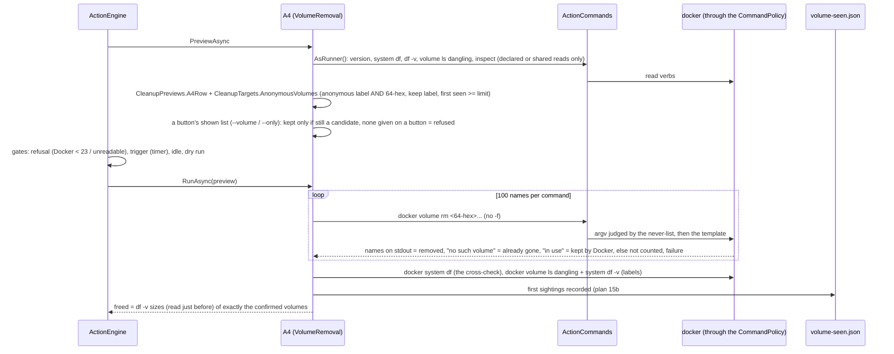

### Per action — what it runs, and what "freed" is

| Action | Command | Freed bytes | Refuses / skips |
|---|---|---|---|
| A4 | `docker volume rm <64-hex>{1..100}` | `system df -v` sizes of exactly the volumes Docker printed back (§15c #1); Docker's Local Volumes total before / after beside it | Docker < 23, or a version that is not a number (E3.S2: unknown is not "new enough" — the row's refusal too); a `manual` run without a shown list |
| A5, A5Testcontainers | `docker rm -v <64-hex id>{1..100}` | the confirmed containers' layers + their anonymous volumes that `docker volume ls` no longer lists | — (a container that started since: Docker refuses, kept; its refusal quotes the NAME, matched as an alias) |
| A6, A6Unused | `docker image prune -f` / `-a -f --filter until=<days×24>h`, both `--filter label!=wsl-care.keep=true` | Docker's "Total reclaimed space" | no prune at all when the live selection is empty |
| A7 | timer: `docker builder prune -f --max-used-space <N>GB` or `--keep-storage <N>GB` — whichever `docker builder prune --help` lists (read-only probe; captured 2026-10-02: buildx lists `--max-used-space`, no `--keep-storage`); button: `-a -f` | Docker's "Total:" | timer with neither flag; `IdleRule.Always` |
| A8 | `runuser -u <user> -- <npm> cache clean --force` | `~/.npm` walked before / after (complete walks only) | npm not in the user's bin folders = skip |
| A9 | `apt-get clean`; `snap list --all` again, then `snap remove <snap> --revision=<n>` per revision still disabled | `/var/cache/apt` before / after + each `{name}_{rev}.snap` gone | a missing tool skips its part; an x-revision or an odd name is kept |
| A11 | `IProcessSignals.TerminateAllAsync(pid + start …)`: SIGTERM to all, ONE shared 10 s grace, then SIGKILL to the survivors | none (memory, not disk; the preview counts no bytes either — the memory held is the `heldMemoryBytes` fact) | on by default since E14 S3b (2026-10-09; off before), the timer still under the global dry-run rules; see below |
| A12 | `IFileSystem.DeleteDirectory` per unreferenced browser (root `~/.cache/ms-playwright`); `runuser … dotnet nuget locals http-cache --clear` | folders measured before, counted when gone; http-cache before / after | timer never (button only); the Playwright part refuses whole when what is referenced cannot be told |
| A14 | `IFileSystem.DeleteDirectory` per old build / obsolete extension (root: the editor's folder) | folders measured before, counted when gone | an unreadable process table |
| A17 | `runuser … pnpm store prune`, `uv cache prune`, `pip cache purge` (`pip3` only without `pip`) | each cache before / after | none installed = skip; `cargo sweep` and Gradle not run (below) |

A tool's absence is a SKIP: `ActionPreview.Skip` (new) makes the engine record `skipped` with the reason — never
`refused`, never `failed`. A user-scoped action asks `ActionCommands.Locate(template)` (new) whether the tool is in the
target user's bin folders before anything runs.

### A11 — suspects, by pid and start time

Candidates (`SuspectTermination.Candidates`, pure): orphaned (parent pid 1 or a `systemd --user`), in
`processes.families`, older than `processes.idleOlderThanHours`, no terminal, not a zombie, not root's, not this process.
Since E14 S3 the C# language server is a family of its own, `language-servers` (matched before `vscode-server`): listing it
lets A11 end a language server whose VS Code window closed (it is re-parented) without naming the VS Code server, which is
daemonised and therefore "orphaned" by this rule — `vscode-server` must not be listed for A11. Since E14 S3b (2026-10-09, the
owner's answers to Q14/Q15) `auto.A11` is ON by default and the default families are `dotnet-build-servers`, `testhost`,
`language-servers`; `vscode-server` stays choosable, never a default (Q16). A11 has no dry window of its own: with `dryRun`
at its default (`true`) the timer only records what A11 would end; with `dryRun` off and the first week passed it ends
suspects from the first full timer run after the upgrade (the same answer Q11 gave A19). Each candidate's `/proc/[pid]/stat` and `status` are read, then again after a 5 s window: only a process whose CPU ticks
did not move AT ALL, with the same start and still no terminal and not uid 0, is a suspect. Just before its signal the
run reads it a THIRD time and keeps it if it used any CPU since, gained a terminal or is another process now. The signal
goes through the new seam `Processes/ProcessSignals.cs`:

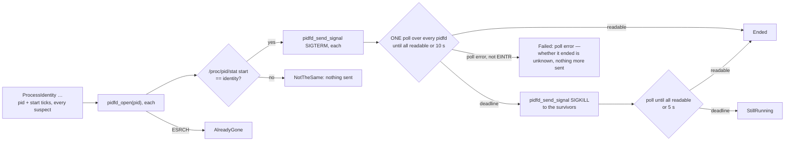

The pidfd pins the process before its start is compared, so the pid can never be reused between the check and the
signal. Since 2026-10-03 the suspects share ONE grace (gate finding #9: three that ignore SIGTERM take 10 s, not 30 s; a
cancellation is seen within a 200 ms slice and every pin is closed), and a `poll` that fails with anything but `EINTR` is
a FAILURE, never an end (independent review): the native calls sit behind `IPidfdCalls` (`LibcPidfdCalls`, the only
implementation the product builds) and the waits on a `TimeProvider`, so both are tested on any platform.
`PidfdProcessSignals` (glibc's `pidfd_open` / `pidfd_send_signal` / `poll`, by the soname `libc.so.6`) is wired
by the CLI only inside the distro and never under `WSL_CARE_ROOT` (a fixture's pids are not this machine's:
`RefusingProcessSignals.Sandboxed`); a context nobody wired refuses (`NotWired`). An architecture test keeps every
signalling call (`"pidfd_send_signal"`, `"kill"`, `"tgkill"`, …) in that one file, with a companion that still finds the
seam's own calls.

### A12 — "not referenced by any project" is Playwright's own rule

Every project that ran `playwright install` left a file in `~/.cache/ms-playwright/.links/` naming its `playwright-core`
folder (seen on this machine on 2026-10-02: four links, one into a `/tmp` scratch folder that no longer exists); that
folder's `browsers.json` names the revisions it uses, and a browser's folder is `<name, '-' as '_'>-<revision>`. A link
whose package is gone references nothing (Playwright drops it too). No link, an unreadable link, a package without a
readable `browsers.json`, a running install (`__dirlock`), an unreadable process table — each refuses the Playwright part
whole; a folder a running process names is kept.

### The target user's home (plan §15c #2, closed here)

`TargetHome.Resolve` (in `Actions/TargetUser.cs`), called by `CliHost.ForThisMachine` when the process is root (real or
claimed in a sandbox): the target user found → `LinuxHostPaths.WithHome(<their home>)` — `Home`, the user configuration
layer (`~/.config/wsl-care/config.json`, never root's `XDG_CONFIG_HOME`) and the user's state folder follow it, the
replaced home stays protected; so the daily folder walk (A8 / A9's rows), the caches of A8 / A12 / A14 / A17 and the
user layer are the TARGET user's. Ambiguous → `HomeOwner.Unknown`: the run reads the embedded defaults and the machine
layer only (`HomeOwner.UserLayerSkipped` names why; `CliHost.LoadConfig`) — machine-scoped actions run, the engine's
target-user gate refuses every user-scoped one (§15c #2, gate finding #2; until 2026-10-03 the user layer was loaded as
unreadable and the whole run went observe-only). The residual: a machine-scoped `auto` switch a user turned off in their
OWN layer is not seen until `/etc/wsl.conf` names the user.
None (no login account, or no `/etc/passwd` at all — now `None`, it was `Ambiguous`) → `$HOME`, there is no user layer to
miss. `config set` / `reset` refuse to run as root for the target user (a root-owned file in their home would lock them
out of it).

### The CLI: the panel's mark and A4's shown list

`act … [--manual or --timer] [--volume <name>]... [--only <file>]`: `--manual` records the trigger `manual`, `--timer` the
timer (the timer wins if both are given — more gates, not fewer); `--volume` (repeatable, each a 64-hex anonymous volume name) and
`--only` (a file of such names, one per line, at most 1 MiB and 10 000 names; read as root through
`IFileSystem.ReadRegularFile` — a REGULAR file only, a directory, FIFO, socket or device refused at once and never waited
on (on Linux `open(O_NONBLOCK)` + `statx` of the open descriptor), never more bytes read than the cap whatever the length
claims — validated line by line, a bad line refused BY NUMBER, its content never echoed) need A4 among the actions and
travel as `ActRequest.ShownVolumes`.

### Decisions taken in E3.S2

- **Re-checked = the run's own live preview.** A4 / A5 / A6 / A7 act on the targets of the preview the engine took
  seconds before, in the same call (§15a #0), never on a stored list; Docker itself refuses a volume attached or a
  container started in between (no `-f` anywhere), and labels and ages cannot change the other way.
- **A6's `-a` also takes a dangling image of that age** (A6's target, run first); a keep label on an IMAGE is honoured by
  the prune's filter but not shown by the preview (`system df -v` carries no image labels) — the run can only take fewer.
- **A7's dry run records the row's figure** (all reclaimable entries); what the timer's capped prune would free is the
  row's "above the cap" note.
- **`cargo sweep` is not run**: it deletes projects' `target/` folders and the projects live under `~/git`, under which
  nothing is ever deleted; **Gradle** has no cache command (it prunes itself). Both are named in A17's preview.
- **A17's trigger** is one cache above 5 GiB (npm's default) — no measurement of these caches exists here yet; auto is off.
- **A8 / A9's previews are their rows** (the daily walk's sample): before the first full run they are unavailable and the
  action is refused with that reason; the RUN measures live.
- **A14's trigger** fires on any target (more than 2 builds of an editor, or an obsolete extension).

## The memory, build-server, trim and clock actions, the timer pass, `logs` / `runs` (E3.S3)

Five more `ICleanupAction`s in `ActionRegistry.Product` — every action of plan §5 but A13 (the archive, E9) is now built —
and the two contract additions they needed, both defaulting to the safe answer: `ActionContext.RanEarlier` (whether an
earlier action of THIS run ran; nothing by default) and `ActionPreview.Urgent` (an EVENT that does not wait for idle;
empty by default — the engine's idle gate is skipped for it, every other gate still applies).

| Folder (`WslCare.Core/Actions/…`) | Action | Runs | Trigger (timer) | Idle | Measured |
|---|---|---|---|---|---|
| `Memory/CacheDrop` | A1 | `sync`, then `sysctl -w vm.drop_caches=1` (two argv, the value a LITERAL; `sync` failing stops before the drop) | `MemAvailable` < `thresholds.memAvailableActPercent`, or page cache > 12 GiB with < 30 % available (plan §4.1) | timer only | page cache and `MemAvailable` before / after (`/proc/meminfo`); memory, so `freedBytes` unknown |
| `Memory/Compaction` | A2 | `sysctl -w vm.compact_memory=1` | A1 ran in this run, or the EVENT: no free order-7 block in zone Normal, or a `page allocation failure` in the kernel log since the last run (`journalctl --dmesg --grep`) | timer only — the EVENT is `Urgent` and runs at once | free order-7 blocks before / after (`/proc/buddyinfo`) |
| `BuildServers/BuildServerShutdown` | A3 | `runuser -u <user> -- dotnet build-server shutdown` | one of the target user's `dotnet-build-servers` processes alive ≥ `buildServers.idleHours` AND none used CPU for `buildServers.idleMinutes` by the timer's CPU history (`AgentCpuHistory`, which records the build servers since E14 S3) | never | the servers gone after (each with the memory it held); the rest `notRemoved` |
| `Disk/FilesystemTrim` | A15 | `fstrim -av` | weekly (the history's newest A15 `ran`), only without `discard` on `/` and with `fstrim.timer` not enabled (`systemctl show`) | always | fstrim's own per-filesystem report; trimmed blocks go to the VHDX, `freedBytes` unknown; exit 64 a success with a note |
| `Clock/ClockFix` | A16 | `chronyc makestep` when `chronyd` runs, else `hwclock -s` | a drift on two observations ≥ 5 min apart (the last full run's and a LIVE probe; `ThresholdRules.IsDrift`, the one rule the health report shares) not yet corrected; since 2026-10-08 only when an independent reference shows the step brings the distro closer ([module_daemon.md](module_daemon.md) § *The Windows Time guard*) | never | the offset before / after (a second probe) |

**Refusals and skips.** A3 REFUSES while any `dotnet build|test|run|publish|pack|msbuild|watch` is alive — a button too —
and re-reads the process table just before the command (a build that started since stops it, nothing asked); no `dotnet`
in the target user's bin folders, or no server, is a skip. A16 skips a clock timesyncd / chrony reports synchronised
(§15 #10) and a live observation within the limit; a correction less than an hour ago REFUSES (a button too); the timer
fires once per drift EVENT: `{state}/clock-fix.json` records the correction, and the event lasts until a full run records
an observation within the limit after it — a step that did not cure the drift is not repeated every run. A1 / A2 / A15
with an unreadable `/proc` are unavailable (refused), never zero.

**Where A2's event comes from.** Every run that previews A2 looks — the timer pass inside `collect` (every 4 h), a button,
and `act A2` started by any timer. There is no watcher process: E4.S1's units may schedule `act A2` more often, and the
event is then acted on within that period.

### The timer pass — the exact order of a timer's full run

`collect --timer` (as the timer unit starts it) runs the engine AFTER measuring, under the lock it already holds, for every
action this build holds; a `collect` from a terminal or the panel's *Run full check now* never acts, and a button's `act`
stays a separate run with its own record. EVERY full run — whatever started it — sweeps a dead run's `running.json` in its
housekeeping (gate finding #8) and holds its own `running.json` (`collect`, pid, start, heartbeat) from the moment it holds
the lock, removed in a `finally` (gate finding #11: *Run full check now* survives a window reload); another run's live,
wedged or unreadable file is left alone and named in the detail's `housekeeping.running`.

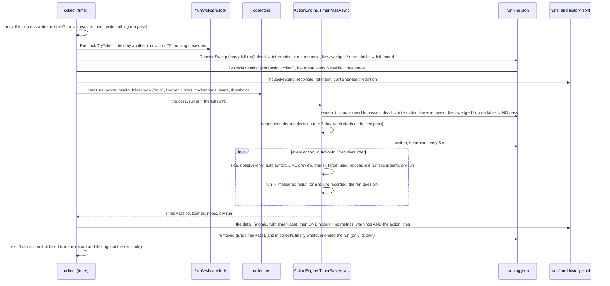

The run's `dryRun` is the pass's decision; the detail keeps every outcome with its live preview and measured result
(`RunDetail.timerPass`), the history line the per-action `{id, status, count, freedBytes, wouldFreeBytes}`
(`ActionRecords.Of`, shared with `act`). `CollectContext` gained `Actions`, `Processes` and `Signals` (no action, a table
that can tell no pid, a refusing sender by default); the CLI sets them from its host.

### `logs` and `runs` (plan §7.4)

`WslCare.Core/History`: `LogPeriod` (`today` — the default — `yesterday`, `yyyy-MM-dd`, `yyyy-MM-dd..yyyy-MM-dd`, at most 366
days; a run belongs to the UTC day it STARTED), `RunLogs` (pure over `IFileSystem`: no lock, nothing written, any user may
ask — the state is 0644) and the wire shapes (`LogsReports`). `runs` lists every run of the period: trigger, outcome, dry
run, detail state (`present` / `lost` / `none`), per-action lines, freed, would-free, and whether it was a cleanup (an
action ran and removed or freed something). `logs` answers the Logs page: freed in total and per action (runs, objects,
bytes; dry runs and what they would have freed apart), the runs with and without a cleanup, dry, by trigger, failed and
interrupted, the run that freed the most and the least (non-zero), each metric's max and min with its time and run
(`memAvailablePercent`, `memAvailableBytes`, `pageCacheBytes`, `swapUsedBytes`, `rootUsedPercent`,
`dockerReclaimableBytes`, `containerStarts24h` — absent when never recorded), and every cleanup in detail: the objects it
removed and those it did not, from the run's detail (an `act` detail's actions or a full run's `timerPass`; a lost
detail still counts from its history line, with no objects). `--action <A#>` narrows the totals, the cleanups and the run
counts to one action. Exit codes: 0 answered, 2 a period that is none of the shapes, 4 a history that exists but cannot
be read (new: `ExitCode.RecordsUnreadable`).

Since 2026-10-03: the totals, counts, extremes and metrics come from the history lines ALONE — no detail file is opened
for them (gate finding #10); the objects each cleanup removed are read from the run details only with `--detail` or one
`--action`, and from at most the newest `RunLogs.MaxDetailsRead` (50) runs (`detailsRead` / `detailsNotRead`; an unread
cleanup's state is `notRead`). A FAILED action's measured deletions count wherever a successful one's do (A4 removing 386
of 387 volumes removed 386), and its failure — on the history line since 2026-10-03 (`ActionRecord.failure`, ≤ 300
characters) — is shown beside its figures; `ActionTotal.failed` counts the runs it failed in. Readers of the line files
(`history.jsonl`, the container-start days) ignore a trailing line without its newline — a write in progress — and the
next append first ends such torn remains (`LineFiles`, gate finding #6).

### Decisions taken in E3.S3

- **Memory actions free no disk.** A1, A2, A3 (and A11) leave `freedBytes` unknown; their before / after and notes say what
  moved, and their previews count no bytes (the item carries the memory) so a dry run's would-free stays disk. `logs` sums
  disk only — A1's history line counts one operation, freed 0. A11's preview counted the memory its suspects hold as
  preview bytes until the code round (gate finding #4): it is the `heldMemoryBytes` fact now, never bytes.
- **A15 waits for `fstrim.timer`.** An enabled `fstrim.timer` already trims weekly, so the timer's A15 does not double it
  (the plan's row names only `discard`); an unread timer state does not fire either.
- **A16's two observations** are the last recorded full run's and the preview's live probe; inside the timer pass the
  full run's own observation is not recorded yet, so it is never counted twice.
- **`sync` is a bare name** resolved on `PATH` like every tool (the plan writes `/bin/sync`; the catalogue takes bare names
  only, and on Ubuntu `/bin` is `/usr/bin`).
- **`ReadCommandTemplates.SystemctlShow` / `JournalSearch`** became named members so A15 and A2 declare the SAME template
  instances the collectors use; `HealthCollector.MeasureWindowsClockAsync` is the one clock observation (the full run's
  and A16's); `ThresholdRules.IsDrift` the one drift rule.

## E3 review fixes (2026-10-03)

The epic's gate code round (session `a90e342d`) and an independent code review, every finding accepted but the gate's #5
(`pidfd_send_signal` is exported by glibc 2.39 as `pidfd_send_signal@@GLIBC_2.36` — verified). Each landed with a test that
was first seen failing for the real symptom ([module_tests.md](module_tests.md) records the red messages).

| Finding | What changed | Where |
|---|---|---|
| review 1 | A4 selects an ANONYMOUS volume only: Docker's `com.docker.volume.anonymous` label AND a 64-hex name; a hex name without the label (named to Docker 23+) and a volume missing from `system df -v` are never selected; the same rule for the first sightings, the kept list and A5's "goes with the container" | `Docker/DockerInventory` (`AnonymousVolumes`), `Preview/CleanupTargets`, `DockerCollector`, `VolumeRemoval` |
| review 2 | a failed action's measured deletions count in `logs` / `runs`, its failure beside them | `History/RunLogs`, `ActionRecord.failure` |
| review 3 | A5 counts a volume two removed containers share once | `ContainerRemoval` (one item per distinct volume, keyed by every holder) |
| review 4 | A3 refuses when the process table cannot be read again just before the command | `BuildServerShutdown` |
| review 5 | `--only` is read as a regular file only, never past the cap | `Files/RegularFiles`, `IFileSystem.ReadRegularFile` |
| review 6 | a `poll` error is a failure, never an end | `Processes/ProcessSignals` (`IPidfdCalls`) |
| review 7 | every method written in E3 at cyclomatic complexity ≤ 4 (C# doctrine §6), without a change of behaviour: conditions extracted into named predicates, chains of one-fact tests written as `Checks.All(value, tests…)` (asked in order, stopping at the first that fails), the per-outcome log line ONE `Cli/Logging/OutcomeLog` (`act` and the timer pass), the folder deletion of A12 / A14 ONE `CacheFolders.RemoveFolder` + `FolderRemovals` | across `Actions/`, `Processes/Policy/`, `History/`, `Cli/` |
| gate #0/#1 | this file's overview, verbs and actions nodes | here |
| gate #2 | an ambiguous target user refuses user-scoped actions only | `TargetHome`, `ConfigLoader`, `CliHost.LoadConfig` |
| gate #3 | an action's runner also runs the collectors' shared read templates | `ActionCommands.AsRunner` |
| gate #4 | A11's preview counts no bytes | `SuspectTermination` (`heldMemoryBytes`) |
| gate #6 | line-file readers ignore an unfinished last line; the next append ends torn remains | `Files/LineFiles`, `PhysicalFileSystem.AppendLine` |
| gate #7 | `running.json` read again before a verdict; unreadable is its own state | `RunningState` (`RunningReadRetry`, `Unreadable`), exit 79 |
| gate #8 | every full run sweeps a dead `running.json` | `RunningSweep`, `CollectRun` |
| gate #9 | A11's suspects share one grace | `PidfdProcessSignals.TerminateAllAsync` |
| gate #10 | `logs` totals from history lines alone; details only when asked, bounded | `RunLogs`, `logs --detail` |
| gate #11 | `collect` holds its own `running.json` | `CollectRun` |

## The installer, the units and the release pipeline (E4.S1, E4.S2) — in module_daemon.md

Moved on 2026-10-12 to [module_daemon.md](module_daemon.md) § *Story history*, unchanged apart from heading levels and the
cross-references the move made wrong, to keep this file well under the conventions resolver's 256 KiB per-file limit.
In short:

- **The installer and the units (E4.S1).** `install.sh` (POSIX `sh`, run as root by `curl … | sudo sh`) is the install
  trust boundary. The `.sha256` proves integrity only; authenticity is the build-provenance attestation, verified by root
  from a fetched bundle with no login and pinned to the EXACT identity `release.yml@refs/tags/daemon-v<version>` (gh ≥
  2.56.0, asked before any download; `--skip-attestation` proceeds only with a banner, the checksum still applied). Every
  write goes through `run` (`--dry-run` only prints it), every wait but `apt-get install` has a ceiling, a failed step
  exits 1 naming it, and `--purge` removes the state only while it holds the run lock. Then the units
  (`wsl-care.service` / `.timer`, `wsl-care-events.service`, `wsl-care-watch.service` / `.timer`,
  `wsl-care-act@.service`), the hardening decided per action (with the snap-Docker risk kept on purpose), the
  deliberately empty machine layer and the `InstallWorld` scenario harness.
- **The release pipeline (E4.S2).** A daemon release is the tag `daemon-v<version>` — created by release-please as an
  ordinary tag push, the only trigger — plus a GitHub release holding, per RID, an archive, its `.sha256` and a
  build-provenance attestation signed by `release.yml`. A guard, three per-RID build legs (tests, AOT, smoke, package,
  attest) and ONE publish job, the only one holding `contents: write`, that verifies the built set, uploads it to the
  draft, verifies it again from the draft and makes the release public last; a red run leaves an invisible draft (fix
  forward, never move or delete the tag). Then the shared scripts, what makes a daemon release, the first version, the
  owner-applied settings as files, and the tests that keep all of it equal.

## The verdicts in `status`, `productVersion` and the golden contracts (E5.S0)

The read-only panel of E5 colours its status bar from verdicts, and `status --json` had only figures (plan §15g B1).
E5.S0 adds two members to it, both additive, `schemaVersion` still 1, riding `daemon-v0.1.0`:

- **`verdicts`** — the SAME `Verdict` records and ids a full run writes into its detail (`RunDetail.Thresholds`), in the
  same order, from ONE evaluator. `ThresholdRules.Evaluate` was split, without a behaviour change, into
  `FromSample` (the eight thresholds a fast sample decides: `memory.available`, `.pageCache`, `.inactiveAnon`, `.swap`,
  `.fragmentation`, `.pressure`, `wslconfig.memory`, `disk.root`) and the full-run rest; `UnreadFullRun(config)` evaluates
  the rest over inputs that were NOT read, so a reader takes the ids, the order and the limits in force from the rules
  themselves — no second list of ids exists. `StatusVerdicts.From` (`WslCare.Core/Status`) answers:
  - the sample's eight, evaluated NOW over `status`'s own sample with the effective configuration — a threshold changed in
    a configuration layer moves them at once; `basis: {source: "sample", evaluatedAt: <the sample's instant>,
    ageSeconds: 0}`. The VM-ceiling verdict's level is the memory's; its value says the `.wslconfig` audit is a full run's
    (read through the Windows profile the clock probe prints, a slow process `status` never starts);
  - every other id carried EXACTLY as the newest full run recorded it, with `basis: {source: "fullRun", runId,
    evaluatedAt: <that run's end>, ageSeconds}`; or `unknown` under the limit the configuration puts in force, with the
    reason: no full run yet, a full run whose detail is gone or does not parse, a run that recorded no verdict for that id.
    A carried verdict keeps the limit its run applied (its `limit` says which); a setting changed since reaches it at the
    next full run — status never re-judges a figure it did not read.
  - `FullRunVerdicts.Read` finds the newest FULL run (a `collect` history line — the only kind carrying the slow parts —
    that names its detail; `act` lines and the reconcile's `interrupted` lines are not full runs) and reads ONE file, its
    detail, through a narrow DTO (`RunDetailVerdicts`: the head and `thresholds`), normalising null strings (C# doctrine
    §4a). `status` reads `history.jsonl` once for the slow parts and the verdicts (`LastFullRun.From`).
  - **E15.S5, Windows memory pressure** ([module_daemon.md](module_daemon.md) § *Windows memory pressure*): the full run judges
    `host.commit` and `host.compression` from the Windows disk script (no `host.vmmem`: the script reads no vmmem), so the
    distro's `status` carries those two from the full run. On the Windows binary ONLY, `StatusVerdicts.From` judges the `host.*`
    rule (`HostRules`) over its OWN sample; a sampled verdict REPLACES the carried full-run verdict of the same id in its place,
    and one nothing carried (`host.vmmem`) is appended after the carried ones, so no id is listed twice. The extension's status
    bar colours on `host.*` ([module_vs_code.md](module_vs_code.md)).
- **`productVersion`** — the assembly's informational version, `Program.VersionText`, the ONE expression `--version` prints
  too (`0.0.0+<sha>` before the first release). The default JSON encoder writes the `+` as `\u002B`; a reader parses.
- The text form adds one line, `verdicts: 1 critical (memory.fragmentation), 2 warn (…), 12 ok, 8 unknown`.

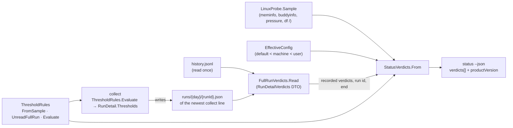

**The compatibility rule** (plan §6, §15g M2) — written before the first public consumer reads these answers:
`schemaVersion` changes only on a BREAKING change (a field removed, renamed, retyped or its meaning changed); an
ADDITIVE field never bumps it. A client ignores keys it does not know and treats every field added after 0.1.0 —
`verdicts` and `productVersion` are the first two — as optional, an absent one reading as "update the daemon to see
this", never as 0 or an error. Refusal is per verb. The extension's client tests replay every golden set present: `head`
now, and `daemon-0.1.0` once it is frozen at the E5 live gate.

**The golden contracts** (`contracts/golden/head/{status,preview,doctor}.json`, plan §15f #10, §15g m7). Written by
`WslCare.Scenarios/GoldenContracts` on the Linux legs: the BUILT CLI over the captured procfs, Docker and health
fixtures, every age limit at 0 (`PreviewFlows.AllAges`, so the rows do not move as the fixtures age), one `collect`
first, then the three verbs. Every value that moves between two runs of one build over one fixture set is replaced by a
fixed value of the same type, through a NAMED, reviewed list — paths (`**.sampledAt`, `**.sampleMilliseconds`,
`**.ageSeconds`, `**.ageSeconds.value`, `**.evaluatedAt`, `**.runId`, `checkedAt`, `productVersion`, `vm.disk.*`,
`slow.windowsClock.offsetSeconds`, `containerStarts.from|to`, `containerStarts.gaps[*].from|to`), objects picked by a key
(`id: disk.root`, `id: journal.history`, `id: clock.drift`, `component: wsl-care`) and run ids quoted inside sentences;
the sandbox root becomes `/golden-root`. A verdict whose figure moves with the clock is fixed to the CONCRETE value it had
at the capture — `journal.history` 0.8 days (the health capture's instant minus the oldest entry), `clock.drift` +0.19 s
(the clock probe's process start minus that instant, so `ok` with the product's own sentence) — never to placeholder
prose a client would render as a figure (E5 code round #1). Part 4 of the list is IDENTITY: `FixtureIdentity.Rules`, the
same rules the captured fixtures were anonymised with, applied to every string after the sandbox root is rewritten —
the sandbox's own home (`/golden-root/home/me`) becomes `/home/user` like any other — so a golden regenerated from a new
capture is anonymised by the code that anonymised the capture; part-4 rules need not match (they guard a future
capture, and `FixturePrivacyTests` proves the files). `productVersion` and doctor's own version become `unknown` — the release number
moves at every release-please bump and a golden pinned to it would turn the release pull request red. `GoldenContractTests`
fails when a checked-in file is not what the CLI answers at that commit (naming the file and the first differing line)
and when a rule no longer matches anything; `WSL_CARE_WRITE_GOLDENS=1` regenerates them. The set frozen at the tag,
`contracts/golden/daemon-0.1.0/`, is an E5 live-gate step, not part of E5.S0. The goldens are test data and never ship.

## The extension's E5: client, panel and polling, *Install daemon* and packaging (E5.S1–E5.S3) — in module_vs_code.md

Moved on 2026-10-12 to [module_vs_code.md](module_vs_code.md) § *Story history*, unchanged apart from heading levels and
the cross-references the move made wrong, to keep this file well under the conventions resolver's 256 KiB per-file
limit — all of it but **the panel's field map, which stays below**: `fieldMap.test.ts` and `npm run fieldmap:doc` read
it from this file. In short:

- **Client, runner and fake (E5.S1).** The extension runs in the Windows extension host (`extensionKind: ["ui"]`) and
  reaches the daemon only by starting the absolute `%SystemRoot%\System32\wsl.exe`, with argv built in ONE module, over
  a closed set of four read-only verbs — root-free, held by structural and bundle tests. It asks whether the distribution
  is running first and makes no `-d` call when it is not, so polling never starts the VM. Then the runner and its
  selection (in Test mode the strict fake, or a closed runner that starts nothing — no test can reach the real
  `wsl.exe`), the reading of failures and of the schema handshake, the per-verb ceilings and `ci · extension`.
- **Status bar, read-only panel and polling (E5.S2).** ONE store of the newest outcome per verb feeds both the status bar
  and a `WebviewView` panel rendered from the field map. The webview rules (a static shell, a nonce CSP, a DOM built by
  `createElement` / `textContent` only, a closed message set); the polling policy (only the focused window polls, and
  only `status`; *Start WSL and check* is the one call that may start the distribution; a distribution switch never mixes
  two distributions — except, stated there as not covered, a WSL default changed mid-round while `wslCare.distro` is
  empty); its tests.
- **Install daemon, packaging and its release (E5.S3).** *Install daemon* TYPES a pinned installer command into a
  terminal and never runs it; the `.vsix` (one `win32-x64` package since E7.S5a) is checked as an artefact — an
  allowlist, leak checks, the build stamp, the minimum daemon held equal in three places; `release-extension.yml`
  publishes the GitHub draft first, the Marketplace second, public last, behind a guard; then the client behaviours and
  fixes of the gate and code rounds, and their tests.

### The panel's field map (plan §15g B2)

Generated from `src_vs_code/src/panel/fieldMap.ts` — the table the renderer reads — by `npm run fieldmap:doc`;
`fieldMap.test.ts` fails while this block and the code differ, and `viewModel.test.ts` fails when a READ row's path is
absent from the head goldens. *Refresh trigger*: a `status` row is refreshed by every poll of the focused window and on
panel open / Refresh; a `preview` / `doctor` row only on panel open / Refresh.

<!-- field-map:begin (generated from src_vs_code/src/panel/fieldMap.ts by npm run fieldmap:doc) -->
| Section | Row | JSON path | Verb | Refresh trigger | In E5 |
|---|---|---|---|---|---|
| Memory | VM ceiling (MemTotal) | `vm.memory.total` | `status --json` | status poll (focused window) + panel open / Refresh | yes |
| Memory | Available (MemAvailable) | `vm.memory.memAvailable` | `status --json` | status poll (focused window) + panel open / Refresh | yes |
| Memory | Available, share of the ceiling | `vm.memory.availablePercent` | `status --json` | status poll (focused window) + panel open / Refresh | yes |
| Memory | Free | `vm.memory.free` | `status --json` | status poll (focused window) + panel open / Refresh | yes |
| Memory | Page cache | `vm.memory.pageCache` | `status --json` | status poll (focused window) + panel open / Refresh | yes |
| Memory | Inactive anonymous | `vm.memory.inactiveAnon` | `status --json` | status poll (focused window) + panel open / Refresh | yes |
| Memory | Anonymous | `vm.memory.anonPages` | `status --json` | status poll (focused window) + panel open / Refresh | yes |
| Memory | Shared memory (shmem) | `vm.memory.shmem` | `status --json` | status poll (focused window) + panel open / Refresh | yes |
| Memory | Fragmentation | `vm.memory.fragmentation` | `status --json` | status poll (focused window) + panel open / Refresh | yes |
| Memory | Unattributed | `vm.unattributed` | `status --json` | status poll (focused window) + panel open / Refresh | yes |
| Memory | MemAvailable today (sparkline) | — | — | — | arrives in E6 — needs the logs / runs verbs |
| Memory | vmmemWSL | — | — | — | arrives in E7 — read by wsl-care.exe on the Windows side (E7.S3) |
| Memory | Host RAM | — | — | — | arrives in E7 — read by wsl-care.exe on the Windows side (E7.S3) |
| Top holders | Top processes by held memory | `vm.processes.top` | `status --json` | status poll (focused window) + panel open / Refresh | yes |
| Top holders | Process families | `vm.processes.families` | `status --json` | status poll (focused window) + panel open / Refresh | yes |
| Top holders | Containers by memory (docker stats) | `slow.containerStats` | `status --json` | status poll (focused window) + panel open / Refresh | yes |
| Top holders | Processes working under /mnt | `vm.processes.mntWalkers` | `status --json` | status poll (focused window) + panel open / Refresh | yes |
| Swap | Swap used | `vm.memory.swapUsed` | `status --json` | status poll (focused window) + panel open / Refresh | yes |
| Swap | Swap total | `vm.memory.swapTotal` | `status --json` | status poll (focused window) + panel open / Refresh | yes |
| Swap | Swap trend today | — | — | — | arrives in E6 — needs the logs / runs verbs |
| Disk | The distribution's / file system | `vm.disk` | `status --json` | status poll (focused window) + panel open / Refresh | yes |
| Disk | Windows volumes: worst free | `verdicts[id=disk.volumeFree]` | `status --json` | status poll (focused window) + panel open / Refresh | yes |
| Disk | Virtual disks: file − guest = gap (E15.S2) | `verdicts[id=disk.vhdxGap]` | `status --json` | status poll (focused window) + panel open / Refresh | yes |
| Folders | Big folders (the daily walk) | `folders` | `status --json` | status poll (focused window) + panel open / Refresh | yes |
| Containers | Running now | `vm.containers` | `status --json` | status poll (focused window) + panel open / Refresh | yes |
| Containers | Docker engine | `docker` | `preview --all --json` | panel open / Refresh | yes |
| Containers | Docker totals (docker system df) | `totals` | `preview --all --json` | panel open / Refresh | yes |
| Container starts | Started in the last 24 h | `containerStarts` | `status --json` | status poll (focused window) + panel open / Refresh | yes |
| Cleanup | Cleanup candidates | `rows` | `preview --all --json` | panel open / Refresh | yes |
| Cleanup | Kept named volumes (never cleaned) | `kept` | `preview --all --json` | panel open / Refresh | yes |
| Cleanup | Containers logging without max-size | `hygiene.unboundedLogs` | `preview --all --json` | panel open / Refresh | yes |
| Cleanup | Builder garbage collection (daemon.json) | `hygiene.builderGc` | `preview --all --json` | panel open / Refresh | yes |
| Cleanup | Forgotten buildx builders | `hygiene.buildkit` | `preview --all --json` | panel open / Refresh | yes |
| Health | Daemon version | `productVersion` | `status --json` | status poll (focused window) + panel open / Refresh | yes |
| Health | Healthy | `healthy` | `doctor --json` | panel open / Refresh | yes |
| Health | Last full run | `checks[id=lastRun]` | `doctor --json` | panel open / Refresh | yes |
| Health | Configuration error | `configError` | `doctor --json` | panel open / Refresh | yes |
| Health | Checks | `checks` | `doctor --json` | panel open / Refresh | yes |
| Health | Versions | `versions` | `doctor --json` | panel open / Refresh | yes |
| Health | Verdicts | `verdicts` | `status --json` | status poll (focused window) + panel open / Refresh | yes |
| Health | Clock jumps | `verdicts[id=clock.jumps]` | `status --json` | status poll (focused window) + panel open / Refresh | yes |
| Health | Journal history | `verdicts[id=journal.history]` | `status --json` | status poll (focused window) + panel open / Refresh | yes |
| Health | Warnings since the last full run | — | — | — | arrives in E6 — needs the logs / runs verbs |
| AI agents | AI agents (both sides, Add CLI path) | — | — | — | arrives in E7 — needs the agents list verb (E7) |
| Last cleanup | Last cleanup | `lastCleanup` | `status --json` | status poll (focused window) + panel open / Refresh | yes |
<!-- field-map:end -->

## The daemon: E6 — the read contract, the detached runs

In [architecture-daemon-e6.md](architecture-daemon-e6.md) (moved there on 2026-10-06 to keep this file under the conventions resolver's 256 KiB): *The daemon read
contract (E6.S0)* with its review round, and *Detached runs, the request, the stop (E6.S1)* with its review round, the
coai E6 code round and *A full check's history line names itself — `kind`* (plan §15o).

## The configuration trust (E7.S0, 2026-10-05, plan §15q R1)

The root timer reads the TARGET user's configuration layer every 4 h, and `config set` — run by that user — writes it. So
the layer is a write path into what root does. The premise that makes trusting it acceptable is WSL interop: with it any
process of that account can already run `wsl.exe -u root` (a confused-deputy boundary, not a privilege one — plan §15,
§15f #2). The design rests on that premise and holds without it:

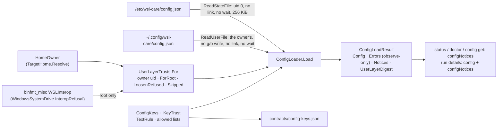

- **No key is free text** (review B1, a live bug before E7.S0): a `TextKey` carries a `TextRule` — `OneOf` (the log level),
  `Matching` (the unused `distro`), `AbsolutePathOrEmpty` (`archive.baseFolder`) — and a `TextListKey` its allowed set.
  `processes.families` ⊆ `ProcessFamilies.ChoosableForA11` = the catalogue without `other` (the catch-all: root's A11 would
  have ended every account's idle orphans) and `ai-agents`. A path key is machine-only (`config set` refuses it, a user value
  is a notice). None exists today: `archive.baseFolder` was one until E9.S0, when the archive's mover became the target user's own process (plan §15r D1) and its folder rules a judgement of that process (*The AI-session archive* below). Tests: `ConfigKeyClosureTests`, `ConfigKeyShapeTests` (every
  number slot a key fills accepts exactly that key's range), `ArchitectureTests.No_policy_or_protected_roots_type_reads_the_configuration`.
- **`KeyTrust` per key**: the `SafeDirection` (`higher` / `lower` / `on` / `off` / `subset` / `none`), `TightenOnlyForRoot`
  (`logging.*`: root's audit log is not the user's to steer), `MachineOnly`, `DaemonUnused` (`distro`, `refreshSeconds`),
  `ZeroIsUnbounded` (`logging.retentionDays`). `KeySafety.IsNoLooser` is the ONE comparison; the extension's loosening
  modal (E7.S3) reads the same direction from `contracts/config-keys.json`.
- **`UserLayerTrust`** (decided once per host in `CliHost.LoadConfig`): an unprivileged run trusts its own layer fully;
  root working for the target user requires that user to own the file and takes `TightenOnlyForRoot` keys only in their safe
  direction; when interop is absent or disabled, EVERY root-effective user value is taken only in its safe direction —
  the target user is kept (not `HomeOwner.Unknown`, which would refuse every user-scoped action, review M3). A value not
  taken is a `ConfigNotice`, never an error: the run is not observe-only.
- **The readers, per class** (review M2): the machine layer as root's own state file; the user layer and the target user's
  own files (nvm's alias, Playwright's link files and `browsers.json`, the editor's `.obsolete`) by `ReadUserFile` — the
  owner's, no group / other write, `O_NOFOLLOW` + `O_NONBLOCK`, one `statx` of the open descriptor, a cap; the Windows profile
  through drvfs (`.wslconfig`, Docker Desktop's `daemon.json`) by `ReadNoFollowFile` — no link, no wait, a cap, and NO owner
  or mode check (drvfs reports every file as the mount's uid, 0777). A group-writable user layer is refused naming
  `chmod go-w` (`config set` writes 0644 whatever the umask; a WSL Ubuntu login shell's umask measured 0022). Under a sandbox
  `PhysicalFileSystem.OwnersAreThisProcess` maps every owner to this process. `UserConfigWriter` reads the layer it rewrites
  through the bounded `ReadRegularFile`, so a FIFO there is moved aside, never waited on.
- **Every read classified** — `ArchitectureTests.Every_read_is_classified_by_whose_file_it_names_and_uses_that_class_s_reader`
  holds a table of every read call in the product (file → call → count → whose file) and fails on a new or a stale site, and
  on a class that someone else controls read without its hardened reader. Residual, stated in the table: a LISTING of a
  target-home folder that is itself a link lists through it (names only, nothing read).
- **The E7.S0 review round** (plan §15q) tightened four things: (S1, S6) `BeneathFiles` — a file someone else controls
  is reached from a trusted folder (the home; the folder holding a drive letter's folder) through NO link: every folder
  below it opened from the previous descriptor with `O_PATH | O_DIRECTORY | O_NOFOLLOW`, the file with `O_NOFOLLOW |
  O_NONBLOCK`, so a linked `~/.config/wsl-care` or `…/.docker` cannot take root's read elsewhere, and the refusal names the
  component only; a Windows profile with a `..` segment is not a drive path. (C2) An unprivileged run inside the distro
  also reads its layer as the root timer would (`UserLayerTrust.RootTimerReads`) and says which values root ignores.
  (C3) `config set` replaces a linked layer's LINK with a regular file (`IFileSystem.ReplaceLinkWithFile`, judged where the
  link itself lives). (C1) An observe-only run prunes no log folder. And outside this module: A11's suspects are the
  TARGET user's processes only (S7), and `doctor`'s text is printable (S4).
- **Visible**: `status --json` carries `configNotices` and `userLayerDigest` (the SHA-256 of the user layer as read);
  `doctor --json` and `config get --json` carry `configNotices`; every run detail (`collect`'s and `act`'s) carries `config`
  — every setting the run used that did not come from the defaults, with its layer — and `configNotices`. All additive,
  absent when empty (`schemaVersion` 1). Capability `config.contract`.

## The AI agents: catalogue, discovery, the walk (E7.S1, 2026-10-05, plan §15q D1–D3, R2)

Which AI coding agents live in this home, and how much their folders hold — measured without reading, moving or
deleting anything inside them (plan §4.6 H1–H3).

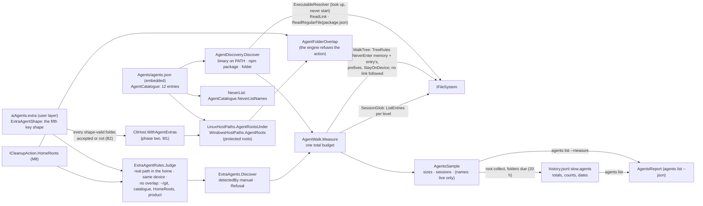

- **The catalogue** is data, not code: `Agents/agents.json`, embedded (`WslCare.Core.Agents.agents.json`), read once
  (`AgentCatalogue.Agents`). Per agent: binaries, npm packages, data folders per side (`~/…`; `%USERPROFILE%`,
  `%APPDATA%`, `%LOCALAPPDATA%` …), `neverEnter` names and `neverEnterPrefixes` (Gemini CLI's `antigravity*`, so one agent
  is not counted inside another), a version regular expression over a link target, and the session layout of the four
  CONFIRMED agents (D2: a glob of one name pattern per level under a folder). The protected roots of both sides and the
  never-list's agent names are DERIVED from it — before E7.S1 they were two hand-typed lists — and
  `AgentCatalogueTests` holds them equal.
- **Discovery** (`AgentDiscovery.Discover(paths, files, PATH, asRoot)`) takes no command runner — the structure is D3's
  guarantee, and a test holds it: a binary is looked up with `ExecutableResolver`, never started; a version comes from
  the binary's link target (`…/versions/<v>`) or the npm package's `package.json` (`ReadRegularFile`, 1 MiB cap), else
  "not asked". As ROOT only folders count: root neither searches the user's `PATH` nor reads their packages.
- **The walk** (`AgentWalk`): per folder `IFileSystem.WalkTree` → `TreeWalk.Measure` with `AgentWalk.RulesFor(entry)` —
  `memory` never entered for ANY agent (a manual entry too, H2), the entry's names and prefixes never entered, no link
  followed, and `StayOnDevice`: every folder's device (`statx`, no follow) compared with the root's, a different one not
  entered and named "<subdir> (different filesystem)" (review C1 — a nested bind mount onto `/mnt/c` would drag the walk
  onto 9p). ONE budget for the whole walk (review M7): 3 min inside `collect`, 60 s for `agents list --measure`; each folder
  gets the per-folder ceiling or what is left, whichever is less, and a folder the budget did not reach says
  `NotReached`, never 0. Sessions (`SessionGlob`) are counted from LISTINGS only: each level's matching folders entered
  (never `memory`), the matching files of the last level taken with the length and last write the listing gives — no
  file is opened (`AgentNoOpenTests`: an inotify `IN_OPEN | IN_ACCESS` watch on every folder sees nothing during a walk,
  and its companion sees a file opened).
- **Recording** (`CollectRun.WalkAgents`): a root `collect` whose folder walk is due walks the agents found by FOLDER
  (discovery as root) and records `slow.agents` on the history line — totals, counts, dates; the five largest sessions by
  name are a live answer only (`AgentSize.Largest` is null in what is persisted). `LastFullRun` reads it back with its age,
  and the previous one for growth. The walk runs on the Linux side only; the Windows binary answers `agents list
  --measure` and reads no history.
- **`agents list [--measure] [--json]`** (`AgentsCommand`): discovery as the invoking process, sizes from the newest full
  run (`sizes.source: fullRun`, its run id and age), measured now (`now`), or `none` with the reason; per agent the
  detection, binaries, version, data folders (size, files, complete, excluded), sessions (counted or "—" with why),
  `totalBytes`, `growthBytes`, warnings (`aiAgents.warnGb`, `aiAgents.sessionWarnMb`). Capability `agents.list`;
  `contracts/golden/head/agents-list.json` is its golden.
- **Read sites**: `AgentDiscovery` (one `ReadRegularFile` of the invoking user's own `package.json` — the class
  `OwnUnprivileged`, never run as root — and one `ListEntries`), `AgentWalk` (`WalkTree`), `SessionGlob` (`ListEntries`) are
  rows of the read-site table (`ArchitectureTests.ReadSites.cs`); `WalkTree` and `ListEntries` are target-home metadata.
- **An agent's total** is unavailable — with the reason — when any folder of it was not measured (not reached, unreadable,
  a manual agent's folder refused); a folder that does not exist counts as nothing; `growthBytes` only between two whole
  walks (E7.S2: before it, a not-reached folder added 0 to an "available" total).

### Manual agents and `agents probe` (E7.S2, 2026-10-05, plan §15q D4, R2)

- **`aiAgents.extra`** is the fifth key shape (`ConfigKey.AgentListKey`, `ConfigValue.AgentList`): at most 16 entries
  `{cli, side, name, dataFolders[1–8], sessionGlob}`, the SHAPE checked by `ExtraAgentShape` at load and at `config set`
  (absolute paths of their side, no `.`/`..` segment, no leading `-`, no control character, ≤ 1 024 characters; a name of
  letters, digits, space, `.`, `_`, `+`, `-` anchored with `\z`; a glob of `[A-Za-z0-9._*-]` segments and whole `**`).
  `config set aiAgents.extra -` reads the list from STDIN only (`StdinList`, 1 MiB, 10 s) and refuses an entry the rules
  refuse, writing nothing. Its `KeyTrust` has no safe direction: root takes it as DATA and judges it again on every read,
  and it can only ADD protection.
- **The rules** (`ExtraAgentRules.Judge`, R2.1): every data folder's REAL path (`IFileSystem.ResolvePath`) must lie strictly
  inside the target home's real path, on its device (`IFileSystem.DeviceOf`), and must not overlap (equal, inside,
  containing) `~/git`, Claude's temp folders, a catalogue agent's folder, any `ICleanupAction.HomeRoots` folder of the
  product registry (review M8: A8 `~/.npm`, A12 the Playwright and NuGet caches, A14 the editor servers, A17 the pnpm /
  uv / pip caches — `ActionHomeRootsTests` holds every user-scoped action to its declaration by a source scan) or the
  product's own folders (review M9). Only the distro's entries are judged by the Linux binary; Windows entries wait for
  E7.S5b.
- **Discovery and the walk** (`ExtraAgents.Discover`): one presence per entry, `detectedBy: ["manual"]`, id
  `manual:<name>`; an accepted one is walked like a catalogue agent (memory never entered, its own glob — `**` supported —
  under its first folder); a refused one stays in the answer, not walked, every figure saying "not walked: <rule>". The
  entry's `cli` is never handed to the file system (a recording double holds it).
- **Protection, two-phase host** (review M1, B2): `CliHost.WithAgentExtras` (called by `Program.Main` right after the
  configuration is loaded) adds every shape-valid folder of this side — accepted or not — to `AgentRoots` and rebuilds the
  file system (`CliHost.Rewire`), so the run's deletion policy holds them; `ProtectedRoots` keeps both the real path and the
  spelling of every agent root. `AgentFolderOverlap` (asked by the engine for every preview) refuses an action whose
  `HomeRoots` folder overlaps any agent root — a command-based cleanup cannot be policed by the deletion policy.
- **`agents probe <path> [--json]`** (`AgentProbe`, D4): unprivileged only (as root: exit 81 `NotAsRoot`, naming uid 0
  and the default-user fix); the file is looked at (`FileExists`, an execute bit via `ExecutableResolver.IsStartable`,
  `ReadLink`) — never started, never read; a name from the FILE NAME; the conventional folders `~/.<name>`,
  `~/.config/<name>`, `~/.local/share/<name>`, `~/.cache/<name>` that exist, measured and judged by the same rules; the
  suggested entry holds the ones that pass. Capabilities `agents.probe`, `config.agentsExtra`.

### What the E7.S1/S2 review round changed (2026-10-05, plan §15q *E7.S1/S2 review round*)

- **Discovery's folders** (R1): the fixed bin list `TargetUserCommands` uses for the target user (nvm's default, `~/.local/bin`,
  `~/.cargo/bin`, `~/.npm-global/bin`, `/usr/local/bin`, `/usr/bin`), then only the PATH entries that are neither under the
  automount root nor on another filesystem than `/` — the PATH `wsl.exe --exec` gives holds none of the user's folders and 30+
  Windows ones (`research/2026-10-03_wsl_exe_facts.md` row 21); the lookup is bounded by `Processes.Bounded.Run` (one helper,
  shared with the system-drive lookup). **Versions** (R3) follow the found binary's whole link chain.
- **Where a walk may start** (S3, S3d): `AgentWalk.PlaceProblem` before every folder walk and session listing, catalogue and
  manual alike: the real path must be the spelled place under the home's real path, and on the home's device. The listing
  (`SessionGlob`, R4) lists each folder once, keeps its device, asks the deadline and the token before every listing, and an
  intermediate stop is "not counted". Never-enter names are compared case-insensitively (S8); a walk whose ROOT is a
  never-enter folder is refused (S2); a manual folder at or under `memory` is refused by the rules (S2).
- **One session** (R7): layouts carry `companions`; a session's size is its transcript plus its companions, measured by stat
  and the walk's rules. **Persisted names** (R9): `slow.agents` keeps "N folder(s) on another filesystem", never the names.
- **Figures** (R2, R6): a cut total keeps its reason; growth needs two whole walks; an unmeasured folder has no file count.
- **Protection bounded** (S1): `Cli/ExtraRoots` keeps a manual folder (spelt and real) only inside a protected home, never a
  filesystem root, never equal to or holding the product's folders — the rest a configuration notice. **The overlap refusal
  first** (R8): `AgentFolderOverlap` replaces an action's own refusal, and a built-CLI scenario holds phase two.
- **Command cleanups ask their tool** (S4): A8 and A17 run the tool's own "where is your cache" template as the target user
  and refuse a cache inside an AI agent folder (`CacheFolders.ConfiguredCacheRefusal`, `AgentFolderOverlap.Refusal(context,
  folder, display)`). Residual: a cache moved only by a shell variable is not seen (the tools run with a clean environment).
- **Smaller** (R10–R13): a user layer that would render past its reader's cap is not written (`UserConfigWriteResult.TooLarge`);
  the probe asks `access(X_OK)` (`RegularFiles.MayExecute`); `config set` / `config reset` as root exit 81 (`NotAsRoot`);
  tuples became records and `DiscoverySide` a closed hierarchy.

## A18 — orphaned AI-agent processes (E7.S2b, 2026-10-05, owner decision)

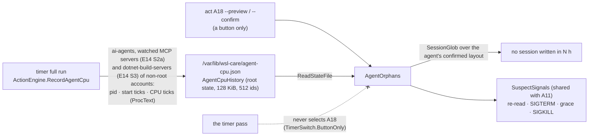

- **Button only, by structure:** `ActionId.Timer` is `Auto(key)` or `ButtonOnly(why)`; A18 has no `auto.*` key, the timer pass
  selects only `Auto` ids, and the engine's timer gate skips a button-only id asked directly; its trigger never fires.
- **Idle is measured:** every TIMER full run records each `ai-agents` process of a non-root account (since E14 also each watched MCP server, for A19, and each `dotnet-build-servers` process, for A3's timer) by identity — pid, the boot
  id, start ticks (stat field 22) — with its CPU ticks and since when they have not changed (`AgentCpuHistory.Next`: a new
  identity, a moved tick, another start or another boot starts the clock now; dead identities are pruned). A process is
  eligible only when `now − unchanged since ≥ processes.aiAgentsIdleHours` (default 4, 1–168, safe higher). A preview writes
  no state.
- **Eligible = all of:** the target user's, re-parented, no terminal, not a zombie, attributed to exactly one catalogue agent
  whose session layout is confirmed, idle as above, and no session file of that agent written in the same window (listing
  + stat; a cut listing keeps it). Every kept process is counted with its reason in the preview's basis.
- **Ending:** `SuspectSignals` — extracted from A11, used by both: each target re-read (same start, no CPU since the preview,
  no terminal, the same account), one SIGTERM each, one shared grace (`processes.termGraceSeconds`, 10 s), SIGKILL to the survivors, each outcome in the record.
- **E7.S2b/S2c review round (2026-10-06):** a BUTTON run is bound to its modal like A4 — the preview answers `pid:start` keys,
  `act … --process <pid:start>` (and a detached request's `shownProcesses`) passes them back, a manual run without them is refused,
  a run ends only the keys still eligible. Eligibility also needs: parent pid 1 (never a `systemd --user` service), no child
  process, the program resolving into the agent's own install (`/proc/<pid>/exe` or the script node runs, along its links), an
  environment that moves no agent home, at least one session found. Idle is the SHORTER of the wall and the monotonic clock over
  a dense chain of sightings (no gap over two timer periods). `agent-cpu.json` is 0600; past its cap the oldest go.

## MCP server instances of the AI agents (E7.S2d, 2026-10-06, owner request)

A collector over the one process snapshot — read-only towards the servers — and the `status --json` `mcpServers` block (also
in every run detail), three verdicts (`mcp.instances`, `mcp.cpu`, `mcp.starts`) and the `mcpServers.*` keys; the Windows
binary answers it unavailable (E11). Since E14 S1 (2026-10-07) an instance's CPU is measured over the interval since its
previous sample from a per-caller ledger (`mcp-cpu.json`: root's under `/var/lib/wsl-care`, an unprivileged `status`'s under
`$XDG_STATE_HOME/wsl-care`), the 1 s window only a fallback. Since E14 S2a/S2c (2026-10-08) A19 stops idle instances — and since S2b (2026-10-09) those busy without a log write for
`mcpWatchdog.busyMinutes`, from root's interval evidence that the watch (`wsl-care-watch.timer`, every 5 minutes, `watch --timer`)
records; the 4-hour timer's full run now waits `requests.lockWaitSeconds` for a lock the watch holds — and the
user may add their own servers by program file name (`mcpServers.programs`, a rule-bound open list — the first list key that
is not closed over a catalogue; `ConfigKey.TextListKey` carries a member rule and a cap). The module, its diagram, entities, flows and residuals: [module_mcp_servers.md](module_mcp_servers.md).

## The "machine busy" signal (E14 S6, 2026-10-09)

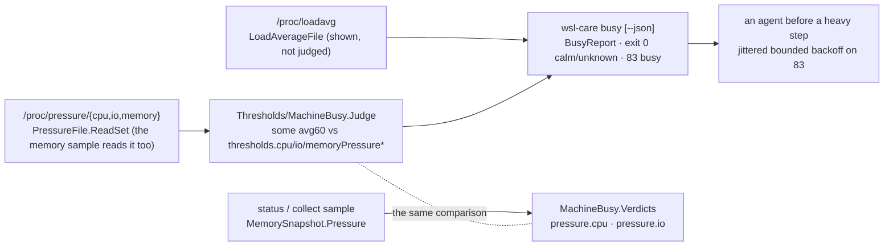

One pure rule (`MachineBusy.Judge`) answers whether heavy work may START now: busy when a read pressure is above its key, calm
only when all three were read, unknown otherwise (never calm by absence). The verb reads two kernel files and the
configuration and nothing else (no process walk, no write but its own run log, any user); `status` judges the same comparison as two verdicts
after `memory.pressure`, from the sample's own PSI. The agent-side contract (exit 0 go, 83 wait with a jittered bounded
backoff, any other code a broken signal: say so and go) is in the README's *Busy* section. Advice only: nothing is started or
stopped because of it.

**Then, how heavy work runs (E14 S4, 2026-10-09):** at `nice -n 19`, in the session's own shell, with
`--disable-build-servers` for a `dotnet` build — documentation, no verb. WSL puts every session and everything it starts in
`/init.scope` and the kernel has no autogroup, so `nice` orders a build against the sessions (68 : 1 measured); a
`systemd-run --user --scope` would move it to `user.slice`, a root-level sibling, where it got 7–21× more CPU than a session's
process (three runs). `dotnet test` under MTP takes no `--disable-build-servers`: build first, then run the tests
without building. The units' `Nice=19` likewise orders the daemon's own run only inside `system.slice`
([2026-10-09_cpu_fairness.md](2026-10-09_cpu_fairness.md), [module_daemon.md](module_daemon.md) § *CPU fairness*).

## The AI-session archive (E9.S0, 2026-10-06, plan §15r)

The archive moves AI-agent sessions older than a configured age into a base folder the user chose, as that user, in two
runs (copy, verify, index; then a later run re-hashes and removes the source). Built: E9.S0 (catalogue blocks, keys, base
rules, `archive check-base`), E9.S1 (selection, `archive preview`), E9.S2a (the file seam `IArchiveFiles`), E9.S2b (`archive run` /
`status` / `reconcile --scan`: the two phases, the MAC'd month index, the lease, the reconcile), E9.S3 (`archive restore` / `list`),
E9.S4 (A13 and A20 in root's engine, the user's own process doing every byte), E9.S5 (the Windows side's open-file check).
Everything about it — purpose, diagrams, entities, verbs, the seam's guarantees and each story's history — is in
[module_archive.md](module_archive.md) (moved there 2026-10-07 to keep this file under the conventions' size cap).

**Across modules on the Windows side (E9.S5).** The archive's open-file check reads two things outside `Archive/`: the Windows
Restart Manager (`rstrtmgr.dll`, asked per unit — never an open of a session file — with the file system's own list of users for a
path past `MAX_PATH`), and the Windows process table of the MCP servers' status (E14 S7a, `Mcp/Win32ProcessTable.cs`, now also
reading ONE process's command line through its query-only handle) to tell whether Claude Code runs. The host wires them in the
Windows binary only (`CliHost.ArchiveWindows` → `RealWindowsSide`); the distro's binary and every test host get a check that
did not run, or the test's own.

**The Windows idle rule (the E9.S5 amendment, owner decision 2026-10-09).** While the process table says a Claude Code runs (or
cannot tell), a Claude Code unit moves only when it is idle. Idle means every file of it was untouched for
`archive.windowsIdleDays`, past the `archive.clockSkewMinutes` tolerance.

- The rule reaches the view from the configuration: `WindowsIdle.Of(files, config, clock)`, handed over by `WithIdle` in the run
  (`ArchiveRun.Moved`) and in the preview (`ArchiveCommand`).
- The file times come from `IFileSystem.FileSize` (`PhysicalFileSystem` answers *unreadable*, not *missing*, for a file it may not
  stat). They are read through the same bounded asker as every Windows question (`InUseView.Bounded`).
- A view never given the rule keeps every such unit (`InUseView.NotJudged`).

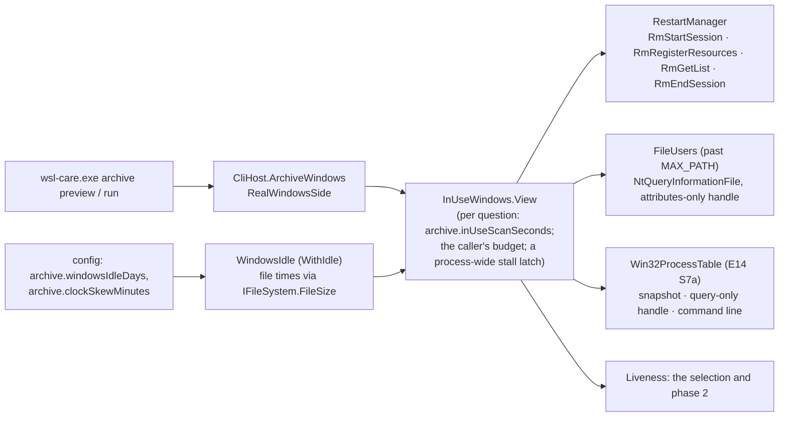

## Numbers are configuration (standing convention, owner rule 2026-10-05)

"Every number we have must be configurable" (the owner, 2026-10-05). From now on **a new behavioural number is a
configuration key (daemon) or a VS Code setting (extension), never a literal** — with a range, a default (today's value)
and, for the daemon, a `KeyTrust`: (A) behaviour → an ordinary key; (B) a limit on what ROOT reads, does or waits for →
a machine-layer-only key that may be lowered freely and raised only up to a hard maximum; (C) a format, a contract or a
unit (exit codes, `schemaVersion`, id shapes, `/proc` field indexes, unit conversions) stays a constant, listed with its
reason. An extension timeout never sits below the daemon ceiling it waits on. The inventory is plan §15q *E7.S2c*
(`todo/PLAN_wsl_care_daemon.md`); **built 2026-10-05** (*E7.S2c as built*): the daemon holds no behavioural literal — the
structural test `ArchitectureTests.Numbers` fails on a new one outside its reasoned group-C list.

**How a number reaches its call site (E7.S2c).**

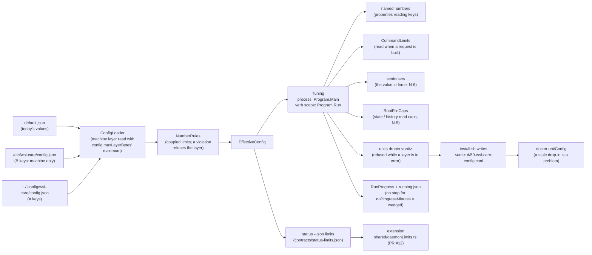

- **`Tuning`** (`Config/Tuning.cs`) is the process's configuration, read through typed accessors (`Seconds(key)`,
  `Mebibytes(key)`, `Text(key)` …). `Program.Main` sets it once after the load; `Program.Run` scopes each verb to the loaded
  configuration (an `AsyncLocal`); anything earlier reads the embedded defaults. The configuration's own key patterns are
  bounded by `patterns.matchTimeoutMilliseconds`' MAXIMUM — they run while the configuration loads (the bootstrap rule).
- **Templates stay static, their limits do not.** `CommandTemplate.Limits` is `Keyed(timeoutKey, capKey)`, `Of(command)` or
  `Fixed(values)`: a key is read when a request is built, never when the template is declared.
- **The units follow the configuration through drop-ins** (`Systemd/UnitDropIns.cs`): the timer's period
  (`timer.periodHours`, the ONE source of every copy of the period — `CollectRun.DefaultWindow`, `DoctorRun.LastRunMaxAge`),
  its randomized delay and accuracy — the calendar `*-*-* 00/<hours>:00:00`, or `*-*-* 00:00:00` for 24, which systemd 255
  refuses as `00/24` ("Invalid argument"; retro review of PR #8, O1; `TimerCalendarTests` runs `systemd-analyze calendar` over
  every accepted period) — the services' Nice / MemoryMax / TimeoutStopSec, the follower's RestartSec. The shipped
  unit files carry the defaults; both root services start with `TimeoutStartSec=infinity` (N-4).
- **`status --json` → `limits`** publishes the daemon values the extension mirrors instead of copying
  (`historyRetentionDays`, `requestFutureSkewSeconds`, `requestGraceSeconds`, `maxShownNames`, `unitStopSeconds`,
  `drainGraceMilliseconds`) — those a host decision rests on whose machine range reaches above the default.
- **Root's file reads are capped** (`IFileSystem.ReadFile(path, maxBytes)`, `Files/RootFileCaps.cs`): a state file at
  `records.maxStateFileBytes`, a growing file at `records.maxHistoryBytes`, which also bounds every uncapped read. A history past
  its cap is a PROBLEM, never "no runs": the reconcile and the request sweep then write nothing (E7.S2b/S2c review C-H1).
- **The rules are held per layer** (E7.S2b/S2c review C-M1, C-M2): a layer whose values break a coupled rule never puts them in
  force — the keys it set go back to the layer below; from the machine layer that is an error (observe-only), from the user layer a
  notice. `config set` refuses such a value; `units dropin` refuses while a layer is in error.
- **A run that hangs is wedged, and the timer's run has a limit** (review C-H2, reversing N-4): `running.json` carries the time of
  the run's last STEP (`Actions/Engine/RunProgress.cs`: a command started or ended, a stretch of a walk, an action begun); a run
  with none for `running.noProgressMinutes` reads WEDGED although its heartbeat beats, so `act --stop` can end it. wsl-care.service
  ends a timer run at `timer.runLimitMinutes` (276), kept above the run's derived worst case (`Config/RunBudget.cs`: every command
  template once at its ceiling with its drains, the two walks, the settle step's waits, a margin — 260 min with the defaults since
  E15.S1's Windows disk script added its 30 s ceiling and two drains, 259 before); a detached confirm stays
  `infinity`.

## The extension: E6 — the root boundary, the cleanup buttons, the Logs page

In [architecture-extension-e6.md](architecture-extension-e6.md) (moved there on 2026-10-06 to keep this file under the
conventions resolver's 256 KiB): *The extension: the root boundary (E6.S2)*, *The extension: the cleanup buttons (E6.S3)*
and *The extension: the Logs page (E6.S4)*.

## Fixture privacy (E5 code round, 2026-10-04)

In [architecture-build.md](architecture-build.md) (moved there on 2026-10-10, unchanged, for the same 256 KiB).

## Fail-closed resolution and the atomic write

Hardened on 2026-10-02 from the review of the E1 pull request.

**Fail closed.** `RealPath.Resolve` answers a typed `RealPathResult` — `Resolved(path)` or
`Unresolvable(component, reason)` — from a typed `LinkInspection` per component (`NotALink`,
`Link(target)`, `Uninspectable(reason)`). An inspection that fails is never taken for a plain name: the
walk stops there, and `PhysicalFileSystem` refuses the operation by `DeletionRule.Unresolvable`, naming
the component. A cycle of links ends the same way (it used to escape as an `IOException`). The real
reader reads `FileInfo.Attributes` before `FileInfo.LinkTarget`, because — measured 2026-10-02 on
Windows 11 and WSL Ubuntu with .NET 10, inside a directory this account was denied — `LinkTarget`
answers `null` for a component it cannot inspect and never throws, while `Attributes` throws
`UnauthorizedAccessException`; `Attributes` answers `-1` for a missing component (a plain name) and
carries `ReparsePoint` for a symlink or junction. A reparse point whose target cannot be read (a cloud
placeholder, for one) is refused too rather than vouched for. A protected root that cannot be resolved
is kept as spelled: a target spelled under it is under it, and one that reaches it through a link meets
the same uninspectable component and is refused.

**The atomic write** judges, builds, re-checks and acts on REAL paths:

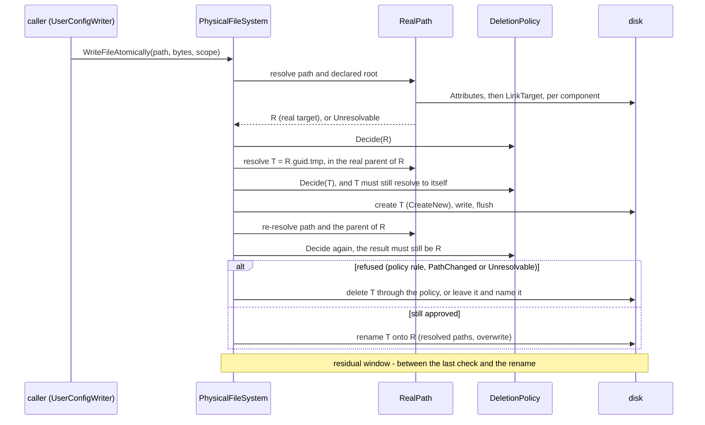

A link swapped in after the approval makes the temporary file's own judgement fail; one swapped in
after the temporary file was written makes the re-check fail — by the policy's own rule when the new
place is outside the scope or protected, by `PathChanged` when it is merely not the approved place.

**The residual window.** Between the last re-check and the rename a component can still be swapped,
because the rename takes a path and the kernel resolves it again. Closing it needs a rename relative to
a directory handle held since the check (`renameat` on Linux, `SetFileInformationByHandle` on Windows);
.NET does not expose one and this code does not P/Invoke. Exploiting the window needs write access to
the directory being written — for the one caller today, the user's own config directory — which means
being the same user: outside the threat model, which guards against this product's own mistakes and
against links planted where a cleanup walks, not against the account the daemon runs as. Deletes and
moves still act on the caller's spelling after judging the real path: acting on the real path would
change what they do (deleting a link inside a root would delete its target), so they keep that
narrower window and say so here.

## Projects and CI

In [architecture-build.md](architecture-build.md) (moved there on 2026-10-10, unchanged, to keep this file under the
conventions resolver's 256 KiB): the projects, the solution layout and the CI workflows.

## The seams inside the binary

```mermaid
flowchart TB
    main["Program.Main<br/>ShutdownSignals → CancellationToken"]
    host["CliHost<br/>IHostPaths · IFileSystem · TimeProvider · ICommandRunner"]
    loader["ConfigLoader<br/>default.json, then machine, then user"]
    logging["WslCareLogging<br/>AnsiConsoleSink (stderr) · DailyRunFileSink · LogRetention"]
    verbs["CommandLine.Parse → ConfigCommand get / set / reset · StatusCommand · PreviewCommand<br/>CollectCommand · DoctorCommand · EventsCommand · ActCommand · LogsCommand (logs, runs, runs show) · AgentsCommand (list, probe)"]
    probe["IHostProbe<br/>LinuxProbe (procfs, cgroup fs) · WindowsProbe (Win32 counters)"]
    history["LastFullRun<br/>slow parts from history.jsonl"]
    writer["UserConfigWriter<br/>repair + atomic write"]
    fs["PhysicalFileSystem<br/>RealPath → DeletionPolicy → disk"]
    runner["ProcessCommandRunner<br/>CommandPolicy (never-list, templates) → Process (tree kill)"]
    records["RunRecordWriter<br/>history.jsonl (locked append)"]

    main --> host
    main --> loader
    main --> logging
    main --> verbs
    verbs -->|status| probe
    verbs -->|status| history
    agents["AgentDiscovery · AgentWalk · SessionGlob<br/>(no command runner)"]
    verbs -->|agents list| agents
    agents -->|WalkTree · ListEntries · ReadLink · ReadRegularFile| fs
    probe -->|ReadFile · ListDirectories · ReadLink · MeasureVolume| fs
    history -->|ReadFile| fs
    loader -->|ReadFile| fs
    logging -->|DeleteDirectory| fs
    verbs --> writer
    writer -->|WriteFileAtomically · MoveFile| fs
    host --> runner
    preview["PreviewRun<br/>DockerCollector · CleanupPreviews · DockerHygiene"]
    seen["VolumeSeenStore<br/>volume-seen.json"]
    verbs -->|preview| preview
    preview -->|docker read commands| runner
    preview --> seen
    seen -->|ReadFile · WriteFileAtomically| fs
    preview -->|FileSize · ReadFile| fs
    records -->|AppendLine| fs
    collect["CollectRun<br/>housekeeping · probe · HealthCollector · FolderSizes · PreviewRun · DockerStats · ThresholdRules"]
    store["RunDetailStore · RunHistory<br/>RunReconcile · RunRetention"]
    follower["EventsFollower<br/>ContainerStartsStore · Coverage"]
    doctor["DoctorRun"]
    verbs -->|collect| collect
    collect --> probe
    collect -->|read commands, ceilings| runner
    collect --> store
    collect --> records
    store -->|WriteFileAtomically · RewriteLines · DeleteFile| fs
    verbs -->|events follow| follower
    follower -->|StreamAsync · RunAsync: docker events / version| runner
    follower -->|AppendLine · DeleteFile| fs
    verbs -->|doctor| doctor
    doctor -->|systemctl show / --version · docker version| runner
    engine["ActionEngine<br/>RunLock · RunningSweep · RunningState + Heartbeat · DryRunWindow · IdleGate · TargetUserDiscovery"]
    actions["ActionRegistry via ActionCommands<br/>CacheDrop A1 · Compaction A2 · BuildServerShutdown A3 · VolumeRemoval A4<br/>ContainerRemoval A5, A5Testcontainers · ImagePrune A6, A6Unused · BuildCachePrune A7<br/>NpmCacheClean A8 · PackageCacheClean A9 · JournalVacuum A10 · SuspectTermination A11<br/>BrowserAndHttpCaches A12 · EditorServerCleanup A14 · FilesystemTrim A15 · ClockFix A16 · ToolCacheTrims A17"]
    signals["IProcessSignals<br/>PidfdProcessSignals (IPidfdCalls) · RefusingProcessSignals"]
    logs["RunLogs<br/>history lines alone · details only with --detail / --action"]
    verbs -->|act, as root| engine
    engine --> actions
    actions -->|declared templates + shared reads| runner
    actions -->|A11: pid + start| signals
    actions -->|DeleteDirectory · ReadRegularFile · walks| fs
    engine -->|running.json · first-timer-run.json · TryLockExclusive| fs
    engine --> store
    engine --> records
    collect -->|timer pass| engine
    collect -->|RunningSweep · own running.json| fs
    verbs -->|logs · runs, read-only| logs
    logs -->|ReadFile history · details when asked| store
    running["RunningReports · RunShow<br/>RunningState.Read · RunRequests (read-only, never a sweep)"]
    verbs -->|status running block · runs show, read-only| running
    running -->|ReadFile running.json · requests · history · a detail| fs
```

## The scenario harness (E1.S3)

```mermaid
flowchart LR
    test["a scenario test<br/>HelpAndVersionFlows · ConfigFlows · StatusFlows · VerbRegisterTests"]
    home["ScenarioHome<br/>temp dir per test"]
    launcher["TestSupport.ChildProcess<br/>argv · progress wait · tree kill"]
    cli["built wsl-care<br/>(apphost beside the harness)"]
    root["root/ = WSL_CARE_ROOT<br/>config layers · logs · state"]
    bin["fakebin/ = the WHOLE PATH<br/>docker · systemctl · journalctl · powershell"]
    log["fake-calls.jsonl<br/>argv log"]
    script["fake-script.json<br/>→ fixtures/"]
    register["CommandLine.Commands"]
    catalogue["research/module_tests.md<br/>§ Flow catalogue"]

    test --> home
    home --> launcher
    launcher --> cli
    cli -->|reads / writes| root
    cli -.->|"a verb that shells out (E2+)"| bin
    bin -->|append| log
    bin -->|answer from| script
    test -->|asserts| log
    launcher -.->|"progress: the log grew (silence 30 s, cap 5 min)"| log
    test -->|"enumerates verbs, runs each Example"| register
    test -->|"every verb has a row"| catalogue
```

Every run gets `WSL_CARE_ROOT`, so nothing real is read or written, and a `PATH` holding only the
fakes, so a verb can reach no real tool. A run is waited on its PROGRESS, not on a wall-clock total: the CLI is killed
after 30 s in which no fake was called, or at 5 minutes whatever it does (`ProgressWait`, 2026-10-05). The harness reads the product's own types (the verb register,
`ExitCode`, `ConfigKeys`, `ConfigValidation`, the source-generated JSON context) instead of retyping
them. What it covers and what it does not prove: [module_tests.md](module_tests.md).

### `ci · daemon` (`.github/workflows/ci-daemon.yml`)

On every push to `main`, every pull request to `main`, and by hand; unconditional (no path filter),
`concurrency` with cancel-in-progress, `permissions: contents: read`, `timeout-minutes: 30`, every
`uses:` pinned by SHA. Matrix `ubuntu-24.04` (`linux-x64`; `ubuntu-latest` until E4.S2 — pinned by name since, because
the release builds on it and the Linux binaries link its glibc 2.39, plan §15 #15), `ubuntu-24.04-arm` (`linux-arm64`) and
`windows-latest` (`win-x64`) — every shipped binary-and-platform pair, per the family platform rule,
mapped in the workflow header, and the same runner per RID as `release.yml` — each: restore → `dotnet format --verify-no-changes` → Release build →
the three test executables (Core, CLI, Scenarios — since E4.S1 the Scenarios run `install.sh` end to end on the two
Linux legs) → on Linux, `.github/scripts/verify-systemd-units.sh` — `systemd-analyze verify` of EVERY unit file, a template
through an instance name, each with the drop-in the Release build renders — failing on ANY output because it exits 0 on an
unknown key → Native AOT `dotnet publish -r <rid>` → `.github/scripts/smoke-daemon.sh` (since E4.S2 ONE script, which
`release.yml` runs too, plan §15e #5): the
published binary must list `--help`/`--version` and print the version in `src_daemon/version.txt` →
the configuration round trip under a temporary `WSL_CARE_ROOT` (set, read back from the user layer,
a refused set exits 2 with one `wsl-care:` line, the value still holds) → `status --json` under a sandbox root (on Linux holding the captured procfs tree, whose `MemTotal` must come back; on Windows the host side) → the full run: `collect --json` must record (one history line naming a run detail under `runs/`), `status --json` must name that run, `doctor --json` must answer → `act <every action --help names> --preview --json` under a sandbox root with root CLAIMED there (E3.S2: preview only, never destructive — exit 0, `previewed`, every id answered, no state written; the Windows binary exits 2 naming the side) → since the E4 review `preview --all --json` with no docker reachable (`PATH` an empty folder): the JSON parsed, `schemaVersion` 1, every row `available: false` with its reason, nothing written → **the release archive packed from the published binary by `package-daemon.sh`, exactly as `release.yml` packs it** (version.txt's version, this RID), checked by `verify-release-assets.sh` for this RID's pair alone, and its printed path opened by a `shell: pwsh` step (Test-Path) — a step that is NOT bash, because Git Bash rewrites a path-looking variable on its way to any child (observed: `ASSET=/c/…` reached node and pwsh as `C:/…`), which would hide the MSYS spelling the check exists to catch. Before the review the Windows packaging ran on no pull request and `package-daemon.sh` printed `/d/a/…`, which the attest and upload actions read as `D:\d\a\…`. Every MSBuild command carries
`-m:4`.

### `ci · family checks` (`.github/workflows/family-checks.yml`)

The shared rules' own checks, run from the `.agents/conventions` submodule (fetched alone, shallow):
`plan-lifecycle.mjs`, `adapter-check.mjs`, `pin-check.mjs` (the pin equals the tip of `release`),
`build-flags-check.mjs`. Separate from the daemon workflow because it gates neither the build nor the
tests. Mirrors the credential-store repository's `docs · plans` workflow.

### `ci · workflows`, `pr · title`, Dependabot

`ci-workflows.yml` runs a version- and checksum-pinned actionlint over every workflow after asserting
shellcheck is on `PATH` (without it actionlint silently skips the `run:` blocks), then shellcheck v0.11.0 — the image
pinned by digest, `-x` to follow a sourced file — over `install.sh` (E4.S1) and `.github/scripts/` (E4.S2). `pr-title.yml` requires
a conventional-commit pull request title. `dependabot.yml` watches NuGet and GitHub Actions weekly,
FluentAssertions held below 8.x.

## The Windows tasks: install and remove, across the modules (WR-E3, 2026-10-18)

Two opt-in per-user scheduled tasks — `\wsl-care\watch` and `\wsl-care\archive` — run a verified staged copy of the bundled Windows daemon (plan [PLAN_windows_runner.md](../todo/PLAN_windows_runner.md); the module level is [module_vs_code.md](module_vs_code.md), the daemon's half [module_daemon.md](module_daemon.md)). What crosses the modules when a person presses *Install the Windows watch task* or *Remove the Windows tasks*:

```mermaid
flowchart LR
    panel["panel: bare button id<br/>(panel/messages.ts)"] --> flow["windowsTasks/tasksFlow<br/>stage, fresh render, checks, read-only tab, modal,<br/>engine again, pending record, ONE run"]
    flow -->|"closed tails: tasks stage / render / stage --remove"| client["client/WindowsCareClient<br/>(typed answers, provenance, own digest)"]
    client -->|"bundled exe: stage, remove · staged copy: render"| daemon["wsl-care.exe (Windows daemon)<br/>renders the task XML, stages and removes copies"]
    flow -->|"the reader's SID, what else is in the folder"| sched["scheduler/ (the peer)<br/>schedulerHost: ONE read of \wsl-care"]
    flow -->|"installTaskScript / removeTasksScript"| reg["scheduler/registerScript<br/>the ONE home of Register-ScheduledTask and the deletes"]
    flow -->|"unelevatedRequest: engine.file, -EncodedCommand, killTree"| launch["powershell/unelevatedLauncher<br/>(+ commandLine, modulePath, engineTypes: shared, not elevated)"]
    launch --> runner["process/runner<br/>ceiling + verified tree kill by pid and creation time"]
    runner -->|"ONE PowerShell, as the user, not elevated"| ts["Task Scheduler<br/>\wsl-care\watch · \wsl-care\archive"]
    flow -->|"pending record before the launch; cleared on every answer but a timeout"| state["globalState<br/>wslCare.windowsTasks.pending"]
    sched -->|"refresh after an answer; settle past the ceiling"| flow
    guard["windowsTime/ (the guard)<br/>same registration scripts, run ELEVATED"] --> reg
```

The boundaries this holds (asserted by `unelevatedBoundary.test.ts`, `registrationPath.test.ts` and `schedulerModule.test.ts`): the Windows tasks and the registration script import nothing of the elevated launcher or the elevated engine module — what both sides share (the encoded command, the quotable path, the module-path line, the engine vocabulary, the command-line bound) lives in `powershell/commandLine.ts`, `modulePath.ts`, `engineTypes.ts` and `engineSource.ts`; `windowsTasks/` and `windowsTime/` are peers that never import each other and both consume `scheduler/`; the extension never writes the daemon's settings and never builds an argv of its own.

## Containers — the system on one page

The parts that run, and what they talk to (added 2026-10-06 by the retro review of PR #2: the family's
knowledge-base rule asks for one system-level container diagram; every other diagram in this file is the inside of
one feature). The detail of each box is in its own section above, in [module_daemon.md](module_daemon.md) (the installer, the units, the daemon's release) and in [module_vs_code.md](module_vs_code.md) (the extension's E5).

```mermaid
flowchart LR
    subgraph Windows["Windows host"]
        ext["VS Code extension AI OS Care<br/>(src_vs_code, UI host)"]
        wslexe["System32\\wsl.exe"]
    end
    subgraph Distro["WSL distribution (Ubuntu)"]
        timer["wsl-care.timer"]
        svc["wsl-care.service<br/>collect: measure, timer pass"]
        events["wsl-care-events.service<br/>events follow"]
        act["wsl-care-act@.service<br/>detached act"]
        watchtimer["wsl-care-watch.timer"]
        watch["wsl-care-watch.service<br/>watch: MCP ledger, A19"]
        cli["/opt/wsl-care/bin/wsl-care<br/>Native AOT CLI"]
        conf["/etc/wsl-care/config.json<br/>+ user layer"]
        state["/var/lib/wsl-care<br/>history, run records, state"]
        logs["/var/log/wsl-care<br/>one log file per run"]
        os["procfs, cgroups, systemd, journal"]
        docker["Docker Engine"]
    end
    subgraph GitHub["GitHub"]
        rel["release.yml / release-extension.yml<br/>attested releases"]
        market["VS Code Marketplace"]
    end

    ext -->|"read-only verbs, no shell"| wslexe
    wslexe -->|"-d distro --exec"| cli
    timer --> svc
    svc --> cli
    watchtimer --> watch
    watch --> cli
    events --> cli
    act --> cli
    cli --> conf
    cli --> state
    cli --> logs
    cli --> os
    cli --> docker
    rel -->|"install.sh verifies sha256 + attestation"| cli
    rel --> market
    market --> ext
```

## Planned module map

| Part | Where | Role | State |
|---|---|---|---|
| daemon / CLI | `src_daemon/` | C# Native AOT, `linux-x64`, `linux-arm64`, `win-x64`: collectors, rules, actions, run records | skeleton + seams + `config` verbs (E1.S1–S2); collectors + `status` (E2.S1); Docker collectors + `preview` (E2.S2); `collect`, `doctor`, `events follow` (E2.S3); the action engine, the command policy, `act` and A10 (E3.S1); A4–A9, A11, A12, A14, A17 (E3.S2); A1–A3, A15, A16, the timer pass, `logs` / `runs` (E3.S3); the review fixes (2026-10-03); `verdicts` + `productVersion` in `status --json` (E5.S0); the AI agents, A18 and every number a key (E7.S0–S2c); the MCP server instances of the AI agents in `status` and the run detail (E7.S2d, `Core/Mcp/`, [module_mcp_servers.md](module_mcp_servers.md)), their CPU over the interval since the previous sample (E14 S1, [PLAN_twenty_sessions_all_day.md](../todo/PLAN_twenty_sessions_all_day.md)) and A19 stopping the idle ones (E14 S2a); the Windows Time guard — which clock is wrong, A16 never stepping to a wrong host (2026-10-08, [module_daemon.md](module_daemon.md) § *The Windows Time guard*); the archive's catalogue blocks, keys and base folder rules, `archive check-base` (E9.S0); the archive in the engine — A13 and the restore button A20, the product's own binary run as the target user (E9.S4, [module_archive.md](module_archive.md)) |
| scenario harness | `src_daemon/tests/WslCare.Scenarios` (+ `WslCare.FakeTool`) | drives the built CLI end to end over a temp home with fake tools on `PATH`; the derived verb register | built (E1.S3): help, version, refusal, the config verbs, `status` (E2.S1), `preview` replaying captured Docker answers (E2.S2), `collect` / `doctor` / `events follow` over captured Docker and health answers, a live follower stopped by SIGTERM on Linux (E2.S3); the status verdicts and the golden contracts' writer and drift test (E5.S0) |
| live contract | `src_daemon/tests/WslCare.LiveContract` | the real `docker` / `systemctl` / `journalctl` against the product parsers; skip locally, required at release | built (E2.S2); E2.S3 adds the health commands, the Windows clock probe and the event stream |
| installer + units | `install.sh`, `src_daemon/systemd/`, `src_daemon/config/machine.json` | install / uninstall into the distro with checksum + attestation, the timer, the follower, the machine layer | built (E4.S1), tested over a prefix with fakes; first live install is the E4 live gate (plan §16), after E4 merges; detail: [module_daemon.md](module_daemon.md) § *The installer and the units (E4.S1)* |
| release pipeline | `release-please-config.json`, `.github/workflows/release*.yml`, `.github/scripts/`, `.github/rulesets/`, `sonarcloud.yml`, `.coderabbit.yaml`, `docs/repo-settings.md` | proposes and cuts `daemon-v*`; per-RID tests, AOT, smoke, archive, attestation; completeness-checked publish of a draft | built (E4.S2), structure and scripts tested on every pull request; the owner's settings and the cut of `daemon-v0.1.0` outstanding; detail: [module_daemon.md](module_daemon.md) § *The release pipeline (E4.S2)* |
| AI-session archive | `src_daemon/src/WslCare.Core/Archive/`, `Files/IArchiveFiles.cs` (+ `PhysicalFileSystem.Archive.cs`, `BeneathWrites.cs`, `ArchiveSourceRules.cs`), `WslCare.Cli/Commands/ArchiveCommand.cs`, `ArchiveRunCommand.cs` | moves aged AI-agent sessions to a base folder the user chose, as the user, verified before anything is removed — [module_archive.md](module_archive.md) | E9.S0 (blocks, keys, `archive check-base`), E9.S1 (`archive preview`), E9.S2a (the file seam), E9.S2b (`archive run`, `status`, `reconcile --scan`), E9.S3 (`archive restore`, `archive list`), E9.S4 (A13 and A20 in the engine — the product's own binary run as the target user, `archive reach`; A19 is the MCP servers' since E14 S2a), E9.S5 (the Windows side's open-file check: the Restart Manager, the Windows process table) built |
| golden contracts | `contracts/golden/head/` | the read-only verbs' answers the extension's client tests replay | built (E5.S0); anonymised through the identity list and held by `FixturePrivacyTests` (2026-10-04); the set frozen at `daemon-v0.1.0` is an E5 live-gate step |
| extension | `src_vs_code/` | status bar, panel, cleanup table, logs page, settings, help | skeleton, runner seam, `WslCareClient` over four read-only verbs, strict fake, structural + bundle tests, `ci-extension.yml` (E5.S1); the status bar, the read-only panel from one field map, focused-window polling, the page harness and `@vscode/test-electron` on 1.85.0 + stable (E5.S2); *Install daemon*, the universal `.vsix` with its leak checks, Marketplace metadata, `release-extension.yml` + `tags-extension.json` as files and tests (E5.S3); the code round's fixes, the attest job and `min-daemon.json` (2026-10-04); released at the E5 live gate; the root boundary (E6.S2), the cleanup buttons and *Last cleanup* (E6.S3) and the Logs page (E6.S4) on `feat/wc-e6-cleanup-logs` ([architecture-extension-e6.md](architecture-extension-e6.md)), merging only after `extension-v0.1.0` is tagged. *Start Windows Time*, one elevated PowerShell (2026-10-08); the Windows Time guard, one SYSTEM scheduled task (2026-10-08, [PLAN_windows_time_task.md](PLAN_windows_time_task.md)); the GPU alert — the extension's own unelevated read of Windows' display adapters, at the top of the panel and on the bar — and *Enable <GPU>* for code 22 through the same launcher, PowerShell 7 elevated by the MSI install or the Store package's resolved path under `Program Files\WindowsApps`, each signature-checked by the extension's own read before the launch (2026-10-10/11, [PLAN_gpu_health.md](PLAN_gpu_health.md)); since 2026-10-11 the launcher and that resolver are shared modules (`src/powershell/`), *Start Windows Time* and the guard's install / remove elevate the same engine — read before their modal and again before the launch — while the guard's SYSTEM task stays on Windows PowerShell 5.1, and the panel names each part's engine ([PLAN_pwsh_engine_windows_time.md](PLAN_pwsh_engine_windows_time.md)). Module overview and the E5.S1–E5.S3 sections: [module_vs_code.md](module_vs_code.md) |
| daemon module overview | [module_daemon.md](module_daemon.md) | the map from the daemon's purpose, entities, entry points and dependencies into this file's epic sections; since 2026-10-12 it holds the installer, units and release-pipeline sections (E4.S1, E4.S2) itself | added by the retro review of PR #7 (2026-10-06) |

## Cross-repository

| Repository | Relationship |
|---|---|
| `dew_flow_vscode_kit` | the extension's help page and display controls come from its npm package (E8). E5.S1 PORTED, not depended on: the strict tsconfig, the eslint config, `scripts/run-tests.mjs` (made recursive, with the tripwire) and `scriptInterpolation.test.ts` (`dew_flow_vscode_kit · src/test/scriptInterpolation.test.ts`, 2026-10-03); E5.S2 PORTED its `pageHarness.ts` (`node:vm`, allowlisted globals, the deadline, `null` for a miss) and made it stricter — a proxy per element that throws on every member it does not model, every HTML sink included, plus `createElement` / `appendChild` / `replaceChildren` |
| `dew_flow_creds_for_devs` (extension) | the model for the absolute `%SystemRoot%System32wsl.exe` and the UTF-16LE list decoding (`dew_flow_creds_for_devs · src_vs_code/src/wslProcess.ts`, `wslRelay.ts`); wsl_care decodes from the bytes (also handling `WSL_UTF8=1`), has no `windir` / `C:Windows` fallback, and kills `wsl.exe` alone — measured to end the Linux process — where the model tree-kills |
| `dew_flow_creds_for_devs` | the model for this repository's build files, CI/CD, the logging sinks (`AnsiConsoleSink`, `DailyRunFileSink`, `LogRetention` are ports) and `install.sh` (its structure: POSIX sh, the newest tag of ONE component through the releases API, the `.sha256` check, a trap-cleaned temporary folder — `dew_flow_creds_for_devs · install.sh`; wsl_care's REQUIRES the `.sha256` where the model warns without one, adds the attestation, and never calls sudo) |
| `dew_flow_creds_for_devs` (release) | the model for E4.S2: `release-please-config.json` (`draft` + `force-tag-creation`, `separate-pull-requests`, `simple` + `version.txt`; its `exclude-paths: [".github"]` was copied and then removed here as inert, E4 review), the App-token `release-please.yml`, the per-RID AOT release legs, ONE publish job that asserts every RID from the release and flips the draft last, the tag ruleset with the App as the only bypass, `sonarcloud.yml`, `.coderabbit.yaml` / `coderabbit-review.yml`. wsl_care differs: the build job cannot write the repository (it uploads a run artifact, the publish job uploads), every archive is attested, the `.sha256` is checked again FROM the draft, the smoke and the packing are scripts the scenario suite runs, and `main` is protected by a ruleset rather than classic branch protection |
| `dew_flow_connect_other_ais` (extension) | the model for E5.S2's extension-host harness: `scripts/run-host.mjs` drives `@vscode/test-electron` without mocha (test-electron only downloads and launches; the scenario list inside throws, and an empty list is red), strips the `ELECTRON_RUN_AS_NODE` / `VSCODE_*` variables a run started from inside VS Code inherits, and runs under `xvfb-run -a` on Linux (`dew_flow_connect_other_ais · src_vs_code/scripts/run-host.mjs`, `src/test/host/scenarios.ts`). wsl_care runs it against 1.85.0 AND stable, twice per version (with the strict fake, and in Test mode without it) |
| `dew_flow_vscode_kit` (release) | its `release-please.yml` (the loud missing-secret refusal, `contents: read` with every write the App token's) and its first-version bootstrap reasoning, applied here as manifest `0.0.0` + `initial-version: 0.1.0` |
