# module_daemon — the `wsl-care` daemon / CLI (`src_daemon/`)

> The module overview of the daemon. The deep detail stays where each epic wrote it, in
> [architecture.md](architecture.md) (the daemon half of E6 in [architecture-daemon-e6.md](architecture-daemon-e6.md); the installer, the units and the release pipeline of E4 in § *Story history* below, moved from architecture.md on 2026-10-12); the tests are in [module_tests.md](module_tests.md). This file is the map between
> them, in the same shape as [module_vs_code.md](module_vs_code.md). Added 2026-10-06 by the retro review of PR #7 (the
> review gate found no module document for the daemon, `common.knowledge-base`); the same finding on PR #5 was first
> rejected as a layout question and is answered by this file too.

## Purpose

Keep one developer workstation from degrading over the working day. A C# Native-AOT binary (`wsl-care`, `linux-x64`,
`linux-arm64`, `win-x64`) **measures** the machine — memory, processes, Docker, disk, health, AI-agent folders — and,
run by the root systemd timer inside WSL, **cleans** behind one switch per action: every cleanup has a preview, a
measured result, a run record and an `auto` switch; the never-lists are tested, not trusted. The VS Code extension is a
view over its CLI contract.

## Diagram

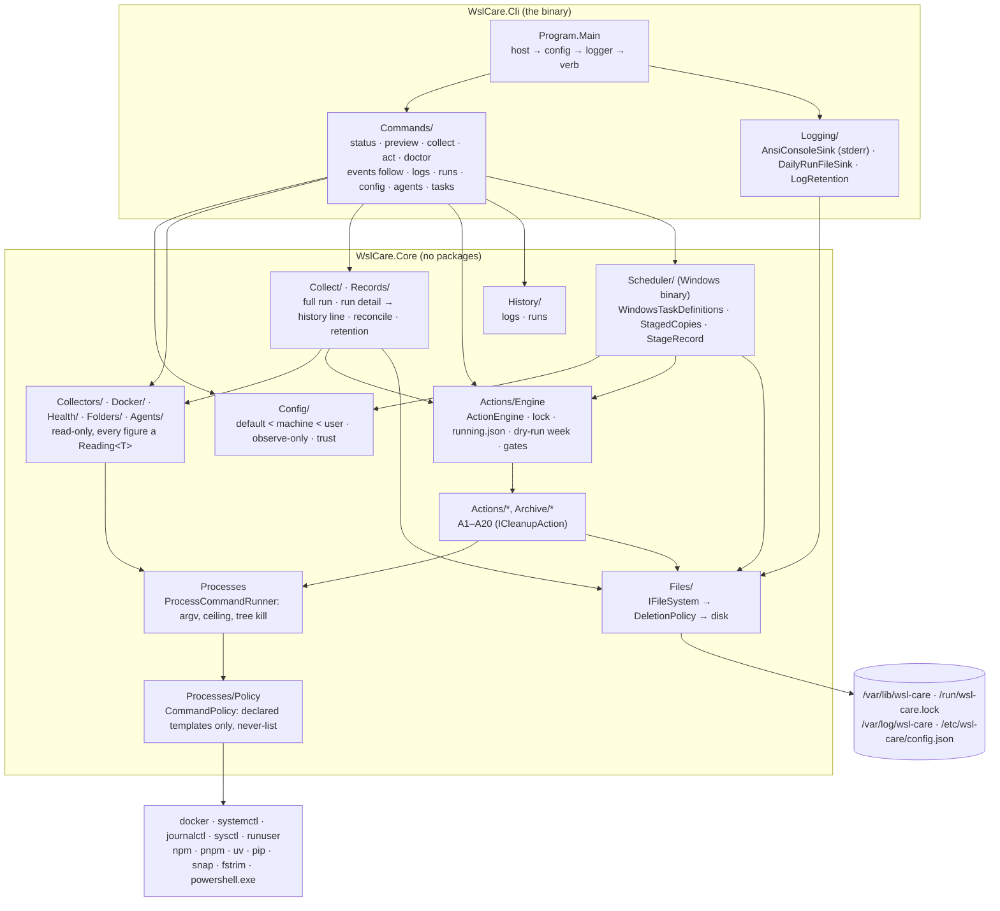

## Core entities

| Entity | Where | What it is |
|---|---|---|
| `EffectiveConfig` / `ConfigLoadResult` | `Core/Config` | the three layers merged with each value's layer; `ObserveOnly` when a layer is invalid; `UserLayerSkipped` when root has no single target user |
| `ConfigKeys` | `Core/Config` | the one register of keys. Only the outer `ConfigKeys` class is `partial` (the namespace shell); every key group is a plain `static class` in exactly ONE file, never one group in two files. `ConfigKeys.cs` holds the range-ceiling constants, the top-level keys, the eight older groups that have no number keys (`Auto`, `Volumes`, `Containers`, `Images`, `BuildCache`, `AiAgents`, `Idle`, `Logging`), `All` and `Find`; `ConfigKeys.Numbers.cs` holds the E7.S2c header and `NumberKeys()` (the order `config get` lists the number keys in); each other group has its own `ConfigKeys.<Group>.cs` (`ConfigKeys.Walk.cs`, `ConfigKeys.Timer.cs`, `ConfigKeys.Archive.cs`, `ConfigKeys.Disk.cs`, … — 41 group files with `ConfigKeys.WindowsTasks.cs` (WR-D1), split 2026-10-11 so that no file passes the 800-line cap). A group with older keys too (`Archive`, `Clock`, `Thresholds`, `Processes`, `McpServers`, `Npm`, `Journal`, `BuildServers`) has them first in its file, then its number keys. A key's name (`ConfigKeys.<Group>.<Key>`) does not depend on its file |
| `Reading<T>` | `Core/Collectors` | a figure or the reason it is unavailable — never a silent zero |
| `RunRecord` / run detail | `Core/Records`, `Core/Collect` | one `history.jsonl` line per run, written AFTER its `runs/{day}/{runId}.json` detail |
| `ActionId`, `ICleanupAction`, `ActionPreview`, `ActionRun` | `Core/Actions` | an action's id (= its `auto.*` key), its live preview and its measured result |
| `CommandTemplate`, `CommandPolicy` | `Core/Processes/Policy` | the only argv shapes that may run; everything else is refused |
| `DeletionPolicy`, `ProtectedRoots` | `Core/Files/Deletion` | the one judge of every delete and move: agent folders, `~/git`, Claude's temp folder, memory, and their ancestors |
| `RunningFile`, `FirstTimerRun` | `Core/Actions/Engine` | `running.json` (pid + start + heartbeat) and the start of the timer's 7-day dry run |
| `DryRunPeek` / `DryWeek` | `Core/Actions/Engine` | what a timer run NOW would decide about the dry run, read without writing the stamp (`DryRunWindow.Peek`, WR-D1; section below) |
| `WindowsTask`, `TaskIdentity`, `WindowsTaskDefinition`, `TasksRenderReport` | `Core/Scheduler` | the Windows runner's two tasks (a closed set), who a task runs as and what it starts, the rendered XML with its numbers and summary, the `tasks render --json` answer (section below) |
| `IWorkerSupervisor`, `JobSupervisor`, `IJobControl` / `Win32JobControl`, `WorkerLaunch`, `WorkerOutcome`, `TaskWorkers` | `Core/Processes`, `Core/Scheduler` | the Windows runner's supervisor (WR-D3): one kill-on-close job per `tasks run`, the worker from a closed table, its deadline on the unbiased clock (section below) |
| `StageRecord` / `StageRead`, `StagedCheck` | `Core/Scheduler` | `stage.json` beside a staged copy and its strict reader; whether this process is a verified staged copy (`registrable`) |
| `Staging`, `StagingPlace`, `StagingAccess`, `StageInput`, `StageReport` / `StageRemoveReport`, `StagingFolder`, `StagingSweep` | `Core/Scheduler` | `tasks stage` and `--remove` (WR-D2; section below): the copy made, read back and recorded, the sweep of the other digest folders (also the `tasks run` start's), every copy removed |
| `WindowsTimeService`, `ClockReference`, `ClockStanding` / `ClockJudgement` | `Core/Health` | the Windows Time guard (section below): the service the probe printed, the independent reference, which clock is wrong |
| `WindowsDiskCommands`, `WindowsDiskSample` / `WindowsDiskFacts`, `WindowsDiskParsers` | `Core/Health` | the Windows disk script (section below): the second fixed interop script, what it read, its tag parser; `HealthCommands.FixedScripts` is PowerShell's closed set |
| `PwshProbe`, `PwshEngine` / `InteropEngine` | `Core/Health` | E15.S1b (section below): what the clock probe saw of the MSI PowerShell 7, and the PURE choice of the engine the disk script runs under |

## Entry points

The CLI verbs, as `CommandLine.Commands` spells them — the derived verb register in [module_tests.md](module_tests.md)
§ *The derived verb register* fails on a verb missing there. The systemd units (`src_daemon/systemd/`) start
`collect --timer` (the timer), `events follow` (the follower) and the `wsl-care-act@` template (detached runs).

**A timer run settles first** (`Core/Collect/RunSettle.cs`, [PLAN_boot_settle.md](PLAN_boot_settle.md)): before the run
lock and before `running.json`, so its wait blocks nothing, a `collect --timer` in the distro waits until the machine has been up
`timer.bootDelayMinutes` (15), then — at any time — while S6's `MachineBusy` says busy, in `timer.busyCheckSeconds` (60) steps
for at most `timer.busyWaitMinutes` (20); then it runs anyway. An unread uptime or busy signal is no wait, noted. The run
detail's `settled {bootWaitSeconds, busyWaitSeconds, busyAtEnd, notes}` says what it waited (absent on a run the timer did not
start). Why: on 2026-10-10 the boot catch-up ran 07:44–07:48Z while Docker started 12 containers. The waits are part of the
run's derived worst case, so `timer.runLimitMinutes` rose from 240 to 276 by exactly them (D8's archive slack unchanged).

## External dependencies

Read: `/proc`, cgroup v2, `/etc/passwd`, `/etc/wsl.conf`, `docker` (read verbs, each with a ceiling), `systemctl show`,
`journalctl`, `timedatectl` (`show`, `timesync-status`), `powershell.exe` (a closed set of two fixed scripts: the Windows
clock and the Windows Time service; since E15.S1 the Windows disk facts, full run only), `curl` (one HEAD for the clock reference's `Date`, a slotted template; since 2026-10-08). Act: `docker` prunes and removals,
`sysctl -w` (two literal keys), `runuser -u <user> --` for user-scoped tools, `npm` / `pnpm` / `uv` / `pip` / `dotnet
nuget`, `snap`, `fstrim`, `chronyc` / `hwclock`, pidfd signals (A11, A18); on Windows, the Job Object of `tasks run` (kernel32:
`CreateJobObjectW`, `CreateProcessW` of its own binary, `TerminateJobObject`; WR-D3). Packages: Serilog only (CLI); `WslCare.Core`
has none.

## Where the detail is

| Area | architecture.md section |
|---|---|
| seams: config layers, `ICommandRunner`, `IFileSystem` + `DeletionPolicy`, `IHostPaths`, logging | *The seams (E1.S2)*, *Fail-closed resolution and the atomic write*, *The seams inside the binary* |
| collectors and `status` | *The collectors and `status` (E2.S1)* |
| Docker and `preview` | *The Docker collectors and `preview` (E2.S2)* |
| the full run, `doctor`, `events follow` | *The full run, `doctor` and the events follower (E2.S3)* |
| the engine, the command policy, `act` | *The action engine, the command policy and `act` (E3.S1)* |
| the irreversible deletions | *The irreversible deletions (E3.S2)* |
| memory / build-server / trim / clock actions, the timer pass, `logs` / `runs` | *The memory, build-server, trim and clock actions, the timer pass, `logs` / `runs` (E3.S3)*, *E3 review fixes (2026-10-03)*; since E14 S3 (2026-10-08) A3's TIMER also waits until every build server is measured idle for `buildServers.idleMinutes` (the section below), and the C# language server is a process family of its own (`language-servers`, for A11) — architecture.md's A3 row and *A11 — suspects* |
| the "machine busy" signal (`wsl-care busy`, `pressure.cpu` / `pressure.io`) | architecture.md *The "machine busy" signal (E14 S6, 2026-10-09)*; the agent-side contract in the README's *Busy* section |
| memory and swap before the evening (E14 S5, a report) | the section below; architecture.md's *`.wslconfig`* paragraph |
| installer and units; release | *The installer and the units (E4.S1)*, *The release pipeline (E4.S2)* — both in § *Story history* below since 2026-10-12 |
| the read contract, detached runs | *The verdicts in `status`, `productVersion` and the golden contracts (E5.S0)*; *The daemon read contract (E6.S0)* and *Detached runs, the request, the stop (E6.S1)* now in [architecture-daemon-e6.md](architecture-daemon-e6.md) |
| configuration trust, AI agents, A18, numbers | *The configuration trust (E7.S0, 2026-10-05, plan §15q R1)*, *The AI agents: catalogue, discovery, the walk (E7.S1, 2026-10-05, plan §15q D1–D3, R2)* with its *Manual agents and `agents probe` (E7.S2, 2026-10-05, plan §15q D4, R2)*, *A18 — orphaned AI-agent processes (E7.S2b, 2026-10-05, owner decision)*, *Numbers are configuration (standing convention, owner rule 2026-10-05)* |
| the MCP server instances of the AI agents (`Core/Mcp/`, `status --json` `mcpServers`) | [module_mcp_servers.md](module_mcp_servers.md) (E7.S2d, 2026-10-06/07); architecture.md *MCP server instances of the AI agents* points there |
| the watch (`Core/Watch/WatchRun.cs`, `wsl-care watch [--timer]`, `wsl-care-watch.timer` / `.service`) and A19's busy half | [module_mcp_servers.md](module_mcp_servers.md) § *The busy half and the watch* (E14 S2b, 2026-10-09) |
| the Windows watch and the Windows ledger lock (`Core/Watch/WatchRun.Windows.cs`, `Core/Mcp/McpCpuLedgerLock.cs`; `wsl-care.exe watch [--timer]`, run by `tasks run watch`) | § *The Windows watch and the ledger lock* below (WR-D4, 2026-10-12) |
| A21, the client-gone interop relays (`Actions/Suspects/InteropRelayStop.cs`, `Collectors/Procfs/InteropRelays.cs` / `StdioHolders.cs`, SIGTERM only through `IProcessSignals.TerminateOnlyAsync`; the watch's `[A19, A21]` act; `status --json` `interopRelays`) | [module_mcp_servers.md](module_mcp_servers.md) § *A21 — ending client-gone interop relays* (E14 S7b.2, 2026-10-10) |
| the Windows side's MCP servers and the vmmem advice (`Core/Mcp/WindowsMcp*`, `Win32ProcessTable`, `Health/VmmemAdvice`; the Windows `status --json` `windowsMcpServers` and `host.vmmemAdvice`, read-only) | [module_mcp_servers.md](module_mcp_servers.md) § *The Windows side* (E14 S7a, 2026-10-09) |
| tests and the harness | [module_tests.md](module_tests.md), architecture.md *The scenario harness (E1.S3)* |
| the Windows Time guard (2026-10-08) | the section below; the plan [PLAN_windows_time_guard.md](PLAN_windows_time_guard.md), the incident [2026-10-08_windows_time_stopped.md](2026-10-08_windows_time_stopped.md) |
| the Windows disk script and PowerShell's closed set (E15.S1, 2026-10-10) | the section below; the plan [PLAN_disk_health.md](../todo/PLAN_disk_health.md) §3.1, the measurement [2026-10-10_disk.md](2026-10-10_disk.md) |
| the Windows runner's render: `tasks render`, the `windowsTasks.*` keys, `DryRunWindow.Peek` (WR-D1, 2026-10-11) | the section below; the plan [PLAN_windows_runner.md](../todo/PLAN_windows_runner.md) §3.2–§3.7 |
| the Windows runner's supervisor: `tasks run`, the Job Object, exit 84 (WR-D3, 2026-10-12) | the section below; the plan [PLAN_windows_runner.md](../todo/PLAN_windows_runner.md) §3.3 |
| Windows memory pressure: `host.commit` / `host.compression` / `host.vmmem`, `Thresholds/HostRules`, `Health/HostMemoryFacts` (E15.S5, 2026-10-12) | the section below; the plan [PLAN_disk_health.md](../todo/PLAN_disk_health.md) *E15.S5 design*, the measurement [2026-10-12_host_memory.md](2026-10-12_host_memory.md) |

| the Windows runner's staged copy: `tasks stage`, `tasks stage --remove`, the sweep (WR-D2, 2026-10-12) | the section below; the plan [PLAN_windows_runner.md](../todo/PLAN_windows_runner.md) §3.2, §3.7, §3.10 |

## Memory and swap before the evening (E14 S5, 2026-10-09) — a report

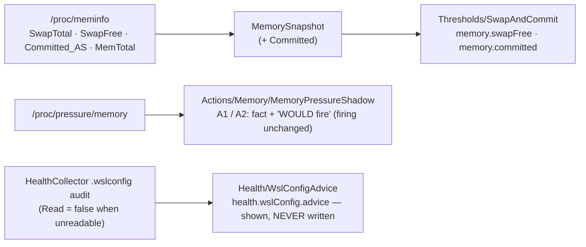

- `memory.swapFree` warns when the swap LEFT is under `thresholds.swapFreeWarnGb` (4). A zero swap is "no swap
  configured"; a swap smaller than the key is judged by `memory.swap` only.
- `memory.committed` warns when `Committed_AS` is above `thresholds.committedWarnPercent` (80) of `MemTotal`. It warns of
  promises, so the extension's status bar leaves it out (`BAR_EXCLUDED_VERDICT_IDS`); the panel lists it.
- A1 and A2 record memory PSI and say whether the S6 rule would have fired them. Their firing is unchanged until S8 measures.
- The `.wslconfig` advice lists only what the file does not already say: `[wsl2]` `memory=` / `swap=`, `[experimental]`
  `autoMemoryReclaim=dropcache`. Each line names its measurement. There is no advice for a file that could not be read.
- `ArchitectureTests.WslConfig` holds that no product file naming `.wslconfig` holds a write.

## CPU fairness (E14 S4, 2026-10-09) — measured, nothing built

The plan proposed a `user@.service` delegation drop-in from `install.sh` and a `wsl-care low` verb running a command in a
`systemd-run --user --scope` with a low `CPUWeight`. The measurement
([2026-10-09_cpu_fairness.md](2026-10-09_cpu_fairness.md)) withdrew both: `cpu` is already delegated to the user manager,
and every session and build runs in `/init.scope` with no autogroup, so `nice 19` works against the sessions (68 : 1); the
scope moved the job to `user.slice`, where it got 7–21× MORE CPU than a session's process (three runs). The answer is documentation: the
README's *Busy* section (`nice -n 19`, plus `--disable-build-servers` for `dotnet build` / `publish` / `pack` / `run`;
`dotnet test` under MTP builds first and runs `--no-build`). No code, unit, key or
`install.sh` line changed. One fact about the daemon itself, recorded and not acted on: the units' `Nice=19` orders a root
run only among `system.slice`'s services, not against the sessions in `/init.scope` (a sibling at the root).

## A3's idle gate (E14 S3, 2026-10-08)

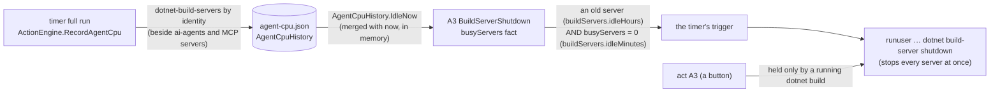

`dotnet build-server shutdown` has no per-server choice, so idleness decides only WHEN the timer runs it. A server that worked
within `buildServers.idleMinutes` (default 60, higher is safer), or that the history does not hold yet (one sighting, another
boot, a reused pid), or every server when the boot id cannot be read, holds the timer. On the 4-hour timer the window is a
floor: a burst anywhere in the interval waits for the next pass. Per-process reaping of idle ORPHANED build servers is A11's
(its default families include `dotnet-build-servers`; A11 is ON by default since E14 S3b, 2026-10-09 — the owner's answer to
Q15 — and the timer stays under the global dry-run rules). The C#
language server is its own family, `language-servers`, so A11 can name it without the daemonised VS Code server; it is one
of A11's default families since E14 S3b (Q14), `vscode-server` never (Q16).

## The Windows Time guard (PLAN_windows_time_guard.md, 2026-10-08)

Built after the incident of 2026-10-08: the Windows Time service stopped, Windows 7 200 s slow, and inside WSL
Hyper-V's time sync (the host's clock) and systemd-timesyncd (NTP's) set the clock against each other every ≈ 33 s.

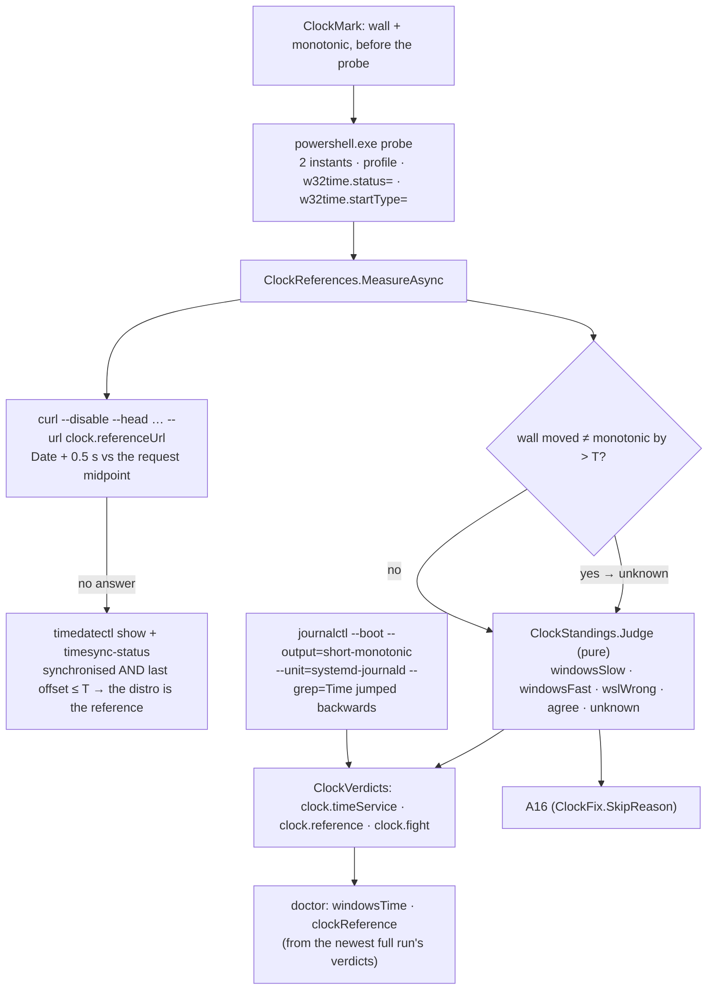

- **Detection.** The probe's two TAGGED lines carry the service state (read after both instants, so the launch latency is
  unchanged; parsed by tag, never by position). The reference is the HTTP `Date` of `clock.referenceUrl` (machine layer
  only; default `https://www.microsoft.com` — github.com's measured up to 6.5 s stale), else timesyncd when it is
  synchronised and its last NTP sample is within `clock.referenceToleranceSeconds` (30). The standing judges Windows
  FIRST, so a distro Hyper-V dragged to the wrong host time still names Windows (and says the distro is off too).
- **Verdicts.** `clock.timeService` is critical only while `clock.reference` names Windows — a stopped service is a
  warning while the clock agrees (Windows trigger-starts it on a workgroup PC); a Manual start warns while
  `clock.manualStartWarns`. `clock.reference` is critical for Windows, a warning for the distro. `clock.fight` counts
  journald's backward jumps in the last 4 h of THIS boot on the monotonic clock (the lines carry the wall time after the
  jump, which `--since` would miss) against `thresholds.timeJumpsBackWarnPer4h` (10). `doctor` reads two of them from the
  newest full run — no probe, so its worst case (the extension's `worstCases.ts`) does not move; only a wrong Windows
  clock makes it unhealthy.
- **A16 steps only with proof.** Skips, in order: timesyncd synchronised (and, when Windows is off, *"the Windows clock is
  wrong, not WSL's"*); the clock agrees; the reference names Windows; NO reference (*"no independent reference can say
  which is wrong"* — this gives up stepping a lagging distro on an offline machine, deliberately); a step that would not
  bring the distro closer to the reference. Then the old gates. The reference is asked only when the clocks disagree past
  `clock.maxDriftSeconds` — a preview whose clocks agree sends nothing to the network — and a full run judges the clocks
  ONCE (`HealthSample.ClockJudgement`), which the detail and the verdicts only project.
- **The live contract** fails a probe a minute off with `ClockStandings.Diagnosis`: which clock, the service as printed,
  and the fix.
- **The fix is the extension's** (*Start Windows Time*, [module_vs_code.md](module_vs_code.md)); the SYSTEM scheduled task
  that would restart the service by itself is the plan's story 2, not built.
- **Who else sets the clock** (measured 2026-10-12, [2026-10-12_wsl_clock_fight.md](2026-10-12_wsl_clock_fight.md)): the
  verdicts used to say "Hyper-V's time sync vs timesyncd". All distros share one kernel clock, and on the owner's
  machine it has three writers besides Hyper-V's TimeSync driver: WSL's own VM-level `chronyd` (the host's PTP clock,
  every 8 s), Ubuntu's `systemd-timesyncd` (NTP), and Docker Desktop's `/initd`, which steps it every 30 s while Docker
  Desktop runs — every clock change counted in the window both logs cover was one of its steps. That record names the
  journal's loss mechanism (`SystemMaxFiles` 100) and the ranked fixes. Since then (fix/wc-clock-verdicts):
  - `clock.fight`'s warning names the three writers and says journald rotated its file at each backward jump.
  - `clock.jumps` warns above `thresholds.clockJumpsWarnPer4h` (100 per 4 h) EXCEPT up to
    `thresholds.clockJumpsStepperFloorPer4h` (600: Docker's measured 480 per 4 h + 25 %) while `clock.fight`'s backward-jump
    count (`HealthSample.TimeJumpsBack`) stays within `thresholds.timeJumpsBackWarnPer4h` — the journal's damage is judged
    by its rotations, not by the count of steps. The floor needs the rotation count to cover the SAME window: it counts
    this boot's last 4 h, the clock changes count since the last run, so a run whose window is longer than the uptime
    (a VM restart) or than 4 h applies no floor; an unread count or uptime applies none either; a count above its limit
    is damage however much of the window it covers — and warns at ANY rate, the ordinary one included. Both verdicts take
    the writers' sentence from ONE constant, `ClockVerdicts.SharedClockWriters`, and judge the backward jumps against the
    SAME effective `thresholds.timeJumpsBackWarnPer4h` (the full run passes its configuration to `ClockVerdicts.Fight`).
  - `journal.history` counts its days from `HealthSample.JournalReadAt` (a `Reading<DateTimeOffset>`: the injected clock
    right after `journalctl --list-boots` answered), no longer from `HealthSample.Since` (the previous run's start); a
    sample without that instant is `unknown` with the reason.

## Failed units that are not failures (2026-10-12)

The first LIVE full run (2026-10-12 10:01Z, `dryRun` false) warned `systemd.failedUnits` for `getty@tty1.service`
(start-limit-hit). WSL has no tty1, so that unit fails on every boot; the warning said nothing real.

- **The verdict** (`Thresholds/FailedUnitsVerdict.cs`, PURE) counts only the failed units that are NOT in
  `systemd.ignoredFailedUnits`. It warns at 1 or more. The reason names the counted units, and it still names every ignored
  unit, so nothing is hidden. The run detail's `health.failedUnits` keeps every unit.
- **The key** `systemd.ignoredFailedUnits` is an OPEN list (the second, after `mcpServers.programs`), at most 32 members. Each
  member passes the reviewed rule `TextRule.SystemdUnitName`: letters, digits and `@ : _ . - \`, then a unit type. It is a name
  compared ordinally, never a pattern, so it can only quiet the unit it names. The default is `["getty@tty1.service"]`. It is a
  user (display) key: it quiets a warning and changes no action. `ConfigKeyShapeTests` holds the list shape, and the cap is an
  allow-listed schema limit.

## The Windows disk script and PowerShell's closed set (E15.S1, 2026-10-10; the engine, E15.S1b, 2026-10-12)

The first story of [PLAN_disk_health.md](../todo/PLAN_disk_health.md) (§3.1, Road 1): the full run reads the SLOW Windows facts
through a second fixed interop script, as it reads the Windows clock. It only collects and records; no verdict judges these
facts yet (E15.S2, S4, S5, S8 do).

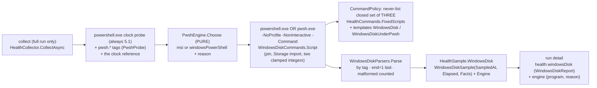

- **What it reads, each line TAGGED** (`WindowsDiskCommands`' `*Tag` constants, a test holds every one printed by the script):
  per distro in `HKCU\…\Lxss` its VHDX path, size, sparse bit and last write (UTC); Docker's data disk at
  `%LOCALAPPDATA%\Docker\wsl\disk\docker_data.vhdx` (no distro, so not under Lxss); each lettered volume with its filesystem,
  size, free space, label and disk number (`Get-Partition`); each physical disk (number, bus, health, operational status,
  firmware, model); the reliability counters, attempted — unelevated they are refused, and the refusal is the answer; the
  System log's events of `disk`, `stornvme`, `Ntfs`, `volmgr`, `storahci` with ids 7, 11, 51, 129, 153, 157 of the last
  `disk.eventsSinceDays` (60) days, at most `disk.eventsMaxRead` (5000), AGGREGATED inside PowerShell per UTC day, provider,
  id and `HarddiskN` (one line per event was 64 of 75 lines, D10); commit charge and limit
  (`Win32_PerfRawData_PerfOS_Memory`); the Memory Compression process's working set; EditionID, DisplayVersion,
  CurrentBuild.UBR, InstallDate; MachineGuid; the account the script ran as (its SID — interop runs it as the Windows user who
  started the VM, whose hive `HKCU` is; the live contract asserts a user SID and that the running distro is in the Lxss map); each display adapter's problem code, PNP device id and name (for G2). The
  last line is `end=1`.
- **The module path is pinned first** (2026-10-11, after the #104 Fable review): the disk script AND the clock probe both begin
  with `HealthCommands.ModulePathPin` — `$env:PSModulePath = $PSHOME + '\Modules'`, the same statement as the extension's
  `MODULES` (`src_vs_code/src/powershell/elevatedEngine.ts`, held equal by an architecture test) — so no cmdlet can autoload a
  module from a user's `Documents` before it. Measured live under 5.1: both scripts answer in full with the pin.
- **The script is one line of ASCII**, no double quote, no control character, none of the never-list's words; its only
  varying parts are the two event numbers, written as invariant integers clamped to their keys' ranges — never text from the
  configuration. Free-text fields (a distro's name, a label, a model, an adapter's name) come LAST on their line.
- **The parser** reads by tag. An answer whose last line is not `end=1` is cut: the whole sample is unavailable. A
  non-zero exit, a timeout (the runner kills the tree at `health.windowsDiskTimeoutSeconds`, 30), a refusal or a failed start
  is the same, with `ToolAnswers`' sentence. A line it cannot read is counted (`malformedLines`) and skipped. An empty field is
  an answer — a file "is not there", a volume "is on no partition" — never a 0. A calendar day is stamped UTC, never converted.
- **Hardening from the story's code round and own review** (2026-10-11): a registry-named file is opened only on a local
  FIXED drive (`[IO.DriveInfo]` before `Get-Item`) — a UNC or mapped path would send the user's credentials to that host, so
  it reads "is not on a local fixed drive, so it was not opened"; paths are joined with `[IO.Path]::Combine` (no drive
  lookup, so one distro on an unplugged disk cannot end the distro section); a failed `Get-Partition` gives its reason
  ("Get-Partition failed for X: (type)"), not "on no partition"; the event groups are cut at `disk.eventGroupsMax` (10–800,
  500, machine-only) with the total printed (`events.groups=`), so `StorageEvents.GroupsCut` says when the list is short and
  the answer stays under `health.outputCapBytes`' floor; the event day is written in the invariant calendar; and the answer
  leaves as UTF-8 bytes on the raw stdout stream (Windows PowerShell 5.1 writes `Console.Out` in the OEM code page).
  The final code round added `groupsTotal` and `groupsCut` to the run detail's `events` (a cut list is never shown as
  complete), gave physical disks their own wire record (`PhysicalDiskReport`, so a domain change cannot change a saved
  detail), and holds every tag the script prints to the parser's known set (`WindowsDiskParsers.KnownTags`).
- **Where it runs.** Only `collect`, after the clock probe and its reference (so its seconds never sit between the two
  clocks' readings), once, under its own ceiling; never `status` (a scenario holds it), never the watch. The Windows binary
  does not run it: its detail says the distro reads these facts. The full run's worst case (`RunBudget`) grew by the
  ceiling and two drains: 260 min with the defaults, under `timer.runLimitMinutes` (276).
- **Measured** (research/2026-10-10_disk.md D10, and 2026-10-10 18:29Z for the product's own text): Windows PowerShell
  5.1, unelevated, 2.4–3.3 s warm, 10.7 s cold; 26 lines on the owner's machine. After the code round (2026-10-11): 6.1–6.2 s
  warm, 21.9 s cold under load (73 % of the ceiling), 29 lines. The captured answer, anonymised, is the
  fixture `tests/fixtures/health/windows-disk-2026-10-10`.
- **The closed set — three members since E15.S1b.** `NeverList`'s `powershell` rule refuses every argv naming PowerShell
  (`powershell` or `pwsh`, any path) that is not EXACTLY one of `HealthCommands.FixedScripts`, program AND arguments, under
  the configuration in force: the clock probe under `powershell.exe`; the disk script under `powershell.exe`; and the SAME
  disk script under the bare `pwsh.exe` (`WindowsDiskCommands.WindowsDiskUnderPwsh` — `WindowsDisk` with only the program,
  the name `pwsh-windows-disk` and the summary changed, so both carry one `Arguments` list). A third script, a one-word variant,
  `-File`, `-EncodedCommand`, a trailing argument, the clock probe under `pwsh.exe`, and the disk script under `pwsh`,
  `PWSH.EXE` or any path to a pwsh (`/mnt/c/Program Files/…`, `C:\Program Files\…`, a user's `WindowsApps`) are all refused
  (`PowerShellClosedSetTests`). The read templates are not `CommandTemplate.Fixed` (it freezes an argv at first use): their
  one slot, `SlotKind.WindowsDiskScript`, accepts exactly the script the configuration in force builds;
  `ReadCommandTemplates.WindowsDisk` and `WindowsDiskUnderPwsh` are one helper under two programs.
- **Which PowerShell (E15.S1b, 2026-10-12): the MSI pwsh 7 when the clock probe verified it, else Windows PowerShell 5.1.**
  The clock probe stays on 5.1 (the trusted System32 path, and its latency is calibrated for 5.1). AFTER its two instants
  and the Windows Time lines it looks at `<known folder>\PowerShell\7\pwsh.exe` and prints four tagged lines —
  `pwsh.knownFolder=`, `pwsh.envProgramFiles=`, `pwsh.msi=` (`absent` / `link` / `directory` / `empty` / `file`) and
  `pwsh.signature=` (`signed` only for Authenticode Valid from `CN=Microsoft Corporation`, through the pinned module path) —
  inside its own `try`, so no third PowerShell starts per run. Code round: every value the probe prints (the profile, the two
  Windows Time words, the four pwsh values) has its control characters replaced by `?`, and (security review, 2026-10-15)
  the probe prints by the disk script's ONE road — UTF-8 bytes on the raw stdout stream (`HealthCommands.Utf8WriteStart` /
  `Utf8WriteEnd`), never `[Console]::Out`, whose OEM best-fit encoding was measured to turn U+25D9 into a real line feed
  after the sanitiser ran. What the code guarantees is narrower than "no forged line ever": a value the PROBE prints cannot
  break its line, and the parser believes a pwsh block ONLY as the probe's own trailing block — the last four non-empty
  lines, in the script's order, after both Windows Time lines (`ClockParsers.NotTheTrailingPwshBlock`) — and none at all
  when a pwsh tag appears more than once (`ClockParsers.RepeatedPwshLine`); either way 5.1 runs. A Windows user who ends or
  replaces the probe can still print a well-shaped block (see the as-built *Open* list); the fixed-folder rule is what
  bounds that to starting the real MSI file or 5.1. The clock lines are written and FLUSHED before the look, so a look that
  hangs past the ceiling costs the engine choice, never the clock reading (`HealthCollector` reads a timed-out probe's whole
  flushed lines). `PwshEngine.Choose(sample)` is PURE: the MSI
  pwsh only when the known folder is `C:\Program Files` (without case, as Windows compares folder names — the final code round; a trailing separator is still another
  spelling), the environment's `ProgramFiles` agrees (case-insensitive),
  the item is a `file` and it is `signed`; anything else, a failed probe and a probe from before the tags give 5.1 with the
  reason; a quoted value is cut to `records.maxReasonChars`. `InteropEngine(Kind, Reason)` DERIVES its program from the
  kind, so the two can never disagree. `HealthCollector.CollectAsync` chooses after the clock probe and its reference and
  runs `WindowsDiskCommands.Under(engine)`; when the MSI pwsh then FAILS TO START (the fixed-folder lookup refused it or did
  not answer: virtiofs, several C: mounts, a non-root ancestor, interop off, a slow 9p), the 5.1 script runs once instead and
  the engine says why (`PwshEngine.NotStartable`: "Windows PowerShell 5.1 was tried instead" — never "ran"; when 5.1 fails
  too, the sample's own reason names that failure). The command run on fallback is `Under(the fallback engine)`, the same
  expression whose answer is read. A timeout or an exit code under pwsh is not retried. The argv names the BARE `pwsh.exe` (what
  the policy judges); the resolver maps it ONLY to its one fixed folder on the mounted system drive
  (`WindowsSystemDrive.Programs`: `pwsh.exe` → `Program Files/PowerShell/7`, through the same mount, interop, ancestor and
  file checks as `powershell.exe`) and NEVER to PATH, with or without a PATH entry (`WindowsSystemDrive.FixedFolderOnly`,
  `ExecutableResolver.OnPath`). The reason: a root collect through `wsl.exe -u root` inherits the Windows PATH, whose user
  part holds the Store package's alias — a file the Windows user can replace — so the daemon never starts the Store package
  or its alias, only the verified MSI file. On the Windows binary a `pwsh.exe` lookup answers "never from PATH" too. The rule
  and the drive list (`WindowsSystemDrive.Programs`) compare without case (the 9p share is case-insensitive). `powershell.exe` keeps PATH first.
- **The scenario seam (E15.S1b).** The scenario harness reaches its fakes through PATH, which `pwsh.exe` never uses. So the
  product's runner asks `SystemDriveLookup.ForThisProcess`: `ThisMachine`, except for a process that is inside a sandbox
  (`WSL_CARE_ROOT`) AND not really privileged, which gets `SystemDriveLookup.Sandboxed` — `<sandbox>/mnt/c`, interop taken as
  enabled, a program startable when it is a regular file (no link) this account may start. A real root process (the timer,
  or a root collect whose environment the Windows user reaches through `WSLENV`) never trusts a folder an environment
  variable names. `WindowsDiskFlows` plants the fake pwsh in the sandbox's fixed folder and a decoy on PATH, and asserts the
  fixed-folder file answered.
- **The Storage import (E15.S1b, measured 2026-10-12).** With the module path pinned to `$PSHOME\Modules`, pwsh 7 has no
  `Get-Volume`, `Get-Partition`, `Get-PhysicalDisk` or `Get-StorageReliabilityCounter`: under the Store pwsh 7.6.6 the script
  answered `volumes.error`, `disks.error` and `reliability.refused` = `CommandNotFoundException`. So right after the pin the
  script imports Storage by its ABSOLUTE path, `[IO.Path]::Combine([Environment]::SystemDirectory,
  'WindowsPowerShell\v1.0\Modules\Storage')` (GetSystemDirectory, not a variable; `[IO.Path]::Combine`, not `Join-Path`, as
  the rest of the script joins paths), in its own `try` — a failed import leaves each Storage section to print its own
  error line. Under 5.1 it is the same module the pinned path already names. Live after the change (read-only, the owner's
  machine): 4 volumes, 2 disks, `end=1` under the Store pwsh (9–15 s, two harmless nested-module errors on stderr, exit 0)
  and under 5.1 (6–8 s). `RealClockProbeTests` (Windows, the owner's machine and CI) runs the ACTUAL clock probe under the real `powershell.exe`
  through the product's runner and policy: exit 0, measured, each pwsh tag exactly once. `RealPwshDiskScriptTests` runs the actual script under `%ProgramFiles%\PowerShell\7\pwsh.exe` on
  CI's `windows-latest`; it skips where the MSI build is absent.
- **The run detail names the engine and the file really started.** `WindowsDiskSample.Engine` (a `Reading`, chosen before
  the run, so it is kept also when the script fails) and `WindowsDiskSample.StartedFrom` (the runner's
  `CommandOutcome.StartedFrom`: the file it started from the system drive, as the drive's mount names it) become
  `health.windowsDisk.engine {program, reason}` (`InteropEngineReport`, a wire record). Its program is the started file, ONE
  source (code round), else the bare program the policy judged. Absent on the Windows binary and on a detail written before
  E15.S1b.
- **What the detail holds** is the machine's own facts (profile paths, the machine id). The detail stays on this machine;
  the redacted statistics export is E17.S3's.

## The virtual disks and the hosting volume (E15.S2, 2026-10-11) — a report

The full run turns E15.S1's Windows disk sample into the virtual disks' facts and three verdicts. Read-only: no new command
runs, the never-list is untouched, and `status` reads what the run recorded.

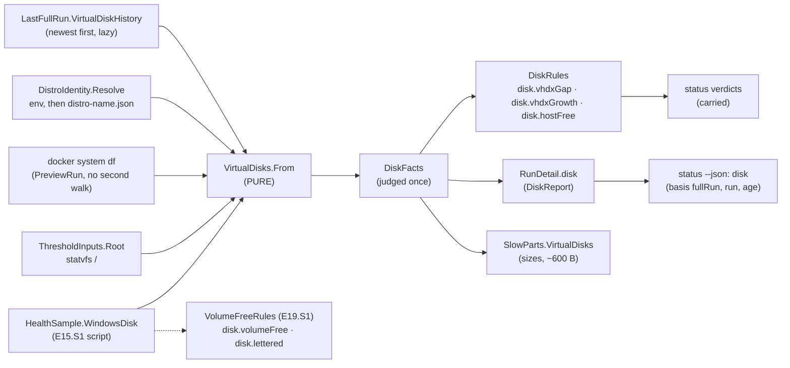

- **Which distro is this one** (`Health/DistroIdentity.cs`, measured 2026-10-11): a systemd unit has no `WSL_DISTRO_NAME`
  (`systemctl show-environment` shows none, the units set none, `wslinfo` has no name option); a process started through
  `wsl.exe` has it. So `collect` run as ROOT that carries it — the panel's *Run full check now* is `wsl.exe -u root … collect
  --detach` — records it in `{state}/distro-name.json` (`{schemaVersion, name, recordedAt}`), atomically and only when the name
  changed; the run itself (the detached unit, the timer) takes the environment first (`CollectContext.DistroVariable`), then the
  file (read as root's state: owned by root, no link, capped). A name is believed only when it passes WSL's rule (the extension's
  `DISTRO_NAME`: a letter or digit, then up to 63 letters, digits, `.`, `_`, `-`). With neither, no distro is mapped and the
  reason says how the name becomes known; a recorded name the Lxss map does not list maps nothing and is named.
- **Who records the name** (E15.S2b, 2026-10-11): two root `collect` runs, and only through `DistroIdentity.Record` — the file's
  ONE writer and ONE format. (1) **Install's first full run**: `install.sh --distro-name <name>` (the documented one-liner passes
  `"$WSL_DISTRO_NAME"`, which the installing user's shell expands before `sudo`, whose `env_reset` drops the variable) checks the
  name against the same rule (`DISTRO_NAME_PATTERN`, held equal to `NamePatternText` by
  `ArchitectureTests.The_installer_and_the_daemon_share_one_distro_name_rule`) and refuses any other name with a usage error
  before anything changes; then `first_run` starts the installed binary as `env WSL_DISTRO_NAME=<name> … collect`, and that root
  `collect` records it. The installer never writes the file. An empty value (typed outside WSL) records nothing and says so;
  without the argument the first run's environment is left as it is. (2) **A root `collect` started through `wsl.exe`** — the
  panel's *Run full check now* — records it and refreshes a changed name. So the timer's runs map this distro's own disk from the
  day of the install. The extension's install command (`src_vs_code/src/install/installCommand.ts`) pins a RELEASED
  `install.sh`, which refuses an unknown argument, so it adds `--distro-name` only after a daemon release ships this.
- **The facts** (`Health/VirtualDisks.cs`, PURE → `Health/VirtualDiskFacts.cs`): per disk the name, path, size, sparse bit, the
  hosting volume's letter (from the path), `mappedBy` (`mount` = this distro's own `/`: guest used = `UsedBytes`, possible growth
  = the filesystem's size − the file; `dockerDf` = Docker's data disk: guest used = the sum of `docker system df`'s sizes, "an
  estimate, not the filesystem", possible growth unknown; `none` = another distro, not mounted here), the gap (file − guest),
  the growth per day and the possible growth — each a `Reading`. Per hosting volume: size, free, the disks on it, their summed
  growth (only when every one has one), their known possible growth and the disks whose possible growth is unknown.
- **Growth needs two measured sizes**: `SlowParts.VirtualDisks` (`{sampledAt, disks[{name, path, sizeBytes}]}`) is on every
  history line whose script answered; the baseline is chosen PER FILE from `LastFullRun.VirtualDiskHistory` (newest first,
  walked lazily): the newest earlier VALID measurement of that path at least `disk.growthMinHours` (1) older than this sample — so
  neither a manual run soon after a timer run, nor a run that missed the file, nor a partial entry hides an older measurement (own
  review, final code round); with only closer sizes it reads "too close to the previous measurement". Growth = (size now − size then) ÷ days,
  only for the same path (case-insensitive), only from a real measurement (a partial history line — no size or no time — is
  "not a measurement") and only forward in time ("the clock moved back"). A negative growth is a shrink.
- **The verdicts** (`Thresholds/DiskRules.cs`, spread into `ThresholdRules.FromFullRun` after `disk.discard`, so `status`
  carries them with the run and their age): `disk.vhdxGap` (warn above `disk.vhdxGapWarnGib`, 20; "file − guest = gap"; the
  advice, as TEXT, for a distro file that is not sparse: compaction with WSL stopped (`wsl --shutdown`, then `Optimize-VHD` or `diskpart compact vdisk`, as an administrator — wsl-care never compacts) and the warning that sparse VHD is NOT advised (WSL disabled it after data-corruption reports, and a sparse VHDX cannot be compacted) (2026-10-11: the first version named `--set-sparse`, a defect); Docker's gap
  labelled its estimate; a known breach warns, otherwise it is `unknown` — never `ok` — while a mapped disk's gap could not be
  read or THIS distro's own disk is not mapped (its name not known, or matching no file: Docker's estimate alone never reads ok);
  another distro, `none` by design, is outside it), `disk.vhdxGrowth` (warn above `disk.vhdxGrowthWarnGibPerDay`, 10; a known
  breach warns, otherwise `unknown` while any file has no growth yet), `disk.hostFree` (warn below `disk.hostFreeWarnGib`, 100, or
  below the KNOWN possible growth; `unknown` — never `ok` — while any file's possible growth is unknown, the free space still in
  the value; one verdict over every volume, the worst level), and — E19.S1, below — `disk.volumeFree` over EVERY lettered volume. The defaults are STARTING VALUES (README, key descriptions).
- **The wire** (`Collect/DiskReport.cs`, its own records): the run detail's `disk` and `status.disk` = `{available, reason,
  sampledAt, distroName, vhdx[{name, path, size, sparse, volume, mappedBy, note, guestUsed, gap, growthBytesPerDay,
  possibleGrowth}], volumes[{letter, size, free, disks, growthBytesPerDay, knownPossibleGrowthBytes, unknownGrowth}]}`; in
  `status` with `basis {source: fullRun, runId, evaluatedAt, ageSeconds}`. `status` reads it from the newest full run's detail
  with its verdicts (`RunDetailVerdicts.Disk`, one file read) but PARSED ON ITS OWN, so a disk section that does not parse costs
  only `disk`, never the carried verdicts; a detail written before E15.S2 says so. The distro-name rule is held equal to the
  extension's `DISTRO_NAME` by `ArchitectureTests.The_daemon_and_the_extension_share_one_distro_name_rule`; the `disk.*` keys live
  in `Config/ConfigKeys.Disk.cs`. The Windows binary's
  `status` answers `disk` unavailable ("the distro's full run reads the virtual disks") and its `host.vhdx` points there.
- **Not built here**: no button (the sparse switch is advice), no Windows-side reading; the defaults await calibration.
- **Known limit**: a distro cloned with `wsl --export` / `wsl --import` carries the old `{state}/distro-name.json`; until a root
  collect through `wsl.exe` records the new name, the clone's timer runs map the ORIGINAL distro's disk by mount (own review,
  2026-10-11 — not fixed: no unelevated fact ties a VHDX to the running filesystem).

## `disk.volumeFree` — every lettered Windows volume (E19.S1, 2026-10-15) — a report

`disk.hostFree` asks "can the VHDX files grow here" and sees only the volumes that HOST a virtual disk; D: filled to 0 bytes with no
VHDX on it and nothing judged it. `Thresholds/VolumeFreeRules.cs` (PURE) judges `HealthSample.WindowsDisk.Facts.Volumes` — the
`Get-Volume` figures already read — so it needs neither the Distros map nor Docker. `Evaluate(Reading<IReadOnlyList<WindowsVolume>>,
VolumeFreeLimits)` returns a `VolumeFreeAssessment`: the verdict and the judgement of every volume beside it. `ThresholdRules.FromFullRun`
spreads the verdict in right after `DiskRules`; `CollectRun` records the judgements as the detail's `disk.lettered`.

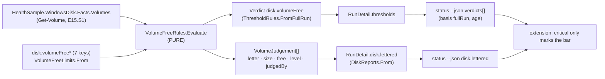

- **Levels, per volume — an OR, critical first**: `critical` when free < `disk.volumeFreeCriticalGib` (10) OR free % < `disk.volumeFreeCriticalPercent`
  (3); `warn` under `disk.volumeFreeWarnGib` (30) OR `disk.volumeFreeWarnPercent` (10); a floor is a strict limit. AND would let the 195 GiB D:
  run to about 19.5 GiB before warning; OR warns at 30 GiB. The GiB floors apply only to a volume of at least
  `disk.volumeFreeAbsoluteMinSizeGib` (100); below that a volume is judged by percent alone (`judgedBy: percent`), so a 16 GiB volume with
  12 GiB free is `ok` and never warns for ever. A volume under `disk.volumeFreeMinSizeGib` (8) or in `disk.volumeFreeIgnoreLetters` is listed with
  `judgedBy: "not judged: <why>"` and takes no part in the level (the measured 29.7 MiB USB volume E: never warns).
- **Across volumes — a rank of its own**: critical > warn > unknown > ok (`VolumeFreeRules.Rank`; `DiskRules.Rank` has only three ranks and would read
  critical as warn). An unread size or free space is `unknown` with the reading's reason, never `ok`, and never hides a critical volume. When no volume
  is judged, or the sample is unavailable, the verdict is `unknown` with a reason — a figure not read renders as nothing, never 0.
- **The words**: the value names the WORST volume first (`D: 4.1 GiB free (2.1 %) — critical; C: 988.8 GiB free (41.2 %) — ok`; ordered by rank, then
  free share); the limit is built from the keys (`warn < 30 GiB or < 10 %, critical < 10 GiB or < 3 % (GiB floors only on volumes of 100 GiB or more;
  volumes under 8 GiB not judged)`); the reason says which rule judged each volume and which floor a breaching one is under.
- **The keys** (`Config/ConfigKeys.Disk.cs`, all Display, STARTING VALUES): `disk.volumeFreeWarnGib` 30 [1..10240], `…CriticalGib` 10 [1..10240],
  `…WarnPercent` 10 [1..90], `…CriticalPercent` 3 [1..90], `…MinSizeGib` 8 [1..1024], `…AbsoluteMinSizeGib` 100 [8..10240] and the list
  `disk.volumeFreeIgnoreLetters` ([], members `^[A-Z]$`, at most 26). `NumberRules`: critical < warn for GiB and for percent, and
  minSize ≤ absoluteMinSize (the machine layer breaking one is an error, the user layer a notice).
- **The wire**: `disk.lettered[{letter, sizeBytes, freeBytes, freePercent, level, judgedBy}]` in the run detail and in `status --json`'s `disk` (same
  `basis`), present even when the virtual disks could not be read; a figure not read is OMITTED (never 0) and its reason rides in `judgedBy`; absent in a
  detail written before E19.S1. The extension reads it for the bar's mark and never parses the verdict's value text.
- **Not built here**: the 5-minute Windows reading (E19.S2) and its read by the extension (E19.S2b/S5) — until then the figure is as old as the
  distro's 4-hourly full run.

## The Windows runner's render (WR-D1 of PLAN_windows_runner.md, 2026-10-11)

The first story of [PLAN_windows_runner.md](../todo/PLAN_windows_runner.md): the contract every later step reads. The Windows
binary renders the XML of its two per-user scheduled tasks and says whether that XML may be registered. Read-only: nothing is
registered, staged, started or written (WR-D2 stages, WR-D3 supervises, WR-E3 registers).

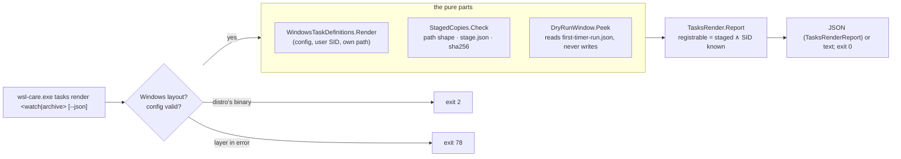

- **The verb** (`Cli/Commands/TasksCommand.cs`, `CommandLine.cs`: `tasks render <watch|archive> [--json]`, a closed set
  `Core/Scheduler/WindowsTask.cs`). The distro's binary refuses it with exit 2 ("the Windows binary's"), as the Windows binary
  refuses `watch`. A configuration layer in error refuses it with exit 78 — no task is rendered from a configuration the
  daemon refuses (the `units dropin` rule). Otherwise it answers with exit 0, registrable or not.
- **The seams** (`CliHost.UserSid`, `CliHost.ProcessPath`): the real SID comes from `WindowsIdentity.GetCurrent().User` and the
  real path from `Environment.ProcessPath`, wired ONLY in `CliHost.ForThisMachine`; a host built by a test has empty ones and
  hands its own. So the XML is a pure function of (configuration, SID, path) and golden-testable.
- **The XML** (`Core/Scheduler/WindowsTaskDefinitions.cs`): principal = the user's SID, `InteractiveToken`, `LeastPrivilege`;
  ONE `LogonTrigger` naming the same SID (an unelevated account may register a logon trigger for itself only) with a `Delay`
  and an indefinite `Repetition`; settings `IgnoreNew`, `StartWhenAvailable`, no battery stop, no wake, not only when idle,
  not hidden, priority 7; `ExecutionTimeLimit` = the deadline + `NumberRules.RunMarginMinutes` (10); the `Exec` action is the
  ABSOLUTE staged path with `tasks run <name> --json`. A delay of 0 writes no `Delay` element (the guard's rule).

  | task | delay | repetition | deadline (+10 min = `ExecutionTimeLimit`) |
  |---|---|---|---|
  | `\wsl-care\watch` | `windowsTasks.watchLogonDelaySeconds` (60) | `mcpWatchdog.periodMinutes` (5) | `mcpWatchdog.runLimitMinutes` (10) |
  | `\wsl-care\archive` | `windowsTasks.archiveLogonDelayMinutes` (20) | `windowsTasks.archiveEveryHours` (4) | `timer.runLimitMinutes` (276) |

- **The summary lines** are the shape of the extension's `SUMMARY_FUNCTION` (`src_vs_code/src/windowsTime/guardTask.ts`):
  `principal=<sid> logon=3 level=0`, `trigger=logon enabled=True delay=<d> interval=<i>`, `settings limit=PT<n>M instances=2
  whenAvailable=True battery=False enabled=True`, `action type=0 path=<path> args=tasks run <name> --json`. The logon line's
  `interval=` is ONE field more than the guard's: WR-E2 widens `SUMMARY_FUNCTION`'s logon case to print the repetition.
  Durations are spelt as the XML spells them (`PT60S`); Task Scheduler may store `PT1M`, so the extension compares by value.
- **`registrable`** (`Core/Scheduler/StagedCopies.cs`): true only when `Environment.ProcessPath` is exactly
  `<stagingRoot>\<64 lower-case hex>\wsl-care.exe` (no `.`/`..` segment; the staging root is `WindowsHostPaths.StateDirectory`
  + `bin`, from the shell-folder API), `stage.json` beside it is a whole record naming that digest and this build's release (the
  version text before `+`, `StagedCopies.ReleaseOf`), and the file — opened through the archive's no-link open
  (`IArchiveFiles.OpenSource`: this account's regular file with one link, no reparse point followed) — hashes to the digest; and
  the user's SID is known. The first failed check is the `reason`. So no task XML can name the extension folder (the bundle
  plan's §4 rule, enforced in the daemon too).
- **`stage.json`** (`Core/Scheduler/StageRecord.cs`): `{ version, sha256, stagedAtUtc, source }`, written by WR-D2 through
  `WslCareJsonContext`, read here strictly — exactly those four members, each well formed (a missing or unknown member, a
  malformed digest, an empty value, a relative `source` is refused naming it), capped at `records.maxStateFileBytes`.
- **The dry state** (`DryRunWindow.Peek(paths, files, config, now)`, `Core/Actions/Engine/DryRunWindow.cs`): what `Decide` would
  find for a timer run now, read from the same stamp by the same read and NEVER written — `week` is `notStarted` (no stamp: the
  first timer or task run starts it), `restarts` (an unreadable stamp), `running` (with `until`) or `passed`; `dryRun` is the
  setting OR the week. On Windows the stamp is `%LOCALAPPDATA%\wsl-care\first-timer-run.json` — a Windows-local dry state.
- **The answer** (`Core/Scheduler/TasksRender.cs`, `TasksRenderReport`): `schemaVersion, task, taskPath, registrable, reason,
  userSid, command, digest, version, numbers[{key, value}], executionTimeLimitMinutes, summary[], xml, dry{dryRun, setting,
  week, until?, reason}`. Its golden is `contracts/golden/windows-tasks-render.json` — the two tasks from a staged copy and the
  watch from the extension folder, built from these pure parts by `Scenarios/ContractFilesTests` (every OS; regenerate with
  `WSL_CARE_WRITE_GOLDENS=1`).
- **The keys** (`Config/ConfigKeys.WindowsTasks.cs`): `windowsTasks.watchLogonDelaySeconds` (60, 0–3600),
  `windowsTasks.archiveLogonDelayMinutes` (20, 0–720), `windowsTasks.archiveEveryHours` (4, 1–24) — all `SafeDirection.Higher`,
  none machine-only (an unelevated runner's own user layer is the natural place, the plan's Q2). No new coupled rule: the
  existing `mcpWatchdog.periodMinutes < mcpServers.cpuIntervalMaxMinutes` holds the watch cadence under the baseline's maximum.

## The Windows runner's supervisor (WR-D3 of PLAN_windows_runner.md, 2026-10-12)

What each per-user task's action runs: `wsl-care.exe tasks run <watch|archive> [--json]`. It starts the task's worker — this
binary's OWN executable, with arguments from a closed table — inside ONE kill-on-close Job Object and ends the worker's whole tree
at its deadline. Nothing else in the product ends a process this way.

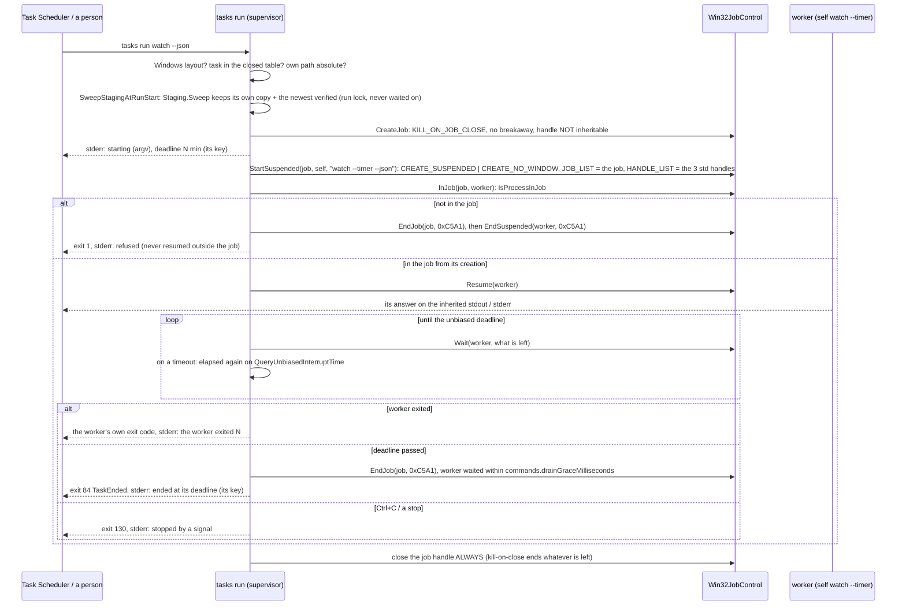

- **The verb** (`Cli/Commands/TasksCommand.Run.cs`, `CommandLine.cs`: `tasks run <task> [--json]`, exactly one task of
  `WindowsTask.All` and optionally `--json`, nothing else). The distro's binary refuses it (2). `archive` runs the archive body
  (below). A host whose own path is not absolute starts
  nothing (2). A configuration in error is NOT refused here: the worker reads the same layers and answers for itself.
- **The closed table** (`Core/Scheduler/TaskWorkers.cs`): `watch` → `<self> watch --timer` (+ `--json` when the supervisor got
  it; the task's action always passes it), deadline `mcpWatchdog.runLimitMinutes` (10); `archive` → the archive body's choice (`<self> archive preview` while the dry window is
  open, `<self> archive run` once it is not, + `--json`), deadline `timer.runLimitMinutes`. Each entry holds the task, its arguments
  and its deadline KEY together; the launch carries both the duration and `DeadlineKey` from that one entry, so no line can name
  another key. The supervisor spells `--timer`; the extension never does. `WorkerLaunch`'s constructor is internal, so the product
  builds a launch only here.
- **Its stderr lines**: ONE when supervision starts (`tasks run watch: starting <argv> in a kill-on-close job, deadline 10 min
  (mcpWatchdog.runLimitMinutes)`) and ONE terminal line — `the worker exited N`, the deadline line, `refused: <why>`, or `stopped by
  a signal` (then the program's `interrupted.`). The worker's own stderr lines come in between.
- **The supervisor** (`Core/Processes/JobSupervisor.cs`, behind `IWorkerSupervisor`; `CliHost.Supervisor`, wired only in
  `CliHost.ForThisMachine` on Windows — every host a test builds holds a `RefusingWorkerSupervisor`): the ORDER of the calls is
  the rule set, so it is written once over the `IJobControl` seam and read by a fake that records every call. Its clock is its own
  seam, `IUnbiasedClock` (`Core/Processes/IUnbiasedClock.cs`; `Win32Boot` implements it — `IWindowsBoot` extends it with the
  ledger's boot id), not the MCP ledger's `IWindowsBoot`. The wait is a LOOP: each timed-out wait reads the unbiased clock again and
  waits for what is left. The job is closed in a `using` whatever happens; the worker's handles too. A clock that stops answering
  mid-run counts as past the deadline (fail closed). After `EndJob` the worker is waited for within
  `commands.drainGraceMilliseconds` (the child runner's grace). `WorkerLaunch.Arguments` is an immutable COPY made by the
  constructor (`{ get; init; } = []`), so no caller's list can change what is started.
- **The Win32 half** (`Core/Processes/JobSupervisor.Win32.cs`, `Win32JobControl`, `LibraryImport` only, Native AOT):
  `CreateJobObjectW` with an explicit non-inheritable `SECURITY_ATTRIBUTES`; `SetInformationJobObject(JobObjectExtendedLimitInformation)`
  with `JOB_OBJECT_LIMIT_KILL_ON_JOB_CLOSE` alone; `CreateProcessW` with `lpApplicationName` = the absolute path (no search),
  `CREATE_SUSPENDED | CREATE_NO_WINDOW | EXTENDED_STARTUPINFO_PRESENT`, a `PROC_THREAD_ATTRIBUTE_JOB_LIST` naming the job — the
  worker is CREATED INSIDE it, so there is no moment between its creation and an assign in which a supervisor that dies would
  leave a suspended worker outside the kill-on-close job (the coai code round, finding 1; Windows 10+; a refused nesting fails
  `CreateProcessW`, nothing started) — then `IsProcessInJob` verifies the membership before the resume (not in the job → the job
  ended, the worker ended by its own handle, refused), `STARTF_USESTDHANDLES` and a
  `PROC_THREAD_ATTRIBUTE_HANDLE_LIST` of inheritable DUPLICATES of the three standard handles (closed again right after; a
  missing one is not passed; one that exists but cannot be duplicated refuses the start, `StandardCopies`); the command line quoted
  by `Core/Processes/WindowsCommandLine.cs` (the C runtime's rules, read back through `CommandLineToArgvW` in a test).
  No `AssignProcessToJobObject` any more; `ResumeThread`, accepted ONLY from the suspended start (a previous suspend count of exactly 1 —
  anything else is "not in its suspended start", the job is ended and the run refused); a `WaitHandle` over the process handle
  (with the run's cancellation; a failed wait throws, the job's `using` closes it, and the program answers 70); `GetExitCodeProcess`
  (unreadable → a refusal, never an invented code); `TerminateJobObject(job, 0xC5A1)`; `TerminateProcess` of the still suspended
  worker only, whose failure the refusal names (it then stays suspended, never resumed — never reported "ended").
  `ArchitectureTests.Only_the_supervisor_ends_a_process_through_a_job_or_by_its_handle` holds this file the only one that spells
  `TerminateJobObject`, `TerminateProcess`, `TerminateThread` (each also as `Nt…`/`Zw…`), `AssignProcessToJobObject` (still
  scanned, though the seam no longer calls it) or `CreateProcess*`, as a call or as a quoted entry point.
- **Its exits**: the worker's own code; **84 `TaskEnded`** (new; `contracts/exit-codes.json`, the extension's `DAEMON_EXIT.taskEnded`
  and its root kind `taskEnded`) with its terminal line naming the deadline and its key; 1 when no worker could run inside a job or
  its exit code could not be read (the reason is the line); 130 on a signal; 70 when a wait itself failed. The supervisor writes
  nothing to stdout — the worker's answer is the stdout.
- **Stops**: Ctrl+C / a console close reaches `ShutdownSignals`, the wait returns, the job is closed — kill-on-close ends the tree.
  Task Scheduler's *End* (and `ExecutionTimeLimit`, the deadline + 10 min, the outer net) terminates the supervisor itself; the
  OS then closes the job handle, and kill-on-close ends the tree the same way.
- **Since WR-D4** the supervised worker is the Windows watch (next section): `Scenarios/WindowsTasksRunFlows` runs `tasks run watch`
  over the built binary in a `ScenarioHome`, so the worker inherits `WSL_CARE_ROOT` and samples into the SANDBOXED ledger; the flow
  asserts exit 0, the worker's JSON answer on stdout, the ledger written and no history line. No flow starts a watch outside the sandbox.

## The Windows watch and the ledger lock (WR-D4 of PLAN_windows_runner.md, 2026-10-12)

What `tasks run watch` supervises every `mcpWatchdog.periodMinutes`: `wsl-care.exe watch --timer --json`. Until WR-D4 the Windows
binary refused `watch` (2). It now samples the Windows MCP servers into this user's CPU ledger and sweeps the run records' retention.
Nothing acts yet: A22 (S7b.3 of [PLAN_twenty_sessions_all_day.md](../todo/PLAN_twenty_sessions_all_day.md)) plugs into its `--timer`
branch later.

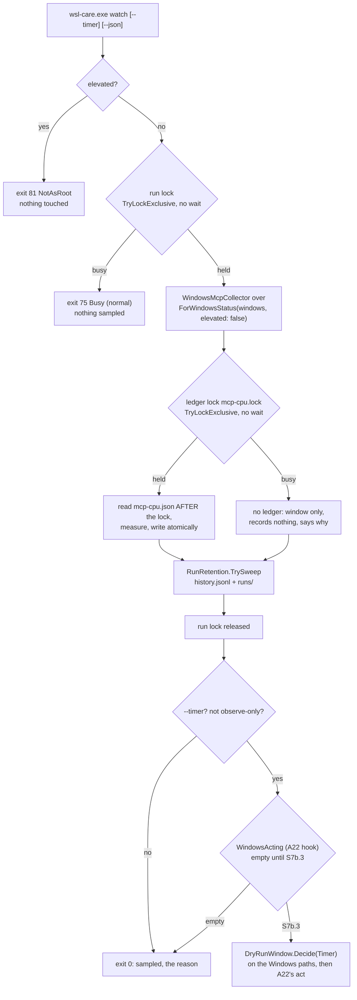

- **The verb** (`Cli/Commands/WatchCommand.cs`): on the Windows binary an ELEVATED process is refused whole, before the lock or any
  state (exit **81 `NotAsRoot`**, `WatchCommand.ElevatedRefusal`, the wording of `ArchiveRunCommand.ElevatedRefusal`) — the opposite
  of the distro's root check (77). The sandbox's privilege claim (`WSL_CARE_SANDBOX_PRIVILEGED=1`) counts as elevated there, which
  is how the built-binary flow proves the refusal. The context gains the Windows seams `WatchContext.WindowsProcesses` and
  `WindowsBoot` (`CliHost`'s; a context a test builds reads neither unless it scripts them).
- **The run** (`Core/Watch/WatchRun.Windows.cs`; `WatchRun.RunAsync` dispatches on the layout — the distro's path is unchanged):
  THE run lock (`%LOCALAPPDATA%\wsl-care\wsl-care.lock`) without waiting — busy is exit **75**, a normal answer (the next period
  samples). Under it: `WindowsMcpCollector` with `McpCpuLedgerPlace.ForWindowsStatus(windows, elevated: false)` — the user's own
  `mcp-cpu.json`, so the ledger advances every period, the interval basis every A22 decision needs — then
  `RunRetention.TrySweep` (`RunRetention.Sweep` guarded: a failing sweep is a problem in its report, never a crash; until now only
  `collect` swept, and nothing swept `runs/` on Windows). The lock is released before the `--timer` branch, as the distro's watch
  releases it before its act (an engine act takes the lock itself).
- **The `--timer` branch and the A22 hook**: without `--timer` → `WatchRun.NoTimerOnWindows`; observe-only → the engine's reason;
  then `WatchRun.WindowsActing`, the Windows actions the branch lets act — **empty until S7b.3** → `WatchRun.NoWindowsAct`. Only
  behind a non-empty list does `DryRunWindow.Decide(RunTrigger.Timer, …)` run on the Windows paths, so a watch with nothing to act
  on never writes `first-timer-run.json`: the dry-run week is not started before a Windows action can use it (the distro's watch
  keeps the same order: its switches before the dry decision).
- **What it records**: the ledger only. **No history line, no run detail** (S2b's rule: a watch that acts on nothing writes no
  run). `WatchResult.History` is `WatchRun.NoAgentHistory` (the agents' CPU history is the distro's evidence; the CLI does not
  warn about it). `WatchResult.Swept` / `watch --json`'s new `retention` member (absent on the distro) carry the sweep's
  `historyLinesRemoved`, `detailsRemoved`, `problems`; the run log has one line for it and one warning per problem, and the text
  answer's one line ends with `; retention: N history line(s) and M detail(s) removed` (its problems in brackets).
- **The ledger lock** (`Core/Mcp/McpCpuLedgerLock.cs`; coai plan round `8138f140`, finding 1): every Windows ledger WRITER — the
  Windows watch AND the Windows `status`, both through `WindowsMcpCollector` — does its read-modify-write under `mcp-cpu.lock`
  beside the ledger (`McpCpuLedgerPlace.WindowsState.LockFile`), taken with `IFileSystem.TryLockExclusive` and never waited on. The
  lease (`LedgerLease`) is taken BEFORE the ledger is read and released after it is written. Held elsewhere, the sample keeps no
  ledger (`WindowsCpuLedger.None`): it answers from the window and records nothing, its `cpuBaseline.reason` naming the held lock
  — so no write ever replaces a sample it did not read. A lost sample only makes the next interval longer. An elevated `status`
  (it writes nothing) takes no lock. There is one ledger; the lock file stays on disk, empty, like the run lock's.

## The Windows runner's archive body (WR-D5 of PLAN_windows_runner.md, 2026-10-14)

`tasks run archive` supervises the archive body (`Core/Scheduler/ArchiveBody.cs`, §3.5). The dry-run decision is taken in the
SUPERVISING process, before the worker's argv is chosen; the worker is one of the archive's two existing verbs.

**Two archive locks, two jobs** (the story's coai plan round `ad924fee`, finding 1): `archive.lock` (`%LOCALAPPDATA%\wsl-care\archive\
archive.lock`, an exclusive open the OS releases when its holder dies) serialises the archive runs of THIS user on THIS machine and
is taken first, its holder named from `holder.json`; the side lease (`SideLease`, a record in the BASE) serialises the runs of one
side across machines and hosts and is taken inside it, a dead holder of this host and boot taken over. Neither is the run lock.

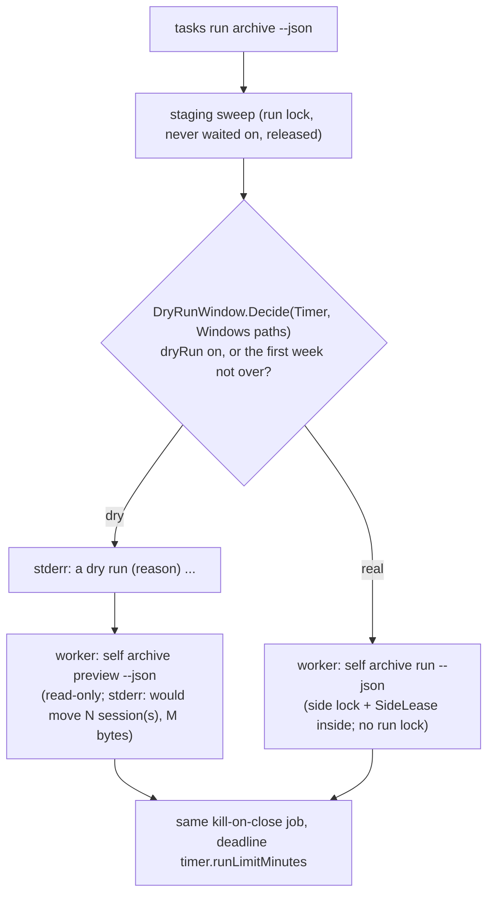

- **Where the decision lives**: in `TasksCommand.Run` through `ArchiveBody.Decide` (a `Lazy<DryRunDecision>`, asked ONLY by the archive
  entry of the closed table — taking the decision may write `first-timer-run.json`: ONE week, started by the first `tasks run` that
  reaches a gated body, §3.5). Two gates come BEFORE the stamp, in `WatchRun.Windows`' order: an observe-only configuration (a layer in
  error; the loader still merges the other entries, so `dryRun` may read false) and an elevated process both preview and write no
  stamp. The table (`TaskWorkers.For`) takes the decision, never argv: `ArchiveBody.ArgumentsFor` is the only mapping, so no caller
  can hand the table free text. WR-D4's
  watch decides inside its worker; the archive's argv depends on the decision, so here it is the supervisor's. The stamp is the
  Windows one, under `%LOCALAPPDATA%\wsl-care`.
- **The closed table** stays two shapes of argv per task: `archive preview` / `archive run` (+ `--json`), never free text. The
  run uses `archive run`'s own default budget (`archive.runBudgetMinutes`), inside the deadline `timer.runLimitMinutes`.
- **The run log**: a dry run says `tasks run archive: a dry run (<reason>): the worker is "archive preview" ...` (supervisor) and the
  preview worker says `archive preview: would move N session(s), M bytes; nothing was moved` on stderr — on the Windows binary's
  `--json` run only (`ArchiveCommand.SayWouldMove`; the distro's root reads its child's stderr as before). Enabled agents only.
- **No run lock, no lock across a wait**: the body takes none; `archive run` takes the side's lock and the side lease itself. A
  watch sample is never suppressed by a long archive (the test holds the run lock for the whole run, and probes it free when the
  supervisor launches the worker). A real second archive meets the side's LOCK first (`archive.lock`, before the lease): `busy`, exit
  75, naming the holder from `holder.json` (`… holds its lock (pid N, run R, since T)`, `ArchiveRun.BusyReason`); past the lock, the
  lease refuses a live holder by name (`another archive run holds the side (host …, pid …, run …, since …)`, exit 1). Either answer is
  the worker's own code, which the supervisor passes through.
- **The window is said once** before the worker starts: `a dry run (<why>)` or `a real run (<why>)` (`ArchiveBody.Note`).

## Windows memory pressure, one rule on both roads (E15.S5, 2026-10-12) — a report

Three host verdicts, judged by ONE pure function over one set of facts, on whichever road has the facts. Read-only: nothing is
acted on, no new command runs, and the never-list is untouched.

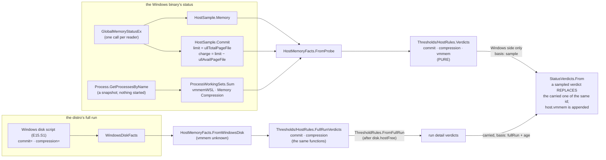

- **The facts** (`Health/HostMemoryFacts.cs`): `CommitBytes`, `CommitLimitBytes`, `CompressionBytes`, `VmmemBytes`,
  `HostTotalBytes` and the `.wslconfig` audit, each a `Reading`. `FromProbe(HostSample, audit)` is the Windows binary's road;
  `FromWindowsDisk(WindowsDiskSample, audit)` is the full run's, where vmmem and the host RAM are unknown ("vmmemWSL is read by the
  Windows binary's status"). `MEMORYSTATUSEX`'s page-file fields are the smaller of the system's and a job's commit limits; the
  daemon sets no job commit limit (WR-D3's job is kill-on-close only), so they are the system's. The two roads read the same commit quantity: on 2026-10-12 the perf counter and `MEMORYSTATUSEX`
  agreed to 0.01 %.
- **The readers fail ALONE** (`Collectors/WindowsProbe.cs`, `Collectors/ProcessWorkingSets.cs`). `Memory()` and `Commit()` each
  make their own `GlobalMemoryStatusEx` call, so a failure costs only that figure. `ProcessWorkingSets.Sum` reads vmmemWSL and
  Memory Compression from the process snapshot: no process, a process that exits between the listing and the read
  (`InvalidOperationException`), a refused read (`Win32Exception`, `UnauthorizedAccessException`) or a failed listing makes only
  that figure unavailable, with the exception named, and every listed process is released. (Before E15.S5 a vmmemWSL that exited
  between the two steps threw out of `status`.)
- **The rule** (`Thresholds/HostRules.cs`, PURE): `host.commit` ("charge of limit = %", warn above
  `thresholds.hostCommitWarnPercent`, 80; critical above `thresholds.hostCommitCriticalPercent`, 90; a limit of 0 is `unknown`);
  `host.compression` (warn above `thresholds.hostCompressionWarnGb`, 8 GiB); `host.vmmem` (warn above the existing
  `wslConfig.vmmemAdviceGb`, and its reason IS `VmmemAdvice.For`'s text — the level follows the advice, so they cannot disagree).
  An unread figure is `unknown` with its reason, never `ok`. `VmmemAdvice.For` gained an overload over the host's RAM in bytes;
  the old one delegates to it.
- **Where each road judges.** The full run: `HostRules.FullRunVerdicts` — `host.commit` and `host.compression` only, by the same
  functions — is spread into `ThresholdRules.FromFullRun` after the disk verdicts, so the distro's `status` carries those two with
  `basis: fullRun` and their age. It judges no `host.vmmem` (code round and own review, 2026-10-12): its script reads no vmmem,
  and a verdict that could only be `unknown` sat in every distro status, the status bar's tooltip and every run's history line.
  The Windows binary, and ONLY the Windows side (`ProbeSample.Side`; a distro sample that ever carried a host part keeps the
  carried verdicts): `StatusVerdicts.From` judges `HostRules.Verdicts` (all three) over its own sample with `basis: sample`. A
  sampled verdict REPLACES the carried full-run verdict of the same id, in that verdict's place — the newer, direct reading wins
  — and one nothing carried (`host.vmmem`) is appended after the carried ones (after `npm.cache`); a `status` never lists an id
  twice. `status` reads `.wslconfig` once on Windows and hands the same audit to
  the advice and to the verdict.
- **The keys** (`Config/ConfigKeys.Thresholds.cs`, display trust): `thresholds.hostCommitWarnPercent` (50–99, 80),
  `thresholds.hostCommitCriticalPercent` (51–100, 90), `thresholds.hostCompressionWarnGb` (1–256, 8). A coupled rule in
  `NumberRules` refuses a layer whose critical value is not above its warn value: as with every coupled rule and every invalid
  value, a machine-layer contradiction is an error (observe-only) and a user-layer one a notice (the value not taken). No softer
  path exists for display keys — a display key out of range in the machine layer is an error too — so this rule follows the
  existing ones (checked in the code round, 2026-10-12). The defaults are PROVISIONAL starting values
  (a heavy afternoon: commit 68.8 %, compression 6.0 GiB, vmmem 18.9 GiB); the full runs' records calibrate them.
- **Not built here**: a vmmem line in the distro's disk script. With it the full run can judge `host.vmmem` again
  (`FullRunVerdicts` gains it); it waits for E15.S1b, which changes that script. The status JSON's `host` block is unchanged (the figures travel as verdict values).

## Story history (moved from architecture.md, 2026-10-12)

What E4 built — the installer and the units (E4.S1) and the release pipeline (E4.S2) — moved here from
[architecture.md](architecture.md), unchanged apart from heading levels and the cross-references the move made wrong, to
keep that file well under the conventions resolver's 256 KiB per-file limit; architecture.md keeps a summary and stays
the entry point. The plan's decisions and review tables are in [PLAN_wsl_care_daemon.md](../todo/PLAN_wsl_care_daemon.md).

### The installer and the units (E4.S1)

`install.sh` (repository root, POSIX `sh`, `set -eu`, no `eval`, shellcheck-clean) is the install trust boundary:
`curl … | sudo sh` runs it as root on the owner's distro. It installs what a release archive carries —
`wsl-care-$VERSION-$RID.tar.gz` holding `wsl-care-$VERSION-$RID/` with `wsl-care`, `systemd/` (every unit of
`src_daemon/systemd/`) and `config/machine.json` (`src_daemon/config/machine.json`) — the layout E4.S2's release job
packs (plan §15e #1).

```mermaid
flowchart TD
    args["arguments<br/>--version · --skip-attestation · --set-default-user · --distro-name · --dry-run · --uninstall [--purge]<br/>each value checked against a whole-string pattern<br/>(--distro-name: WSL's rule = DistroIdentity.NamePatternText; empty = no name)"]
    pre["preflight — nothing written yet<br/>Linux · root (or --dry-run) · systemd booted (/run/systemd/system)<br/>arch → linux-x64 / linux-arm64 · tools<br/>/usr/local/bin/wsl-care absent or ours · wsl.conf decision"]
    ghpre{"gh ≥ 2.56.0 with attestation verify<br/>--bundle · --cert-identity · --deny-self-hosted-runners<br/>(unless --skip-attestation; asked BEFORE any download)"}
    rel["release: --version, or the newest daemon-v* of the releases API<br/>(never releases/latest — the extension's)"]
    dl["download archive + .sha256 into a mktemp folder (trap removes it)<br/>curl https-only, redirects too, --max-time"]
    sum{"sha256 of the archive<br/>= the .sha256?"}
    fetchatt["root fetches the attestations itself, unauthenticated:<br/>GET /repos/R/attestations/sha256:digest → each bundle_url<br/>→ the snappy bundle → unsnappy (od + awk)"]
    att{"as root, gh isolated in the temp folder, no token:<br/>gh attestation verify --bundle · --repo<br/>--cert-identity release.yml@refs/tags/daemon-vVERSION<br/>--deny-self-hosted-runners — any ONE bundle passes"}
    skip["--skip-attestation:<br/>ATTESTATION NOT VERIFIED, on stderr"]
    unp{"members: regular files and folders,<br/>all under wsl-care-V-RID/, no '..', no link"}
    files["/opt/wsl-care/bin/wsl-care 0755 · link /usr/local/bin/wsl-care<br/>the units → /etc/systemd/system 0644<br/>/etc/wsl-care/config.json ONLY if absent<br/>/var/lib/wsl-care · /var/log/wsl-care 0755"]
    conf["/etc/wsl.conf: [user] default= ONLY with the flag and only when none is set<br/>otherwise advice, nothing written"]
    pkgs["sysstat + atop via apt when missing<br/>debconf sysstat/enable=true; dpkg-reconfigure when still off"]
    units["systemctl daemon-reload · try-restart follower (upgrade)<br/>enable --now wsl-care.timer wsl-care-events.service<br/>enable --now sysstat.service atop.service<br/>each call ≤ WSL_CARE_INSTALL_SYSTEMCTL_SECONDS (900) + 10 s kill grace"]
    first["said first: may take minutes, at most 900 s<br/>[env WSL_DISTRO_NAME=--distro-name] /opt/wsl-care/bin/wsl-care collect<br/>(a root collect: DistroIdentity.Record writes distro-name.json — the installer never does)<br/>(one full run: records, never acts; ≤ 900 s + 30 s kill grace)"]
    ver["verify: sar · atop on PATH → is-active timer · events<br/>→ doctor --json healthy (wall-clock wait ≤ WSL_CARE_INSTALL_DOCTOR_SECONDS,<br/>each call cut to the deadline, at least 10 s)"]
    fail["exit 1: FAILED at step #quot;…#quot;<br/>+ how to re-run or --uninstall once something was written"]
    ok["summary"]

    args --> pre --> ghpre
    ghpre -- "missing / too old / a flag missing" --> fail
    ghpre -- usable --> rel --> dl --> sum
    sum -- no --> fail
    sum -- yes --> fetchatt --> att
    sum -- "yes, --skip-attestation" --> skip --> unp
    att -- refused --> fail
    att -- verified --> unp
    unp -- no --> fail
    unp -- yes --> files --> conf --> pkgs --> units --> first --> ver
    ver -- "a check fails" --> fail
    ver -- all hold --> ok
```

**What each check proves.** The `.sha256` is integrity only — whoever can replace the archive can replace its checksum
beside it. Authenticity is the build-provenance attestation, pinned to the EXACT certificate identity
`https://github.com/oleksandrdubyna88/wsl_care/.github/workflows/release.yml@refs/tags/daemon-v<version>`
(`--cert-identity`) with `--repo oleksandrdubyna88/wsl_care` and `--deny-self-hosted-runners`. E4.S1 used
`--signer-workflow …/release.yml`, which gh matches as a literal PREFIX of the identity, so `release.yml` built from any
branch passed (independent review HIGH, 2026-10-03; measured on gh 2.97.0 with cli/cli's own attestation:
`--signer-workflow …/deploy` accepted `…/deployment.yml@refs/heads/trunk`).

**How it is verified — root, a bundle, no login** (review LOW, the better design taken). E4.S1 ran `gh` online as
`SUDO_USER` through `runuser`, so that user's gh login, configuration and Sigstore cache decided the verdict. Now root
asks GitHub's attestation API for the archive's digest **unauthenticated** (`Accept: application/vnd.github+json`,
`X-GitHub-Api-Version: 2026-03-10`); the API answers every attestation by `bundle_url` alone (`bundle: null`, observed
for every probe on 2026-10-03), a blob of snappy-compressed JSON (`application/x-snappy`), which the installer fetches
(≤ 1 MiB, ≤ 10 bundles) and decompresses itself — `unsnappy`, awk over `od`, `LC_ALL=C` so mawk and gawk both write
each value as one byte (a real bundle carries bytes above 127). Then root runs `gh attestation verify <archive>
--bundle <file> …` with `HOME`, `GH_CONFIG_DIR`, `XDG_{CONFIG,CACHE,DATA,STATE}_HOME` inside the run's temporary folder
and every token variable unset: **measured, a `--bundle` verification needs no login** (gh 2.56.0–2.97.0, empty
configuration, no token); gh still fetches Sigstore's trusted root by TUF from `tuf-repo-cdn.sigstore.dev`, unauthenticated
(with the network cut it hangs until the 180 s ceiling — a refusal, never a pass). Each bundle is verified on its own
and any ONE passing suffices (gh before 2.65 stops at the first bundle in a set that fails — GitHub's own immutable-release
attestation sits beside a build attestation for some artifacts).

**Which gh** (review MEDIUM, corrected by measurement). The review assumed `gh attestation` (2.49.0+) suffices; bisected
over gh's releases on 2026-10-03, **2.56.0** is the oldest that verifies a public-good attestation today — 2.49.0 to
2.55.0 fail with `unsupported tlog public key type: PKIX_ED25519` (Sigstore's trusted root now carries a Rekor v2
Ed25519 key), and Ubuntu 24.04's own gh is 2.45.0 (no `gh attestation`). The preflight asks BOTH the version (≥
2.56.0) and `gh attestation verify --help` for the four flags, BEFORE any download, and points at GitHub's apt
repository (`cli.github.com/packages`) — never `apt-get install gh`, never a login. `--skip-attestation` proceeds with
a banner on stderr and the checksum still applies.

**Every step that writes goes through `run`**, which under `--dry-run` only prints `would run: …`; the dry run still
downloads and verifies into its temporary folder, needs no root, and changes nothing else. A failed step exits 1 naming
it (`preflight`, `resolve-release`, `download`, `checksum`, `attestation`, `unpack`, `install-binary`, `install-units`,
`machine-config`, `wsl-conf`, `packages`, `upgrade-wait`, `enable-units`, `first-run`, `verify: …`; uninstall: `units`, `purge`,
`verify: …`); a usage refusal exits 2.
`apt-get install` has no kill ceiling on purpose (a dpkg killed mid-configure breaks the package database) — its waits
are bounded by `DPkg::Lock::Timeout=300`; every other wait has one (`curl --max-time`, `timeout` around `gh`, `apt-get
update`, `units dropin`, `status`, every job-waiting `systemctl`, `collect` and `doctor`).

**The ceilings** (retro reviews of PR #8 and PR #11, 2026-10-06). Every `timeout` carries `-k`: SIGTERM at the ceiling,
SIGKILL after a grace (10 s; 30 s for the first `collect`), so a child that ignores SIGTERM never outlives its ceiling by
more than the grace. Every `systemctl` call that waits for a job — `daemon-reload`, `try-restart`, `enable --now`,
`disable --now`, `stop` — goes through `systemctl_job`, under `WSL_CARE_INSTALL_SYSTEMCTL_SECONDS` (default 900: above a stop's
worst case, `TimeoutStopSec` ≤ 300 s twice); measured on WSL Ubuntu, `sysstat.service` is `Type=oneshot` with
`TimeoutStartUSec=infinity` and `JobTimeoutUSec=infinity`, so `enable --now` had no ceiling at all. At the ceiling only the
WAIT ends — the step fails saying the job may still be running (`systemctl list-jobs`); a dry run prints the plain systemctl
command. The two waits run on the WALL clock and end at their deadline: the health wait
(`WSL_CARE_INSTALL_DOCTOR_SECONDS`, 120) gives each `doctor --json` what is left of it (at least 10 s) and never sleeps past
it, then at most the last look and the readable report, 10 s each plus the kill grace — a refusal within 120 + 40 s (it
counted only its 5 s sleeps before, so 120 s could stretch to ~50 minutes of 120 s calls); the upgrade wait
(`WSL_CARE_INSTALL_RUN_WAIT_SECONDS`, 600) does the same with each `status --json` (`WSL_CARE_INSTALL_STATUS_SECONDS`, 30, cut to
what is left, at least 5 s unless set lower). Every ceiling variable (and `WSL_CARE_INSTALL_PROGRESS_SECONDS`) is a whole number of seconds,
no leading zero, at most a day, or a usage refusal (exit 2) before anything runs; `SYSTEMCTL` and `STATUS` refuse 0, which
`timeout` reads as no ceiling. The first full run is announced before it starts — it takes minutes. An installed binary
that EXISTS but cannot be started is no status answer (in flight, then the refusal with the manual escape); only a binary
that does not exist means a fresh install.

**Uninstall** stops and disables the timer and the follower, stops a running full run, removes the units (every loaded `wsl-care-act@*` instance stopped first), the
binary, the link (only when it is the installer's) and the emptied `/opt/wsl-care`, and verifies the timer inactive and
the files gone. It keeps `/var/lib/wsl-care`, `/var/log/wsl-care` and `/etc/wsl-care`; `--purge` names and removes
exactly those and `/run/wsl-care.lock` — **only while it holds the run lock** (retro review of PR #8, G1): the daemon's
`RunLock` is `flock(2)` on `/run/wsl-care.lock` (.NET's `FileShare.None`), so after the units are stopped and the binary is
gone the installer takes `flock -n` on that file (fd 9) and removes the three folders and then the lock file itself, LAST,
inside the locked section — with no binary left nothing can lock a new file at that path in between. A run started by hand
(`sudo wsl-care collect`) still holding it refuses the purge at step `purge`: nothing of the state is removed, and the same
command purges once that run has ended. `--purge` needs `flock` (util-linux) and refuses at `preflight`, before anything
changes, without it. It never removes sysstat, atop, `/etc/wsl.conf` or a user's own layer.

**The units** (`src_daemon/systemd/`, all root):

| Unit | Shape | Why |
|---|---|---|
| `wsl-care.service` | `Type=oneshot`, `ExecStart=/opt/wsl-care/bin/wsl-care collect --timer`, `Nice=19`, `IOSchedulingClass=idle`, `MemoryMax=1G`, `TimeoutStartSec=276min` (above the derived worst case of a timer run, E7.S2b/S2c review C-H2; 240 until PLAN_boot_settle.md added the settle step's waits), `SuccessExitStatus=75 130`, `NoNewPrivileges=yes`, `KillMode=control-group`, `TimeoutStopSec=90`; no `[Install]` | `--timer` is the only thing that makes a run the timer (§15d CI). 75 is `ExitCode.Busy`: a second run meeting the lock is designed, not a failed unit (the health collector counts failed units); 130 is a stop asked for, recorded `interrupted` (retro over PR #11). `MemoryMax` is the cgroup's, so it covers every child — npm, dotnet, pip, the Docker CLI, the 2M-entry walk — and §8's 256M (a guess for the binary alone) was raised to 1G by the E4 review |
| `wsl-care.timer` | `OnCalendar=*-*-* 00/4:00:00`, `Persistent=true`, `RandomizedDelaySec=5min`, `AccuracySec=1min` | Persistent= acts on calendar timers only; the stored last trigger makes the first boot of the day run ONCE for the night's missed slots — the case §8's monotonic timer was chosen for. That catch-up fires at boot; the SERVICE then settles (`RunSettle`: `timer.bootDelayMinutes` after boot, then while S6 says busy, bounded) before it takes the lock — PLAN_boot_settle.md |
| `wsl-care-events.service` | `Type=simple`, `ExecStart=/opt/wsl-care/bin/wsl-care events follow`, `Restart=always`, `RestartSec=30`, `MemoryMax=1G`, `NoNewPrivileges=yes`, `WantedBy=multi-user.target` | the follower waits for Docker in-process (§15b #8); the restart is the outer net |
| `wsl-care-watch.service` | `Type=oneshot`, `ExecStart=/opt/wsl-care/bin/wsl-care watch --timer`, the hardening of `wsl-care.service`, `TimeoutStartSec=10min` (`mcpWatchdog.runLimitMinutes`, above `RunBudget.WatchRunWorstCase`), `SuccessExitStatus=75 130`; no `[Install]` | E14 S2b: the watch — root's MCP CPU ledger and the agents' CPU history every few minutes, and A19 as a recorded act (the busy half needs interval evidence the 4-hour timer never gives); since E14 S7b.2 the act is `[A19, A21]` — A21 ends client-gone interop relays with SIGTERM only, each action by its own switch; [module_mcp_servers.md](module_mcp_servers.md) § *The busy half and the watch*, § *A21* |
| `wsl-care-watch.timer` | `OnActiveSec=5min`, `OnUnitActiveSec=5min` (`mcpWatchdog.periodMinutes`), `AccuracySec=30s` | monotonic, from the timer's own start (a past `OnBootSec` would fire at `enable --now`, into the installer's first run): nothing to catch up after the VM was off; installed only when the release ships it |
| `wsl-care-act@.service` | template; `[Unit] CollectMode=inactive-or-failed`; `Type=oneshot`, `ExecStart=/opt/wsl-care/bin/wsl-care act --request %i`, the hardening of `wsl-care.service`, `TimeoutStartSec=infinity`, `SuccessExitStatus=3 75 76 78 79 80 82 130` (the RECORDED ends: an action failed, a refusal recorded, no request, an unusable request recorded, a stop recorded); no `[Install]` | a detached run the panel asked for (E6.S1, described with the detached runs in [architecture-daemon-e6.md](architecture-daemon-e6.md)); `CollectMode` sits in `[Unit]`, the only section systemd reads it from (0.1.0 had it in `[Service]`, ignored — fixed in 0.1.1) |

Each unit's configurable values (`timer.*`, `units.*`) come as a drop-in, `<unit>.d/50-wsl-care-config.conf`, that
`install.sh` writes from `wsl-care units dropin <unit>` (E7.S2c); the drop-in of the defaults says what the unit file
says.

**Hardening, decided per action.** Deliberately NOT set, because each breaks a named action: `ProtectHome` (A8, A12,
A14, A17 clean caches under the target user's home), `ProtectSystem=strict` (state, A9's `/var/cache/apt`, A10's
journal), `ProtectKernelTunables` (A1, A2 write `/proc/sys/vm`), `ProtectClock` (A16's `hwclock -s`), `PrivateDevices`
(A15's `fstrim`), `ProtectProc` / `PrivateUsers` / `PrivateTmp` (A11 and the collectors read every user's processes and
signal them by pidfd), a `CapabilityBoundingSet` (the set the actions need is nearly all of root's). Set: only what no
action relies on — `NoNewPrivileges=yes` (the run already is root; `runuser` only drops privilege; `sudo` is on the
never-list) and §8's resource limits. **One known risk is kept on purpose:** no_new_privs also blocks the AppArmor profile
change a snap application makes at start, so a Docker installed as a snap would fail under the timer (Docker figures
unavailable, A4–A7 refused) while working from a terminal; Docker Desktop's CLI and apt's docker-ce are not snaps. The
README says what to do, `POST_DEPLOY.md` #11 checks the journal for it (and for an OOM kill at `MemoryMax`). None of it
has been OBSERVED on a live systemd yet (E4's live install): it is a request to systemd until then, and the unit files
say so. `ShippedFilesTests` keeps the breaking directives out; CI's
`verify-systemd-units.sh` step reads every unit file (templates as instances, with their drop-ins) with systemd's own
parser.

**The machine layer is deliberately empty** (`src_daemon/config/machine.json`: comments and `{}`), not a copy of the
embedded defaults: a copy would freeze every default at the installed version, show every key as `(machine)` in `config
get`, and — the moment a later release renames a key — make the layer invalid and every run observe-only. Its comment
documents an example that `ShippedFilesTests` runs through the real loader.

**The test harness** is `InstallWorld` / the `Install*Flows` classes in `WslCare.Scenarios` (C#, the product's language, no new
dependency): the real script under `/bin/sh` over a temporary prefix `WSL_CARE_INSTALL_ROOT` (every path the script
reads or writes as a file sits under it), `TMPDIR` the world's own, a `PATH` of exactly two folders — the fake tool under
the names of everything that changes the machine or reaches the network (curl, gh, systemctl, apt-get, debconf,
runuser, sudo, plus `id` / `uname` so a test can be root or arm64) and links to an allowlist of real text and file
tools. The fake gained one answer option for it, `OutputFlag` (write the fixture to the file named after `--output`),
and since the E4 review a verifying `gh`: `VerifiesAttestation` makes it ENFORCE the identity flags of the call over a
bundle in Sigstore's own shape (`FakeAttestation`: the certificate's SAN and Fulcio extensions, the statement's digests;
`--cert-identity` exact, `--signer-workflow` a prefix, as measured on the real gh), and `WSL_CARE_FAKE_RECORD_ENV` makes
every call record the named environment variables — so a test proves what the installer's check lets through, and
under whose configuration, rather than the argv it sent. The worlds publish an attestation per release
(`AttestationBundles`: a self-signed certificate with the SAN and extensions, snappy-compressed, served at a bundle URL
named by the API answer), and a captured cli/cli bundle (`src_daemon/tests/fixtures/attestation/`) exercises the
decoder's copy elements.
The released binary is a stub that logs the path it was started as and hands its argv to a fake `wsl-care`, so the
absolute-path rule is observed, not assumed. [module_tests.md](module_tests.md) lists every flow and its red run.

### The release pipeline (E4.S2)

A daemon release is the tag `daemon-v<version>` plus a GitHub release holding, per RID, an archive, its `.sha256`, and a
build-provenance attestation of the archive signed by `.github/workflows/release.yml` — the three things `install.sh`
checks. Nothing has been released yet: the first cut, `daemon-v0.1.0`, is the owner's step after the settings of
`docs/repo-settings.md` (the App, its secrets, the two rulesets) are in place.

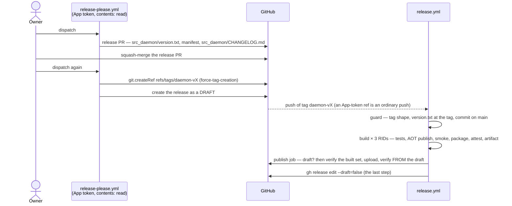

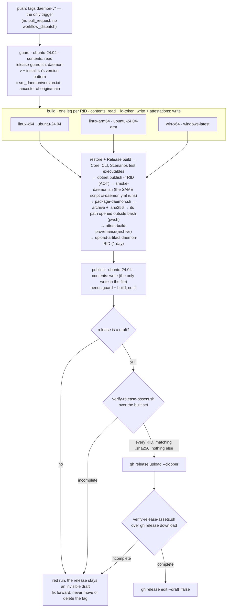

**Why the tag push is the trigger.** With `draft: true` + `force-tag-creation: true` release-please (holding the App's
token) creates the tag ref through `git.createRef` before it creates the draft release — read in its bundled source
(`release-please-action` v5.0.0, `dist/index.js`). That ref creation is an ordinary tag push, so `push: tags` fires —
the event the family's `bugs-v0.3.0` ran on. `release: published` never fires for a draft, and the draft is the point
(nothing public until every RID's asset is on it, plan §15e #2); `workflow_dispatch` carries no tag, so its attestation would not
carry the identity `install.sh` pins (`release.yml@refs/tags/daemon-v<version>`). A failed run is re-run, which replays the tag event.

**Permissions** (plan §15e #0): workflow level `contents: read`; the build job alone holds `id-token: write` +
`attestations: write` (it signs) and nothing that writes the repository, so it hands its archive to the run as an
artifact instead of to the draft; the publish job alone holds `contents: write`. `release-please.yml`'s job holds only
`contents: read` — every write there is the App token's.

**The scripts** (`.github/scripts/`, bash): `lib/daemon-assets.sh` is the asset contract in one place — the RIDs
(`DAEMON_RIDS`), the version pattern (equal to `install.sh`'s `VERSION_PATTERN`) and `daemon_archive_name` (tarball for
Linux, zip for Windows, an unknown RID refused rather than mapped). `package-daemon.sh` packs one archive with exactly the
E4.S1 layout (`wsl-care-$V-$RID/` with `wsl-care` 0755, every file of `src_daemon/systemd/` and `config/machine.json`
0644, folders, owner 0:0, sorted names, `gzip -n`; Windows: the exe alone, zipped with 7-Zip) and writes the `.sha256`
line itself (`<hash>  <name>`, so Git Bash's binary-mode `*` can never reach it) and prints the archive's path spelled for
the caller — from `<out-dir>` as given, through `cygpath -m` under Git Bash (E4 review B1). `release-guard.sh` and
`verify-release-assets.sh` are the two refusals the pipeline rests on; the latter takes optional RIDs to check one leg's
pair (`ci-daemon.yml`). `smoke-daemon.sh` is ci-daemon.yml's former smoke steps, now one script both workflows call
(plan §15e #5), six parts since the review added `preview --all --json`. Every one is shellchecked by `ci · workflows`;
`package-daemon.sh` and `verify-release-assets.sh` run on every pull request leg (all three RIDs, the Windows zip
included), and the scenario suite runs the scripts too (`PackageFlows` and `ReleaseScriptFlows` on Linux,
`PackagePathFlows` on every OS — under Git for Windows' bash on Windows, the zip wherever 7-Zip is on `PATH`). The
smoke itself runs in CI, not in the suite.

**What makes a daemon release** is the package path: release-please hands `src_daemon` only the commits touching a file
under `src_daemon/`, so a `.github/`- or root-only commit never reaches it. The former `exclude-paths: [".github"]` was
inert (no exclude path can remove a commit the split never handed over) and was removed by the E4 review;
`ReleaseConfigTests` holds the package-path rule and the key's absence. Before 1.0.0, `bump-minor-pre-major: true` makes
a breaking change a MINOR (release-please's default would jump to 1.0.0) and `bump-patch-for-minor-pre-major: false`
keeps a `feat:` a minor.

**The first version** is 0.1.0 exactly: the manifest says `"src_daemon": "0.0.0"` (release-please backfills a "previous
release" from the manifest only when it is not 0.0.0) and the package sets `initial-version: 0.1.0` (what
`buildNewVersion` returns with no previous release; the `simple` strategy does not override it). After the first release
both files say 0.1.0 and `initial-version` is never read again.

**Owner-applied settings, as files** (GitHub reads none of them; `docs/repo-settings.md` applies them, each with a probe
that must be refused): `.github/rulesets/tags-daemon.json` (target tag, `refs/tags/daemon-v*`, creation + update +
deletion, bypass = the release App alone) and `.github/rulesets/branch-main.json` (the default branch: no deletion, no
force push, linear history, pull requests with resolved conversations, squash or rebase, the six check names a pull
request reports — pinned to the GitHub Actions app, id 15368 — strict, no bypass). Sonar: `sonarcloud.yml` passes every
`key=value` of `.github/sonar.properties` to `dotnet-sonarscanner begin` (pinned 11.3.0, with `dotnet-coverage`
18.11.2 over the three test executables) and skips with a warning when `SONAR_TOKEN` is absent; the settings file is
deliberately NOT a `sonar-project.properties` — the .NET scanner 11.3.0 fails its `end` step when one sits in the folder
`begin` ran in (`SonarProjectPropertiesValidator`, read in its source). CodeRabbit: `.coderabbit.yaml` (ru-RU, chill,
per-path instructions) and `coderabbit-review.yml` (asks for the review once; the App's installation is the owner's).

**Kept equal by tests** (`ReleaseWorkflowTests`, `ReleaseConfigTests`, every OS — the workflows read with a small YAML
subset reader that refuses what it does not understand): the trigger, the permissions per job across every workflow,
`publish` needing `guard` + `build` with no `if:`, the release matrix = `DAEMON_RIDS` = ci-daemon.yml's matrix (same
runner per RID) with Linux on `ubuntu-24.04*`, both workflows calling `smoke-daemon.sh` with no inline copy, the stage
order inside a leg, the publish order, every `uses:` pinned to a 40-hex commit with its version, a ceiling on every job,
`persist-credentials: false` on every checkout, no `${{ }}` inside a `run:`, the release-please tag = the release
trigger = the tag ruleset's pattern, manifest = `version.txt`, and the required checks = the jobs a pull request runs —
the gating workflows DERIVED (every workflow a `pull_request` / `pull_request_target` triggers, minus the two named
non-gating ones, `sonarcloud.yml` and `coderabbit-review.yml`), every workflow declaring `permissions:` at the top or on
every job (a workflow without one would pass the per-job checks vacuously), and every pull-request leg packing the
archive and opening its path outside bash (E4 review B2, B5, B6).

## The Windows runner's staged copy (WR-D2 of PLAN_windows_runner.md, 2026-10-12)

The second story of [PLAN_windows_runner.md](../todo/PLAN_windows_runner.md): the copy a task runs. The extension runs
`tasks stage` on the BUNDLED exe (a short run, no child); it copies its own file into the staging root and sweeps the older
copies. `tasks stage --remove` is the *Remove* button's last step. Nothing is registered here (WR-E3 does).

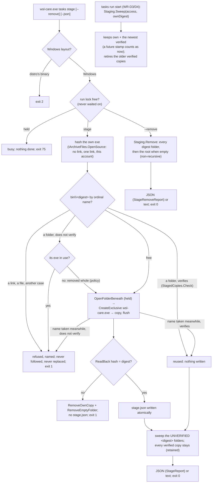

- **The verb** (`Cli/Commands/TasksCommand.cs`, `CommandLine.cs`: `tasks stage [--remove] [--json]`, each switch once, any
  order). The distro's binary refuses it with exit 2, as it refuses `tasks render`. A configuration layer in error does NOT refuse
  it: nothing is rendered from the configuration (only `records.maxStateFileBytes` caps the `stage.json` read), and *Remove* must
  still clear the copies. Exit 0 for staged, reused and every removal (a kept copy is named, not an error); exit 1 (`RunFailed`,
  its doc widened) when no verified copy was staged; exit 75 (`Busy`) when another run holds THE run lock — the stage, the removal
  and the run-start sweep take it without waiting (`StagingPlace.RunLockFile`), so two stages of one digest are serialised.
- **The source** is `CliHost.ProcessPath` (`Environment.ProcessPath`, wired only in `CliHost.ForThisMachine`; a test hands a
  sandbox file). It is opened through the archive's no-link open and hashed first: the digest names the folder.
- **The copy** (`Core/Scheduler/Staging.cs`) uses only the archive's file seam (`IArchiveFiles`): the digest folder opened (made
  when missing) and HELD under the staging root (`OpenFolderBeneath`), `wsl-care.exe` made by the exclusive no-replace create
  (`CreateExclusive`), the bytes streamed from a second no-link open and flushed to the disk, the folder flushed (a failed flush
  refuses the stage: a name that may not survive a crash is never recorded), the copy read back past the cache (`ReadBack`) and
  compared with the digest. Any failure removes THIS stage's own copy by its identity (`RemoveOwnCopy`) and its new folder only
  when empty (`RemoveEmptyFolder`, never recursive) — no `stage.json`, nothing swept; the refusal says how that removal went ("the
  copy was removed", or "could NOT be removed (…): it stays at <exe>", which the next stage replaces as unverified).
  Then `stage.json` (`{ version: the release, sha256, stagedAtUtc, source }`) is written with `IFileSystem.WriteFileAtomically`.
  Every create and write is judged by the deletion policy inside the staging root (action `tasks-stage`).
- **What is at the digest name** (by its ORDINAL name in the root's listing): a real folder is judged as an existing copy; a LINK
  (a junction) is refused, never followed and never replaced — a junction to a sibling would otherwise lead the replace to delete
  that sibling's exe; a file is refused as in the way; the same name in another case is refused (NTFS folds case, the sweep does
  not); a free name is staged.
- **Never over an existing folder in place**: an existing digest FOLDER is checked with the render's own `StagedCopies.Check`. It is
  reused when it verifies (nothing is written, its `stagedAtUtc` stays). When it does not verify (an interrupted stage: a half
  copy, a missing or disagreeing `stage.json`) it is removed WHOLE through the deletion policy — the sweep's exe-first removal —
  and staged fresh, so a retry recovers by itself; when its exe is in use it is refused and named. Nothing is ever written into an
  existing folder. The exclusive create is the second guard: a name taken between the classification and the create is judged as
  an existing folder, reused only when it verifies, never replaced.
- **The keep rule**: only a VERIFIED folder (`StagedCopies.Verify`: the render's checks without the release; `StagedCheck` carries
  `StagedAtUtc`) is ever protected; an unverified one never is, even one named with the running digest; `--remove` keeps nothing.
  `tasks stage` keeps EVERY verified folder and sweeps the unverified ones only — it cannot know which copy the registered tasks
  name (one declined registration, a skewed clock), and a verified folder is never that cost. The `tasks run` start sweep —
  `Staging.Sweep(StagingAccess, ownDigest)`, public for WR-D3/D4 — runs FROM the registered copy and keeps {own, the newest verified}:
  from the new copy it retires the older verified copies; from an old copy whose re-registration failed it keeps the new one. The
  newest is chosen with a clamp: a future `stagedAtUtc` counts as now and loses a tie to a genuine stamp. The folders kept by the
  rule besides the sweeper's own are answered as `retained`. So the staging bound (plan §3.10) rests on runs happening.
- **What each sweep hashes** (the coai code round on WR-D2, finding 2): the stage-time sweep and `--remove` (rare) hash every digest
  folder. The run-start sweep (every 5 minutes once the watch task runs) keeps its OWN folder when its `stage.json` agrees, UNHASHED
  (the render verified that copy at registration); it walks the other folders with an agreeing `stage.json` newest first and hashes
  only until one verifies — that one is kept — and retires every other folder unhashed, described from its `stage.json`. Running
  from the newest copy, the usual case, it hashes nothing.
- **Said on the run** (`TasksCommand.Run.cs`, finding 3): one stderr line when the run-start sweep was skipped (the run lock held),
  one when it retired folders, one naming the folders it could not remove; nothing when it did nothing.
- **The sweep** (`Core/Scheduler/Staging.Sweep.cs`): every entry of the staging root that is a FOLDER named with 64 lower-case hex
  digits, other than those the keep rule keeps, oldest first. Anything else — a person's folder, a file, a link (never
  followed), an upper-case or short name — is never touched and is listed as `untouched`. A folder goes **exe first**
  (`IFileSystem.DeleteFile`): an exe that is executing cannot be deleted (Windows refuses a running image, as it refuses a file
  held open without delete sharing), so the folder is KEPT WHOLE, `stage.json` too, and named with the reason; the next stage,
  remove or `tasks run` start retries. Only then the rest of the folder (`IFileSystem.DeleteDirectory`, judged inside the root).
  A sharing violation, or access denied on the exe (a running image), reads "in use"; any other failure "could not be
  removed (…)". Each folder says what it was: from its `StagedCopies.Verify` check when it was hashed — "an older copy (release …)"
  or "unverified: …" with the check's reason (a half copy, bytes that disagree with `stage.json`) — and from its `stage.json` alone
  when a run-start sweep retires it unhashed ("an older copy by its stage.json (…; not hashed)").
- **The removal** (`Staging.Remove`): the sweep keeping none, then the staging root itself through `RemoveEmptyFolder` (judged
  inside the state directory, which is never removed) only when nothing is kept and nothing is untouched.
- **The answers**: `StageReport {schemaVersion, outcome (staged, reused, refused, busy), reason, digest, path, version, source,
  swept[], kept[], retained[]}`, `StageRemoveReport {schemaVersion, outcome (removed, busy), reason, root, rootRemoved, removed[],
  kept[], untouched[]}` and the run-start `StagingSweep {swept, kept, retained, untouched, busy}`, each folder
  `{digest, path, why}`; the text form prints one head line and one `swept:` / `removed:` / `kept:` / `retained:` line per folder.
- **Not here**: no elevated refusal (the plan does not ask it; an elevated stage's copy may be owned by Administrators, and the
  render's no-link open then refuses it — not registrable, so nothing is registered); the extension's own digest compare and its
  `BUNDLED_DAEMON` check (§3.7) are WR-E3's.
