# module_vs_code — the VS Code extension (`src_vs_code/`)

> The module overview of the extension **AI OS Care** (Marketplace id `remsoftdev.ai-os-care`; its setting and command
> keys stay `wslCare.*`). The deep detail stays where it was written, in [architecture.md](architecture.md) — the
> sections *The extension: client, runner and fake (E5.S1)*, *The extension: status bar, read-only panel and polling
> (E5.S2)* (with the generated field-map table between its markers) and *The extension: Install daemon, packaging and
> its release (E5.S3)*; the root boundary, the cleanup buttons and the Logs page of E6.S2–E6.S4 are in
> [architecture-extension-e6.md](architecture-extension-e6.md) — and its tests in [module_tests.md](module_tests.md) §
> *The extension* and the E6 sections. This file is the map
> between them. Added 2026-10-06 by the retro review of PR #9 (the review gate found no module document for the
> extension, `common.knowledge-base`).

## Purpose

Show the `wsl-care` daemon's state inside VS Code — memory, swap, containers, the threshold verdicts, the cleanup
preview and the health checks — and, since E6.S2–E6.S4, run a cleanup **only after the person confirms it**, follow it
to its result across a reload, and show the run history on the *Logs* page. It reads through four closed daemon verbs
and three unprivileged run reads (`runs show`, `runs`, `logs`) via `wsl.exe` without a shell; it changes the machine
only through ONE module, `root/rootCall.ts` — a closed union of seven root calls (`ROOT_OPS`: preview, confirm,
stop, full check, root check and, since E10.S2b, *Restore*'s `restorePreview` / `restoreConfirm` over A20), built from
validated ids only and held by one host-side controller. It never starts a
stopped WSL distribution unless the person presses *Start WSL and check*, never starts one for a root call, and
*Install daemon* only TYPES the pinned install command into a terminal (the person presses Enter). Since
2026-10-08 (PLAN_windows_time_guard.md D7) it changes ONE thing on Windows itself, and only after a modal that shows the
exact commands: *Start Windows Time* runs one elevated Windows PowerShell (`Process.Start` with the `runas` verb) that sets the
Windows Time service to start Automatic (while `wslCare.windowsTime.setAutomaticStart` is on), starts it and resyncs.
And since 2026-10-08 (PLAN_windows_time_task.md) it can install, through the same launcher, ONE scheduled task that does
that by itself — *the Windows Time guard*, `\wsl-care\windows-time-guard`, run as SYSTEM at startup, at logon, every N
hours, on the Time-Service's stop event 258 and on the Service Control Manager's start-type change 7040 for `W32Time` (which, while
`wslCare.windowsTime.setAutomaticStart` is on, undoes a *disabled*), with a rate limit on starts — after showing the exact elevated script in
a read-only tab; it removes it the same way, and shows on the *Health* section what Task Scheduler holds.
Since E10.S1 it shows the daemon's AI-session archive in the *AI agents* section (three unprivileged reads: `archive status`,
`archive preview`, `archive check-base <path>`) and writes ONE daemon setting, `archive.baseFolder`, through ONE module,
`config/configCall.ts` — a folder the daemon itself judged and accepted, or the empty value that stops the archive — as the
person's own user, never `-u`, and only after *Choose archive folder…* or *Stop archiving* and their modal. Since E10.S1b
*Archive now* runs the daemon's A13 at once — through the cleanup controller as it is, one more id of the closed root union, with
its own modal and words, followed to its result across a reload.
Since 2026-10-10 ([PLAN_gpu_health.md](PLAN_gpu_health.md)) it reads Windows' display adapters itself (unelevated,
`Win32_VideoController`), puts a GPU that is not working at the TOP of the panel and on the status bar, and changes ONE more
thing on Windows, only after a modal that shows the exact script and the program: *Enable <GPU>* for an adapter at code 22,
through the same `runas` launcher — PowerShell 7 elevated (the MSI install, else the Store package by the path its own read
resolved and signature-checked under `Program Files\WindowsApps`; the owner's decision of 2026-10-10, the path of 2026-10-11),
Windows PowerShell 5.1 when neither is there, and the outcome names which. Since 2026-10-11
([PLAN_pwsh_engine_windows_time.md](PLAN_pwsh_engine_windows_time.md)) the same resolver — moved to `src/powershell/` —
also chooses the program of *Start Windows Time* and of the guard's install / remove, read before their modal and AGAIN right
before the launch; the guard's SYSTEM task stays on Windows PowerShell 5.1, and the panel names each part's engine.
Since E10.S2a the *Archive page* (`archivePage/`, a second
`WebviewPanel` in the Logs page's shape) shows what this distribution's archive holds — agent → month → entries — from ONE more
unprivileged read, `archive list --json`. Since E10.S2b it also selects verified sessions removed at their source and hands
their ids, as text, to the cleanup host's *Restore* — A20 through the cleanup transaction and the root road.
It runs on the Windows side (`extensionKind: ["ui"]`), on VS Code 1.85.0 or newer.

## Diagram

```mermaid
flowchart LR
    subgraph VSCode["VS Code (Windows, UI extension host)"]
        ext["extension.ts<br/>activate()"]
        poller["Poller<br/>(when to ask)"]
        client["WslCareClient<br/>(four closed verbs)"]
        runner["runner.ts<br/>(the one spawn, shell: false)"]
        store["OutcomeStore<br/>(newest outcome per verb)"]
        bar["StatusBar"]
        panel["PanelProvider<br/>(WebviewView)"]
        page["media/panel.js<br/>(textContent only)"]
        install["Install daemon<br/>(types, never runs)"]
        cleanupHost["CleanupHost<br/>(modals, journal, durable poll)"]
        controller["CleanupController<br/>(the one holder of root)"]
        rootCall["root/rootCall.ts<br/>(closed ROOT_OPS argv)"]
        logs["LogsPanel<br/>(WebviewPanel, run reads)"]
        archiveHost["ArchiveHost<br/>(archive reads, one flow at a time)"]
        configCall["config/configCall.ts<br/>(THE user-layer writer)"]
        archivePage["ArchivePanel<br/>(WebviewPanel, archive list)"]
    end
    wsl["%SystemRoot%\\System32\\wsl.exe"]
    daemon["/opt/wsl-care/bin/wsl-care<br/>status | preview | doctor | --version<br/>runs show | runs | logs<br/>archive status | preview | check-base | list<br/>config set archive.baseFolder<br/>-u root: act … --detach | --stop | collect --detach"]

    ext --> poller
    ext --> bar
    ext --> panel
    ext --> install
    poller -->|"run(verb)"| client
    poller -->|"set(verb, outcome)"| store
    client --> runner
    runner -->|"-d distro --cd / --exec"| wsl
    wsl --> daemon
    store --> bar
    store --> panel
    panel -->|"postMessage (data only)"| page
    page -->|"closed message set"| panel
    install -->|"terminal: -d distro --cd ~"| wsl
    panel -->|"clean / select / stop (row ids, indices)"| cleanupHost
    cleanupHost --> controller
    controller --> rootCall
    rootCall -->|"-u root, stdin only for --only -"| runner
    cleanupHost -->|"read: runs show, runs"| client
    logs -->|"read: logs, runs, runs show"| client
    panel -->|"startWindowsTime (bare)"| wtime["windowsTime/<br/>(modal, then ONE run)"]
    engine["powershell/<br/>(the launcher, the resolver, EngineHost)"]
    panel -->|"refresh: the engine read"| engine
    wtime -->|"engine() before the modal, reread() before the launch"| engine
    engine -->|"unelevated probe: Get-AppxPackage, Get-AuthenticodeSignature"| runner
    wtime -->|"powershell.exe -Command (absolute), the chosen engine"| runner
    runner -->|"Process.Start(runas) -EncodedCommand"| w32["elevated pwsh 7 (MSI or Store, verified) or Windows PowerShell 5.1<br/>Set-Service · Start-Service · w32tm /resync"]
    panel -->|"installWindowsTimeGuard / removeWindowsTimeGuard (bare)"| guard["windowsTime/guard*<br/>(read-only tab, modal, pending run)"]
    guard -->|"engine() before the modal, reread() before the launch"| engine
    guard -->|"the same runas launcher, the chosen engine"| runner
    runner -->|"elevated: Register-ScheduledTask / DeleteTask"| sched["Task Scheduler<br/>\wsl-care\windows-time-guard (SYSTEM)"]
    guard -->|"unelevated query (Schedule.Service, read)"| runner
    sched -.->|"boot · logon · every N h · event 258 · SCM 7040 (W32Time)"| w32
    panel -->|"chooseArchiveFolder / stopArchiving (bare)"| archiveHost
    archiveHost -->|"read: archive status, preview, check-base"| client
    archiveHost -->|"the judged folder, or empty"| configCall
    configCall -->|"daemonArgv, no -u"| runner
    panel -->|"archiveNow (bare)"| archiveHost
    archiveHost -->|"archiveNow: the archive's conditions hold"| cleanupHost
    cleanupHost -.->|"act A13 --preview / --confirm --detach"| controller
    gpu["gpu/<br/>(GpuHost: adapters, alert, bar mark, pending enable)"] -->|"unelevated query: Win32_VideoController"| runner
    gpu -->|"read the tail: %LOCALAPPDATA%\Ollama\server.log"| ollama["Ollama's server.log<br/>(inference compute)"]
    panel -->|"enableGpu (index)"| gpu
    gpu -.->|"mark: GPU off / GPU ?"| bar
    gpu -->|"its query embeds the shared probe; the shared resolver"| engine
    gpu -->|"the same runas launcher"| runner
    runner -->|"elevated: Get-PnpDevice re-check · Enable-PnpDevice"| pnp["the display adapter<br/>(code 22 → 0)"]
    panel -->|"openArchive (bare)"| archivePage
    archivePage -->|"read: archive list"| client
    archivePage -->|"restore: the selected entry ids as text"| cleanupHost
    cleanupHost -.->|"facts: restoreInFlight, restoreBlocker"| archivePage
    cleanupHost -.->|"act A20 --preview / --confirm --detach --entry - (ids on stdin)"| controller
```

## Core entities

| Entity | File | What it is |
|---|---|---|
| `WslCareClient` | `src/client/WslCareClient.ts` | Builds every `wsl.exe` argv: the three WSL questions (`--list --quiet`, `-l -v`, `--list --running --quiet`) and `-d <distro> --cd / --exec /opt/wsl-care/bin/wsl-care <verb>` for the four verbs of `client/verbs.ts`. Validates the `wslCare.distro` setting before any spawn, makes no `-d` call into a stopped distribution, shares a call in flight per (setting, verb), checks the schema per verb (`client/handshake.ts`), maps exit codes (`client/exitCodes.ts`). |
| `Runner` | `src/process/runner.ts` | The only module that starts a process: `{file, args}`, `shell: false`, a ceiling per call, bounded output, bytes back. `runnerSelection.ts` picks the real runner, the strict fake (Test mode) or the closed runner (Test mode without a fake — starts nothing). |
| `Poller` | `src/poll/poller.ts` | Decides WHEN: only a focused window polls, only `status`; `preview` and `doctor` on panel open and Refresh. Stamps each round with its target (the distro setting); a round for a new target clears the store and makes older rounds obsolete. |
| `OutcomeStore` | `src/state/outcomeStore.ts` | The newest outcome of `status`, `preview` and `doctor` plus the "checking" flag — the one source the bar and the panel read. Read-only verbs, so nothing is persisted. |
| `StatusBar` | `src/statusBar/` | `WSL RAM <used>% · swap <x>G · <n> containers`, coloured by the worst `memory.*` / `kernel.*` verdict. |
| `PanelProvider` + field map | `src/panel/` | The `WebviewView`: a static shell with a per-render nonce and a strict CSP (`panelHtml.ts`), rows from ONE table (`fieldMap.ts`, rendered by `viewModel.ts`), a closed page→host message set validated exactly (`messages.ts`). |
| *Install daemon* | `src/install/` | The pinned command in one module (`installCommand.ts`), the flow (`installDaemon.ts`), a modal and a terminal — recorders in Test mode (`installUi.ts`). It installs `INSTALL_DAEMON` (0.1.2), a value of its own since 2026-10-06 — never below `MIN_DAEMON_FOR_RENDER` (0.1.0, the oldest daemon the extension renders) nor `MIN_DAEMON_FOR_ACTIONS` (0.1.0, the daemon the cleanups need; before the rebase onto #37 *Install daemon* typed this one): 0.1.0's act unit carries the CollectMode defect, so a new install gets the fixed release while an installed 0.1.0 still renders. All three are in `min-daemon.json`; the release guard requires every one published and the stamp at or above the install pin. |
| Root boundary | `src/root/` | `rootCall.ts` — the closed `ROOT_OPS` union and the only argv with `-u root`; `cleanupController.ts` — the one holder: ids = the compiled registry ∩ `status.actions`, acting only on advertised `status.capabilities`, A4's volume names only from a held, frozen preview, one root call in flight per distribution, an unknown detach followed through `status.running`; `rootIds.ts` validates action ids, run ids and 64-hex names — and, since E10.S2b, archived entry ids (`EntryIds`: 16 lowercase hex, 1 to `MAX_RESTORE_ENTRIES`, none twice, made only by `entryIdsOf`). E10.S2b adds *Restore*: `previewRestore(texts)` (texts → `EntryIds`, else `entriesRefused` before anything starts; A20 only when the daemon REPORTS it — `GateOpen.reported`, the button-only ids included, while the cleanup ops still take `allowed` — with `archive.restore` + `act.entryStdin` + `act.shownList`; more ids than `act.maxShownNames` refused), the held preview's `restore` selection (every shown id validated, none twice, `shown.length == min(count, cap)` with `shownTruncated` exactly when capped, frozen), and its confirm piping the HELD shown ids (a cut or empty list → `restoreListInvalid`, never confirmed); a restore detach answered without a run id never adopts the full check's `["collect"]`. The bundle scan keeps every root word inside this region (E6.S2; `--entry` and `A20` joined its exact set in E10.S2b). |
| Cleanup buttons | `src/cleanup/` | `cleanupHost.ts` — the host transaction behind *Clean*, *Clean selected*, *Run full check now* and *Stop*: sanitised modals, the `globalState` journal of run ids until a terminal answer, the durable poll through `runs show` (E6.S3); `cleanupView.ts` derives the controls; *Last cleanup* from `status.lastCleanup`. Since E10.S2b a run of ONE named action is told in its own words from ONE table, `runWords.ts` (root-free): A13 *the archive run* / *Archiving… the aged AI sessions* / "moved X, N objects archived", A20 *the restore run* / *Restoring… archived sessions* / "N archived session(s) restored", A21 *the relay stop* / *Stopping… the client-gone relays* / "ended N relays" — it replaced `isArchiveOnly` and S7b.2b's `isRelayOnly` at their sites. `CleanFlow.restore(texts)` is the cleanup transaction over A20 (one flow at a time, the preview, the restore modal — "Restore N archived session(s) in …", up to ten sessions, how — the age re-check, the journal entry before ONE detached confirm); a preview offering none still restorable opens no modal (the relay stop's `nothing` outcome, reused). `CleanupHost.restore` refuses and tells while `restoreBlocker()` names a reason (A20 not offered with every capability its preview and confirm need — the controller's own `actionGate` — or the cleanup controls greyed); `restoreInFlight()` is a journal entry or a daemon running block of A20 alone. |
| Elevated PowerShell (shared) | `src/powershell/` | PLAN_pwsh_engine_windows_time.md: `elevatedLauncher.ts` — the ONE `runas` launcher (moved from `windowsTimeFix.ts`; `LAUNCH_EXIT` 0 / 13 / 1223; the unelevated Windows PowerShell 5.1 starts the elevated program through `Process.Start`, the inner script as `-EncodedCommand`); `elevatedEngine.ts` — the ONE resolver (moved from `src/gpu/`): `MODULES` (the module path pinned first in every probe query and every guard script), the probe (`TAG_HELPER`, `SIGNED_HELPER`, `PWSH_PROBE` inside `try`/`catch`, five tags since `pwsh.programFiles`), `engineOf` (the MSI `pwsh` 7 verified at the known-folder path, else the Store package verified under the KNOWN-FOLDER Program Files — the environment's `ProgramFiles` must name the same folder, else nothing is elevated — else 5.1), `elevatedArg`, `NO_ENGINE`, `byEngine` / `elevatedProgramLine` / `engineChangedSentence` / `withStoreNote` (the words every elevated flow shares), `fileInfoOf`; the launcher's `failedExit` is the ONE failing-exit outcome both Windows Time flows use, and `process/notAnswered.ts` the ONE wording of a query that did not answer (GPU, guard, engine read); `engineHost.ts` — the engine read for the Windows Time runs: `ENGINE_QUERY` (the probe alone, unelevated, `wslCare.timeouts.engineProbeSeconds`), `engineReadOf` (a read that did not answer runs 5.1 and its label says PowerShell 7 could not be checked, and why), `EngineHost` (`engine()` reads first when there is none or the last one did not answer, `refresh()` shares a read in flight, `reread()` always asks again after one; a listener or ceiling that throws never rejects; the GPU line and the guard line come from two reads, so for one refresh after a Store update they can name two versions), `engineProblem` (another program, or a re-read that did not answer — worded apart — starts nothing), `guardEngineLine`; `taggedAnswer.ts` — the ONE strict reader of a tagged answer (a tag printed twice is named), shared by the GPU query and the engine read; `engineRecorder.ts` — the read recorded in Test mode. Nothing here imports `gpu/` or `windowsTime/` (`elevatedEngine.test.ts`). |
| GPU alert, *Enable <GPU>* | `src/gpu/` | PLAN_gpu_health.md: `gpuScripts.ts` — the unelevated `Win32_VideoController` query (every field printed through ONE line-break-stripping helper, the name last, the Store PowerShell 7 package resolved and signature-checked as Windows sees it, the count last) and the elevated enable as a pure function of ONE id that passed `INSTANCE_ID` (no quote, `$`, backtick or whitespace), re-checking the device as administrator (present, `Display`, still 22) before `Enable-PnpDevice`, `PnpDevice` by absolute path under the cut module path; the engine that runs elevated (the owner, 2026-10-10; the path, 2026-10-11; round 4): ONE PowerShell verdict for both installs — a real file, no link, Authenticode Valid from Microsoft — the MSI `pwsh` 7 when the LAST read gave it that verdict at the path the known-folder API names and the environment's `ProgramFiles` agrees, else the Store package by the path that read resolved (`Get-AppxPackage`) and verified under this machine's `Program Files\WindowsApps` with Microsoft's publisher id — a folder only TrustedInstaller writes, which Node cannot even see (ENOENT), so the read's facts stand alone — else Windows PowerShell 5.1, named in the modal and the outcome; the user's alias under `%LOCALAPPDATA%` is never started; `gpuProblems.ts` — the ONE code → meaning / fix / restart table; `gpuState.ts` — the answer as one closed state (`unknown` with its reason, never "no GPU"; a tag printed twice is `unknown` too, so a name carrying a newline cannot spoof the count or shadow an id; more than `MAX_ADAPTERS` (32) adapters is `unknown`, never a partial read), the alerts (each button carrying the read's time stamp — which the page keeps OUT of the live region's identity, so a new read with the same words is not re-announced; the region itself is mounted once beside the rest of the panel and never detached), the working line, the bar mark; `gpuEnable.ts` — the order (offered → not busy → ONE look at the engine and the settle setting, the request built for that engine → modal → the pending record read AGAIN → a fresh read that re-verifies the elevated program, so a program other than the one the modal named starts nothing → pending → one run → re-read, none after a declined prompt) and the sentence worded from the code Windows reports after, naming the engine (and, on the Store package, why exit 13 may be the elevating account); `gpuPending.ts` over the shared `state/pendingRun.ts` (extracted from the guard's pending run; advisory coordination, its residual in `gpuEnable.ts`'s header); `ollamaLog.ts` — the last `inference compute` line of a bounded tail, or why the log could not be read (only ENOENT / ENOTDIR read as absent); `gpuHost.ts` — one query and one enable at a time, a button from an older read refused (`readAt`) and Windows read again, the working line saying "checking again…" while a query runs (beside an alert, a Health line of its own), a query that throws read as `unknown` (never a rejection into the host), the periodic timer and the deadline re-render (armed at start and after every read; a settings change keeps it); `gpuUi.ts` / `gpuRecorder.ts` — real surfaces or a recorder in Test mode; `gpuWiring.ts` — the command (its read shown in a progress notification; a QuickPick among several disabled) and the settings listener. |
| Logs page | `src/logsPage/` | A `WebviewPanel` under the panel's shell and CSP: periods (This run, Today, Yesterday, a day, a range) become argv in `period.ts` alone, over the UTC instants of local midnights; a closed message set (`logsMessages.ts`); the selection persisted in `globalState`; nothing computed in the page (E6.S4). Since E10.S2c (D8) `runDetail.ts` takes the words of a single-action run from `cleanup/runWords.ts` (root-free; `structure.test.ts` holds it so): the run list's *Actions* cell reads "A13 ran (n) — AI sessions archived" / "A20 ran (n) — archived sessions restored" (the count the daemon's), *This run*'s actions table names them the same way, and the *removed* table of A13 is titled "A13 — AI sessions archived, per agent" (Agent / Moved / What the archive did) and of A20 "A20 — archived sessions restored" (Archived session / Size / Agent, month and outcome) over the daemon's name, size and note; every other action keeps the generic table. |
| *Start Windows Time* | `src/windowsTime/` | PLAN_windows_time_guard.md D7: `windowsTimeFix.ts` — the elevated script as module constants (modules from `$PSHOME`, `w32tm.exe` by absolute path, one exit code per failure because an elevated child's streams cannot be read), the request for the engine the shared resolver chose (the launcher itself lives in `powershell/elevatedLauncher.ts`), the closed outcome, the flow (since PLAN_pwsh_engine_windows_time.md D3: the engine read → modal naming the program → the engine read AGAIN (`launchedFix`; another program, or no answer, runs nothing — `notRun`) → one run → *Run full check now* on success; a done, failed or timed-out outcome ends with the elevated program, exit 13 on the Store engine with the Store note; the first press may wait up to `engineProbeSeconds` for the engine read, with no progress notification before the modal); `windowsTimeNeed.ts` — the panel offers it only on the daemon's verdicts (`clock.timeService` warn/critical, `clock.reference` critical); `windowsTimeUi.ts` — the real modal, a progress notification while it runs, or a recorder in Test mode. |
| *The Windows Time guard* | `src/windowsTime/guard*.ts` | PLAN_windows_time_task.md: `guardTask.ts` — the task as pure functions of the settings (the ONE-line action reusing story 1's start-type, start and resync lines with a rate limit on starts before them; the XML with its SYSTEM principal, five triggers (the fifth, SCM 7040 for `W32Time`, since the later 2026-10-08 change — the start-type line then runs only when the type is not already Automatic, so the guard's own change cannot re-fire it), read ACE for Authenticated Users and plain `-Command` action; the canonical summary and the PowerShell that prints it); `guardScripts.ts` — the elevated install (ScheduledTasks imported by its absolute System32 path, exit 33 when it cannot — PowerShell 7 with the pinned module path does not hold it, measured 2026-10-11; folder through `Schedule.Service`, `Register-ScheduledTask -Xml -Force`) and removal ("if present" at every step), the unelevated read-only query (since 2026-10-11 also `stamp=present|absent`: a task gone with its stamp still there — a removal the Store engine may have virtualised — says so and offers *Remove* again), the length bound; `guardState.ts` — the query's answer as one closed state and the panel's line and buttons (the registered summary is compared with `guardSummary` line for line, byte for byte EXCEPT the three duration fields — `delay=`, `interval=`, `limit=` before a line's first free-text field (`subscription=`, `path=`, `args=`) — which are compared by value through `durationSeconds`: Task Scheduler stores a registered `PT60S` as `PT1M`, measured on the owner's machine 2026-10-10, and 0.3.0 read every real install as "not as the current settings would install it"); `guardPending.ts` — the elevated run persisted in `globalState` before it starts (checked again after the modal), held past a timeout until its deadline or until Task Scheduler shows its end, swept at activation; `guardFlow.ts` — the order (the engine read → tab → modal naming the program → the engine read AGAIN → the time → another window's pending run looked for → pending → one run → re-read) and the closed outcomes (`notRun` when the read before the launch disagreed; exit 33 the ScheduledTasks module); `guardHost.ts` — one query and one flow at a time, and the part's engine line from the engine read (`guardEngineLine`: the runs' program, the task on 5.1 as SYSTEM; re-rendered on engine reads too); `guardUi.ts` / `guardRecorder.ts` — the read-only tab, the modal, the progress, or a recorder in Test mode. |
| *The AI-session archive* | `src/archive/`, `src/config/configCall.ts` | E10.S1 (plan §15s): `archiveHost.ts` — the two reads (`archive status`, `archive preview`) asked only on the panel's refresh and only of a daemon whose `status` advertises `archive.run` / `archive.preview`, one flow at a time, the reads again after a write; `archiveFlow.ts` — *Choose archive folder…* (the folder dialog → `archive check-base <path>` → a refusal told with its rule and nothing written, or a modal with the daemon's warnings → *Use this folder* writes the folder AS THE DAEMON SPELT IT) and *Stop archiving* (a modal → the empty value), the ONE importer of the writer; `judgedFolder.ts` — the branded `JudgedFolder`, made only from an ACCEPTED report; `archiveView.ts` — the base folder, per agent what is due, the agent's own retention and the retention badge exactly when it is below the effective age, the run lock and the last run, the three buttons (greyed without `archive.checkBase`, *Stop* and *Archive now* also without a folder); never a lasting *checking…* — a failed panel `status` reads *unavailable — <reason>*, a daemon answering no archive status after a refresh *update the daemon*, a failed preview *What is due: <failure>*, a missing figure *unknown* (never 0), and while the reads run again the panel says the lines are the previous answer; after any write that may have happened (written, timed out — `unknown` —, failed) the reads run again; `archiveUi.ts` / `archiveRecorder.ts` — the dialog and modal, or a recorder in Test mode. `config/configCall.ts` spells `config set archive.baseFolder <v>` and nothing else (never `-u`, never `reset`, no other key), reads the text answer by its exit (0 written; 2, 81, 70 the client's failures — `config set` never answers 78) and takes the run-read ceiling; the bundle scan holds its region to an exact literal set and keeps `config` out of every other region. The path rule of both the check and the write is `shared/basePath.ts` (the daemon's `IsPathArgument` + the key's 1024 limit). **E10.S1b, *Archive now*:** the section's third button posts the bare `archiveNow`; `ArchiveHost.archiveNow()` refuses it, and says why, on the archive's own conditions (`archiveNowBlocker`: a capability not advertised, A13 not offered, no folder set, the archive folder being changed — the conditions the button greys on, because the palette's command and a stale page send the same bare request; the own review on Fable, #1) and hands it to `CleanupHost.archiveNow()` (refused and told while the cleanup controls are greyed), which runs `CleanFlow.archive()` — the cleanup transaction over the ids `['A13']`: `act A13 --preview --json` as root (the controller needs `archive.preview`, `previewNeeds`), the archive's modal (each agent's sessions and bytes from the preview's items, read whole by `rootAnswers.ts`; *Archive*; no second modal), the journal entry before the call, ONE `act A13 --confirm --manual --detach --json` (needs `archive.run`, `confirmNeeds`), the follower; the words are chosen by an entry of A13 alone (since E10.S2b `runWords.ts`, which replaced `isArchiveOnly`): *the archive run*, *moved* not *freed*, *Archiving… the aged AI sessions* in flight. A13's preview share is `wslCare.timeouts.archivePreviewSeconds`. The button is greyed unless the daemon advertises everything the controller's preview and confirm of A13 need — `ARCHIVE_NOW_CAPABILITIES` is `previewNeeds(['A13'])` ∪ `confirmNeeds(['A13'])`, ONE definition, the controller's (`running.block`, `runs.show`, `act.shownList`, `archive.preview`, `act.detach`, `archive.run`; the second code round #2) — offers A13, a base folder is set, no archive flow is busy and the cleanup controls are enabled (`ArchiveHost` reads them from the cleanup host, re-renders on its changes and stops listening on `dispose`). A done archive run's notice reads its bytes through `sizeText` (200 B, never 0.0 GB); a queued or wedged archive run is named *the archive run* in the cleanup controls, as a live one reads *Archiving…*; a held preview's `details` are frozen with its `items`. |
| *The Archive page* | `src/archivePage/`, `media/archive.js` | E10.S2a (plan §15s D6, D9): `archivePanel.ts` — ONE `WebviewPanel` `wslCare.archive` under the panel's shell and CSP (`panelHtml.ts` page `archive`), one slot (`panel/panelSlot.ts`, moved from `logsPage/` and shared with the Logs page), restored after a reload by its serializer; `archiveController.ts` — vscode-free: reads `archive list --json` (`client archiveList`, unprivileged, the archive preview's ceiling) on the page's first `ready` and on *Refresh*, only of a daemon advertising `archive.list` (else it says to update the daemon; a status that newly advertises it reads the list, one that drops it ends the list), shares a read in flight with every Refresh (greyed meanwhile), takes the list's exit 1 WITH an answer (an unreachable base) as the answer, drops an answer to an older read (a generation count), starts afresh when the page is closed, opens a month by an INDEX into the months it holds and keeps it open by agent and month (a refreshed list keeps it), tells an index the list no longer holds; `archiveMessages.ts` — the closed set (`ready`, `refresh`, `rendered`, `expandMonth` / `collapseMonth` / `selectMonth` / `toggleEntry` `{index, generation}`, `clearSelection`, `restore`, `showPaths` / `hidePaths`; an index from an older view is refused, E10.S2b); `archiveSelection.ts` (E10.S2b, pure) — selectable = verified, `sourceRemoved` / `split`, an id of the daemon's shape; the ceiling `min(restoreCeiling, status.limits.maxShownNames)` (no readable `restoreCeiling` → none, *Restore* greyed, "update the daemon"); a new list keeps the selection BY ID and counts what it dropped; *Select month* takes the newest by `archivedAtUtc` when the month does not fit; the controller holds the selection by entry id, hands it in the list's order as TEXT to the cleanup host (`ArchiveRestore.start`, wired in `extension.ts` — the page imports nothing of `cleanup/` or `root/`), shows the host's *Restoring…* or why *Restore* is greyed, and reads its list again and clears the selection when the restore stops being in flight; `archiveViewModel.ts` — pure: the D9 label, the base folder, the answer's notes, skipped lines and a not-`done` outcome, per agent its months (counted and summed over the answer's own entries), per open month its entries — the session path SHORT (`…/<last segment>`) until *Show full session paths*, the status in words from ONE table of the daemon's index events (an unknown one `unknown (<value>)`), *verified* or, for an unverified entry removed at its source, the terminal sentence; `media/archive.js` — the one file that renders it (`createElement` / `textContent`), so the page can move into the shared kit (`todo/PLAN_disk_health.md` E18). Opened by the archive section's *Open archive…* (greyed without `archive.list`) and `wslCare.openArchive`. No module under it imports `root/` or `config/` (`structure.test.ts`). |
| Number settings | `src/settings/numbers.ts` | Every E6 number — the host ceilings (each above the daemon's own worst case for its call), the cleanup and Logs limits — as an `application`-scope setting, held equal to `package.json`. |

## Entry points

- **Activation** — `onStartupFinished`; `activate()` in `src/extension.ts` wires the client, the poller, the store, the
  bar, the panel and the commands, and asks `status` once if the window is focused.
- **Commands** — `wslCare.openPanel`, `wslCare.refresh`, `wslCare.startWsl`, `wslCare.installDaemon`, and since E6.S4
  `wslCare.openLogs` (also in the panel's title bar), and since 2026-10-08 `wslCare.startWindowsTime` (also a panel
  button while the daemon's verdicts ask for it), `wslCare.installWindowsTimeGuard` and `wslCare.removeWindowsTimeGuard`
  (also the *Health* section's buttons beside the guard's line), and since E10.S1 `wslCare.chooseArchiveFolder` and
  `wslCare.stopArchiving` (also the *AI agents* section's buttons beside the archive's line), and since E10.S1b `wslCare.archiveNow`
  (the section's *Archive now…* button), and since E10.S2a `wslCare.openArchive` (the section's *Open archive…*). No cleanup is a command: cleanups start only from the panel's
  buttons, through the host's modals. **Every command has a button in the panel UI** (the owner's standing rule of
  2026-10-09; the palette may duplicate a button, never be the only way): `src/panel/commandButtons.ts` declares where each
  one lives — a page button posting the same operation, the panel view's title bar (`wslCare.openLogs`), or the activity-bar
  icon for the opener — and `commandButtons.test.ts` holds it to the manifest and to the page's real button sets.
- **Webview panels** — `wslCare.logs` (the Logs page) and, since E10.S2a, `wslCare.archive` (the Archive page), each restored
  after a reload by its serializer (`onWebviewPanel:wslCare.logs`, `onWebviewPanel:wslCare.archive`).
- **View** — the activity-bar container `wslCare` with the webview view `wslCare.panel`.
- **Settings** — `wslCare.distro` (empty = WSL's default distribution), `wslCare.refreshSeconds` (30 to 86 400,
  default 120) and, since E6, the number table of `settings/numbers.ts` (`wslCare.timeouts.*`, `wslCare.cleanup.*`,
  `wslCare.logs.*`) — every one `application` scope, so a workspace cannot steer them; since 2026-10-08
  `wslCare.windowsTime.setAutomaticStart` (default on) and `wslCare.timeouts.windowsTimeFixSeconds` (default 180); for the
  guard `wslCare.windowsTime.guard.everyHours` (4), `….minMinutesBetweenStarts` (10), `….delaySeconds` (60),
  `….timeLimitMinutes` (5) — baked into the task at install — and `wslCare.timeouts.windowsTimeGuardSeconds` (180),
  `wslCare.timeouts.windowsTimeGuardQuerySeconds` (30); since 2026-10-11 `wslCare.timeouts.engineProbeSeconds` (20, 5–120: the engine read); since E10.S1 `wslCare.timeouts.archivePreviewSeconds` (630, its minimum
  strictly above the daemon's `archive.previewTimeoutSeconds` at its range maximum, 600 s; since E10.S2a also the ceiling of
  `archive list`).
- **Test mode** — `activate()` returns a test API only in `ExtensionMode.Test`; the extension-host tier drives it.

## External dependencies

| Dependency | Why |
|---|---|
| VS Code API `^1.85.0` (`@types/vscode` pinned to it) | the host; the Node of VS Code 1.85 is 18, so the bundle targets node18 |
| `wsl.exe` (absolute, System32) | the only way the extension reaches the distribution — facts measured in [2026-10-03_wsl_exe_facts.md](2026-10-03_wsl_exe_facts.md) |
| Windows PowerShell 5.1 (absolute, `System32\WindowsPowerShell\v1.0`) and UAC — and, for the user-context elevated runs (*Enable <GPU>*; since 2026-10-11 *Start Windows Time* and the guard's install / remove), PowerShell 7 elevated through the MSI install or the Store package's resolved path under `Program Files\WindowsApps` (`Get-AppxPackage` and `Get-AuthenticodeSignature` in the extension's own query, at every read and once more before the launch; the owner's decision of 2026-10-10, [2026-10-10_gpu_disabled.md](2026-10-10_gpu_disabled.md) §G9) | *Start Windows Time*, the guard's install / remove and *Enable <GPU>* (the guard's SYSTEM task stays on 5.1); the UAC prompt is Windows' own and its policy is the machine's (`ConsentPromptBehaviorAdmin`) — the extension's modal is the confirmation it controls ([2026-10-08_windows_time_stopped.md](2026-10-08_windows_time_stopped.md) §4) |
| Task Scheduler (`Schedule.Service`, `Register-ScheduledTask` from the ScheduledTasks module imported by its System32 path), the Time-Service's Operational channel and the System log | the Windows Time guard only: registered and deleted elevated, read unelevated; its stop-event trigger needs the Operational channel enabled (measured enabled; the panel says when it is not), its start-type trigger reads the System log, which is always on — [2026-10-08_windows_time_guard_trigger.md](2026-10-08_windows_time_guard_trigger.md) §2, §6 |
| the `wsl-care` daemon ≥ `minDaemonForRender` of `src_vs_code/min-daemon.json` (*Install daemon* installs its `installDaemon`) | `status --json`, `preview --all --json`, `doctor --json`, `--version`, the run reads, and the root calls of `ROOT_OPS`; their shapes are the golden contracts in `contracts/golden/` and `contracts/*.json` (actions, exit codes, status limits). Acting needs `minDaemonForActions` and, as the authority, the capabilities `status` advertises |
| esbuild (`scripts/bundle.mjs`), `@vscode/vsce`, `@vscode/test-electron`, TypeScript, typescript-eslint | build, package, extension-host tests, lint — dev only; the `.vsix` ships no runtime dependency |
| `release-extension.yml` + `.github/scripts/release-extension-guard.sh` | the release pipeline: guard → build → attest → github-draft → publish-marketplace → github-public; the guard and `check-vsix --root-allowed` keep a root-capable bundle out of `extension-v0.1.0` and earlier (plan §15j B3, §15k #7); publish-marketplace decides "served" with `marketplace-served.cjs` and waits with `wait-marketplace-served.sh` (up to 45 minutes, every attempt logged, 2026-10-09) |

## Known limits (owner decisions and live-gate observations)

- The polling cadence's run-log churn is the owner's open decision M1
  ([2026-10-04_extension_poll_churn.md](2026-10-04_extension_poll_churn.md)); the daemon prunes its run logs after
  `logging.retentionDays` (default 14).
- Where *Install daemon*'s terminal opens in a Remote – WSL window, and which settings file a UI extension reads there,
  are E5 live-gate observations (`POST_DEPLOY.md` item 3).
- **A18's and A19's buttons are not built yet.** They stay in `BUTTON_ONLY_IDS`, so the E6 cleanup gate never acts on them. A21's
  button (S7b.2b) built the `--process` road they will use.
- **Stop client-gone relays (S7b.2b).** A21 left `BUTTON_ONLY_IDS`, and runs through the cleanup host's transaction, on *Archive
  now*'s road.
  - **The preview** holds A21's `shown` processes (each a canonical `pid:start`, `rootIds.shownProcessOf`) under A4's count/cap
    invariant — ONE `ShownSelection<T>` for both. A list past `MAX_PROCESS_ARGS` (500) is cut, because the pairs travel as argv
    and Windows' command line is 32 767 characters. The modal says the timer takes the rest.
  - **The confirm** (`rootCall.confirmTail`) spells `--process <pid:start>` once per held process. There is never an empty list,
    never one without A21, and never one beside A4's `--only -`.
  - **The gate:** `act.shownList` and `act.processList` for the preview, `act.detach` and `act.processList` for the confirm.
  - **The preview's ceiling** is A21's own share: the fd scan's range maximum, 30 s (`worstCases.relayScan`).
  - **The panel:** one line in *AI agents* from `status.interopRelays` (`relays/relaysView.ts`): the counts, or "unavailable —
    <reason>", and the timer's switch with the daemon's command that flips it. The extension never writes daemon config. Beside
    it, the button, with each blocker's sentence.
  - **The three preview states:** unavailable tells the reason, empty tells the daemon's basis (every kept relay and why), and
    only a non-empty preview opens the modal.
  - **The words** (since E10.S2b the A21 row of `cleanup/runWords.ts`, which replaced `isRelayOnly`): *Stopping… the client-gone relays*, *the relay stop*, "ended N relays; their Windows programs
    end with them", and the relays that did not end on SIGTERM.
  - **The confused deputy:** the page sends a bare `stopRelays`. The processes come only from the controller's held, frozen
    preview, through the validator. The daemon re-validates, intersects them with a fresh judgement, and re-judges again before
    SIGTERM, so a stale list ends nothing A21 would not end alone.
  - **`state/statusBody.ts`** is the one reader of the newest status body, its capabilities and its actions. It was extracted from
    the archive host, which now uses it.
