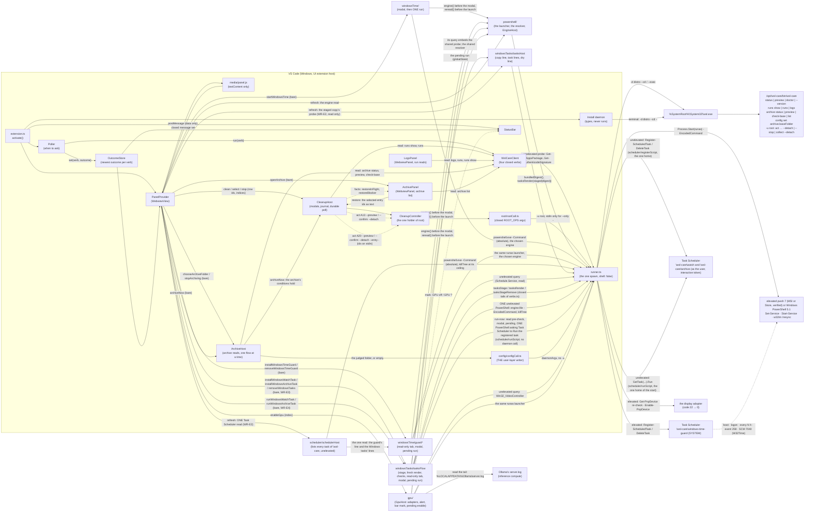
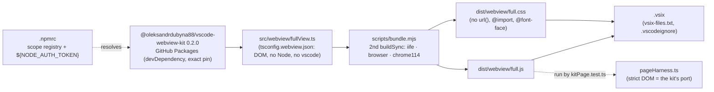
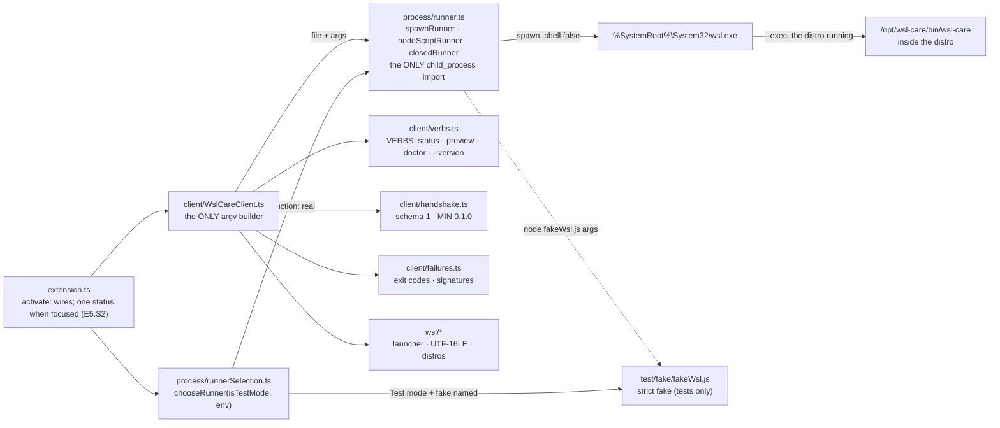
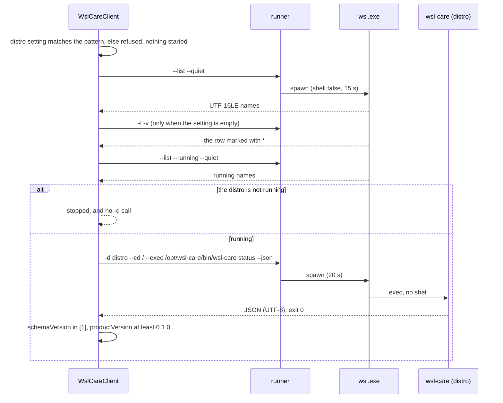
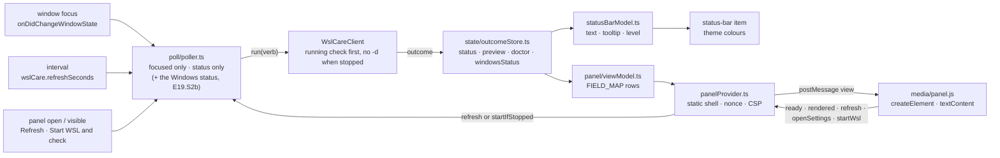
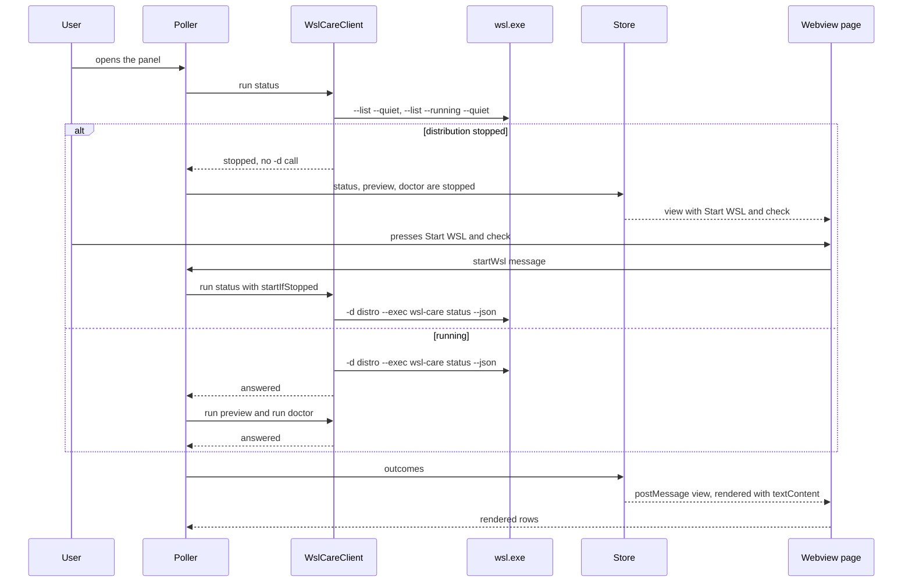
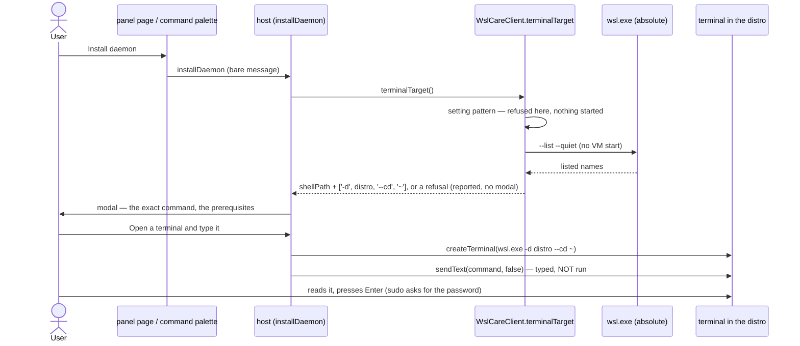
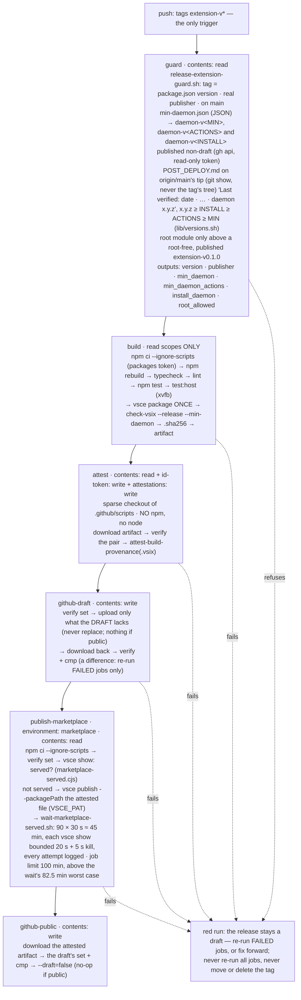

# module_vs_code — the VS Code extension (`src_vs_code/`)

> The module overview of the extension **AI OS Care** (Marketplace id `remsoftdev.ai-os-care`; its setting and command
> keys stay `wslCare.*`). The deep detail of E5 is in § *Story history* below — the sections *The extension: client,
> runner and fake (E5.S1)*, *The extension: status bar, read-only panel and polling (E5.S2)* and *The extension: Install
> daemon, packaging and its release (E5.S3)*, moved from [architecture.md](architecture.md) on 2026-10-12; the generated
> field-map table stays in architecture.md § *The panel's field map*, between its markers; the root boundary, the cleanup buttons and the Logs page of E6.S2–E6.S4 are in
> [architecture-extension-e6.md](architecture-extension-e6.md) — and its tests in [module_tests.md](module_tests.md) §
> *The extension* and the E6 sections. This file is the map
> between them. Added 2026-10-06 by the retro review of PR #9 (the review gate found no module document for the
> extension, `common.knowledge-base`).

## Purpose

Show the `wsl-care` daemon's state inside VS Code — memory, swap, containers, the threshold verdicts, the cleanup
preview and the health checks — and, since E6.S2–E6.S4, run a cleanup **only after the person confirms it**, follow it
to its result across a reload, and show the run history on the *Logs* page. It reads through four closed daemon verbs
and three unprivileged run reads (`runs show`, `runs`, `logs`) via `wsl.exe` without a shell; it changes the machine
only through ONE module, `root/rootCall.ts` — a closed union of seven root calls (`ROOT_OPS`: preview, confirm,
stop, full check, root check and, since E10.S2b, *Restore*'s `restorePreview` / `restoreConfirm` over A20), built from
validated ids only and held by one host-side controller. It never starts a
stopped WSL distribution unless the person presses *Start WSL and check*, never starts one for a root call, and
*Install daemon* only TYPES the pinned install command into a terminal (the person presses Enter). Since
2026-10-08 (PLAN_windows_time_guard.md D7) it changes ONE thing on Windows itself, and only after a modal that shows the
exact commands: *Start Windows Time* runs one elevated Windows PowerShell (`Process.Start` with the `runas` verb) that sets the
Windows Time service to start Automatic (while `wslCare.windowsTime.setAutomaticStart` is on), starts it and resyncs.
And since 2026-10-08 (PLAN_windows_time_task.md) it can install, through the same launcher, ONE scheduled task that does
that by itself — *the Windows Time guard*, `\wsl-care\windows-time-guard`, run as SYSTEM at startup, at logon, every N
hours, on the Time-Service's stop event 258 and on the Service Control Manager's start-type change 7040 for `W32Time` (which, while
`wslCare.windowsTime.setAutomaticStart` is on, undoes a *disabled*), with a rate limit on starts — after showing the exact elevated script in
a read-only tab; it removes it the same way, and shows on the *Health* section what Task Scheduler holds. Since WR-E2 that is ONE read of every task under `\wsl-care` (the guard's line and the two Windows tasks' lines come from it), plus the staged copy of the bundled exe and, per task, whether it is registered as this version would register it. Since WR-E3 it also installs and removes those two tasks (*Install the Windows watch task*, *Install the Windows archive task*, *Remove the Windows tasks*): each is ONE unelevated PowerShell started DIRECTLY (the engine's own program, `-EncodedCommand`, tree kill at its ceiling) after the daemon staged and rendered the task, the render was checked field by field, the exact script was shown read-only and a modal was confirmed; the pending run is persisted before it starts and cleared on every answer but a timeout.
Since E10.S1 it shows the daemon's AI-session archive in the *AI agents* section (three unprivileged reads: `archive status`,
`archive preview`, `archive check-base <path>`) and writes ONE daemon setting, `archive.baseFolder`, through ONE module,
`config/configCall.ts` — a folder the daemon itself judged and accepted, or the empty value that stops the archive — as the
person's own user, never `-u`, and only after *Choose archive folder…* or *Stop archiving* and their modal. Since E10.S1b
*Archive now* runs the daemon's A13 at once — through the cleanup controller as it is, one more id of the closed root union, with
its own modal and words, followed to its result across a reload.
Since 2026-10-10 ([PLAN_gpu_health.md](PLAN_gpu_health.md)) it reads Windows' display adapters itself (unelevated,
`Win32_VideoController`), puts a GPU that is not working at the TOP of the panel and on the status bar, and changes ONE more
thing on Windows, only after a modal that shows the exact script and the program: *Enable <GPU>* for an adapter at code 22,
through the same `runas` launcher — PowerShell 7 elevated (the MSI install, else the Store package by the path its own read
resolved and signature-checked under `Program Files\WindowsApps`; the owner's decision of 2026-10-10, the path of 2026-10-11),
Windows PowerShell 5.1 when neither is there, and the outcome names which. Since 2026-10-11
([PLAN_pwsh_engine_windows_time.md](PLAN_pwsh_engine_windows_time.md)) the same resolver — moved to `src/powershell/` —
also chooses the program of *Start Windows Time* and of the guard's install / remove, read before their modal and AGAIN right
before the launch; the guard's SYSTEM task stays on Windows PowerShell 5.1, and the panel names each part's engine.
Since E10.S2a the *Archive page* (`archivePage/`, a second
`WebviewPanel` in the Logs page's shape) shows what this distribution's archive holds — agent → month → entries — from ONE more
unprivileged read, `archive list --json`. Since E10.S2b it also selects verified sessions removed at their source and hands
their ids, as text, to the cleanup host's *Restore* — A20 through the cleanup transaction and the root road.
It runs on the Windows side (`extensionKind: ["ui"]`), on VS Code 1.85.0 or newer.

## Diagram

## Core entities

| Entity | File | What it is |
|---|---|---|
| `WindowsCareClient` + the Windows row | `src/client/WindowsCareClient.ts`, `src/bundled/` | E7.S5a ([PLAN_bundle_windows_binary.md](PLAN_bundle_windows_binary.md)): the ONE module that names the bundled exe — `<extension>\bin\wsl-care.exe` by absolute path, only on Windows and a `file:` extension, `VERBS.version` alone, through the SAME runner seam as `WslCareClient` (the Test-mode fake, which learns the exact path, or the closed runner; never the Windows-Time real runner), `windowsHide`, the `wslCare.timeouts.versionSeconds` ceiling; a refused start is Node's message as Windows gave it. `BundledHost` reads it on the panel's refresh, never at activation; `bundledView.ts` words the *Health* row against `BUNDLED_DAEMON` (the build this extension carries; a mismatch says to reinstall; nothing off Windows). Never elevated, never from `windowsTime/`, `root/` or `powershell/` (`bundledExeStructure.test.ts`). The exe itself is fetched by `npm run fetch:windows-daemon` (`scripts/fetch-windows-daemon.mjs` → `.github/scripts/fetch-windows-daemon.sh`, the pin read from `min-daemon.json` as JSON; Git's bash on Windows) into the git-ignored `bin/`; tests read it through `test/support/bundledExe.ts` (missing on CI fails, off CI it is dropped from the expected list). S7b's long-lived watch must copy the exe or run briefly (an image lock blocks the extension's update) and own its process tree (a Job Object). **Widened by WR-E1** ([PLAN_windows_runner.md](../todo/PLAN_windows_runner.md) §3.8, *WR-E1 as built*): the exe is named by an `ExeSource` — `bundled`, or `staged(<digest>)` = `<LocalAppData>\wsl-care\bin\<digest>\wsl-care.exe` (the client DERIVES the folder from the `localAppData` option and refuses one not in its normal form; the digest must be 64 lower-case hex digits or `exe` THROWS before any path is built). The bundled exe is asked `--version`, `tasks stage` and `tasks stage --remove`; the staged copy `tasks render <watch|archive>`; either exe the five Windows run reads (`read`, typed `WindowsRunRead`, sharing `client/runReadChecks.ts` with `WslCareClient`). Every `tasks` answer is typed from the exit code AND the JSON (`client/windowsTasks.ts`): render = `registrable` / `notRegistrable` / `wrongSide` (2) / `configurationInError` (78); stage = `staged` / `reused` / `refused` (1) / `busy` (75, only with a busy or no answer) / `provenanceRefused` (a digest other than the one the CLIENT computed from the bundled exe, a path other than the staged exe it would start, or a `version` other than `BUNDLED_DAEMON`); a render is `registrable` only for `BUNDLED_DAEMON`, the digest asked and the file the client ran; remove = `removed` / `busy`; a code and an outcome that disagree are a failure, and `stage.json` is never read. Never `tasks run`, never `--timer` (`structure.test.ts`: the `tasks` words are `verbs.ts`'s alone). The strict fake learns `stagedExe` and `tasks` (the daemon's render golden + stage fixtures in `test/fixtures/windows-tasks/`) and refuses every other argv of either exe. **The Windows `status` read (E19.S2b, [PLAN_disk_hygiene_windows_E19.md](../todo/PLAN_disk_hygiene_windows_E19.md) decision 12):** `status()` runs `status --json` on the bundled exe under its own ceiling `wslCare.timeouts.windowsStatusSeconds` (default 20 s, minimum 12 s: `worstCases.windowsStatus` = the MCP CPU window + the run-log listing, the distro status's own expression — the Windows side waits one window and lists no logs — held strictly below by `ceilings.test.ts`), and `client/windowsStatus.ts` reads the result into the SAME `VerbOutcome` the distro's `status` is: `parseAnswer('status', …)` (`checkedBody` / `statusAnswer`, raw body kept), `versionRefusal`, the failure kinds the client already uses (a timeout `timedOut`, exit 2 `refused`, 70 `internalDefect`, any other exit `unknownFailure` with the daemon's `wsl-care:` lines via `classifyDirectExit`, a refused start `unknownFailure` with Node's message, off Windows `notWindows`) — every ending an outcome, none a throw. The answered outcome's `distro` is `WINDOWS_SIDE` (`'Windows'`): the side, not a distribution. The extension builds ONE client (`windowsClientOf`), shared by `BundledHost` (`--version`), the poller (`status`) and — WR-E2 — `TasksHost`. |
| The Windows tasks' read (WR-E2) | `src/scheduler/` (the peer), `src/windowsTasks/`, `src/windowsTime/` | WR-E2 ([PLAN_windows_runner.md](../todo/PLAN_windows_runner.md) §3.8, *WR-E2 as built*): the guard's unelevated `QUERY_SCRIPT` was widened to list every task under `\wsl-care` (`GetTasks(1)`; per task `enabled`, `state`, `lastRunUtc`, `lastResult` and `SUMMARY_FUNCTION's `summary:` lines; `user=<sid>`; `folder=absent` for `0x80070002` — an empty task set; `read=unreadable` for one task that cannot be read), `scheduler/schedulerAnswer.ts` parses it (a task whose fields do not parse is unreadable alone), `scheduler/queryScript.ts` builds the query from the caller's facts (the guard's `channel=` and `stamp=`, from `windowsTime/guardScripts.ts`), `scheduler/taskSummary.ts` holds `SUMMARY_FUNCTION`, `durationSeconds` and `summariesMatch`, and `SchedulerHost` holds the ONE read in flight (one more query when asked during a flight; no timer; ceiling `wslCare.timeouts.windowsTimeGuardQuerySeconds`, at which the runner ends the PowerShell's whole tree — `ProcessRequest.killTree` = ONE fixed verifying PowerShell, `process/treeKill.ts`: the host's own child only, each process by pid AND creation time, never by image name, never asked once the child exited, bounded, and the result's `treeEnded` is its VERIFIED verdict — the timeout line claims the tree ended only for true), and the guard host consumes it (`parseGuardAnswer(stdout, task)`). `windowsTime/` and `windowsTasks/` consume `src/scheduler/` as PEERS and import each other not at all (`schedulerModule.test.ts`); the capability to run the query is handed in from the process layer — the real unelevated runner, or the guard recorder's `recordingQuery` in Test mode — and is not one of the guard's surfaces (`GuardUi` has no `query`). The folder's lines (`channel=` first) all precede the first task; a task the list skips (an account that may not read it) is asked for by name — absent only for `0x80070002`. `shared/singleFlight.ts` and `shared/listeners.ts` are the one single-flight rule and the one fault-isolated listener list the shared read and the probe use. `TasksHost` (read only; WR-E3 widens it) probes the staged copy — `WindowsCareClient.bundledDigest()` (the client's own SHA-256 of the bundled exe, read ONCE per client — a memoised promise, a failed read not remembered), then `tasks render watch` on `staged(<digest>)`: answered = staged (and `archive` is asked too), a start that finds no file = not staged (NOTHING more is rendered), any other ending = "could not be checked" with its words — and `tasksState.ts` / `tasksView.ts` derive the plan's D5 rows per task (not installed · installed, last run <t>: <sentence> · install again to update · disabled · running (0x41301) · unreadable · unknown / timed out), the copy line ("Windows daemon copy: <`BUNDLED_DAEMON`> (<digest12>) staged / not staged") and the dry line from `tasks render` (`summariesMatch` against the render's summary on the staged copy). `panelRefresh` asks `parts.scheduler.refresh()` ONCE (the guard host and the tasks host both follow its change; neither reads Task Scheduler itself) and `parts.tasks.refresh()` (the probe of the staged copy only); `PanelView.windowsTasks` draws a `div[data-windows-tasks]` in *Health* as text. New setting `wslCare.timeouts.windowsTasksStageSeconds` (60, 10–600: `tasks render`). `SUMMARY_FUNCTION`'s logon case prints `interval=`. |
| The Windows tasks' install / remove (WR-E3) | `src/windowsTasks/tasksFlow.ts`, `tasksOutcome.ts`, `tasksPrompts.ts`, `tasksGuards.ts`, `tasksScripts.ts`, `tasksPending.ts`, `tasksUi.ts`, `tasksRecorder.ts`, `tasksHost.ts`; the peer `src/scheduler/registerScript.ts`; `src/powershell/unelevatedLauncher.ts`; `src/shared/readOnlyDocuments.ts` | WR-E3 ([PLAN_windows_runner.md](../todo/PLAN_windows_runner.md) §3.4, §3.8, *WR-E3 as built*): the three buttons of the *Health* section's Windows tasks part (bare ids; commands `wslCare.installWindowsWatchTask`, `wslCare.installWindowsArchiveTask`, `wslCare.removeWindowsTasks`). An install: busy check (any window's pending record) → `tasks stage` (always; one retry of a busy lock after `wslCare.windowsTasks.busyRetrySeconds`) → a FRESH `tasks render` → `registrationProblem` (the reader's own SID, `InteractiveToken` + `LeastPrivilege`, the staged absolute path, no SYSTEM / service SID / group / `RunAs` / extension folder, no here-string terminator line, the right task path) → the engine → the exact script (the daemon's XML inside a single-quoted here-string) in a read-only tab → the modal → the engine again → the pending record → `unelevatedRequest` (`engine.file -NoProfile -NonInteractive -EncodedCommand`, `killTree`, `wslCare.timeouts.windowsTasksSeconds`) → the outcome (one closed kind; exit 30 / 33 / 1 / other with the child's own first stderr line) → one Task Scheduler read and one probe. A removal: the modal holds `removeTasksScript()` (the two names, the folder only when empty, never the guard) → the PowerShell → on exit 0 or 32 only, `tasks stage --remove` (a busy lock retried once; a timeout of it is TYPED and keeps the pending record to its deadline; a copy whose exe is executing is kept and named). The record is `wslCare.windowsTasks.pending` (`tasksPending.ts`), swept at activation (a refusing store is logged) and settled by `finishedBy` — from the read only once its PowerShell's own ceiling has passed (`ceilingPassed`: another window's live run is never released early; the Windows Time guard's host keeps its older rule, an open question in the plan §14). `scheduler/registerScript.ts` is the ONE module that spells `Register-ScheduledTask -`, `DeleteTask(`, `CreateFolder(` and `DeleteFolder(` — the guard's elevated scripts are built from it, text unchanged (`registrationPath.test.ts`). Nothing REACHABLE from `windowsTasks/` or the registration module imports `config/`, `child_process`, the elevated launcher or the elevated engine module (`unelevatedBoundary.test.ts`): the pieces both sides share live in `powershell/commandLine.ts`, `modulePath.ts`, `engineTypes.ts` and `engineSource.ts`, and `windowsTasks/` never imports `windowsTime/`. |
| The Windows tasks' run-now (WR-E4) | `src/windowsTasks/tasksFlow.ts` (`runNow`), `tasksOutcome.ts`, `tasksPrompts.ts` (`runPrompt`), `tasksScripts.ts` (`runNowScript`), `tasksPending.ts`, `tasksState.ts` (`finishedBy`), `tasksView.ts`; the peer `src/scheduler/runScript.ts` | WR-E4 ([PLAN_windows_runner.md](../todo/PLAN_windows_runner.md) §3.8, *WR-E4 as built*): *Run the Windows watch now* / *Archive Windows sessions now* (bare ids; commands `wslCare.runWindowsWatchTask`, `wslCare.runWindowsArchiveTask`). The install flow with the stage, the render and the guards taken OUT and ONE read put in — NO daemon call: the busy check (any window's record, any op) → the task's row from the READ (not answered, unreadable, not installed → "install the Windows <task> task first", disabled → "install it again to enable it", RUNNING → `alreadyRunning`, told as information, nothing started — R2) → the engine → ONE modal holding `runNowScript(task)` verbatim → the install's own `launched` (the engine again, the record BEFORE the spawn, cleared on every answer but a timeout — R1) → ONE unelevated PowerShell. `scheduler/runScript.ts` is the ONE home of `$task.Run($null)` (COM only, no `Import-Module`): the state is printed before any decision; disabled → exit 36; State 4 or LastTaskResult 0x41301 → exit 35 (nothing started — the read may have been stale); then `Run`, exit 37 with the HRESULT printed when it throws; 34 = not registered. The same record key holds all FIVE buttons (`waitingLine`: "Waiting for the PowerShell that starts the Windows <task> task…"); `finishedBy` settles a run record past the PowerShell's own ceiling only, when the task is running or ran since the record started (one minute of tolerance). The line after comes from the READ ("installed, running (0x41301)", then its last result), never from the flow's outcome. |
| `WslCareClient` | `src/client/WslCareClient.ts` | Builds every `wsl.exe` argv: the three WSL questions (`--list --quiet`, `-l -v`, `--list --running --quiet`) and `-d <distro> --cd / --exec /opt/wsl-care/bin/wsl-care <verb>` for the four verbs of `client/verbs.ts`. Validates the `wslCare.distro` setting before any spawn, makes no `-d` call into a stopped distribution, shares a call in flight per (setting, verb), checks the schema per verb (`client/handshake.ts`), maps exit codes (`client/exitCodes.ts`). |
| `Runner` | `src/process/runner.ts` | The only module that starts a process: `{file, args}`, `shell: false`, a ceiling per call, bounded output, bytes back. `runnerSelection.ts` picks the real runner, the strict fake (Test mode) or the closed runner (Test mode without a fake — starts nothing). |
| `Poller` | `src/poll/poller.ts` | Decides WHEN: only a focused window polls, only `status`; `preview` and `doctor` on panel open and Refresh. Stamps each round with its target (the distro setting); a round for a new target clears the store and makes older rounds obsolete. **Since E19.S2b** the same tick (and a panel Refresh, not the cleanup follower's `askStatus`) also reads the bundled Windows daemon's `status` through its `windows` source (`usable()` = the client can start the exe: Windows host, local extension folder) into the store's own `windowsStatus` slot. The Windows read is shared while it runs (a tick or Refresh that finds the exe still running joins it: one start, one store write), and a Windows machine writes about twice the run logs ([2026-10-04_extension_poll_churn.md](2026-10-04_extension_poll_churn.md), E19.S2b section). The two reads are independent — each is stored on its own answer, a failure or a throw of one never touches the other's slot, so WSL stopped still shows the Windows reading; the Windows read is not about the distro target (a switch keeps it) and an unfocused window reads neither. Nothing shows it yet (the bar and panel half is E19.S5). |
| `OutcomeStore` | `src/state/outcomeStore.ts` | The newest outcome of `status`, `preview` and `doctor` plus the "checking" flag — the one source the bar and the panel read. Read-only verbs, so nothing is persisted. **Since E19.S2b** a second status slot, `windowsStatus` (`setWindowsStatus`; its own `VerbOutcome`, never mixed with `status`), optional — absent off Windows and until read; `clear()` (a distribution switch) forgets the distro's outcomes and keeps it. |
| `StatusBar` | `src/statusBar/` | `WSL RAM <used>% · swap <x>G · <n> containers`, coloured by the worst `memory.*` / `kernel.*` / `pressure.*` / `host.*` verdict; the GPU mark and (E19.S1) the critical-volume mark are laid over it. |
| `PanelProvider` + field map | `src/panel/` | The `WebviewView`: a static shell with a per-render nonce and a strict CSP (`panelHtml.ts`), rows from ONE table (`fieldMap.ts`, rendered by `viewModel.ts`), a closed page→host message set validated exactly (`messages.ts`). |
| *Install daemon* | `src/install/` | The pinned command in one module (`installCommand.ts`), the flow (`installDaemon.ts`), a modal and a terminal — recorders in Test mode (`installUi.ts`). It installs `INSTALL_DAEMON` (0.1.2), a value of its own since 2026-10-06 — never below `MIN_DAEMON_FOR_RENDER` (0.1.0, the oldest daemon the extension renders) nor `MIN_DAEMON_FOR_ACTIONS` (0.1.0, the daemon the cleanups need; before the rebase onto #37 *Install daemon* typed this one): 0.1.0's act unit carries the CollectMode defect, so a new install gets the fixed release while an installed 0.1.0 still renders. All three are in `min-daemon.json`; the release guard requires every one published and the stamp at or above the install pin. |
| Root boundary | `src/root/` | `rootCall.ts` — the closed `ROOT_OPS` union and the only argv with `-u root`; `cleanupController.ts` — the one holder: ids = the compiled registry ∩ `status.actions`, acting only on advertised `status.capabilities`, A4's volume names only from a held, frozen preview, one root call in flight per distribution, an unknown detach followed through `status.running`; `rootIds.ts` validates action ids, run ids and 64-hex names — and, since E10.S2b, archived entry ids (`EntryIds`: 16 lowercase hex, 1 to `MAX_RESTORE_ENTRIES`, none twice, made only by `entryIdsOf`). E10.S2b adds *Restore*: `previewRestore(texts)` (texts → `EntryIds`, else `entriesRefused` before anything starts; A20 only when the daemon REPORTS it — `GateOpen.reported`, the button-only ids included, while the cleanup ops still take `allowed` — with `archive.restore` + `act.entryStdin` + `act.shownList`; more ids than `act.maxShownNames` refused), the held preview's `restore` selection (every shown id validated, none twice, `shown.length == min(count, cap)` with `shownTruncated` exactly when capped, frozen), and its confirm piping the HELD shown ids (a cut or empty list → `restoreListInvalid`, never confirmed); a restore detach answered without a run id never adopts the full check's `["collect"]`. The bundle scan keeps every root word inside this region (E6.S2; `--entry` and `A20` joined its exact set in E10.S2b). |
| Cleanup buttons | `src/cleanup/` | `cleanupHost.ts` — the host transaction behind *Clean*, *Clean selected*, *Run full check now* and *Stop*: sanitised modals, the `globalState` journal of run ids until a terminal answer, the durable poll through `runs show` (E6.S3); `cleanupView.ts` derives the controls; *Last cleanup* from `status.lastCleanup`. Since E10.S2b a run of ONE named action is told in its own words from ONE table, `runWords.ts` (root-free): A13 *the archive run* / *Archiving… the aged AI sessions* / "moved X, N objects archived", A20 *the restore run* / *Restoring… archived sessions* / "N archived session(s) restored", A21 *the relay stop* / *Stopping… the client-gone relays* / "ended N relays" — it replaced `isArchiveOnly` and S7b.2b's `isRelayOnly` at their sites. `CleanFlow.restore(texts)` is the cleanup transaction over A20 (one flow at a time, the preview, the restore modal — "Restore N archived session(s) in …", up to ten sessions, how — the age re-check, the journal entry before ONE detached confirm); a preview offering none still restorable opens no modal (the relay stop's `nothing` outcome, reused). `CleanupHost.restore` refuses and tells while `restoreBlocker()` names a reason (A20 not offered with every capability its preview and confirm need — the controller's own `actionGate` — or the cleanup controls greyed); `restoreInFlight()` is a journal entry or a daemon running block of A20 alone. |
| Elevated PowerShell (shared) | `src/powershell/` | PLAN_pwsh_engine_windows_time.md: `elevatedLauncher.ts` — the ONE `runas` launcher (moved from `windowsTimeFix.ts`; `LAUNCH_EXIT` 0 / 13 / 1223; the unelevated Windows PowerShell 5.1 starts the elevated program through `Process.Start`, the inner script as `-EncodedCommand`); `elevatedEngine.ts` — the ONE resolver (moved from `src/gpu/`): `MODULES` (the module path pinned first in every probe query and every guard script), the probe (`TAG_HELPER`, `SIGNED_HELPER`, `PWSH_PROBE` inside `try`/`catch`, five tags since `pwsh.programFiles`), `engineOf` (the MSI `pwsh` 7 verified at the known-folder path, else the Store package verified under the KNOWN-FOLDER Program Files — the environment's `ProgramFiles` must name the same folder, else nothing is elevated — else 5.1), `elevatedArg`, `NO_ENGINE`, `byEngine` / `elevatedProgramLine` / `engineChangedSentence` / `withStoreNote` (the words every elevated flow shares), `fileInfoOf`; the launcher's `failedExit` is the ONE failing-exit outcome both Windows Time flows use, and `process/notAnswered.ts` the ONE wording of a query that did not answer (GPU, guard, engine read); `engineHost.ts` — the engine read for the Windows Time runs: `ENGINE_QUERY` (the probe alone, unelevated, `wslCare.timeouts.engineProbeSeconds`), `engineReadOf` (a read that did not answer runs 5.1 and its label says PowerShell 7 could not be checked, and why), `EngineHost` (`engine()` reads first when there is none or the last one did not answer, `refresh()` shares a read in flight, `reread()` always asks again after one; a listener or ceiling that throws never rejects; the GPU line and the guard line come from two reads, so for one refresh after a Store update they can name two versions), `engineProblem` (another program, or a re-read that did not answer — worded apart — starts nothing), `guardEngineLine`; `taggedAnswer.ts` — the ONE strict reader of a tagged answer (a tag printed twice is named), shared by the GPU query and the engine read; `engineRecorder.ts` — the read recorded in Test mode. Nothing here imports `gpu/` or `windowsTime/` (`elevatedEngine.test.ts`). |
| GPU alert, *Enable <GPU>* | `src/gpu/` | PLAN_gpu_health.md: `gpuScripts.ts` — the unelevated `Win32_VideoController` query (every field printed through ONE line-break-stripping helper, the name last, the Store PowerShell 7 package resolved and signature-checked as Windows sees it, the count last) and the elevated enable as a pure function of ONE id that passed `INSTANCE_ID` (no quote, `$`, backtick or whitespace), re-checking the device as administrator (present, `Display`, still 22) before `Enable-PnpDevice`, `PnpDevice` by absolute path under the cut module path; the engine that runs elevated (the owner, 2026-10-10; the path, 2026-10-11; round 4): ONE PowerShell verdict for both installs — a real file, no link, Authenticode Valid from Microsoft — the MSI `pwsh` 7 when the LAST read gave it that verdict at the path the known-folder API names and the environment's `ProgramFiles` agrees, else the Store package by the path that read resolved (`Get-AppxPackage`) and verified under this machine's `Program Files\WindowsApps` with Microsoft's publisher id — a folder only TrustedInstaller writes, which Node cannot even see (ENOENT), so the read's facts stand alone — else Windows PowerShell 5.1, named in the modal and the outcome; the user's alias under `%LOCALAPPDATA%` is never started; `gpuProblems.ts` — the ONE code → meaning / fix / restart table; `gpuState.ts` — the answer as one closed state (`unknown` with its reason, never "no GPU"; a tag printed twice is `unknown` too, so a name carrying a newline cannot spoof the count or shadow an id; more than `MAX_ADAPTERS` (32) adapters is `unknown`, never a partial read), the alerts (each button carrying the read's time stamp — which the page keeps OUT of the live region's identity, so a new read with the same words is not re-announced; the region itself is mounted once beside the rest of the panel and never detached), the working line, the bar mark; `gpuEnable.ts` — the order (offered → not busy → ONE look at the engine and the settle setting, the request built for that engine → modal → the pending record read AGAIN → a fresh read that re-verifies the elevated program, so a program other than the one the modal named starts nothing → pending → one run → re-read, none after a declined prompt) and the sentence worded from the code Windows reports after, naming the engine (and, on the Store package, why exit 13 may be the elevating account); `gpuPending.ts` over the shared `state/pendingRun.ts` (extracted from the guard's pending run; advisory coordination, its residual in `gpuEnable.ts`'s header); `ollamaLog.ts` — the last `inference compute` line of a bounded tail, or why the log could not be read (only ENOENT / ENOTDIR read as absent); `gpuHost.ts` — one query and one enable at a time, a button from an older read refused (`readAt`) and Windows read again, the working line saying "checking again…" while a query runs (beside an alert, a Health line of its own), a query that throws read as `unknown` (never a rejection into the host), the periodic timer and the deadline re-render (armed at start and after every read; a settings change keeps it); `gpuUi.ts` / `gpuRecorder.ts` — real surfaces or a recorder in Test mode; `gpuWiring.ts` — the command (its read shown in a progress notification; a QuickPick among several disabled) and the settings listener. |
| Logs page | `src/logsPage/` | A `WebviewPanel` under the panel's shell and CSP: periods (This run, Today, Yesterday, a day, a range) become argv in `period.ts` alone, over the UTC instants of local midnights; a closed message set (`logsMessages.ts`); the selection persisted in `globalState`; nothing computed in the page (E6.S4). Since E10.S2c (D8) `runDetail.ts` takes the words of a single-action run from `cleanup/runWords.ts` (root-free; `structure.test.ts` holds it so): the run list's *Actions* cell names the ACTION wherever it appears — "A13 ran (n) — archive of AI sessions" / "A20 … — restore of archived sessions" / "A21 … — stop of client-gone relays" (a name, never a result: a skipped A13 never reads "archived"; the count the daemon's) —, *This run*'s actions table names them the same way, and the *removed* table of A13 is titled "A13 — AI sessions archived, per agent" (Agent / Removed from its folder / What the archive did) and of A20 "A20 — archived sessions restored" (Archived session / Size / Agent, month and outcome) over the daemon's name, the size in the unit it reaches (`sizeText`) and the note — only when every item is of the kind the table names (agent / archived session), else the generic table; every other action keeps the generic table. |
| *Start Windows Time* | `src/windowsTime/` | PLAN_windows_time_guard.md D7: `windowsTimeFix.ts` — the elevated script as module constants (modules from `$PSHOME`, `w32tm.exe` by absolute path, one exit code per failure because an elevated child's streams cannot be read), the request for the engine the shared resolver chose (the launcher itself lives in `powershell/elevatedLauncher.ts`), the closed outcome, the flow (since PLAN_pwsh_engine_windows_time.md D3: the engine read → modal naming the program → the engine read AGAIN (`launchedFix`; another program, or no answer, runs nothing — `notRun`) → one run → *Run full check now* on success; a done, failed or timed-out outcome ends with the elevated program, exit 13 on the Store engine with the Store note; the first press may wait up to `engineProbeSeconds` for the engine read, with no progress notification before the modal); `windowsTimeNeed.ts` — the panel offers it only on the daemon's verdicts (`clock.timeService` warn/critical, `clock.reference` critical); `windowsTimeUi.ts` — the real modal, a progress notification while it runs, or a recorder in Test mode. |
| *The Windows Time guard* | `src/windowsTime/guard*.ts` | PLAN_windows_time_task.md: `guardTask.ts` — the task as pure functions of the settings (the ONE-line action reusing story 1's start-type, start and resync lines with a rate limit on starts before them; the XML with its SYSTEM principal, five triggers (the fifth, SCM 7040 for `W32Time`, since the later 2026-10-08 change — the start-type line then runs only when the type is not already Automatic, so the guard's own change cannot re-fire it), read ACE for Authenticated Users and plain `-Command` action; the canonical summary and the PowerShell that prints it); `guardScripts.ts` — the elevated install (ScheduledTasks imported by its absolute System32 path, exit 33 when it cannot — PowerShell 7 with the pinned module path does not hold it, measured 2026-10-11; folder through `Schedule.Service`, `Register-ScheduledTask -Xml -Force`) and removal ("if present" at every step), the unelevated read-only query (since 2026-10-11 also `stamp=present|absent`: a task gone with its stamp still there — a removal the Store engine may have virtualised — says so and offers *Remove* again), the length bound; `guardState.ts` — the query's answer as one closed state and the panel's line and buttons (the registered summary is compared with `guardSummary` line for line, byte for byte EXCEPT the three duration fields — `delay=`, `interval=`, `limit=` before a line's first free-text field (`subscription=`, `path=`, `args=`) — which are compared by value through `durationSeconds`: Task Scheduler stores a registered `PT60S` as `PT1M`, measured on the owner's machine 2026-10-10, and 0.3.0 read every real install as "not as the current settings would install it"); `guardPending.ts` — the elevated run persisted in `globalState` before it starts (checked again after the modal), held past a timeout until its deadline or until Task Scheduler shows its end, swept at activation; `guardFlow.ts` — the order (the engine read → tab → modal naming the program → the engine read AGAIN → the time → another window's pending run looked for → pending → one run → re-read) and the closed outcomes (`notRun` when the read before the launch disagreed; exit 33 the ScheduledTasks module); `guardHost.ts` — one query and one flow at a time, and the part's engine line from the engine read (`guardEngineLine`: the runs' program, the task on 5.1 as SYSTEM; re-rendered on engine reads too); `guardUi.ts` / `guardRecorder.ts` — the read-only tab, the modal, the progress, or a recorder in Test mode. |
| *The AI-session archive* | `src/archive/`, `src/config/configCall.ts` | E10.S1 (plan §15s): `archiveHost.ts` — the two reads (`archive status`, `archive preview`) asked only on the panel's refresh and only of a daemon whose `status` advertises `archive.run` / `archive.preview`, one flow at a time, the reads again after a write; `archiveFlow.ts` — *Choose archive folder…* (the folder dialog → `archive check-base <path>` → a refusal told with its rule and nothing written, or a modal with the daemon's warnings → *Use this folder* writes the folder AS THE DAEMON SPELT IT) and *Stop archiving* (a modal → the empty value), the ONE importer of the writer; `judgedFolder.ts` — the branded `JudgedFolder`, made only from an ACCEPTED report; `archiveView.ts` — the base folder, per agent what is due, the agent's own retention and the retention badge exactly when it is below the effective age — rendered by `media/panel.js` as ONE line, "name — due — retention" (and " — <badge>"), each part its own span with a " — " separator span between, a part with no text left out with its separator (an E10.S1 follow-up: extension 0.5.0 ran the parts together); the badge reads "sessions are deleted before the archive takes them at <N> d" — what is at risk, and the retention beside it says when the agent deletes (follow-up 3) — and `media/panel.css` colours it with `--vscode-editorWarning-foreground` in the panel's one warn rule, its words kept (follow-up 2), the run lock and the last run, the three buttons (greyed without `archive.checkBase`, *Stop* and *Archive now* also without a folder); never a lasting *checking…* — a failed panel `status` reads *unavailable — <reason>*, a daemon answering no archive status after a refresh *update the daemon*, a failed preview *What is due: <failure>*, a missing figure *unknown* (never 0), and while the reads run again the panel says the lines are the previous answer; after any write that may have happened (written, timed out — `unknown` —, failed) the reads run again; `archiveUi.ts` / `archiveRecorder.ts` — the dialog and modal, or a recorder in Test mode. `config/configCall.ts` spells `config set archive.baseFolder <v>` and nothing else (never `-u`, never `reset`, no other key), reads the text answer by its exit (0 written; 2, 81, 70 the client's failures — `config set` never answers 78) and takes the run-read ceiling; the bundle scan holds its region to an exact literal set and keeps `config` out of every other region. The path rule of both the check and the write is `shared/basePath.ts` (the daemon's `IsPathArgument` + the key's 1024 limit). **E10.S1b, *Archive now*:** the section's third button posts the bare `archiveNow`; `ArchiveHost.archiveNow()` refuses it, and says why, on the archive's own conditions (`archiveNowBlocker`: a capability not advertised, A13 not offered, no folder set, the archive folder being changed — the conditions the button greys on, because the palette's command and a stale page send the same bare request; the own review on Fable, #1) and hands it to `CleanupHost.archiveNow()` (refused and told while the cleanup controls are greyed), which runs `CleanFlow.archive()` — the cleanup transaction over the ids `['A13']`: `act A13 --preview --json` as root (the controller needs `archive.preview`, `previewNeeds`), the archive's modal (each agent's sessions and bytes from the preview's items, read whole by `rootAnswers.ts`; *Archive*; no second modal), the journal entry before the call, ONE `act A13 --confirm --manual --detach --json` (needs `archive.run`, `confirmNeeds`), the follower; the words are chosen by an entry of A13 alone (since E10.S2b `runWords.ts`, which replaced `isArchiveOnly`): *the archive run*, *moved* not *freed*, *Archiving… the aged AI sessions* in flight. A13's preview share is `wslCare.timeouts.archivePreviewSeconds`. The button is greyed unless the daemon advertises everything the controller's preview and confirm of A13 need — `ARCHIVE_NOW_CAPABILITIES` is `previewNeeds(['A13'])` ∪ `confirmNeeds(['A13'])`, ONE definition, the controller's (`running.block`, `runs.show`, `act.shownList`, `archive.preview`, `act.detach`, `archive.run`; the second code round #2) — offers A13, a base folder is set, no archive flow is busy and the cleanup controls are enabled (`ArchiveHost` reads them from the cleanup host, re-renders on its changes and stops listening on `dispose`). A done archive run's notice reads its bytes through `sizeText` (200 B, never 0.0 GB); a queued or wedged archive run is named *the archive run* in the cleanup controls, as a live one reads *Archiving…*; a held preview's `details` are frozen with its `items`. |
| *The Archive page* | `src/archivePage/`, `media/archive.js` | E10.S2a (plan §15s D6, D9): `archivePanel.ts` — ONE `WebviewPanel` `wslCare.archive` under the panel's shell and CSP (`panelHtml.ts` page `archive`), one slot (`panel/panelSlot.ts`, moved from `logsPage/` and shared with the Logs page), restored after a reload by its serializer; `archiveController.ts` — vscode-free: reads `archive list --json` (`client archiveList`, unprivileged, the archive preview's ceiling) on the page's first `ready` and on *Refresh*, only of a daemon advertising `archive.list` (else it says to update the daemon; a status that newly advertises it reads the list, one that drops it ends the list), shares a read in flight with every Refresh (greyed meanwhile), takes the list's exit 1 WITH an answer (an unreachable base) as the answer, drops an answer to an older read (a generation count), starts afresh when the page is closed, opens a month by an INDEX into the months it holds and keeps it open by agent and month (a refreshed list keeps it), tells an index the list no longer holds; `archiveMessages.ts` — the closed set (`ready`, `refresh`, `rendered`, `expandMonth` / `collapseMonth` / `selectMonth` / `toggleEntry` `{index, generation}`, `clearSelection`, `restore`, `showPaths` / `hidePaths`; an index from an older view is refused, E10.S2b); `archiveSelection.ts` (E10.S2b, pure) — selectable = verified, `sourceRemoved` / `split`, an id of the daemon's shape; the ceiling `min(restoreCeiling, status.limits.maxShownNames)` (no readable `restoreCeiling` → none, *Restore* greyed, "update the daemon"); a new list keeps the selection BY ID and counts what it dropped; *Select month* takes the newest by `archivedAtUtc` when the month does not fit; the controller holds the selection by entry id, hands it in the list's order as TEXT to the cleanup host (`ArchiveRestore.start`, wired in `extension.ts` — the page imports nothing of `cleanup/` or `root/`), shows the host's *Restoring…* or why *Restore* is greyed, and reads its list again and clears the selection when the restore stops being in flight; `archiveViewModel.ts` — pure: the D9 label, the base folder, the answer's notes, skipped lines and a not-`done` outcome, per agent its months (counted and summed over the answer's own entries), per open month its entries — the session path SHORT (`…/<last segment>`) until *Show full session paths*, the status in words from ONE table of the daemon's index events (an unknown one `unknown (<value>)`), *verified* or, for an unverified entry removed at its source, the terminal sentence; `media/archive.js` — the one file that renders it (`createElement` / `textContent`; a label/value line holds its ": " separator inside the label span, so `textContent` and copy-paste read "Archive folder: /…" while the flex gap stays — the Logs page's `media/logs.js` the same, follow-up 2), so the page can move into the shared kit (`todo/PLAN_disk_health.md` E18). Opened by the archive section's *Open archive…* (greyed without `archive.list`) and `wslCare.openArchive`. No module under it imports `root/` or `config/` (`structure.test.ts`). |
| Number settings | `src/settings/numbers.ts` | Every E6 number — the host ceilings (each above the daemon's own worst case for its call), the cleanup and Logs limits — as an `application`-scope setting, held equal to `package.json`. |

## Entry points

- **Activation** — `onStartupFinished`; `activate()` in `src/extension.ts` wires the client, the poller, the store, the
  bar, the panel and the commands, and asks `status` once if the window is focused.
- **Commands** — `wslCare.openPanel`, `wslCare.refresh`, `wslCare.startWsl`, `wslCare.installDaemon`, and since E6.S4
  `wslCare.openLogs` (also in the panel's title bar), and since 2026-10-08 `wslCare.startWindowsTime` (also a panel
  button while the daemon's verdicts ask for it), `wslCare.installWindowsTimeGuard` and `wslCare.removeWindowsTimeGuard`
  (also the *Health* section's buttons beside the guard's line), and since E10.S1 `wslCare.chooseArchiveFolder` and
  `wslCare.stopArchiving` (also the *AI agents* section's buttons beside the archive's line), and since E10.S1b `wslCare.archiveNow`
  (the section's *Archive now…* button), and since E10.S2a `wslCare.openArchive` (the section's *Open archive…*), and since WR-E3 `wslCare.installWindowsWatchTask`, `wslCare.installWindowsArchiveTask` and `wslCare.removeWindowsTasks` (the buttons of the Windows tasks' part in *Health*), and since WR-E4 `wslCare.runWindowsWatchTask` and `wslCare.runWindowsArchiveTask` (*Run the Windows watch now*, *Archive Windows sessions now*). No cleanup is a command: cleanups start only from the panel's
  buttons, through the host's modals. **Every command has a button in the panel UI** (the owner's standing rule of
  2026-10-09; the palette may duplicate a button, never be the only way): `src/panel/commandButtons.ts` declares where each
  one lives — a page button posting the same operation, the panel view's title bar (`wslCare.openLogs`), or the activity-bar
  icon for the opener — and `commandButtons.test.ts` holds it to the manifest and to the page's real button sets.
- **Webview panels** — `wslCare.logs` (the Logs page) and, since E10.S2a, `wslCare.archive` (the Archive page), each restored
  after a reload by its serializer (`onWebviewPanel:wslCare.logs`, `onWebviewPanel:wslCare.archive`).
- **View** — the activity-bar container `wslCare` with the webview view `wslCare.panel`.
- **Settings** — `wslCare.distro` (empty = WSL's default distribution), `wslCare.refreshSeconds` (30 to 86 400,
  default 120) and, since E6, the number table of `settings/numbers.ts` (`wslCare.timeouts.*`, `wslCare.cleanup.*`,
  `wslCare.logs.*`) — every one `application` scope, so a workspace cannot steer them; since 2026-10-08
  `wslCare.windowsTime.setAutomaticStart` (default on) and `wslCare.timeouts.windowsTimeFixSeconds` (default 180); for the
  guard `wslCare.windowsTime.guard.everyHours` (4), `….minMinutesBetweenStarts` (10), `….delaySeconds` (60),
  `….timeLimitMinutes` (5) — baked into the task at install — and `wslCare.timeouts.windowsTimeGuardSeconds` (180),
  `wslCare.timeouts.windowsTimeGuardQuerySeconds` (30); since WR-E2 `wslCare.timeouts.windowsTasksStageSeconds` (60, 10–600) and since WR-E3 `wslCare.timeouts.windowsTasksSeconds` (60, 10–600: the ONE unelevated PowerShell of an install or removal) and `wslCare.windowsTasks.busyRetrySeconds` (3, 1–60) — the former also bounds a start now (WR-E4); since 2026-10-11 `wslCare.timeouts.engineProbeSeconds` (20, 5–120: the engine read); since E10.S1 `wslCare.timeouts.archivePreviewSeconds` (630, its minimum
  strictly above the daemon's `archive.previewTimeoutSeconds` at its range maximum, 600 s; since E10.S2a also the ceiling of
  `archive list`).
- **Test mode** — `activate()` returns a test API only in `ExtensionMode.Test`; the extension-host tier drives it.

## External dependencies

| Dependency | Why |
|---|---|
| VS Code API `^1.85.0` (`@types/vscode` pinned to it) | the host; the Node of VS Code 1.85 is 18, so the bundle targets node18 |
| `wsl.exe` (absolute, System32) | the only way the extension reaches the distribution — facts measured in [2026-10-03_wsl_exe_facts.md](2026-10-03_wsl_exe_facts.md) |
| Windows PowerShell 5.1 (absolute, `System32\WindowsPowerShell\v1.0`) and UAC — and, for the user-context elevated runs (*Enable <GPU>*; since 2026-10-11 *Start Windows Time* and the guard's install / remove), PowerShell 7 elevated through the MSI install or the Store package's resolved path under `Program Files\WindowsApps` (`Get-AppxPackage` and `Get-AuthenticodeSignature` in the extension's own query, at every read and once more before the launch; the owner's decision of 2026-10-10, [2026-10-10_gpu_disabled.md](2026-10-10_gpu_disabled.md) §G9) | *Start Windows Time*, the guard's install / remove and *Enable <GPU>* (the guard's SYSTEM task stays on 5.1); the UAC prompt is Windows' own and its policy is the machine's (`ConsentPromptBehaviorAdmin`) — the extension's modal is the confirmation it controls ([2026-10-08_windows_time_stopped.md](2026-10-08_windows_time_stopped.md) §4) |
| Task Scheduler (`Schedule.Service`, `Register-ScheduledTask` from the ScheduledTasks module imported by its System32 path), the Time-Service's Operational channel and the System log | the Windows Time guard only: registered and deleted elevated, read unelevated; its stop-event trigger needs the Operational channel enabled (measured enabled; the panel says when it is not), its start-type trigger reads the System log, which is always on — [2026-10-08_windows_time_guard_trigger.md](2026-10-08_windows_time_guard_trigger.md) §2, §6 |
| the `wsl-care` daemon ≥ `minDaemonForRender` of `src_vs_code/min-daemon.json` (*Install daemon* installs its `installDaemon`) | `status --json`, `preview --all --json`, `doctor --json`, `--version`, the run reads, and the root calls of `ROOT_OPS`; their shapes are the golden contracts in `contracts/golden/` and `contracts/*.json` (actions, exit codes, status limits). Acting needs `minDaemonForActions` and, as the authority, the capabilities `status` advertises |
| esbuild (`scripts/bundle.mjs`), `@vscode/vsce`, `@vscode/test-electron`, TypeScript, typescript-eslint | build, package, extension-host tests, lint — dev only; the `.vsix` ships no runtime dependency |
| `@oleksandrdubyna88/vscode-webview-kit` `0.2.0` (exact), from **GitHub Packages** through `src_vs_code/.npmrc` | the full view's components (E18.W0) — bundled by esbuild into `dist/webview/full.js` and `full.css`, so a development dependency only; `NODE_AUTH_TOKEN` reaches the install step alone (see *The full view's webview bundle and the kit*) |
| `release-extension.yml` + `.github/scripts/release-extension-guard.sh` | the release pipeline: guard → build → attest → github-draft → publish-marketplace → github-public; the guard and `check-vsix --root-allowed` keep a root-capable bundle out of `extension-v0.1.0` and earlier (plan §15j B3, §15k #7); publish-marketplace decides "served" with `marketplace-served.cjs` and waits with `wait-marketplace-served.sh` (up to 45 minutes, every attempt logged, 2026-10-09) |

## The full view's webview bundle and the kit (E18.W0, 2026-10-21)

[PLAN_disk_health_E18.md](../todo/PLAN_disk_health_E18.md) § W0. The full view (W1b) is built from the components of
`@oleksandrdubyna88/vscode-webview-kit` `0.2.0`, compiled into the extension's own webview bundle. W0 laid the road and nothing
visible: **no panel opens the page yet**, so the extension's behaviour did not change.

- **The dependency.** Exactly `0.2.0` (no range). `src_vs_code/.npmrc` holds two lines and no secret: the scope's registry
  `https://npm.pkg.github.com` and `//npm.pkg.github.com/:_authToken=${NODE_AUTH_TOKEN}`. It is not in `vsix-files.txt`. The lock
  entry carries `version`, `integrity` and no `resolved`: npm asks the scope's registry for the tarball and refuses any byte
  that is not the published one. A contributor needs a classic PAT with `read:packages` in `NODE_AUTH_TOKEN` (README). On a
  machine without one, the entry was written from the release run's attested artifact (see [the plan](../todo/PLAN_disk_health_E18.md) § 3 and
  *Known limits* below).
- **CI.** Every job that installs the extension's dependencies (`ci-extension.yml`'s matrix job; `release-extension.yml`'s
  `build` and `publish-marketplace`) has `packages: read`, and the install step alone carries
  `NODE_AUTH_TOKEN: ${{ secrets.GITHUB_TOKEN }}`; it runs `npm ci --ignore-scripts`, so no dependency's lifecycle script runs
  while the token is in its environment. In the two jobs that build, the very next step runs `npm rebuild` without the token. The
  Marketplace job runs no script at all, as before. `ReleaseExtensionWorkflowTests` holds both halves.
- **The bundle.** `scripts/bundle.mjs` loops ONE `buildSync` over `scripts/bundle-entries.json` — the one list of bundles, read by the tests too (`support/bundleEntries.ts`; the kit page test bundles its entry with the webview entry's own options, not a copy): the host's, and `src/webview/fullView.ts` → `dist/webview/full.js`
  (`iife`, `browser`, `chrome114` — the Chromium of VS Code 1.85 —, no source map, not minified); the kit's stylesheet,
  imported by the entry, is emitted by esbuild as `dist/webview/full.css`. Both are in `.vscodeignore`'s allowlist and
  `vsix-files.txt`; the `.vsix` check holds them like every other file. The webview's CSP is `default-src 'none'`, so the
  stylesheet may not fetch anything.
- **Two programs, one boundary.** `tsconfig.json` (the host: no DOM) excludes `src/webview` and `src/test/webview`;
  `tsconfig.webview.json` (DOM, no `@types/node`, no `@types/vscode`, `moduleResolution: Bundler` so the kit's `exports` are
  read) checks them; `npm run typecheck` runs both. `webviewBoundary.test.ts` holds the boundary both ways: nothing under
  `src/webview/` imports `vscode`, a Node module or host code (only its folder and the kit's `…/components` and
  `…/components.css`), and no host module imports `src/webview/` or the kit. `fullView.test.ts` RUNS the shipped `dist/webview/full.js` in the harness, with the mount point and without: no throw, nothing posted, the API acquired once. `src/webview/stylesheets.d.ts` declares the one stylesheet
  specifier, because TypeScript 6 refuses a side-effect import it cannot resolve.
- **The harness is the kit's port, and nothing more.** `pageHarness.ts` gained `id` and `tabindex` attributes, `keydown`
  and `input` listeners, `focus()` (taking effect only on an ATTACHED button, input or element with a `tabindex` that is neither `disabled` nor `hidden` (itself or under a hidden ancestor — the kit hides a tab panel), as in a browser — it sets the document's `activeElement`, `Page.activeElement`) and an event with its `key` and a
  recorded `preventDefault()` (`Page.key`, `Page.type`). `style`, `on*`, `href`, `change`, `focus` listeners stay refused.
- **The mount point is `view`.** `structure.test.ts` allows the word `root` in the shipped sources only in the root-call module.

## Known limits (owner decisions and live-gate observations)

- **The kit's lock entry cannot be installed offline from a cache** (E18.W0, 2026-10-21). With no `resolved`, npm asks the registry
  for the packument before it looks at the cache, so `npm ci --offline` answers `ENOTCACHED` even after `npm cache add <tarball>`;
  the same entry installs from a registry (proved against a throwaway local one: the tarball is taken, and a tampered tarball
  stops with `EINTEGRITY`). The same lock WITH a `resolved` URL installs offline. Dependabot authenticates to GitHub Packages through the
  package's *Manage Actions access* grant to this repository ([GitHub changelog, 2026-09-08](https://github.blog/changelog/2026-09-08-automatic-dependabot-access-to-github-hosted-registries/)) — no `dependabot.yml` change, no secret, no `ignore`
  entry, no `registries:` block. Without that grant the grouped npm update job for `src_vs_code` may fail entirely, security updates included;
  a missing grant answers 401, 403 or 404, for CI's install as well. It is the owner's setting, recorded in the plan. The Dependabot side is confirmed only when the first Dependabot npm run on `src_vs_code` succeeds.

- The polling cadence's run-log churn is the owner's open decision M1
  ([2026-10-04_extension_poll_churn.md](2026-10-04_extension_poll_churn.md)); the daemon prunes its run logs after
  `logging.retentionDays` (default 14).
- Where *Install daemon*'s terminal opens in a Remote – WSL window, and which settings file a UI extension reads there,
  are E5 live-gate observations (`POST_DEPLOY.md` item 3).
- **A18's and A19's buttons are not built yet.** They stay in `BUTTON_ONLY_IDS`, so the E6 cleanup gate never acts on them. A21's
  button (S7b.2b) built the `--process` road they will use.
- **Stop client-gone relays (S7b.2b).** A21 left `BUTTON_ONLY_IDS`, and runs through the cleanup host's transaction, on *Archive
  now*'s road.
  - **The preview** holds A21's `shown` processes (each a canonical `pid:start`, `rootIds.shownProcessOf`) under A4's count/cap
    invariant — ONE `ShownSelection<T>` for both. A list past `MAX_PROCESS_ARGS` (500) is cut, because the pairs travel as argv
    and Windows' command line is 32 767 characters. The modal says the timer takes the rest.
  - **The confirm** (`rootCall.confirmTail`) spells `--process <pid:start>` once per held process. There is never an empty list,
    never one without A21, and never one beside A4's `--only -`.
  - **The gate:** `act.shownList` and `act.processList` for the preview, `act.detach` and `act.processList` for the confirm.
  - **The preview's ceiling** is A21's own share: the fd scan's range maximum, 30 s (`worstCases.relayScan`).
  - **The panel:** one line in *AI agents* from `status.interopRelays` (`relays/relaysView.ts`): the counts, or "unavailable —
    <reason>", and the timer's switch with the daemon's command that flips it. The extension never writes daemon config. Beside
    it, the button, with each blocker's sentence.
  - **The three preview states:** unavailable tells the reason, empty tells the daemon's basis (every kept relay and why), and
    only a non-empty preview opens the modal.
  - **The words** (since E10.S2b the A21 row of `cleanup/runWords.ts`, which replaced `isRelayOnly`): *Stopping… the client-gone relays*, *the relay stop*, "ended N relays; their Windows programs
    end with them", and the relays that did not end on SIGTERM.
  - **The confused deputy:** the page sends a bare `stopRelays`. The processes come only from the controller's held, frozen
    preview, through the validator. The daemon re-validates, intersects them with a fresh judgement, and re-judges again before
    SIGTERM, so a stale list ends nothing A21 would not end alone.
  - **`state/statusBody.ts`** is the one reader of the newest status body, its capabilities and its actions. It was extracted from
    the archive host, which now uses it.

## Story history (moved from architecture.md, 2026-10-12)

What E5.S1–E5.S3 built — the client, runner and fake; the status bar, the read-only panel and the polling; *Install
daemon*, the packaging and the extension's release — moved here from [architecture.md](architecture.md), unchanged apart
from heading levels and the cross-references the move made wrong, to keep that file well under the conventions
resolver's 256 KiB per-file limit; architecture.md keeps a summary and stays the entry point. The panel's generated field
map stays there, in § *The panel's field map*, because `fieldMap.test.ts` and `npm run fieldmap:doc` read it from that
file. The plan's decisions and review tables are in [PLAN_wsl_care_daemon.md](../todo/PLAN_wsl_care_daemon.md).

### The extension: client, runner and fake (E5.S1)

`src_vs_code/` holds the VS Code extension's skeleton: TypeScript (the family's strict set, `noEmitOnError`), built
in place into `out/` for the tests and bundled by esbuild into ONE file, `dist/extension.js` (CommonJS, `--platform=node
--target=node18` — the Node of VS Code 1.85 —, `vscode` external, no source map). No runtime dependency. E5.S1 wires the
client; the status bar and the panel are E5.S2's (next section), *Install daemon* and packaging E5.S3's.

**The process model.** `extensionKind: ["ui"]`: the extension runs in the WINDOWS extension host whether the window is
local or *Remote – WSL*. It reaches the daemon only by starting `%SystemRoot%\System32\wsl.exe` (absolute; `PATH` holds a
second, Store-alias `wsl.exe` on this machine, and a bare name searches the current directory first) with argv built in
one place. The settings `wslCare.distro` (empty = WSL's default, the `*` row of `wsl.exe -l -v`) and
`wslCare.refreshSeconds` (≥ 30, default 120) are `"scope": "application"`: a cloned repository's `.vscode/settings.json`
cannot steer either; the extension declares untrusted- and virtual-workspace support.

**Root-free, by construction and by test (plan §15f #5).** The four verbs are the closed set `VERBS` in
`client/verbs.ts`: `status --json`, `preview --all --json`, `doctor --json`, `--version`. No `-u`, no `act`, no `collect`,
no `config`. `structure.test.ts` parses the shipped sources and holds: only `process/runner.ts` imports `child_process`;
only `client/WslCareClient.ts` spells a `wsl.exe` argv word or the daemon's path; only `verbs.ts` spells the verbs' option
words. `bundleScan.test.ts` parses the SHIPPED bundle and fails on any string carrying `-u`, `--user`, `root`, `--timer`,
`--confirm`, `--manual` or `config` — each with planted-instance companions.

**The seams.**

- **Runner** (`process/runner.ts`) — `{file, args, timeoutMs, env?}` in, a typed ending out (`exited` with the code as a
  signed 32-bit value — Windows reports `wsl.exe`'s -1 as 4294967295 —, `signalled`, `timedOut`, `tooMuchOutput`,
  `failedToStart`); `shell: false`, streams as BYTES, output capped (16 MiB / 1 MiB), the ceiling enforced by
  `child.kill()` and a 2 s grace. Killing `wsl.exe` ends the Linux process through the relay's hang-up (measured; a
  process ignoring SIGHUP survives, reparented to PID 1). `nodeScriptRunner(script)` starts `node <script> <args>` in
  place of the requested file (the strict fake); `closedRunner` starts nothing.
- **Runner selection** (`process/runnerSelection.ts`) — `extension.ts` passes `context.extensionMode ===
  ExtensionMode.Test`. Outside Test mode: the real runner, always (no variable is read). In Test mode: the fake named by
  `WSL_CARE_TEST_FAKE_WSL` (an absolute `.js`), otherwise the CLOSED runner — a test run that forgot the fake spawns
  nothing.
- **Client** (`client/WslCareClient.ts`) — per verb: the platform (`win32` only), the launcher, the configured
  distribution SETTING checked against a strict pattern (`^[A-Za-z0-9][A-Za-z0-9._-]{0,63}$`, never a leading `-`) BEFORE any
  spawn, `--list --quiet` (UTF-16LE), the default from `-l -v` when none is set — a name `wsl.exe` LISTS is taken as it is
  (argv reaches `wsl.exe` without a shell; only a leading `-` is refused, §15h #4) and an unlisted one is refused naming
  the listed names and the pattern —, `--list --running --quiet` — and when the
  distribution is not running (or the question fails) it STOPS: no `-d` call, so polling never starts the VM. Then
  `-d <distro> --cd / --exec /opt/wsl-care/bin/wsl-care <verb>` (`--exec`, never `--`: measured, `--` hands argv to the
  distro's shell). One call per verb in flight (a second caller shares the first's outcome), and the `--version` the
  handshake may need is shared the same way — `preview` and `doctor` asked at once with no version known make ONE
  `--version` call (E5 code round).
- **Reading the ending** (`client/failures.ts`, `client/handshake.ts`, `wsl/*`) — `wsl.exe`'s own output is decoded from
  its bytes (UTF-16LE when a BOM leads or a NUL sits at an odd offset; UTF-8 otherwise, which is what `WSL_UTF8=1` and
  the Linux side produce). `--list --quiet` or `-l -v` failing in any way (a non-zero exit, no answer within 15 s) is a
  WSL failure with `wsl.exe`'s own sentence; the RUNNING check (`--list --running --quiet`) failing reads as NOT
  running — *stopped*, and no `-d` call — never as a WSL failure. For a daemon call: exit -1 → `wsl.exe` refused (its sentence from STDOUT); exit 1 with the measured relay
  signature for OUR path → *not installed* (exit 1 is also the daemon's `RunFailed`, so nothing else reads as not
  installed); a `GLIBC_… not found` line → *unsupported distribution*; 2 → refused, 70 → a daemon defect, 130 →
  interrupted, anything else → unknown — each showing only the daemon's `wsl-care:` lines, colour stripped. Exit 0 →
  the per-verb schema handshake of plan §6: `SUPPORTED_SCHEMA = [1]`; an unknown major blanks THAT verb only ("needs a
  newer extension"); unknown keys ignored; `verdicts` / `productVersion` optional; the daemon version from
  `status.productVersion`, else one cached `--version` per distribution; a released daemon below
  `MIN_DAEMON_FOR_RENDER = 0.1.0` blanks the view, `unknown` and `0.0.0(+sha)` (a build before the first release) render.
  The client's exit-code names are read back from `ExitCode.cs` by a test.
- **Per-verb ceilings** above the daemon's own: `status` / `--version` 20 s (no child process), `doctor` 100 s (four
  `systemctl show` at 15 s + `systemctl --version` 15 s + `docker version` 10 s = 85 s), `preview` 330 s (`docker version`
  10 s + two `system df` at 2 min + the dangling listing 30 s + one `container inspect` batch 30 s = 310 s); the three WSL
  questions 15 s each (measured: ~50 ms).

**The strict fake** (`src/test/fake/fakeWsl.ts`, never bundled) answers only the shapes the client may send, in the
measured encodings, and refuses everything else with its own exit codes — `-u`, `--`, any verb outside the four, a `-d`
to a stopped distribution, a start as anything but `…\System32\wsl.exe`. The bundled exe (started as EXACTLY the scenario's `bundledExe` path) answers `--version` and, since E19.S2b, `status --json` — no Windows golden exists, so that answer is the distro `status.json` golden with `side: "windows"` (`bundledStatusExit` scripts a failing exit); any other argv to it is refused. **No test can reach the real `wsl.exe`**: the
test runner loads a tripwire into every test process that throws on any start of `wsl` / `wsl.exe`, and a test asserts it
is armed. Tests, flows and what they do not prove: [module_tests.md](module_tests.md) § *The extension*. The measurements:
[2026-10-03_wsl_exe_facts.md](2026-10-03_wsl_exe_facts.md).

**CI.** `ci-extension.yml` (`ci · extension`), unconditional, on `windows-latest` and `ubuntu-24.04`: setup-node (SHA
pinned, Node 22), `npm ci`, a clean `tsc`, the linter, `npm test`. Its two job contexts are required in
`.github/rulesets/branch-main.json` (`ReleaseConfigTests` derives the gating workflows and holds the list equal). Dependabot
watches `/src_vs_code` weekly, holding `@types/vscode` at 1.85.0 (major and minor ignored), `typescript` on 6.x,
`@types/node` on 18.x.

### The extension: status bar, read-only panel and polling (E5.S2)

E5.S2 hangs the first visible surface on E5.S1's client: a **status-bar item**, a **read-only panel** (a `WebviewView`
in its own activity-bar container "AI OS Care"), and the **poller** that decides when the daemon is asked. All three read
ONE store of the newest outcome per verb, so the bar and the panel can never disagree about what the daemon last said.
Still read-only and root-free: the same four verbs, the bundle scan unchanged (it caught the shell's first draft —
`<main id="root">` spells the forbidden word — and the element became `id="panel"`).

| Module | Role |
|---|---|
| `state/outcomeStore.ts` | the newest `status` / `preview` / `doctor` outcome, the separate Windows `windowsStatus` slot (E19.S2b) and a "checking" flag; listeners |
| `poll/poller.ts` | WHEN the daemon is asked (below); the only caller of `client.run` |
| `statusBar/statusBarModel.ts` + `statusBar.ts` | the bar as a pure function of the `status` outcome; thin VS Code wiring |
| `statusBar/volumeMark.ts` | E19.S1: the volume mark — `volumeMarkOf(answer)` reads the raw `status` body (`verdicts[id=disk.volumeFree]`, `disk.lettered`); `withVolumeMark` (in `statusBarModel.ts`, beside `withGpuMark`, both over one private `withMark`) lays it on the bar |
| `panel/fieldMap.ts` | THE field map — every row, its section, verb, JSON path, refresh trigger, or the epic it arrives in |
| `panel/viewModel.ts`, `rowRenderers.ts`, `read.ts`, `jsonPath.ts`, `format.ts` | the view as a pure function of the store's snapshot and the field map |
| `panel/panelHtml.ts`, `messages.ts`, `panelProvider.ts` | the static shell + CSP + webview options, the closed page→host message set, the `WebviewViewProvider` |
| `media/panel.js`, `panel.css`, `wsl-care.svg` | the page script (DOM by `createElement` / `textContent` only), its theme-variable styles, the activity-bar icon |
| `failureText.ts` | the short label and the sentence for every client failure kind, one typed table |
| `testApi.ts` | what `activate` returns in Test mode only — the extension-host scenarios' handles |

**The status bar** — `WSL RAM <used>% · swap <x>G · <n> containers` from `status --json` (`used` = 100 − `availablePercent`),
coloured by the worst RELEVANT verdict (§15g B1): the `memory.*` and `kernel.*` verdicts — what the bar shows, plus the
allocation-failure / OOM alerts —, since E14 S6 `pressure.*` (a busy machine) and since E15.S5 `host.*` (Windows memory
pressure: `host.commit`, `host.compression`, `host.vmmem`; `RELEVANT_VERDICT_PREFIXES` in `statusBarModel.ts`), but not
`memory.committed` (`BAR_EXCLUDED_VERDICT_IDS`: a promise, not a state) — as `statusBarItem.warningBackground` (warn) or
`statusBarItem.errorBackground` (critical), theme colours; `ok` and `unknown` colour nothing, and the clock / systemd /
collector / `disk.*` warnings leave it uncoloured on purpose. The distro's `status` carries `host.commit`, `host.compression`,
`host.vmmem` (since E15.S10 §B: the full run's disk script reads vmmemWSL) and `host.defenderCpu` (E15.S10) from the newest full run
(`basis: fullRun`) — the golden's `host.vmmem` is ok (12.50 GiB, so the tooltip does not list it) and its `host.defenderCpu` is
`unknown` (one read, no span: it colours nothing, and the tooltip lists it as `host.defenderCpu: unknown —` until a second full run
exists) — so the head golden, whose captured full run read 9.86 GiB of Memory Compression, colours
the bar warn; `statusBar.test.ts` reads that golden, so an id or a shape that drifts between the daemon and the extension fails
there. A daemon without `verdicts` → uncoloured, the tooltip says "update the daemon to
see warnings". A figure answered `available: false` is `?`, never 0, with its reason in the tooltip. Failures are their
short state: "WSL stopped" (no call was made into the distribution), "AI OS Care: daemon not installed", "… unsupported
distro", "… needs a newer extension", "… Windows + WSL only" (the non-win32 notice — nothing is asked off Windows). A
click opens the panel (`wslCare.openPanel`).

**The volume mark** (E19.S1, PLAN_disk_hygiene_windows.md §3.2). The only `disk.*` verdict that reaches the bar, and only by its EXACT id and only when `critical`:
`disk.volumeFree` (the distro's full run judging every lettered Windows volume) appends ` · D: low space` (the letter of the worst critical
volume in `status.disk.lettered`, the one with the smallest EXACT free share (`freeBytes / sizeBytes`, because the wire percent is rounded to one decimal and ties where the volumes do not; the letter breaks a true tie, and the wire percent is the fallback when a size is absent); a volume that was not judged is never named) and raises the bar to the
error colour; the tooltip's FIRST line is that volume's free space, free share and the reading's age from the verdict's own `basis.ageSeconds`
(`D: 4.1 GiB free (2.1 %), read 3 h 12 min ago by the full run`) — read from the raw body, because the typed `Verdict` drops `basis`. A `warn`
adds nothing (the panel's *Disk* section row *Windows volumes: worst free* shows it, `disk.volumes` in the field map, which replaced the
arriving *C: free* row); no other `disk.*` verdict marks or colours the bar (`RELEVANT_VERDICT_PREFIXES` is unchanged, and
`statusBar.test.ts` still holds the E15.S2 trio out); and a mark never LOWERS the bar's level, exactly as the GPU mark. `volumeMark.ts` owns the extension's one reader of the list, `readLettered`, which keeps only entries that satisfy the daemon's contract
(capital letter, known level, rule text; a figure not read stays absent). `volumeMark.test.ts` runs it over the DAEMON's own golden
(`contracts/golden/head/status.json`), so a daemon shape change turns the extension red. A critical verdict whose
`disk.lettered` names no volume (a daemon that wrote only the verdict) still marks the bar — ` · low space`, no letter invented. The mark follows
the distro's 4-hourly reading until the Windows watch's 5-minute one reaches the bar (E19.S2/S2b/S5).

**The panel** renders the field map (generated from `fieldMap.ts`, and kept in [architecture.md](architecture.md) § *The panel's field map*, where `fieldMap.test.ts` and `npm run fieldmap:doc` read it). Each row is, in this order: "arrives in E# — why" for a row the four verbs
cannot fill; "checking…" before its verb was asked; its verb's failure label (per verb — an unknown `preview` major
blanks only the `preview` rows, plan §6); "update the daemon to see this" when the answering daemon lacks the path (the
compatibility rule — never 0); "unavailable — <reason>" for an `available: false` figure; otherwise its renderer. Lists
(top processes, families, container stats, folders, cleanup rows, kept volumes, hygiene, checks, versions, verdicts)
render as sub-tables. Slow parts say which full run measured them and how long ago. Since E6.S3 *Cleanup* carries a
*Clean* and a *Select* per row, *Clean selected (n)*, *Run full check now* and — for a wedged run the daemon can stop —
*Stop*, and *Last cleanup* the results this window showed and "Docker after" (section *The extension: the cleanup
buttons* of [architecture-extension-e6.md](architecture-extension-e6.md)). The panel's header buttons are Refresh, Settings and — only when the distribution is stopped — **Start WSL and
check**.

#### Webview rules (§15g M7, m10)

- **A static shell** (`panelShell`): no daemon data in the HTML at all — the data arrives only by `postMessage` as a
  plain view object (strings, numbers, arrays), so there is nothing to escape and the TypeScript doctrine's
  `scriptInterpolation` scan stays green with an EMPTY allowlist.
- **CSP** `default-src 'none'; script-src 'nonce-N'; style-src 'nonce-N'` with a fresh 128-bit nonce per render
  (`crypto.randomBytes`); one script and one stylesheet, both from `media/`, both carrying the nonce; no inline code, no
  inline handler, no inline style. The shell refuses a nonce that is not 32 hex characters and a URI with a quote or
  angle bracket.
- **Options**: `enableScripts: true`, `enableCommandUris: false`, `localResourceRoots: [media/]`.
- **The page builds its DOM with `createElement` / `textContent` / `setAttribute('data-…')` only.** Every daemon string
  is first passed through `safeText` in the host: C0/C1 controls, DEL and the bidi embedding / override / isolate
  characters become a visible U+FFFD (a process name chosen by any distro process cannot re-order what the panel shows),
  and anything past 500 characters is clipped with an ellipsis.
- **A closed message set from the page**, validated EXACTLY in the host (`parsePageMessage`: no extra key, no other
  type): `ready` (send the current view), `rendered {rows}` (how many rows the page drew — what the extension-host
  scenarios read), `refresh`, `openSettings`, `startWsl`. E5.S3 adds `installDaemon`. Nothing from the page becomes
  argv: each message maps to a host action built from the host's own closed verb set.
- **The Logs page (E6.S4) is the second webview under the SAME rules** — the same shell (page `logs`), CSP, options and
  stylesheet, its own closed set (`logsPage/logsMessages.ts`) and its own strict-harness tests; one new element is modelled,
  the date picker's `<input type="date">` with `min` / `max` (never a form). See *The extension: the Logs page (E6.S4)* in [architecture-extension-e6.md](architecture-extension-e6.md).

#### The polling policy (§15f #8, §15g M1, m3)

- Only the **focused** window polls (`window.state.focused`): once when it gains focus (and at activation, if
  focused), then every `wslCare.refreshSeconds` (default 120, schema minimum 30; a non-number reads as 120) while it
  keeps focus; losing focus disarms the timer, and a timer that fires just after focus was lost asks nothing.
- A poll asks **`status` only**. `preview` and `doctor` are asked when the panel opens (or becomes visible again) or
  Refresh is pressed — `status` first; when it ends in a target failure (stopped, not installed, unsupported, WSL
  missing / failed, distribution refused) the other two are NOT asked and their rows show the same state.
- Every call goes through the client, which asks `wsl.exe --list --running --quiet` first and makes **no `-d` call**
  when the distribution is not running — so neither a poll nor opening the panel starts the VM. **Start WSL and check**
  (`wslCare.startWsl`, the panel's button) is the one call that may: `status` with `startIfStopped`, which keeps every
  check but lets the `-d` that starts the distribution through, because the user asked for exactly that.
- **The race, stated:** a distribution that stops between the running check and the `-d` call is started again by
  that call; the window is the ~50 ms between two `wsl.exe` starts (each answers in 46–59 ms, measured 2026-10-03).
- **A distribution switch never mixes two distributions** (retro review of PR #9, 2026-10-06). The client reads
  `wslCare.distro` once per call and shares a call in flight only for the same setting AND verb, so a `preview` asked
  after the switch never joins the one still running for the previous distribution (its ceiling is 330 s). The poller
  stamps every round with its target (the same setting) and looks at the setting again at every boundary — a round
  starting, an answer about to be stored, `status` answered, even an unfocused tick that asks nothing. A changed
  target clears the store and makes every round started so far obsolete — an obsolete round stores nothing, asks no
  `preview` / `doctor`, and leaves "checking" to the current round. A round for the SAME target makes nothing
  obsolete, so a status poll never drops a `preview` in flight (`distroSwitch.test.ts`). The setting is read as
  whatever settings.json holds and normalised by ONE function, `distroSettingText` (`wsl/distros.ts`), for the client
  and the poller alike: a non-string (a hand-edited number, `null`, an object) becomes `<not a name: <type>>`, refused
  as `distroRefused` before any spawn — never a throw out of a timer callback. **Not covered, stated:** with
  `wslCare.distro` EMPTY the target is "WSL's default", which the client resolves per call; a default changed with
  `wsl --set-default` in the middle of a panel round can still mix two distributions in that one round (pre-existing,
  found by the consultant 2026-10-06; binding the resolved distribution to the round is the follow-up).
- **The churn** this costs the daemon (every `status` run opens one run-log file): measured over a simulated day by
  the real poller — 721 runs per fully focused day at 120 s, 241 for an 8-hour focused day, 2 881 at the 30 s floor —
  [2026-10-04_extension_poll_churn.md](2026-10-04_extension_poll_churn.md). Accepting it or recording a logging-rule
  exception is the **owner's open M1 decision**.

#### Tests (details: [module_tests.md](module_tests.md) § *The extension*)

Unit tests over the goldens for the bar, the view model, the field map (held equal to architecture.md's generated field-map block), the poller (a
manual clock), the shell / CSP / options and the message set; the page script RUN in a ported `node:vm` harness that is
stricter than a browser (every HTML sink and unmodelled member throws), over every golden set and over hostile process /
container strings; and `@vscode/test-electron` against **1.85.0 and stable** (`npm run test:host`, two launches per
version: with the strict fake, and in Test mode without it — which must start nothing), wired into `ci · extension` on
both legs (xvfb on `ubuntu-24.04`, the downloads cached).

### The extension: Install daemon, packaging and its release (E5.S3)

Three things, none of which runs anything privileged: *Install daemon* TYPES a pinned command for the person; the
universal `.vsix` is checked as an ARTEFACT before it can ship; and `release-extension.yml` publishes it — the GitHub
draft first, the Marketplace second, public last — behind a guard that refuses until the minimum daemon is out and was
seen working. Nothing is released yet (the publisher `remsoftdev` was created on 2026-10-06; the Environment and the tag ruleset are
the E5 live gate's, `docs/repo-settings.md` steps 9–11).

#### *Install daemon* (plan §15g m2, §15f #5)

- **One module builds the command** (`install/installCommand.ts`): `curl -fsSL
  https://raw.githubusercontent.com/oleksandrdubyna88/wsl_care/refs/tags/daemon-v<V>/install.sh | sudo sh -s -- --version <V>`,
  `V` = the compiled `INSTALL_DAEMON` (0.1.2 since 2026-10-06 — 0.1.0's act unit carries the CollectMode defect), a value
  of its own never below `MIN_DAEMON_FOR_RENDER` (0.1.0, the oldest daemon the extension renders) nor, since E6.S2,
  `MIN_DAEMON_FOR_ACTIONS` (0.1.0), checked `x.y.z` when
  the module loads; never `--skip-attestation`,
  never `main`, no argument at all. The ref is spelt in full, `refs/tags/…`, so no branch of that name can be served
  instead (observed 2026-10-04: raw.githubusercontent.com answers 200 for an existing tag in that form, 404 for a missing
  one). If the installer then stops for want of `gh`, its last-resort `--skip-attestation` line repeats the SAME ref and
  version (`install.sh`'s `rerun_command`), never main's installer. The prerequisites are TEXT (systemd, Ubuntu 24.04 / glibc 2.39, `gh` 2.56.0+, `sudo`):
  `gh --version` is outside the four verbs, and the installer checks each one itself before it changes anything.
- **The flow** (`install/installDaemon.ts`, collaborators injected): the client's `terminalTarget()` validates the
  distribution — the setting's pattern before any spawn, then `wsl.exe --list` (no VM start) — and refuses before anything
  opens; a MODAL (`showWarningMessage({ modal: true })`) shows the command and the prerequisites; on its one confirm button
  ONE terminal `createTerminal({ shellPath: %SystemRoot%\System32\wsl.exe, shellArgs: ['-d', <distro>, '--cd', '~'] })` —
  the user's home, not the Windows folder VS Code was started from (observed: `--cd ~` lands in `/home/<user>`) — and
  `sendText(command, false)` — typed, not run. `terminalTarget` lives in the client so it stays the only module that
  spells a `wsl.exe` argument.
- **Its surfaces** — the command `wslCare.installDaemon` and the panel's first button when `status` answers *daemon not
  installed*; the page sends the BARE message `installDaemon` (any extra key is dropped), so nothing from the page reaches
  the text. In Test mode the modal and the terminal are RECORDERS (`install/installUi.ts`, chosen like the runner, by the
  extension mode alone): a real terminal would start the real `wsl.exe`, and a pseudo-terminal is outside the tripwire.
- **Held by structure** — only `installCommand.ts` spells the installer, its URL or `sudo`; the install modules import
  neither the runner nor `child_process`; only `installUi.ts` touches `createTerminal`; in the BUNDLE, `sudo` appears only
  in the command's template part and its prerequisite line, and the forbidden set (`-u`, `--user`, `root`, `--timer`,
  `--confirm`, `--manual`, `config`) needed no exception.

#### The package and its leak checks (plan §15g M8, §15f #6 / #13)

- **One `.vsix`** — universal up to 0.5.0; since E7.S5a ONE `win32-x64` package carrying the attested Windows daemon
  ([PLAN_bundle_windows_binary.md](PLAN_bundle_windows_binary.md)): `bin/wsl-care.exe` is the member of `daemon-v<bundledDaemon>`
  (a fourth pin in `min-daemon.json`), fetched by THE fetch (`fetch-windows-daemon.sh`: asset set, exact attestation, one zip
  member), exempt from the text scan by its exact path and digest only, RE-DERIVED by the attest job before it signs
  (`verify-bundled-exe.sh`, repeated by github-public), and started by `WindowsCareClient` alone (`--version`, the panel's
  Windows row; `status --json`, E19.S2b) (`npm run package` = `vsce package --no-dependencies --target win32-x64`, `@vscode/vsce` 4.0.0 pinned):
  `vscode:prepublish` runs `scripts/bundle.mjs` — esbuild's API with the CLI's old options (CommonJS, node18, `vscode`
  external, no source map) plus a **build stamp**: `WSL_CARE_BUILD_STAMP` := `"wsl-care-build <package.json version>"`
  (`src/buildStamp.ts`; the test API reads it back in the extension host). It also EMITS `dist/min-daemon.json` —
  `{ "minDaemonForRender": "<x.y.z>", "minDaemonForActions": "<x.y.z>", "installDaemon": "<x.y.z>", "bundledDaemon": "<x.y.z>" }` — read by RUNNING `src/client/handshake.ts` (esbuild's transform in a bounded
  `node:vm`), never matched as text; the checked-in `src_vs_code/min-daemon.json` is the copy the release guard reads at
  the tag with a JSON parser (E5 code round #2/#5), held equal to the constant by `minDaemon.test.ts` on every pull request.
- **`.vscodeignore` is an ALLOWLIST** (`**`, then `package.json`, `README.md`, `CHANGELOG.md`, `LICENSE`,
  `dist/extension.js`, `media/**`). `vsix-files.txt` is what `vsce ls --no-dependencies` must print, exactly.
- **`scripts/check-vsix.mjs`** (logic in `src/test/support/vsixCheck.ts`, a dependency-free ZIP reader in
  `zipFile.ts`) opens the built `.vsix`: the entry list equals the allowlist under `extension/` (vsce's renames
  `readme.md`, `changelog.md`, `LICENSE.txt`) plus vsce's two own files; no drive path (`X:\` / `X:/`), `/home/`, `/mnt/`,
  `\\wsl`; no user name of the machine running the check (derived then — `os.userInfo()`, `USERNAME`, `USER`, the home
  folder — never stored) nor a word of `vsix-denylist.txt`, as whole words in every entry (the bundle's string LITERALS
  only: an identifier named `runner` is code). A machine name that is a SERVICE account (`SERVICE_ACCOUNTS`: `runner` /
  `runneradmin` — the GitHub-hosted images —, `root`, `vscode`, `codespace`, `user`; the same list as
  `FixturePrivacy.ServiceAccounts`, held equal by `FixturePrivacyTests`) is no person and is left out, and the success line
  names what was left out: release-please's 0.2.0 CHANGELOG said "the runner seam", and under the runner's own account
  `runner` both CI legs of PR #47 were red (run 37751902435). The narrowing is stated, not hidden: a person whose login is
  one of those six is not looked for by name; a `/home/…` or `X:\…` path is still refused whatever the name. No e-mail address; no source map; exactly one build stamp, equal to the
  `.vsix`'s version; with `--release`, a real publisher; the minimum daemon equal in the compiled constant, the emitted
  `dist/min-daemon.json` and the checked-in `min-daemon.json` — and, with `--min-daemon <x.y.z>` (the release guard's
  output), the minimum the guard found published and verified. A denied word is reported by its index, never printed.
- **Marketplace metadata** — `icon` (`media/icon.png`, 256 px, drawn by `src/test/support/iconPng.ts`: no third-party art,
  only IHDR/IDAT/IEND, held to its recipe by its pixels), `pricing: Free`, `repository` / `bugs` / `homepage` (https),
  `categories`, `keywords`, `galleryBanner`, `preview: true`; a README with no images (screenshots are a live-gate item:
  no synthetic-fixture pipeline exists here); `CHANGELOG.md` written by release-please. The publisher is the
  owner's `remsoftdev` (2026-10-06), so the Marketplace id is `remsoftdev.ai-os-care`; the guard and `--release`
  still refuse the placeholder `publisher-tbd`. `vsce package --target win32-x64` writes `<name>-<target>-<version>.vsix` —
  `ai-os-care-win32-x64-<version>.vsix` since E7.S5a (before it `ai-os-care-<version>.vsix`) — named in ONE function per
  language (`lib/extension-package.sh` `vsix_name`, `ReleaseFiles.ExtensionVsix`, `check-vsix.mjs --print-default-name`), held
  equal by `ExtensionPackageNameTests`; a release `.vsix` must carry `TargetPlatform="win32-x64"` in its vsixmanifest, and the
  Marketplace's served check counts only `win32-x64` entries.
- **On every pull request** `ci · extension` packages and runs the checks on both legs (job names unchanged); the
  release's build job runs the same with `--release`.

#### `release-extension.yml` (plan §15g M4/M5, §15h #0)

- **A file of its own** — `release.yml` is untouched (its triggers are pinned, `install.sh` trusts its identity), and the
  `VSCE_PAT` Environment secret is named by one job of one workflow (`ReleaseExtensionWorkflowTests`).
- **The Marketplace wait** (2026-10-09): extension 0.2.0 was published at 15:58:44Z and `vsce show` had still not listed it
  when the old 20-minute job limit cancelled the job at 16:23:28Z, with no log of what it saw. `wait-marketplace-served.sh`
  now waits up to 45 minutes, prints one line per attempt (the vsce exit, the newest five versions) and ends with its own
  `::error::` naming the last answer; each `vsce show` is bounded (`timeout -k 5 20`), and the job limit stays above the
  worst case, so the script — never the job timeout — ends a slow propagation. The skip step and the wait decide "served"
  with ONE reader, `marketplace-served.cjs`.
- **The order** puts the rollback source first: the `.vsix` is on the draft before the Marketplace serves anything, and
  the release goes public only after it does — compared once more with the attested build immediately before.
- **The signing scope** (E5 code round #3): the build runs `npm ci --ignore-scripts` (the packages token on that step alone), then `npm rebuild` (the dependency install scripts, without the token), every test and a
  downloaded VS Code, so it holds `contents: read` only; the ONLY job with `id-token` / `attestations: write` is
  `attest`, which checks out `.github/scripts` alone, downloads the build's artifact, checks the pair and attests it.
- **Re-runs** — "Re-run FAILED jobs" only: it reuses the successful build's artifact. "Re-run all jobs" rebuilds a
  .vsix that is not byte-identical while the Marketplace may already serve the first, so an asset on the release is
  NEVER replaced (draft or public): the draft upload adds only what is missing, and both GitHub jobs compare the release
  with this run's build and refuse on a difference, saying to re-run failed jobs only.
- **The guard's three daemon versions** — the render minimum, the actions minimum (E6.S2) and the release *Install
  daemon* types — come from
  `src_vs_code/min-daemon.json` (JSON, `python3`), never from TypeScript with a line
  pattern, and its comparisons — and POST_DEPLOY item 6's ranking of the versions the Marketplace serves — go through ONE
  POSIX file, `.github/scripts/lib/versions.sh` (`version_at_least`, `highest_version`, `is_top_version`). Every line the
  guard prints is a declared output; the build checks its .vsix against `min_daemon`, `min_daemon_actions` and `install_daemon`.
- **The credential**: none — the owner's decision of 2026-10-06 is a MANUAL upload of the attested `.vsix` (no `VSCE_PAT`,
  `POST_DEPLOY.md` item 12 accepts `none — manual upload`; `docs/repo-settings.md` step 9). The served check names a
  version only, so before approving `publish-marketplace` (which then skips) the owner runs
  `.github/scripts/compare-installed-extension.sh`: the installed extension equals the `.vsix` file by file, apart from
  VS Code's `.vsixmanifest` and `__metadata`; item 6 runs it again after the release. A PAT (dead on 2026-12-01) or
  OIDC (`azure/login` + `--azure-credential`) stay the documented ways to automate the publish.
- **The tag ruleset** `.github/rulesets/tags-extension.json` — `refs/tags/extension-v*`, creation / update / deletion, the
  release App the only bypass; `tags-daemon.json` is not edited.
- **release-please** gains the package `src_vs_code` (`extension`, `node`, `initial-version` 0.1.0, manifest 0.0.0,
  `package.json` 0.0.0): the first extension release is 0.1.0 exactly, by the daemon's bootstrap.

#### Two client behaviours added by the gate round (§15h)

- **A crowded preview** — when `preview --all --json` times out and the newest `status` answered more running containers
  than the ceiling assumes (`PREVIEW_CONTAINER_ASSUMPTION` = one `container inspect` batch, 100), the failure is
  `previewTooManyContainers` — "too many containers for a quick preview (<n>)" — instead of a bare timeout. The count is
  running containers, a lower bound of what `preview` inspects.
- **Listed distribution names** are taken as `wsl.exe --list` reports them (§15h #4); only a leading `-` is refused, and
  the strict pattern applies to the setting's value only.

#### What the E5 code round changed in the extension (2026-10-04)

- **The interval is clamped to a day** — `effectiveSeconds` keeps `wslCare.refreshSeconds` within 30–86 400
  (`MAX_REFRESH_SECONDS`, also the schema's `maximum`): above 2^31-1 ms `setInterval` overflows and fires every
  millisecond.
- **An unavailable PARENT** — a part the daemon could not read (`vm`, `vm.memory`) arrives as `{ available: false,
  reason }` with no children; `jsonPath.unavailableAncestor` finds the deepest such ancestor of a missing path, so every row
  under it reads "unavailable — <its reason>" (never "update the daemon to see this") and the bar shows `?` with that
  reason in its tooltip.
- **The notice is the page's one live region** — `aria-live="polite"` moved from `<main>` (whose whole tree is rebuilt
  on every render) to the notice, which is ONE element for the page's life whose text changes only when it differs.
- **The call log exists in Test mode only** — `clientRunner(testMode, …)` hands the real runner over unwrapped outside it;
  before, every request of a long-lived window was appended to a list nobody read.

#### Tests (details: [module_tests.md](module_tests.md) § *The extension*)

`installDaemon.test.ts`, `vsixCheck.test.ts`, `icon.test.ts`, the new rows of `structure.test.ts`, `bundleScan.test.ts`,
`manifest.test.ts`, `client.test.ts`, `fakeWsl.test.ts` and `viewModel.test.ts`; since the E5 code round
`minDaemon.test.ts` and `testApi.test.ts`; the host suite's *Install daemon* scenarios on 1.85.0 and stable; and in C#,
`ReleaseExtensionWorkflowTests` (the workflow's structure, the attest job, the re-run rule, POST_DEPLOY item 6),
`ReleaseExtensionScriptFlows` (the guard, `lib/versions.sh` and the asset set, run under bash / sh on Linux) and the
widened `ReleaseWorkflowTests` / `ReleaseConfigTests`.
